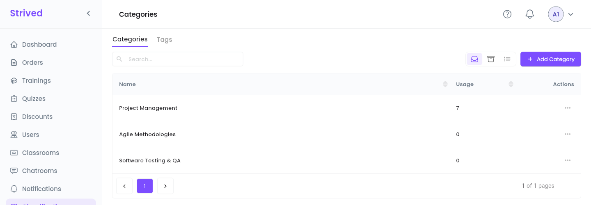
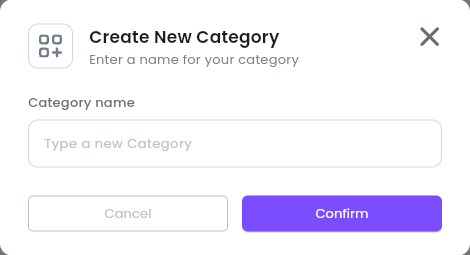
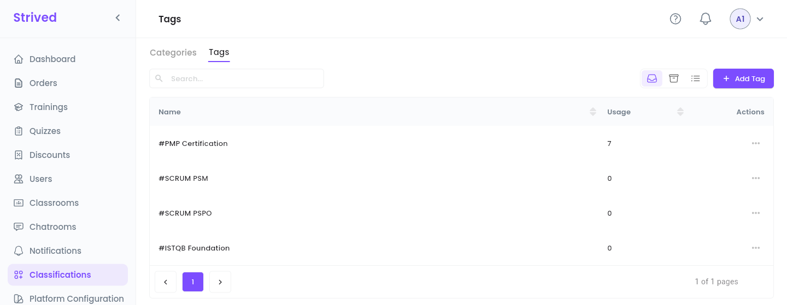

**Categories** and **tags** organize the catalog. Every training needs at least one of each, and
every exam needs a category. Learners use them to browse and filter the Marketplace.

| | **Category** | **Tag** |
| :-- | :-- | :-- |
| What it is | A broad subject area, e.g. *Project Management*. | A precise keyword, e.g. *#PMP Certification*. |
| Used by | Trainings and exams. | Trainings. |

<Note>
  Everything below is for the **web app** on a computer, signed in as an **Admin**.
</Note>

---

## Table of contents

- **Step 1 — Open the categories**
- **Step 2 — Add a category**
- **Step 3 — Rename or archive a category**
- **Step 4 — Manage the tags**
- **Good to know**

---

## Step 1 — Open the categories

Click **Classifications** in the sidebar. The **Categories** tab opens first.

<Frame caption="Classifications → Categories.">
  
</Frame>

Each row shows the category's **Name** and its **Usage**: how many items are classified under it.

---

## Step 2 — Add a category

<Steps>
  <Step title="Open the window">
    Click **Add Category** at the top right.
  </Step>
  <Step title="Name it">
    Type the **Category name**.
  </Step>
  <Step title="Confirm">
    Click **Confirm**. The category is available at once in the training and exam editors.
  </Step>
</Steps>

<Frame caption="Create New Category.">
  
</Frame>

---

## Step 3 — Rename or archive a category

Open the **⋯** menu of the row:

- **Update** renames the category. Every training and exam that uses it shows the new name.
- **Archive** removes it from the list. The **Archived** icon at the top right shows it again,
  with **Restore**.

---

## Step 4 — Manage the tags

Open the **Tags** tab. It works exactly like the categories: **Add Tag**, then **⋯ → Update** or
**Archive** on a row. Tags are shown with a `#` in front of their name.

<Frame caption="Classifications → Tags.">
  
</Frame>

---

## Good to know

<AccordionGroup>
  <Accordion title="Where do I pick the categories and tags of a training?">
    In the training editor, step **Basic Info**, section **Identity**: **Training Categories** and
    **Training Tags** — see [Manage trainings](/admin-guide/manage-trainings).
  </Accordion>
  <Accordion title="Should I archive a category that is still used?">
    Check its **Usage** first. If it is not 0, move the trainings and exams that use it to another
    category before you archive it.
  </Accordion>
</AccordionGroup>
