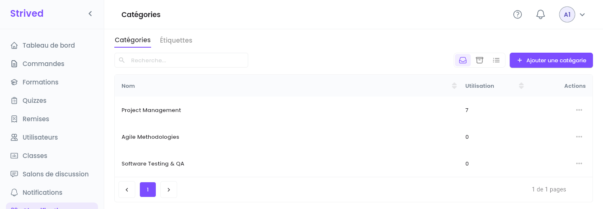
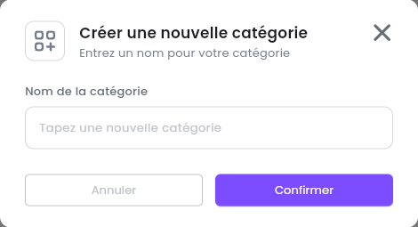
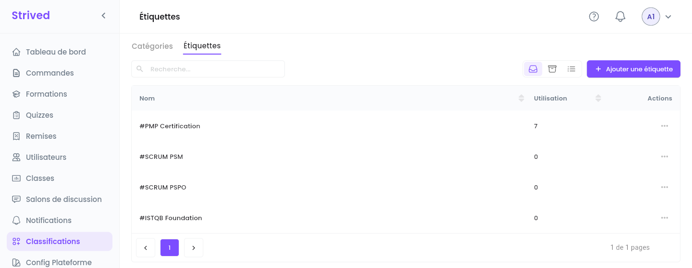

Les **catégories** et les **étiquettes** (tags) organisent le catalogue. Chaque formation a besoin
d'au moins une de chaque, et chaque examen d'une catégorie. Les apprenants s'en servent pour
parcourir et filtrer la Marketplace.

| | **Catégorie** | **Étiquette** |
| :-- | :-- | :-- |
| Ce que c'est | Un grand domaine, par exemple *Project Management*. | Un mot-clé précis, par exemple *#PMP Certification*. |
| Utilisée par | Les formations et les examens. | Les formations. |

<Note>
  Tout ce qui suit concerne l'**application web** sur ordinateur, avec un compte **Admin**.
</Note>

---

## Sommaire

- **Étape 1 — Ouvrir les catégories**
- **Étape 2 — Ajouter une catégorie**
- **Étape 3 — Renommer ou archiver une catégorie**
- **Étape 4 — Gérer les étiquettes**
- **Bon à savoir**

---

## Étape 1 — Ouvrir les catégories

Cliquez sur **Classifications** dans la barre latérale. L'onglet **Catégories** s'ouvre en premier.

<Frame caption="Classifications → Catégories.">
  
</Frame>

Chaque ligne affiche le **Nom** de la catégorie et son **Utilisation** : le nombre d'éléments
classés sous cette catégorie.

---

## Étape 2 — Ajouter une catégorie

<Steps>
  <Step title="Ouvrez la fenêtre">
    Cliquez sur **Ajouter une catégorie** en haut à droite.
  </Step>
  <Step title="Nommez-la">
    Saisissez le **Nom de la catégorie**.
  </Step>
  <Step title="Confirmez">
    Cliquez sur **Confirmer**. La catégorie est aussitôt disponible dans les éditeurs de formations
    et d'examens.
  </Step>
</Steps>

<Frame caption="Créer une nouvelle catégorie.">
  
</Frame>

---

## Étape 3 — Renommer ou archiver une catégorie

Ouvrez le menu **⋯** de la ligne :

- **Modifier** renomme la catégorie. Toutes les formations et tous les examens qui l'utilisent
  affichent le nouveau nom.
- **Archiver** la retire de la liste. L'icône **Archivé** en haut à droite l'affiche de nouveau,
  avec **Restaurer**.

---

## Étape 4 — Gérer les étiquettes

Ouvrez l'onglet **Étiquettes**. Il fonctionne exactement comme les catégories : **Ajouter une
étiquette**, puis **⋯ → Modifier** ou **Archiver** sur une ligne. Les étiquettes s'affichent avec un
`#` devant leur nom.

<Frame caption="Classifications → Étiquettes.">
  
</Frame>

---

## Bon à savoir

<AccordionGroup>
  <Accordion title="Où choisir les catégories et les étiquettes d'une formation ?">
    Dans l'éditeur de formation, à l'étape **Détails**, section **Identité** : **Catégorie de
    formation** et **Étiquettes de formation**. Voir
    [Gérer les formations](/admin-guide/gerer-les-formations).
  </Accordion>
  <Accordion title="Faut-il archiver une catégorie encore utilisée ?">
    Vérifiez d'abord son **Utilisation**. Si elle n'est pas à 0, déplacez vers une autre catégorie
    les formations et les examens qui l'utilisent avant de l'archiver.
  </Accordion>
</AccordionGroup>
