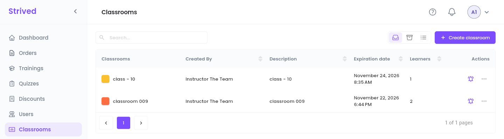
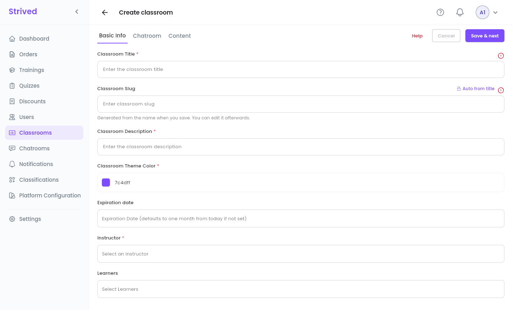
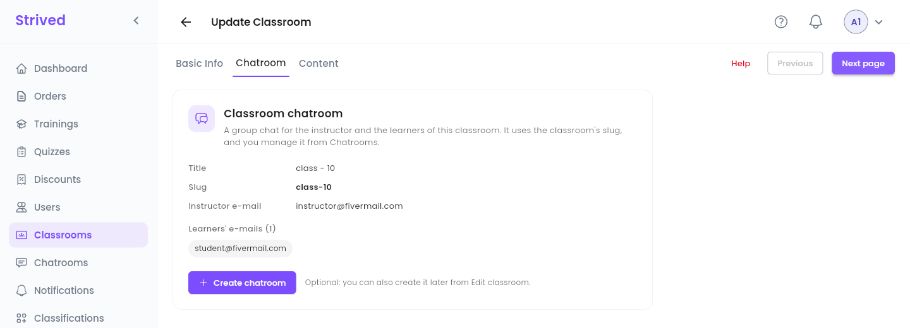
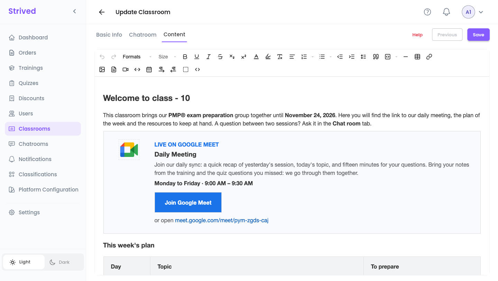
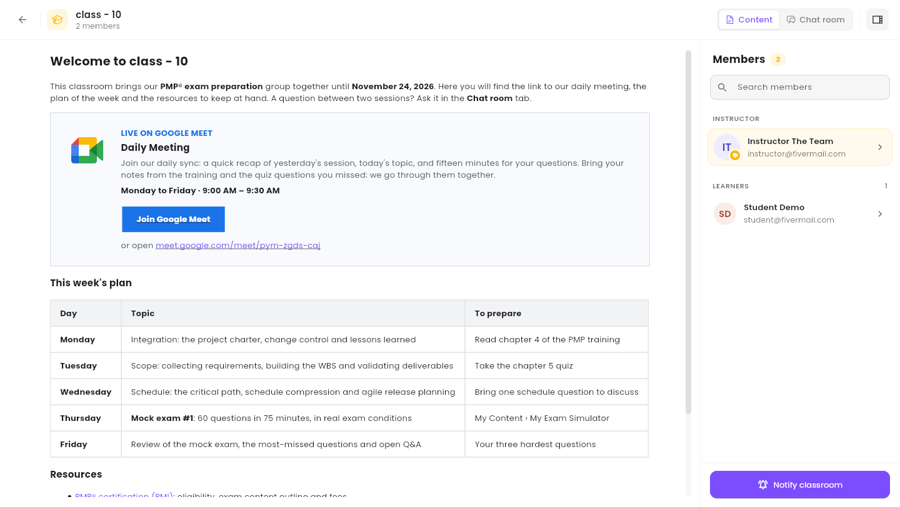
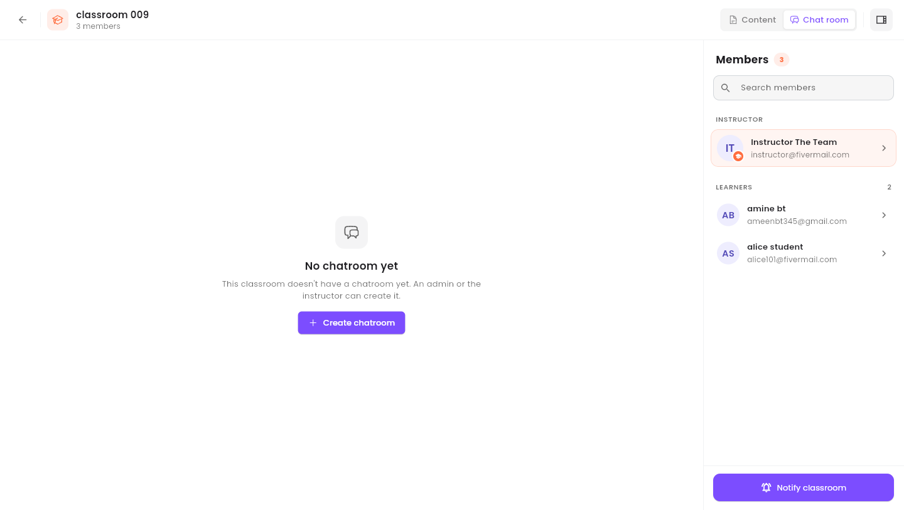
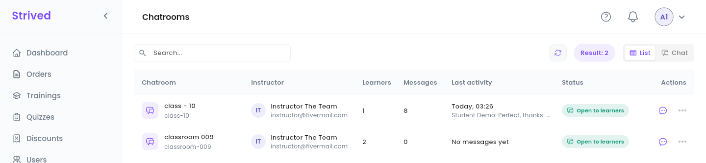
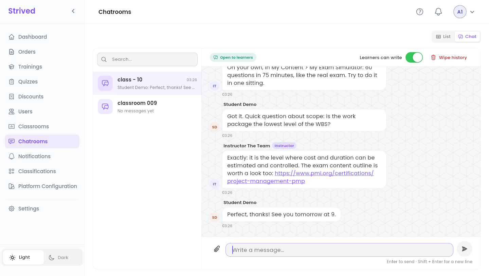
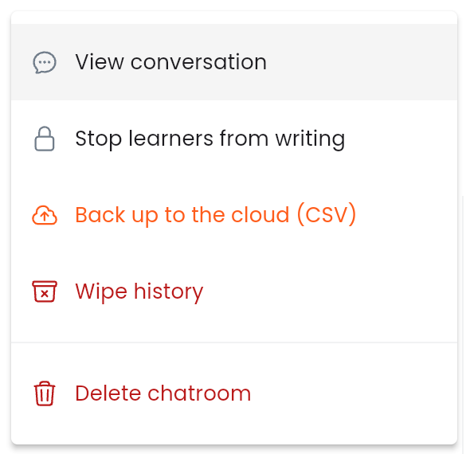

A **classroom** brings a group of learners together with an instructor, for a set period. It has a
content page and, if you create one, a **chatroom**: a group chat for the instructor and the
learners. This guide covers both.

<Note>
  Everything below is for the **web app** on a computer, signed in as an **Admin**. Learners find
  their classrooms in **My Content → Classrooms & Chat** — see the student guide
  [Classrooms and chat](/student-guide/classrooms-and-chat).
</Note>

---

## Table of contents

- **Step 1 — Open the classrooms**
- **Step 2 — Create a classroom**
- **Step 3 — Add the chatroom and the content**
- **Step 4 — Preview a classroom and notify its members**
- **Step 5 — Read the chatrooms**
- **Step 6 — Moderate a chatroom**
- **Good to know**

---

## Step 1 — Open the classrooms

Click **Classrooms** in the sidebar.

<Frame caption="Classrooms.">
  
</Frame>

Each row shows the classroom's color and name, the instructor (**Created By**), the
**Description**, the **Expiration date** and the number of **Learners**. The bell sends a message
to the classroom (Step 4), and **⋯** offers **Preview**, **Update**, **Notify classroom** and
**Archive**.

---

## Step 2 — Create a classroom

Click **Create classroom** at the top right. The editor has three tabs: **Basic Info**,
**Chatroom** and **Content**.

<Frame caption="Create classroom → Basic Info.">
  
</Frame>

<Steps>
  <Step title="Name and describe it">
    **Classroom Title** and **Classroom Description**. The **Classroom Slug** (its short web name)
    is generated from the title when you save; you can edit it afterwards.
  </Step>
  <Step title="Pick a color">
    **Classroom Theme Color**: the color of the classroom's icon, for learners and in your list.
  </Step>
  <Step title="Set the end date">
    **Expiration date**. Left empty, it defaults to one month from today.
  </Step>
  <Step title="Add the people">
    **Instructor**: the person who leads the classroom. **Learners**: everyone who takes part.
  </Step>
  <Step title="Save & next">
    Click **Save & next**. The classroom is created and the **Chatroom** tab opens.
  </Step>
</Steps>

---

## Step 3 — Add the chatroom and the content

<Frame caption="The Chatroom tab.">
  
</Frame>

<Steps>
  <Step title="Create the chatroom (optional)">
    The tab sums up the chatroom to come: **Title**, **Slug**, **Instructor e-mail** and
    **Learners' e-mails**. Click **Create chatroom**. You can also skip it and create it later from
    **Update**.
  </Step>
  <Step title="Write the content">
    **Next page** opens **Content**: a rich-text editor (text, images, tables, files, videos,
    links). Write what learners should find in the classroom: schedule, instructions, resources.
  </Step>
  <Step title="Save">
    Click **Save**.
  </Step>
</Steps>

To change a classroom later, use **⋯ → Update**: the same three tabs, with **Next page** /
**Previous**, and a single **Save** at the end. Saving also updates the chatroom's title and
members.

### The content editor

<Frame caption="Content: the rich-text editor, here with the page of class - 10.">
  
</Frame>

| Buttons | What they do |
| :-- | :-- |
| **Formats**, **Size** | Headings, paragraph styles and text size. |
| Bold, underline, italic, strikethrough, subscript, superscript | Text styles. |
| Text color, highlight, clear format | Colors, and removing every style from the selection. |
| Alignment, numbered and bulleted lists, indent, line height | The layout of the paragraphs. |
| Quote, code block, horizontal line, table, link | Blocks, tables and links. |
| Image, PDF, video, embed, Google Calendar | Images and PDFs are uploaded to the cloud storage, in the classroom's folder. **Embed** takes an `<iframe>` code or a link (YouTube, Google Drive…). |
| Left-to-right / right-to-left, show blocks, code view (`<>`) | Writing direction, block outlines, and the HTML of the page. |

<Tip>
  The learners' page keeps headings, lists, text colors, links, images and **tables** with their
  borders and background colors. To draw a card or a button, use a table, as the Google Meet card
  above does: the editor removes the styles it has no tool for (padding, rounded corners, styled
  `<div>`s or buttons). After saving, check the result with **⋯ → Preview**.
</Tip>

<Accordion title="Reuse the Google Meet card">
  Open the code view (`<>`), paste the HTML below where the card should go, and change the link (it
  appears twice), the days and the times. Close the code view and click **Save**. Keep the
  description about two lines long: on the learners' page, a table is only as wide as its text
  needs.

  ```html
  <table style="width: 100%; border: 1px solid #dadce0; background-color: #f8fafd">
    <tbody>
      <tr>
        <td style="border: 0"><p style="margin: 0 10px">&nbsp;</p></td>
        <td style="border: 0; text-align: center; vertical-align: top">
          <p style="margin: 0; line-height: 18px"><br></p>
          
        </td>
        <td style="border: 0"><p style="margin: 0 7px">&nbsp;</p></td>
        <td style="border: 0; vertical-align: top">
          <p style="margin: 20px 24px 2px 0"><span style="color: #1a73e8"><strong>LIVE ON GOOGLE MEET</strong></span></p>
          <h3 style="margin: 0 24px 4px 0">Daily Meeting</h3>
          <p style="margin: 0 24px 6px 0"><span style="color: #5f6368">Join our daily sync: a quick recap of yesterday's session, today's topic, and fifteen minutes for your questions. Bring your notes from the training and the quiz questions you missed: we go through them together.</span></p>
          <p style="margin: 0 24px 14px 0"><strong>Monday to Friday · 9:00 AM – 9:30 AM</strong></p>
          <table style="border-collapse: collapse">
            <tbody>
              <tr>
                <td style="background-color: #1a73e8; border: 0">
                  <p style="margin: 10px 22px"><a href="https://meet.google.com/meet/pym-zgds-caj"><span style="color: #ffffff"><strong>Join Google Meet</strong></span></a></p>
                </td>
              </tr>
            </tbody>
          </table>
          <p style="margin: 10px 24px 20px 0"><span style="color: #5f6368">or open </span><a href="https://meet.google.com/meet/pym-zgds-caj">meet.google.com/meet/pym-zgds-caj</a></p>
        </td>
      </tr>
    </tbody>
  </table>
  ```
</Accordion>

---

## Step 4 — Preview a classroom and notify its members

**⋯ → Preview** opens the classroom as its members see it.

<Frame caption="Previewing a classroom.">
  
</Frame>

- **Content** / **Chat room** at the top right switch between the content page and the group chat.
- The **Members** panel lists the **Instructor** and the **Learners**, with **Search members**. The
  icon at the far top right hides or shows it.
- **Notify classroom** at the bottom sends an in-app notification to every member (the same as the
  bell in the list).

If the classroom has no chatroom yet, **Chat room** says so and offers **Create chatroom**:

<Frame caption="A classroom without a chatroom.">
  
</Frame>

---

## Step 5 — Read the chatrooms

Click **Chatrooms** in the sidebar: every chatroom of the platform, in a table (**List**) or as a
messenger (**Chat**).

<Frame caption="Chatrooms → List.">
  
</Frame>

| Column | What it shows |
| :-- | :-- |
| **Chatroom** | Its name and slug. |
| **Instructor** | The classroom's instructor. |
| **Learners** / **Messages** | How many learners belong to it, how many messages it holds. |
| **Last activity** | When the last message was posted, and an excerpt. |
| **Status** | **Open to learners**, or **Learners can't write** when you have stopped them (Step 6). |

**Chat** at the top right opens the messenger view: the chatrooms on the left, the conversation on
the right.

<Frame caption="Chatrooms → Chat.">
  
</Frame>

You can write in any chatroom: type in **Write a message…**, press Enter to send (Shift + Enter for
a new line). The paperclip attaches images: JPG, PNG, GIF or WEBP, up to 20 MB each, 4 per message.

---

## Step 6 — Moderate a chatroom

The **⋯** menu of a chatroom (in **List**) holds the moderation tools:

<Frame caption="The ⋯ menu of a chatroom.">
  
</Frame>

| Action | What it does |
| :-- | :-- |
| **View conversation** | Opens the chatroom in the **Chat** view. |
| **Stop learners from writing** | Learners can only read; the instructor and the admins can still write. **Let learners write** reopens it. In the **Chat** view, the **Learners can write** switch does the same. |
| **Back up to the cloud (CSV)** | Saves every message (sender, e-mail, date, images) as a CSV file in the cloud storage, and shows where the file is. |
| **Wipe history** | Deletes every message and image of the chatroom, for everyone. |
| **Delete chatroom** | Deletes the chatroom with all its messages, images and members. The classroom stays, and you can create a new chatroom for it from **Update**. |

<Warning>
  **Wipe history** and **Delete chatroom** cannot be undone. Run **Back up to the cloud (CSV)**
  first if you may need the conversation later.
</Warning>

---

## Good to know

<AccordionGroup>
  <Accordion title="Who can read a chatroom?">
    The classroom's instructor, its learners and the admins. Nobody else can open it.
  </Accordion>
  <Accordion title="I added a learner to the classroom: are they in the chatroom?">
    Yes. Saving the classroom updates the chatroom's members too.
  </Accordion>
  <Accordion title="Does every classroom need a chatroom?">
    No, it is optional. Without one, members only see the content page, and **Chat room** shows
    **No chatroom yet**. You can create it at any time.
  </Accordion>
</AccordionGroup>
