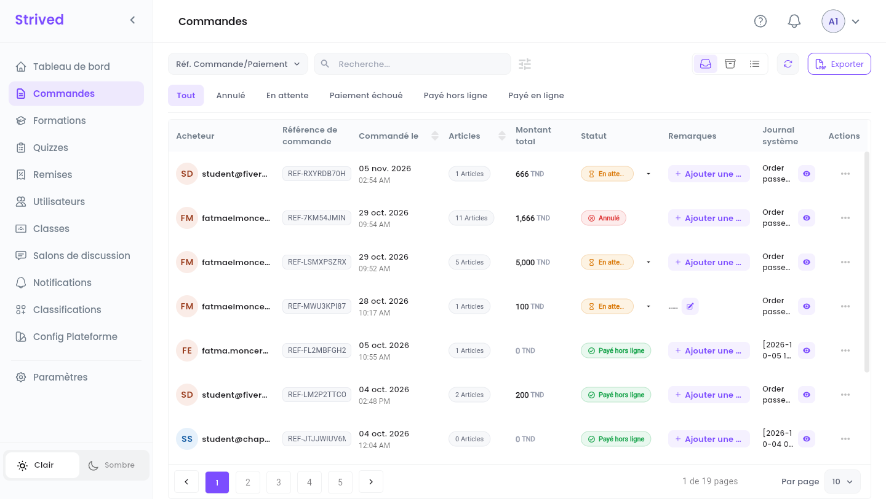
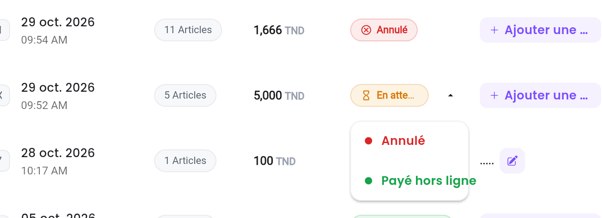
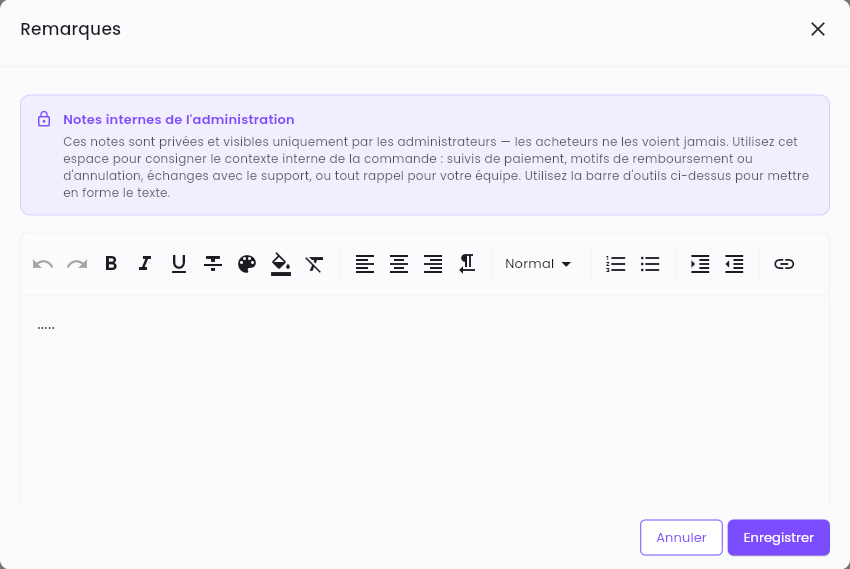
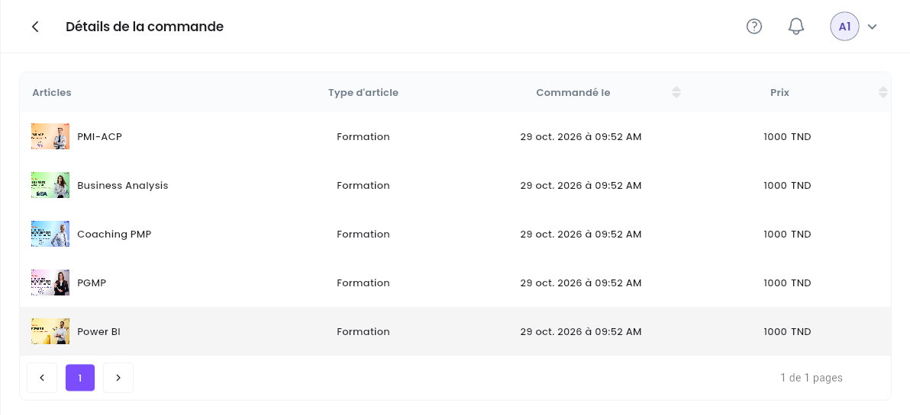

Chaque fois qu'un apprenant commande une formation ou un examen depuis le panier, une commande
apparaît dans **Commandes**. Ce guide vous montre comment la suivre jusqu'au paiement, puis comment
en garder la trace.

<Note>
  Tout ce qui suit concerne l'**application web** sur ordinateur, avec un compte **Admin**. Les
  montants sont en dinars tunisiens (TND).
</Note>

---

## Sommaire

- **Étape 1 — Ouvrir la liste des commandes**
- **Étape 2 — Retrouver une commande**
- **Étape 3 — Confirmer ou annuler un paiement**
- **Étape 4 — Ajouter une note interne**
- **Étape 5 — Lire le détail et le journal système d'une commande**
- **Étape 6 — Archiver ou exporter des commandes**
- **Bon à savoir**

---

## Étape 1 — Ouvrir la liste des commandes

Cliquez sur **Commandes** dans la barre latérale.

<Frame caption="Commandes : une ligne par commande, la plus récente en premier.">
  
</Frame>

| Colonne | Ce qu'elle montre |
| :-- | :-- |
| **Acheteur** | L'apprenant qui a passé la commande. |
| **Référence de commande** | La référence unique de la commande, par exemple `REF-7KM54JMINK`. L'apprenant voit la même dans son **Archive des commandes**. |
| **Commandé le** | La date et l'heure de la commande. |
| **Articles** | Le nombre de formations et d'examens de la commande. |
| **Montant total** | Ce que l'apprenant doit payer pour la commande. |
| **Statut** | Où en est le paiement (voir le tableau de l'Étape 3). |
| **Remarques** | Les notes internes de votre équipe (Étape 4). |
| **Journal système** | Ce que la plateforme a enregistré sur la commande. L'œil ouvre le journal complet (Étape 5). |
| **Actions** | **⋯** ouvre **Visualiser** et, pour une commande payée, **Archiver**. |

---

## Étape 2 — Retrouver une commande

<Steps>
  <Step title="Choisissez le critère de recherche">
    La liste à gauche du champ de recherche définit ce que vous saisissez :
    **Réf. Commande/Paiement**, **Formation**, **Examen** ou **Apprenant**.
  </Step>
  <Step title="Saisissez dans Recherche…">
    Le tableau se filtre au fil de la saisie.
  </Step>
  <Step title="Filtrez par statut">
    Les onglets sous le champ de recherche affichent **Tout**, ou seulement les commandes
    **Annulé**, **En attente**, **Paiement échoué**, **Payé hors ligne** ou **Payé en ligne**.
    L'icône à curseurs à côté du champ de recherche masque ou affiche ces onglets.
  </Step>
</Steps>

Le bouton à flèche ronde (**Actualiser les données**) recharge la liste, par exemple quand un
apprenant vient de commander.

---

## Étape 3 — Confirmer ou annuler un paiement

Une commande **En attente** attend un paiement hors ligne : virement bancaire, espèces dans vos
locaux, chèque, etc. Une fois l'argent reçu :

<Steps>
  <Step title="Ouvrez la liste des statuts">
    Cliquez sur la petite flèche à côté du badge **En attente**.
  </Step>
  <Step title="Choisissez le nouveau statut">
    **Payé hors ligne** confirme le paiement. **Annulé** annule la commande.
  </Step>
  <Step title="Confirmez">
    La plateforme demande *« Êtes-vous sûr de vouloir confirmer le paiement? »* (ou *« Êtes-vous
    sûr de vouloir annuler ce paiement? »*). Confirmez : le badge change.
  </Step>
</Steps>

<Frame caption="La liste des statuts d'une commande en attente.">
  
</Frame>

Ce qui se passe ensuite :

- **Payé hors ligne** : l'apprenant reçoit aussitôt les formations et les examens de la commande,
  gagne les points de fidélité qu'ils rapportent, et reçoit une notification dans l'application
  *« Order Accepted »*. Si l'apprenant possédait déjà l'un des articles grâce à une autre commande
  payée, la plateforme le retire de celle-ci et l'écrit dans le journal système.
- **Annulé** : l'apprenant reçoit une notification dans l'application *« Order Cancelled »* qui
  l'invite à contacter le support.

| Statut | Signification | Pouvez-vous le changer ? |
| :-- | :-- | :-- |
| **En attente** | Commandé avec **Commander maint.**, en attente d'un paiement hors ligne. | Oui : **Payé hors ligne** ou **Annulé**. |
| **En attente (en ligne)** | Un paiement en ligne a commencé mais n'est pas encore confirmé. | Non, le prestataire de paiement le met à jour. |
| **Paiement échoué** | Le paiement en ligne a été refusé ou abandonné. | Non. |
| **Payé hors ligne** | Vous avez confirmé le paiement. | Non. |
| **Payé en ligne** | Le paiement en ligne a abouti. | Non. |
| **Annulé** | La commande a été annulée. | Non. |

<Warning>
  Ne confirmez un paiement qu'une fois l'argent réellement reçu : l'apprenant accède tout de suite
  au contenu, et une commande payée ne peut plus revenir à **En attente** ni à **Annulé**.
</Warning>

---

## Étape 4 — Ajouter une note interne

Cliquez sur **Ajouter une note** dans la colonne **Remarques** (ou sur le crayon à côté d'une note
existante).

<Frame caption="La fenêtre des notes.">
  
</Frame>

Les notes sont **privées** : seuls les administrateurs les voient, jamais l'acheteur. Servez-vous
en pour le suivi d'un paiement, le motif d'un remboursement ou d'une annulation, un échange avec le
support, ou un rappel pour votre équipe. La barre d'outils met le texte en forme (gras, couleurs,
listes, liens, etc.). Cliquez sur **Enregistrer**.

---

## Étape 5 — Lire le détail et le journal système d'une commande

- **Ce qui a été commandé** : **⋯ → Visualiser** ouvre **Détails de la commande**, avec chaque
  article, son type (**Formation** ou examen), la date de la commande et son prix.

<Frame caption="Détails de la commande.">
  
</Frame>

- **Ce qui s'est passé** : l'œil de la colonne **Journal système** ouvre le journal, une ligne
  numérotée par événement, par exemple *« Order passed by '…' with coupon 'N/A' at 2026-10-04
  14:48:10 »*. L'icône de copie en haut de la fenêtre copie tout le journal.

---

## Étape 6 — Archiver ou exporter des commandes

- **Archiver** : **⋯ → Archiver** retire une commande payée de la liste principale. Retrouvez-la
  avec l'icône **Archivé** en haut à droite, et faites-la revenir avec **Restaurer**. Les commandes
  en attente ou annulées ne peuvent pas être archivées.
- **Exporter** : cliquez sur **Exporter** en haut à droite, cochez les commandes voulues dans
  **Exporter les commandes** (le champ de recherche les retrouve par référence), puis
  **Confirmer**. Vous obtenez un fichier ZIP avec un PDF par commande.

---

## Bon à savoir

<AccordionGroup>
  <Accordion title="Un apprenant a payé mais ne voit pas sa formation">
    Vérifiez le statut de la commande : l'accès ne s'ouvre qu'une fois la commande **Payé hors
    ligne** ou **Payé en ligne**. Si elle est encore **En attente**, confirmez le paiement
    (Étape 3).
  </Accordion>
  <Accordion title="Un apprenant a commandé deux fois le même article">
    La plateforme refuse une nouvelle commande tant qu'une commande plus ancienne contenant le même
    article est encore **En attente** : l'apprenant doit d'abord payer ou annuler la première. Si
    deux commandes payées contiennent le même article, le doublon est retiré quand la seconde est
    confirmée, et le journal système l'indique.
  </Accordion>
  <Accordion title="Où voir le coupon utilisé sur une commande ?">
    Dans le journal système : la ligne *« Order passed by … »* nomme le coupon, ou `N/A` s'il n'y
    en avait pas.
  </Accordion>
  <Accordion title="Paiements en ligne">
    Les commandes en ligne (**En attente (en ligne)**, **Payé en ligne**, **Paiement échoué**)
    ont une entrée de menu en plus, **Flouci - Payment Details**, qui ouvre la page de paiement
    enregistrée dans les notes de la commande.
  </Accordion>
</AccordionGroup>
