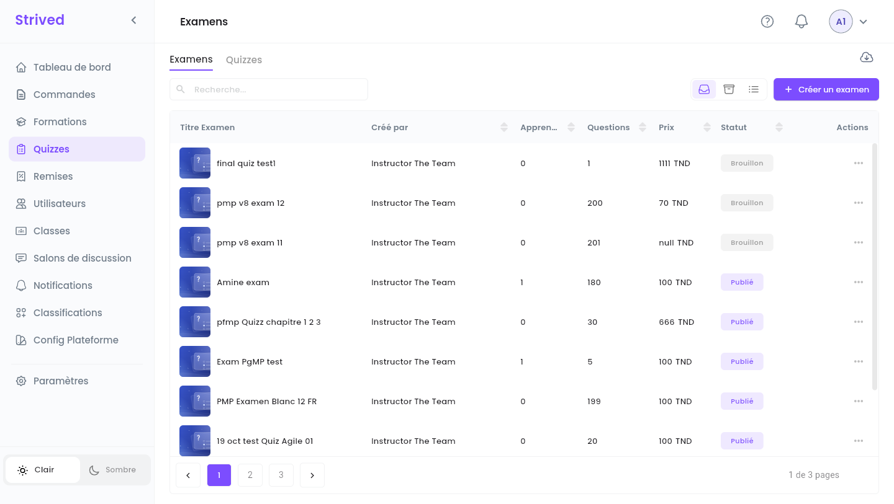
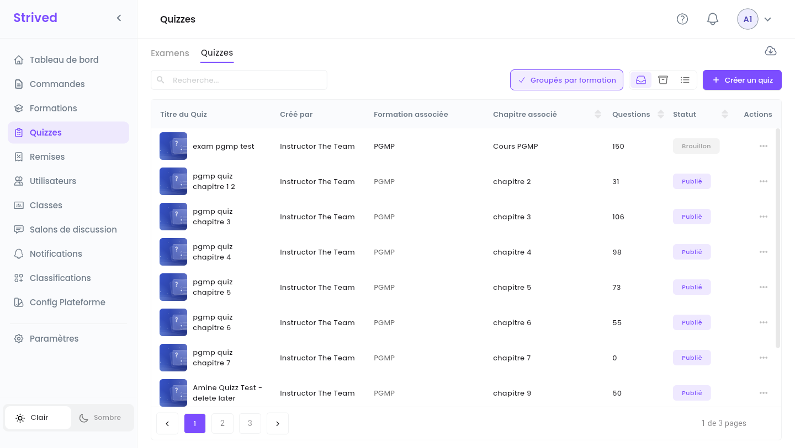
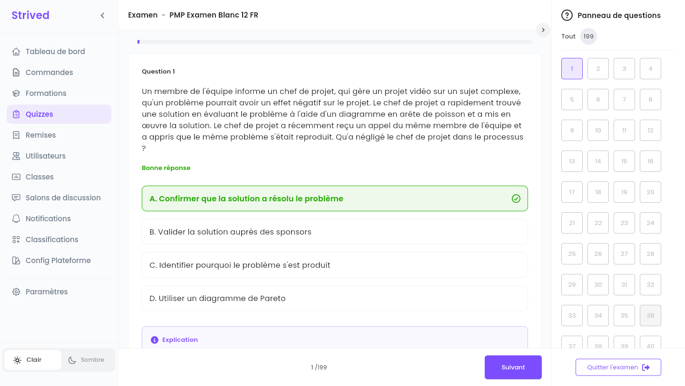
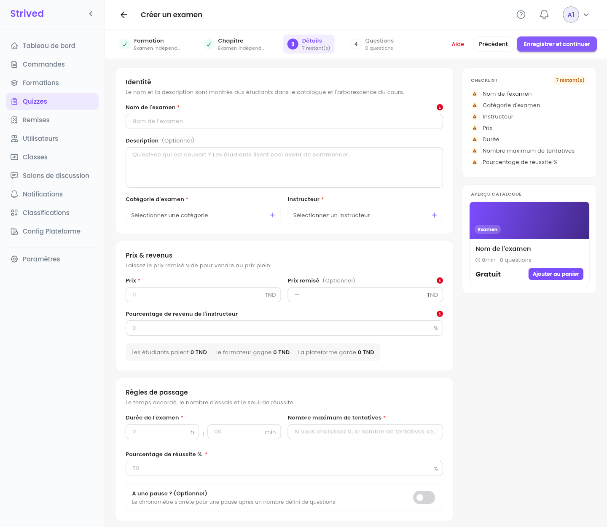
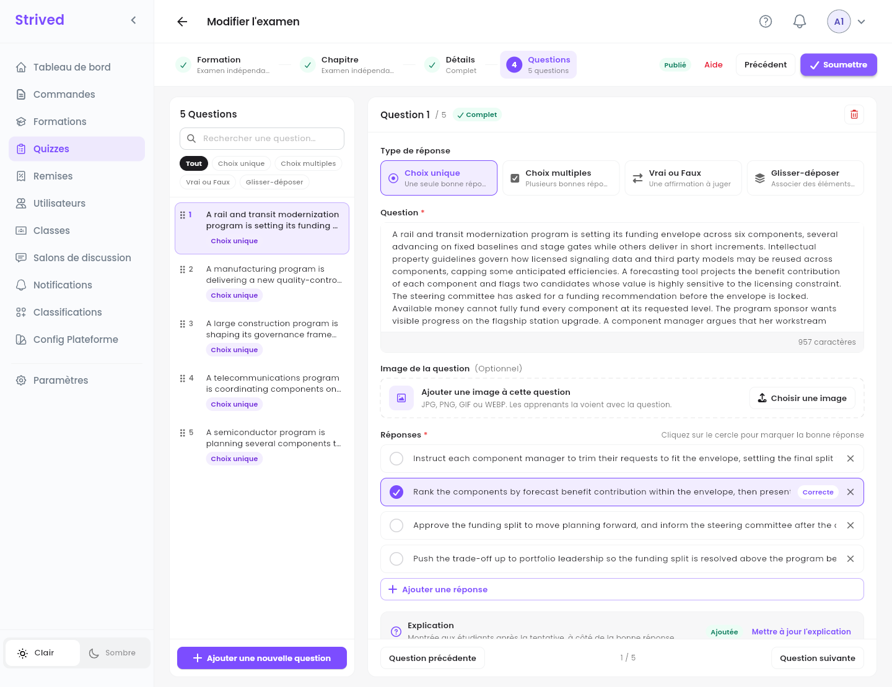

**Quizzes**, dans la barre latérale, regroupe deux sortes de tests, construits avec le même
éditeur :

| | **Examen** | **Quiz** |
| :-- | :-- | :-- |
| Ce que c'est | Un examen blanc indépendant, vendu seul dans le **Catalogue des examens**. | Un test à l'intérieur d'une formation, placé dans l'un de ses chapitres. |
| Les apprenants le trouvent dans | **Mon contenu → Mon simulateur d'examens**. | Le panneau **Contenu du cours** de la formation. |
| A son propre prix | Oui. | Non : il est fourni avec la formation. |

<Note>
  Tout ce qui suit concerne l'**application web** sur ordinateur, avec un compte **Admin**.
</Note>

---

## Sommaire

- **Étape 1 — Ouvrir les examens et les quiz**
- **Étape 2 — Prévisualiser un examen et ses questions**
- **Étape 3 — Créer un examen ou un quiz : Formation et Chapitre**
- **Étape 4 — Détails**
- **Étape 5 — Rédiger les questions**
- **Étape 6 — Publier et donner accès**
- **Bon à savoir**

---

## Étape 1 — Ouvrir les examens et les quiz

Cliquez sur **Quizzes** dans la barre latérale. Deux onglets se trouvent en haut : **Examens** et
**Quizzes**.

<Frame caption="L'onglet Examens.">
  
</Frame>

L'onglet **Examens** liste tous les examens indépendants avec leur formateur (**Créé par**), leurs
**Apprenants**, leur nombre de **Questions**, leur **Prix** et leur **Statut** (**Publié** ou
**Brouillon**).

<Frame caption="L'onglet Quizzes, groupé par formation.">
  
</Frame>

L'onglet **Quizzes** ajoute la **Formation associée** et le **Chapitre associé** de chaque quiz.
**Groupés par formation** garde ensemble les quiz d'une même formation.

Le menu **⋯** d'une ligne propose :

| Action | Examens | Quiz |
| :-- | :-- | :-- |
| **Visualiser** | ✓ | ✓ |
| **Brouillon** / **Publier** | ✓ | ✓ |
| **Modifier** | ✓ | ✓ |
| **Attribuer des apprenants** / **Désattribuer des apprenants** | ✓ | — (ils viennent avec la formation) |
| **E-mails des apprenants** | ✓ | — |
| **Importer des questions** | ✓ | ✓ |
| **Archiver** | ✓ | ✓ |

---

## Étape 2 — Prévisualiser un examen et ses questions

**⋯ → Visualiser** ouvre la page de l'examen telle que la voient les apprenants : nombre de
questions, durée, tentatives, pauses, note de réussite et vues.

<Frame caption="L'aperçu d'un examen.">
  
</Frame>

Cliquez sur **Prévisualiser toutes les questions** pour parcourir les questions une à une, chacune
avec sa **Bonne réponse** en vert et son **Explication**. Le **Panneau de questions**, à droite,
mène directement à n'importe quelle question, et **Quitter l'examen** vous ramène en arrière. Rien
n'est enregistré : c'est un aperçu en lecture seule.

<Frame caption="L'aperçu des questions.">
  
</Frame>

---

## Étape 3 — Créer un examen ou un quiz : Formation et Chapitre

Cliquez sur **Créer un examen** (dans l'onglet **Examens**) ou sur **Créer un quiz** (dans l'onglet
**Quizzes**). L'éditeur a quatre étapes : **Formation**, **Chapitre**, **Détails** et
**Questions**.

<Frame caption="Étape 1 : choisissez une formation, ou passez cette étape pour un examen indépendant.">
  
</Frame>

<Steps>
  <Step title="Pour un quiz : choisissez la formation">
    Cochez la formation à laquelle appartient le quiz (**Rechercher une formation par nom…** la
    retrouve), puis **Continuer vers les chapitres** et choisissez le chapitre où il se place.
  </Step>
  <Step title="Pour un examen : passez les deux étapes">
    Ne choisissez rien et cliquez deux fois sur **Continuer**. Les étapes affichent **Examen
    indépendant** : l'examen est vendu seul.
  </Step>
</Steps>

**Votre sélection**, à droite, rappelle votre choix, et **Réinitialiser** l'efface. Changer de
formation réinitialise le chapitre, mais garde les détails et les questions.

---

## Étape 4 — Détails

<Frame caption="Étape 3 : Détails.">
  
</Frame>

| Section | Champs |
| :-- | :-- |
| **Identité** | **Nom de l'examen**, **Description** (facultative, les apprenants la lisent avant de commencer), **Catégorie d'examen** et **Instructeur**. |
| **Prix & revenus** | **Prix**, **Prix remisé** facultatif, **Pourcentage de revenu de l'instructeur**. La ligne en dessous montre ce que paie l'étudiant, ce que gagne le formateur et ce que garde la plateforme. |
| **Règles de passage** | **Durée de l'examen** (heures et minutes), **Nombre maximum de tentatives** (0 signifie illimité), **Pourcentage de réussite %** (70 par défaut) et **A une pause ? (Optionnel)** : une pause après un nombre défini de questions, pendant laquelle le chronomètre s'arrête. |

La **Checklist**, à droite, compte ce qui reste à remplir, et l'**Aperçu catalogue** montre la
carte. Cliquez sur **Enregistrer et continuer** : l'examen est créé **en brouillon**, ce qui vous
permet d'ajouter ses questions.

---

## Étape 5 — Rédiger les questions

<Frame caption="Étape 4 : Questions.">
  
</Frame>

<Steps>
  <Step title="Ajoutez une question">
    Cliquez sur **Ajouter une nouvelle question** en bas de la liste.
  </Step>
  <Step title="Choisissez le Type de réponse">
    **Choix unique** (une seule bonne réponse), **Choix multiples** (plusieurs bonnes réponses),
    **Vrai ou Faux** (une affirmation à juger) ou **Glisser-déposer** (associer des éléments à des
    groupes).
  </Step>
  <Step title="Rédigez la question">
    Saisissez la **Question**. Vous pouvez ajouter une **Image de la question** (JPG, PNG, GIF ou
    WEBP) avec **Choisir une image**.
  </Step>
  <Step title="Rédigez les réponses">
    Saisissez chaque réponse, **Ajouter une réponse** pour en ajouter, et cliquez sur le rond devant
    la bonne : il devient violet et affiche **Correcte**.
  </Step>
  <Step title="Ajoutez une explication">
    L'**Explication** est montrée aux apprenants après leur tentative, à côté de la bonne réponse.
  </Step>
  <Step title="Soumettez">
    Quand toutes les questions sont complètes, cliquez sur **Soumettre** en haut à droite.
  </Step>
</Steps>

La liste de gauche affiche toutes les questions avec leur type. Filtrez-la par type, cherchez-y avec
**Rechercher une question…**, faites glisser les poignées pour réordonner, et utilisez **Question
précédente** / **Question suivante** pour passer de l'une à l'autre. Une question incomplète est
signalée : l'éditeur refuse de soumettre tant qu'elle n'est pas corrigée. L'icône de corbeille en
haut à droite d'une question la supprime.

<Tip>
  Vos questions sont déjà dans un fichier ? **⋯ → Importer des questions**, sur la ligne de
  l'examen, les importe depuis un fichier JSON. Pour une sauvegarde, l'icône de nuage en haut à
  droite de l'onglet propose **Exportation unique** (un examen ou un quiz) et **Tout exporter**
  (tous, dans un fichier ZIP).
</Tip>

---

## Étape 6 — Publier et donner accès

- **Publier** : ouvrez **⋯** sur la ligne et cliquez sur **Publier**. L'examen apparaît dans le
  **Catalogue des examens** (un quiz apparaît dans le chapitre de sa formation). **Brouillon** le
  masque de nouveau.
- **Donner un examen sans commande** : **⋯ → Attribuer des apprenants**, cochez les apprenants,
  **Confirmer**. Il apparaît dans leur **Mon simulateur d'examens**. **Désattribuer des
  apprenants** le retire.
- **Le modifier plus tard** : **⋯ → Modifier** ouvre les mêmes quatre étapes. L'en-tête indique si
  l'examen est **Publié**.

---

## Bon à savoir

<AccordionGroup>
  <Accordion title="Quand les apprenants voient-ils les explications ?">
    Après une tentative : dans **Vérifier les réponses**, chaque question a un bouton **Voir
    l'explication** à côté de la bonne réponse.
  </Accordion>
  <Accordion title="Combien de tentatives ont les apprenants ?">
    Le nombre fixé dans **Nombre maximum de tentatives** ; 0 signifie illimité. Chaque démarrage de
    l'examen consomme une tentative.
  </Accordion>
  <Accordion title="Où donner plusieurs examens et formations d'un coup ?">
    Avec un **voucher** : voir [Vouchers et coupons](/admin-guide/vouchers-et-coupons).
  </Accordion>
</AccordionGroup>
