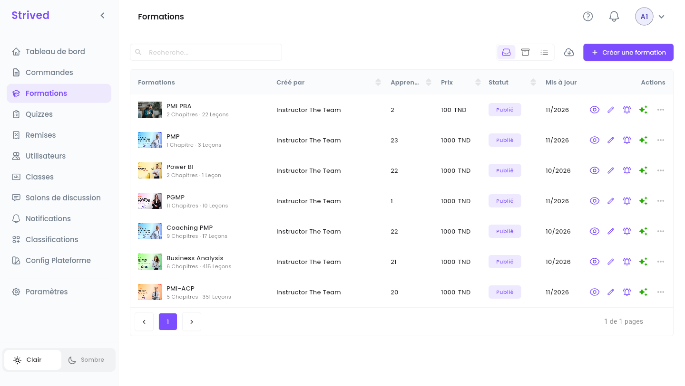
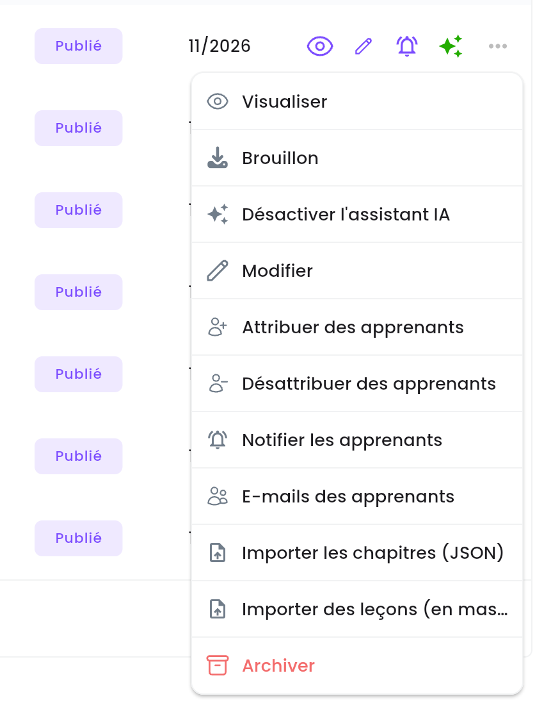
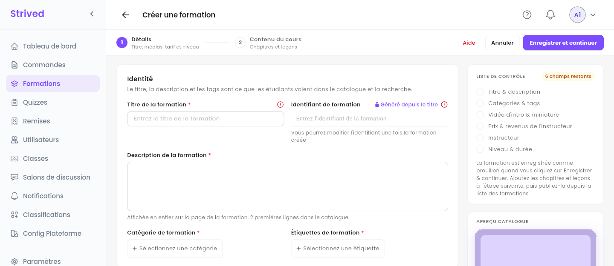
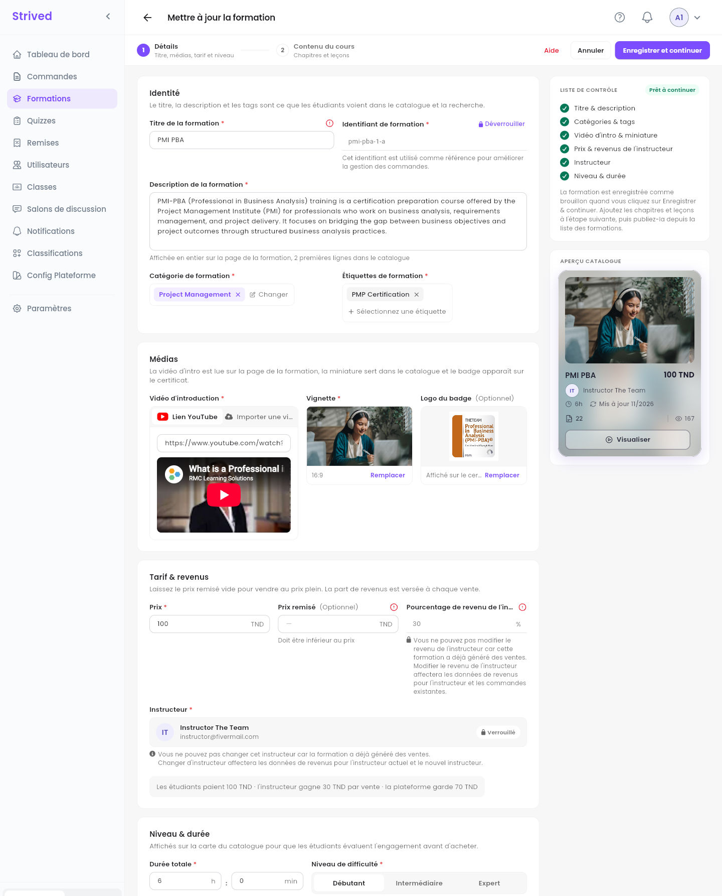
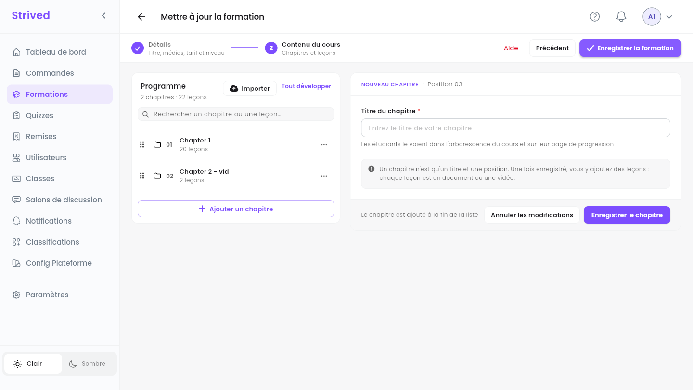
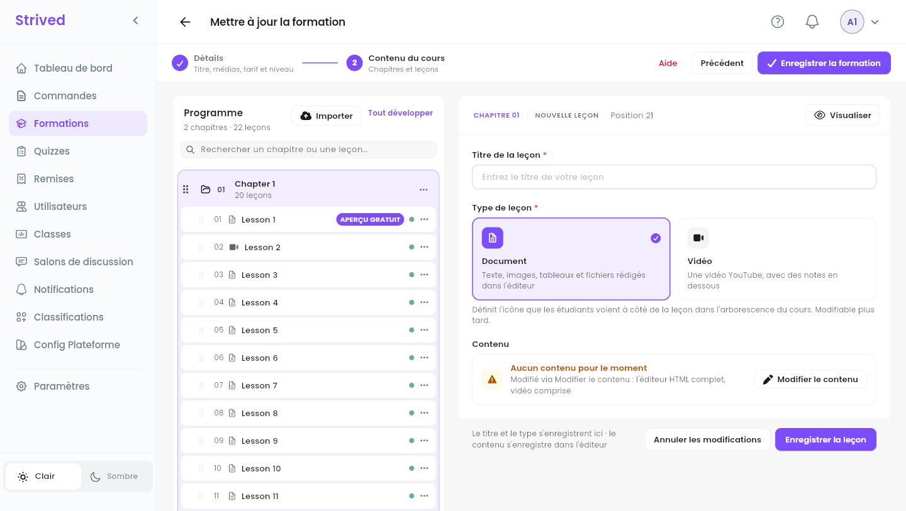
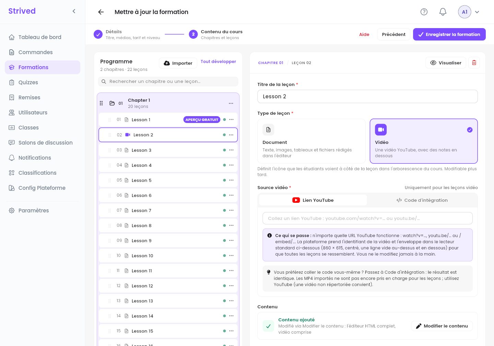
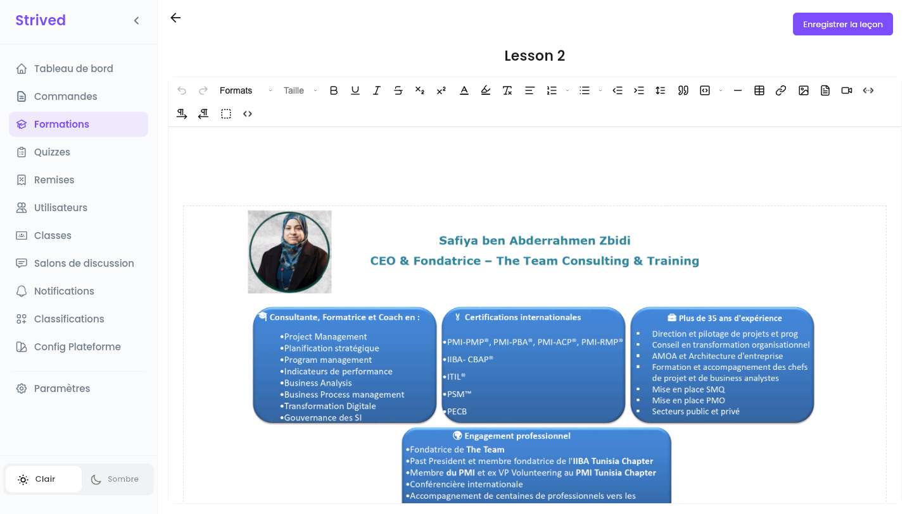
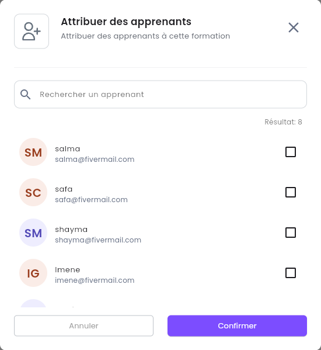
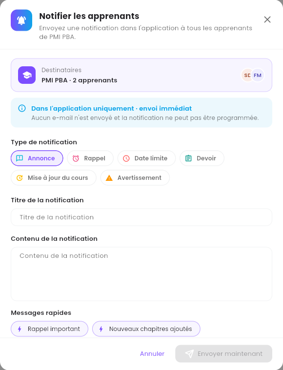

Une **formation** est un cours vendu dans le catalogue : une présentation, un prix, et des
chapitres remplis de leçons (documents ou vidéos). Ce guide vous accompagne pour en créer une, la
remplir, la publier, et gérer qui peut la suivre.

<Note>
  Tout ce qui suit concerne l'**application web** sur ordinateur, avec un compte **Admin**. Les
  captures montrent les formations de la plateforme de test.
</Note>

---

## Sommaire

- **Étape 1 — Ouvrir la liste des formations**
- **Étape 2 — Créer une formation : Détails**
- **Étape 3 — Construire le contenu du cours**
- **Étape 4 — Rédiger une leçon**
- **Étape 5 — Visualiser et publier**
- **Étape 6 — Donner accès aux apprenants**
- **Étape 7 — Notifier les apprenants**
- **Étape 8 — Archiver, exporter et importer**
- **Bon à savoir**

---

## Étape 1 — Ouvrir la liste des formations

Cliquez sur **Formations** dans la barre latérale.

<Frame caption="Formations : une ligne par formation.">
  
</Frame>

| Colonne | Ce qu'elle montre |
| :-- | :-- |
| **Formations** | La couverture, le titre, et le nombre de chapitres et de leçons. |
| **Créé par** | Le formateur qui l'anime. |
| **Apprenants** | Le nombre d'apprenants qui y ont accès. |
| **Prix** | Le prix en TND. |
| **Statut** | **Publié** (visible dans le catalogue) ou **Brouillon** (masqué). |
| **Mis à jour** | Le mois de la dernière modification. |

Les icônes au bout d'une ligne sont des raccourcis : l'œil (**Visualiser**), le crayon
(**Modifier**), la cloche (**Notifier les apprenants**, grisée tant que la formation n'a pas
d'apprenants) et les étincelles, vertes quand l'**Assistant IA** est activé pour cette formation
(survolez-les : *« Assistant IA : activé »*). **⋯** ouvre toutes les actions :

<Frame caption="Le menu ⋯ d'une formation.">
  
</Frame>

| Action | Ce qu'elle fait |
| :-- | :-- |
| **Visualiser** | Ouvre la formation telle que la voient les apprenants (Étape 5). |
| **Brouillon** / **Publier** | Masque la formation du catalogue, ou la publie (Étape 5). |
| **Désactiver l'assistant IA** / **Activer l'assistant IA** | Désactive ou active l'assistant IA du lecteur de cours pour cette formation. |
| **Modifier** | Ouvre l'éditeur de formation (Étapes 2 à 4). |
| **Attribuer des apprenants** / **Désattribuer des apprenants** | Donne l'accès à des apprenants sans commande, ou le leur retire (Étape 6). |
| **Notifier les apprenants** | Envoie un message dans l'application à tous ceux qui suivent la formation (Étape 7). |
| **E-mails des apprenants** | Liste les adresses e-mail des apprenants de la formation. |
| **Importer les chapitres (JSON)** / **Importer des leçons (en masse)** | Ajoute du contenu à partir de fichiers (Étape 8). |
| **Archiver** | Retire la formation de la liste (Étape 8). |

---

## Étape 2 — Créer une formation : Détails

Cliquez sur **Créer une formation** en haut à droite. L'éditeur a deux étapes, affichées en haut :
**1 Détails** et **2 Contenu du cours**.

<Frame caption="Une nouvelle formation : l'éditeur s'ouvre sur Détails, avec une liste de contrôle à droite.">
  
</Frame>

La **Liste de contrôle**, à droite, coche chaque partie au fur et à mesure (*« 6 champs
restants »* au début, puis *« Prêt à continuer »*), et l'**Aperçu catalogue** en dessous montre la
carte que verront les apprenants. Voici la même page remplie, pour une formation existante :

<Frame caption="Détails, une fois rempli.">
  
</Frame>

<Steps>
  <Step title="Identité">
    **Titre de la formation** et **Description de la formation** (affichée en entier sur la page de
    la formation, ses deux premières lignes dans le catalogue). L'**Identifiant de formation**, le
    nom court de la formation sur le web, est **Généré depuis le titre**. Choisissez au moins un
    élément dans **Catégorie de formation** et dans **Étiquettes de formation** : voir
    [Catégories et étiquettes](/admin-guide/categories-et-tags).
  </Step>
  <Step title="Médias">
    **Vidéo d'introduction** : collez un **Lien YouTube** (un aperçu s'affiche en dessous) ou passez
    à **Importer une vidéo**. **Vignette** : la couverture 16:9 utilisée dans le catalogue
    (**Choisir une image**). **Logo du badge** (facultatif) : affiché sur le certificat.
  </Step>
  <Step title="Tarif & revenus">
    Le **Prix** en TND, un **Prix remisé** facultatif (il doit être inférieur au prix), et le
    **Pourcentage de revenu de l'instructeur**. La ligne en dessous résume le tout, par exemple
    *« Les étudiants paient 100 TND · l'instructeur gagne 30 TND par vente · la plateforme garde
    70 TND »*.
  </Step>
  <Step title="Instructeur">
    **Sélectionnez un instructeur** : la personne qui anime la formation.
  </Step>
  <Step title="Niveau & durée">
    La **Durée totale** en heures et en minutes, et le **Niveau de difficulté** : **Débutant**,
    **Intermédiaire** ou **Expert**.
  </Step>
  <Step title="Enregistrer et continuer">
    Cliquez sur **Enregistrer et continuer** en haut à droite. La formation est enregistrée
    **en brouillon** : elle n'apparaît pas encore dans le catalogue, vous pouvez donc la remplir
    tranquillement.
  </Step>
</Steps>

<Warning>
  Dès qu'une formation a été vendue, son **Instructeur** et son **Pourcentage de revenu de
  l'instructeur** sont verrouillés : les changer fausserait les revenus du formateur et des
  commandes existantes. L'éditeur affiche un cadenas et explique pourquoi.
</Warning>

---

## Étape 3 — Construire le contenu du cours

L'étape 2, **Contenu du cours**, affiche le **Programme** à gauche et un panneau d'édition à
droite.

<Frame caption="Contenu du cours : le programme à gauche, un nouveau chapitre à droite.">
  
</Frame>

<Steps>
  <Step title="Ajoutez un chapitre">
    Cliquez sur **Ajouter un chapitre**, saisissez le **Titre du chapitre** (les apprenants le voient
    dans l'arborescence du cours et sur leur page de progression), puis **Enregistrer le
    chapitre**. Un chapitre n'est qu'un titre et une position : les leçons vont dedans.
  </Step>
  <Step title="Ajoutez des leçons au chapitre">
    Ouvrez le menu **⋯** du chapitre et choisissez **Ajouter une leçon** (le même menu propose
    **Renommer le chapitre** et **Supprimer le chapitre**). L'Étape 4 explique le formulaire de
    leçon.
  </Step>
  <Step title="Réorganisez">
    Faites glisser un chapitre ou une leçon par sa poignée (les six points à gauche) pour le
    déplacer.
  </Step>
  <Step title="Enregistrez la formation">
    Quand le programme est prêt, cliquez sur **Enregistrer la formation** en haut à droite.
    **Précédent** revient à Détails.
  </Step>
</Steps>

Le champ **Rechercher un chapitre ou une leçon…** cherche dans le programme, **Tout développer**
ouvre tous les chapitres, et **Importer** ajoute des chapitres depuis un fichier (Étape 8).

---

## Étape 4 — Rédiger une leçon

<Frame caption="Une nouvelle leçon dans le chapitre 01.">
  
</Frame>

<Steps>
  <Step title="Titre et type">
    Saisissez le **Titre de la leçon** et choisissez le **Type de leçon** : **Document** (du texte,
    des images, des tableaux et des fichiers rédigés dans l'éditeur) ou **Vidéo** (une vidéo
    YouTube, avec des notes en dessous). Le type définit l'icône que les apprenants voient dans
    l'arborescence du cours, et vous pouvez le changer plus tard.
  </Step>
  <Step title="Pour une vidéo : la source">
    Collez un **Lien YouTube**, ou passez à **Code d'intégration** et collez le code d'intégration.
    Toute adresse YouTube fonctionne ; la plateforme place la vidéo dans le lecteur standard. Les
    fichiers MP4 importés ne sont pas encore pris en charge pour les leçons : utilisez YouTube (une
    vidéo non répertoriée fonctionne).
  </Step>
  <Step title="Rédigez le contenu">
    Cliquez sur **Modifier le contenu** pour ouvrir l'éditeur complet, rédigez la leçon, puis
    cliquez sur **Enregistrer la leçon** en haut de l'éditeur.
  </Step>
  <Step title="Enregistrez">
    De retour dans le formulaire, cliquez sur **Enregistrer la leçon**. Le titre et le type sont
    enregistrés ici, le contenu dans l'éditeur.
  </Step>
</Steps>

<Frame caption="La modification d'une leçon vidéo existante.">
  
</Frame>

<Frame caption="L'éditeur de leçon (Modifier le contenu).">
  
</Frame>

Dans le programme, chaque leçon porte une pastille : **verte** quand elle a du contenu
(*« Contenu ajouté »*), **orange** quand elle est encore vide (*« Aucun contenu pour le moment »*).
Le menu **⋯** de la leçon propose **Visualiser**, **Modifier** et **Supprimer**.

<Tip>
  La première leçon du chapitre 1 porte un badge **APERÇU GRATUIT** : les visiteurs peuvent
  toujours la regarder avant d'acheter, pour découvrir la formation. Mettez-y une bonne
  introduction.
</Tip>

---

## Étape 5 — Visualiser et publier

**⋯ → Visualiser** (ou l'œil) ouvre la page de la formation telle que les apprenants la voient dans
le catalogue : catégorie, niveau, vues, apprenants, formateur, vidéo de présentation, prix et
**Cette formation inclut**.

<Frame caption="L'aperçu d'une formation.">
  
</Frame>

Quand tout est prêt, ouvrez **⋯** sur la ligne de la formation et cliquez sur **Publier**. Son
statut passe à **Publié** et elle apparaît dans le catalogue des apprenants. **Brouillon**, dans le
même menu, la masque de nouveau.

---

## Étape 6 — Donner accès aux apprenants

Les apprenants obtiennent normalement une formation en la commandant. Vous pouvez aussi la leur
donner directement, sans commande :

<Steps>
  <Step title="Ouvrez Attribuer des apprenants">
    **⋯ → Attribuer des apprenants**.
  </Step>
  <Step title="Cochez les apprenants">
    Cherchez par nom ou par e-mail dans **Rechercher un apprenant**, et cochez toutes les personnes
    qui doivent recevoir la formation.
  </Step>
  <Step title="Confirmez">
    Cliquez sur **Confirmer**. La formation apparaît dans leur **Mon contenu → Mes formations**.
  </Step>
</Steps>

<Frame caption="Attribuer des apprenants.">
  
</Frame>

**⋯ → Désattribuer des apprenants** fonctionne de la même façon et retire l'accès.

<Tip>
  Pour donner d'un coup plusieurs formations et examens à un apprenant, par e-mail, créez plutôt un
  **voucher** : voir [Vouchers et coupons](/admin-guide/vouchers-et-coupons).
</Tip>

---

## Étape 7 — Notifier les apprenants

Cliquez sur la cloche de la ligne (ou **⋯ → Notifier les apprenants**).

<Frame caption="Notifier les apprenants.">
  
</Frame>

<Steps>
  <Step title="Vérifiez les destinataires">
    **Destinataires** affiche la formation et le nombre d'apprenants qui recevront le message.
  </Step>
  <Step title="Choisissez un Type de notification">
    **Annonce**, **Rappel**, **Date limite**, **Devoir**, **Mise à jour du cours** ou
    **Avertissement**.
  </Step>
  <Step title="Rédigez le message">
    Renseignez **Titre de la notification** et **Contenu de la notification**, ou partez de l'un des
    **Messages rapides** (**Rappel important**, **Nouveaux chapitres ajoutés**, **Mise à jour de
    formation**, etc.).
  </Step>
  <Step title="Envoyez">
    Cliquez sur **Envoyer maintenant**.
  </Step>
</Steps>

<Note>
  Ce message est **uniquement dans l'application** et **envoyé immédiatement** : aucun e-mail ne
  part et il ne peut pas être programmé. Pour des e-mails ou des messages programmés, utilisez
  **Notifications** dans la barre latérale : voir
  [Envoyer des notifications](/admin-guide/envoyer-des-notifications).
</Note>

---

## Étape 8 — Archiver, exporter et importer

- **Archiver** : **⋯ → Archiver** retire la formation de la liste. Retrouvez-la avec l'icône
  **Archivé** en haut à droite, puis faites-la revenir avec **Restaurer**, ou supprimez-la
  définitivement avec **Supprimer**.
- **Exporter** : l'icône de nuage à côté de **Créer une formation** ouvre **Exporter la
  formation**. Choisissez une formation, confirmez, et une sauvegarde se télécharge sous le nom
  `<formation>_backup.zip`.
- **Importer les chapitres (JSON)** : ajoute des chapitres depuis des fichiers JSON, par exemple
  l'export d'une autre formation. La fenêtre explique les étapes sous **Comment importer les
  chapitres**.
- **Importer des leçons (en masse)** : transforme des images en leçons, une image par leçon, dans
  l'ordre des noms de fichier (nommez-les `01-…`, `02-…`, etc.). Choisissez le chapitre, déposez
  les images (PNG, JPG, WEBP ou GIF), ajustez les titres, puis lancez l'envoi.

---

## Bon à savoir

<AccordionGroup>
  <Accordion title="Puis-je modifier une formation après sa publication ?">
    Oui. **Modifier** ouvre le même éditeur. Les apprenants voient les changements dès que vous
    enregistrez. Seuls le formateur et le pourcentage de revenu sont verrouillés une fois la
    formation vendue.
  </Accordion>
  <Accordion title="Et les quiz ?">
    Un quiz appartient à un chapitre d'une formation : vous le créez depuis **Quizzes** et vous l'y
    rattachez à la formation et au chapitre. Voir
    [Gérer les examens et les quiz](/admin-guide/gerer-les-examens-et-quiz).
  </Accordion>
  <Accordion title="Que faut-il à l'apprenant pour obtenir le certificat ?">
    Toutes les leçons terminées et tous les quiz de la formation réussis. Le logo du badge que vous
    importez dans **Médias** apparaît sur le certificat.
  </Accordion>
  <Accordion title="J'ai quitté l'éditeur sans enregistrer">
    Les chapitres et les leçons non enregistrés sont perdus. Enregistrez chaque chapitre et chaque
    leçon au fur et à mesure, puis **Enregistrer la formation** à la fin.
  </Accordion>
</AccordionGroup>
