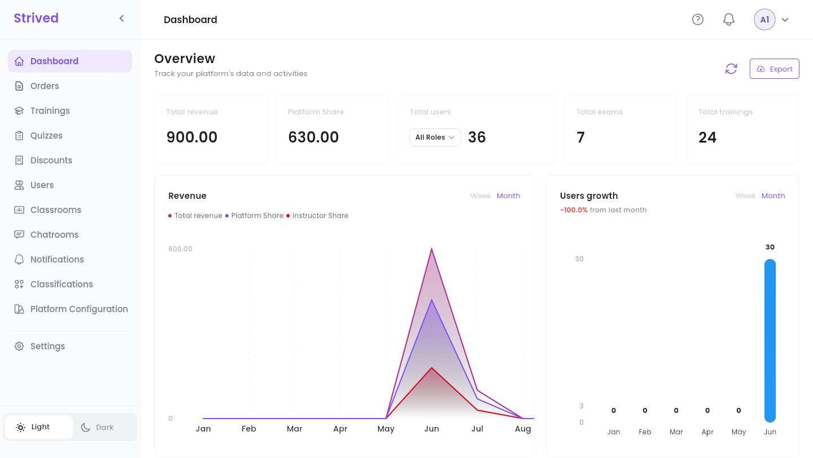
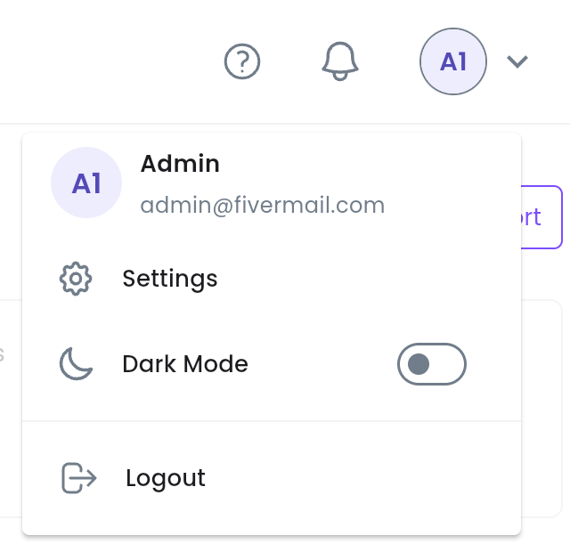
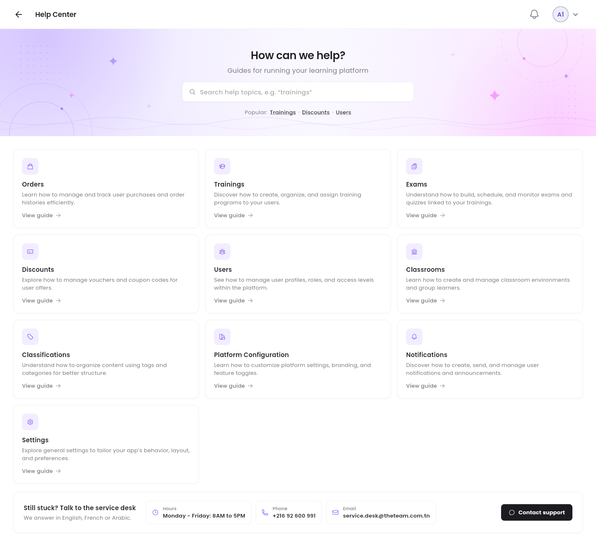

This guide covers the admin side of the platform: where each tool lives, what the dashboard
tells you, and the controls that work the same way on every admin list.

<Note>
  Everything below is for the **web app** on a computer, signed in with an **Admin** account. The
  screenshots come from the test platform, so your figures, trainings and users will be different.
</Note>

---

## Table of contents

- **Step 1 — The sidebar and the top bar**
- **Step 2 — Read the dashboard**
- **Step 3 — Export the revenue**
- **Step 4 — Get help**
- **Controls every list shares**
- **Good to know**

---

## Step 1 — The sidebar and the top bar

After you sign in, the platform opens on the **Dashboard**. The sidebar on the left leads to every
admin tool:

<Frame caption="The admin dashboard, with the sidebar on the left.">
  
</Frame>

| Sidebar item | What you do there | Guide |
| :-- | :-- | :-- |
| **Dashboard** | Key figures and charts for the platform. | This page |
| **Orders** | Confirm or cancel payments, add internal notes, export orders. | [Manage orders](/admin-guide/manage-orders) |
| **Trainings** | Create trainings, build their chapters and lessons, publish them, give learners access. | [Manage trainings](/admin-guide/manage-trainings) |
| **Quizzes** | Create standalone exams (mock exams) and quizzes attached to a training. | [Manage exams and quizzes](/admin-guide/manage-exams-and-quizzes) |
| **Discounts** | Create vouchers (free access sent by e-mail) and coupons (discount codes). | [Vouchers and coupons](/admin-guide/vouchers-and-coupons) |
| **Users** | Create accounts, change roles, look up a learner's activity. | [Manage users](/admin-guide/manage-users) |
| **Classrooms** | Group learners around an instructor, with shared content and a group chat. | [Classrooms and chatrooms](/admin-guide/classrooms-and-chatrooms) |
| **Chatrooms** | Read and moderate the group chats of every classroom. | [Classrooms and chatrooms](/admin-guide/classrooms-and-chatrooms) |
| **Notifications** | Send an in-app notification to users, roles or the whole company. | [Send notifications](/admin-guide/send-notifications) |
| **Classifications** | Manage the categories and tags used in the catalog. | [Categories and tags](/admin-guide/categories-and-tags) |

**Platform Configuration** and **Settings** (your own profile, password, language, notifications
and two-factor authentication) are not covered in this guide.

Two more controls sit in the sidebar:

- The **arrow** next to the **Strived** logo folds the sidebar down to icons, which leaves more room
  for wide tables. Click it again to unfold it.
- **Light** / **Dark** at the bottom switches the theme.

### The top bar

<Frame caption="The avatar menu, top right.">
  
</Frame>

| Icon | What it does |
| :-- | :-- |
| **?** | Opens the **Help Center** (Step 4). |
| Bell | Your latest notifications. **View All** opens the full list. |
| Avatar (your initials) | Shows your name and e-mail, with **Settings**, **Dark Mode** and **Logout**. |

---

## Step 2 — Read the dashboard

The **Overview** sums up the platform at a glance.

| Card / chart | What it shows |
| :-- | :-- |
| **Total revenue** | Everything paid for trainings and exams, in TND. |
| **Platform Share** | The part of that revenue the platform keeps, after the instructors' share. |
| **Total users** | The number of accounts. The **All Roles** list narrows the count to **Learners**, **Instructors**, **Content Managers** or **Admins**. |
| **Total exams** / **Total trainings** | How many exams and trainings the platform holds. |
| **Revenue** | **Total revenue**, **Platform Share** and **Instructor Share** over time. Switch between **Week** and **Month** at the top right of the chart. |
| **Users growth** | New accounts per week or month, and the change compared with the previous month (e.g. `+20.0% from last month`). |

The round-arrow button next to **Export** (**Refresh Data**) reloads the figures without
reloading the page.

<Tip>
  The charts are wider than the screen on a laptop. Scroll sideways inside a chart to see the last
  months of the year.
</Tip>

---

## Step 3 — Export the revenue

Click **Export** at the top right of the dashboard, then pick **As PDF** or **As CSV**. The file
holds the revenue figures and downloads straight away. CSV opens in Excel or Google Sheets.

---

## Step 4 — Get help

Click **?** in the top bar.

<Frame caption="The admin Help Center.">
  
</Frame>

- Search a topic, or use the **Popular:** shortcuts (**Trainings**, **Discounts**, **Users**).
- Each card covers one admin tool (**Orders**, **Trainings**, **Exams**, **Discounts**, **Users**,
  **Classrooms**, **Classifications**, **Platform Configuration**, **Notifications**,
  **Settings**). **View guide** opens its video guide.
- **Still stuck? Talk to the service desk** gives the service desk's hours, phone number and
  e-mail. **Contact support** opens an e-mail ready to send. The service desk answers in English,
  French or Arabic.

---

## Controls every list shares

Orders, trainings, exams, discounts, users, classrooms and classifications are all shown as tables
that work the same way:

| Control | What it does |
| :-- | :-- |
| **Search…** box | Filters the table as you type. |
| Three icons next to the main button: **Active**, **Archived**, **All records** | Show the live items, the archived ones, or both. |
| Column header with arrows | Click it to sort by that column. Click again to reverse the order. |
| **⋯** at the end of a row | The row's actions (preview, update, archive, and so on). |
| Pages at the bottom, **Per page** | Move through the results and choose how many rows a page shows. |

<Note>
  **Archive** hides an item without deleting it: it moves to the **Archived** view, where
  **Restore** brings it back. Archived trainings can also be deleted for good from there.
</Note>

---

## Good to know

<AccordionGroup>
  <Accordion title="Admin, Content Manager, Instructor: who sees what?">
    An **Admin** reaches every tool on this page. A **Content Manager** works on trainings and
    exams. An **Instructor** writes and teaches their own trainings. You change a user's role from
    **Users** — see [Manage users](/admin-guide/manage-users).
  </Accordion>
  <Accordion title="Where do the amounts come from?">
    From the orders marked **Paid Offline** or **Paid Online**. A pending or cancelled order does
    not count. See [Manage orders](/admin-guide/manage-orders).
  </Accordion>
  <Accordion title="The figures look out of date">
    Click **Refresh Data** (the round arrow next to **Export**). The figures load again from the
    server.
  </Accordion>
</AccordionGroup>
