**Quizzes** in the sidebar holds two kinds of tests, built with the same editor:

| | **Exam** | **Quiz** |
| :-- | :-- | :-- |
| What it is | A standalone mock exam, sold on its own in the **Exam Catalog**. | A test inside a training, placed in one of its chapters. |
| Learners find it in | **My Content → My Exam Simulator**. | The training's **Course Content** panel. |
| Has its own price | Yes. | No: it comes with the training. |

<Note>
  Everything below is for the **web app** on a computer, signed in as an **Admin**.
</Note>

---

## Table of contents

- **Step 1 — Open the exams and quizzes**
- **Step 2 — Preview an exam and its questions**
- **Step 3 — Create an exam or a quiz: Training and Chapter**
- **Step 4 — Basic Info**
- **Step 5 — Write the questions**
- **Step 6 — Publish and give access**
- **Good to know**

---

## Step 1 — Open the exams and quizzes

Click **Quizzes** in the sidebar. Two tabs sit at the top: **Exams** and **Quizzes**.

<Frame caption="The Exams tab.">
  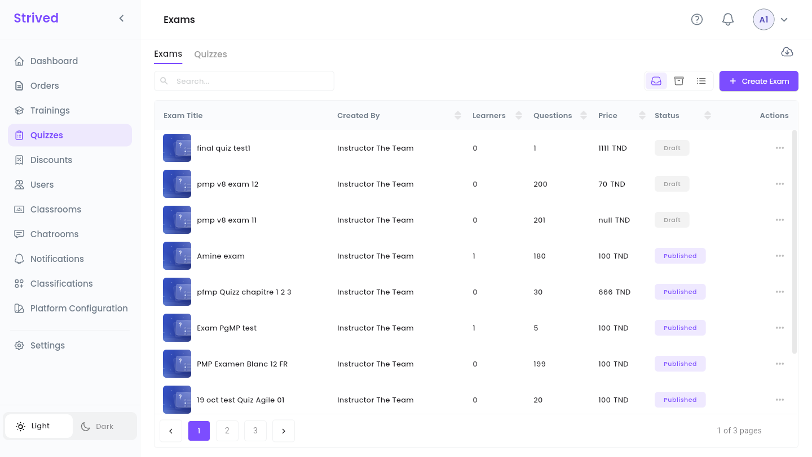
</Frame>

The **Exams** tab lists every standalone exam with its **Created By** instructor, **Learners**,
number of **Questions**, **Price** and **Status** (**Published** or **Draft**).

<Frame caption="The Quizzes tab, grouped by training.">
  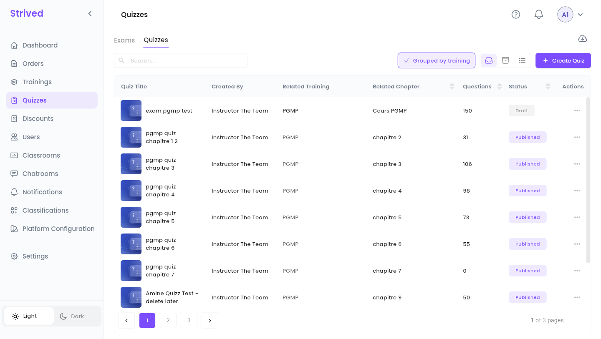
</Frame>

The **Quizzes** tab adds the **Related Training** and **Related Chapter** of each quiz.
**Grouped by training** keeps the quizzes of the same training together.

The **⋯** menu of a row offers:

| Action | Exams | Quizzes |
| :-- | :-- | :-- |
| **Preview** | ✓ | ✓ |
| **Draft** / **Publish** | ✓ | ✓ |
| **Update** | ✓ | ✓ |
| **Assign learners** / **Unassign learners** | ✓ | — (they come with the training) |
| **Learners' emails** | ✓ | — |
| **Import Questions** | ✓ | ✓ |
| **Archive** | ✓ | ✓ |

---

## Step 2 — Preview an exam and its questions

**⋯ → Preview** opens the exam's page as learners see it: number of questions, duration, attempts,
breaks, passing grade and views.

<Frame caption="Previewing an exam.">
  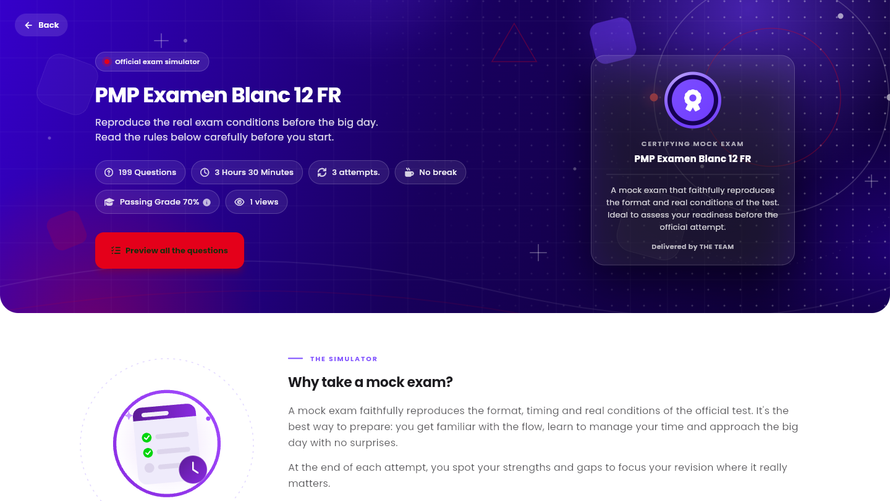
</Frame>

Click **Preview all the questions** to go through the questions one by one, each with its
**Correct Answer** in green and its **Explanation**. The **Question panel** on the right jumps to
any question, and **Quit Exam** brings you back. Nothing is recorded: it is a read-only preview.

<Frame caption="Previewing the questions.">
  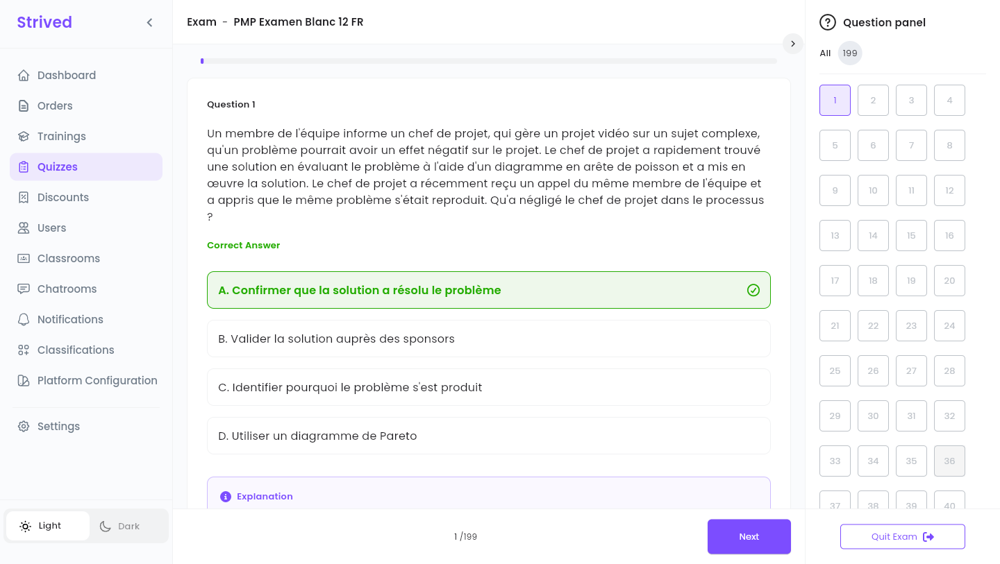
</Frame>

---

## Step 3 — Create an exam or a quiz: Training and Chapter

Click **Create Exam** (on the **Exams** tab) or **Create Quiz** (on the **Quizzes** tab). The
editor has four steps: **Training**, **Chapter**, **Basic Info** and **Questions**.

<Frame caption="Step 1: pick a training, or skip it for a standalone exam.">
  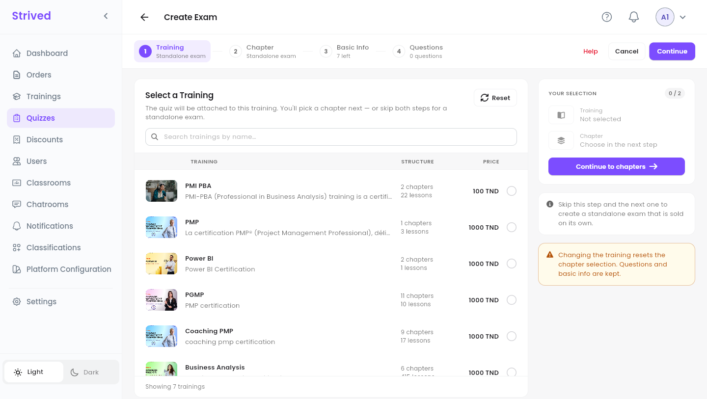
</Frame>

<Steps>
  <Step title="For a quiz: pick the training">
    Tick the training the quiz belongs to (**Search trainings by name…** finds it), then
    **Continue to chapters** and pick the chapter it goes into.
  </Step>
  <Step title="For an exam: skip both steps">
    Pick nothing and click **Continue** twice. The steps show **Standalone exam**: the exam is sold
    on its own.
  </Step>
</Steps>

**Your selection** on the right recalls your choice, and **Reset** clears it. Changing the
training resets the chapter, but keeps the basic info and the questions.

---

## Step 4 — Basic Info

<Frame caption="Step 3: Basic Info.">
  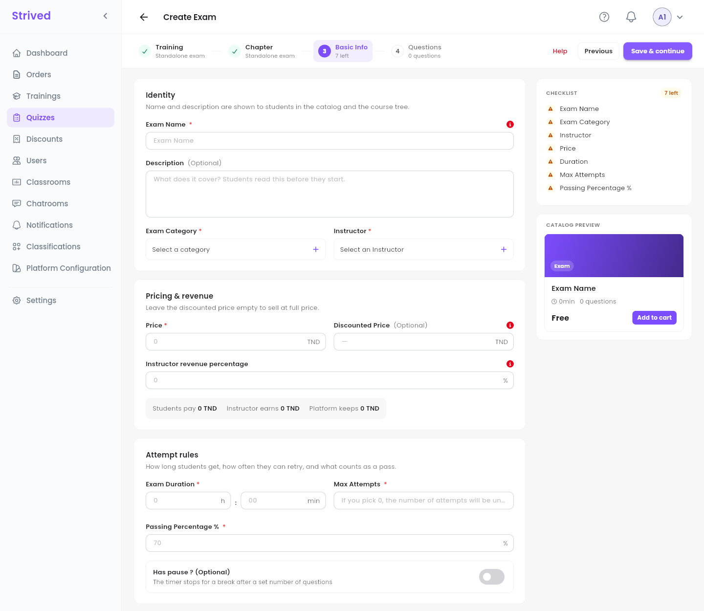
</Frame>

| Section | Fields |
| :-- | :-- |
| **Identity** | **Exam Name**, **Description** (optional, learners read it before they start), **Exam Category** and **Instructor**. |
| **Pricing & revenue** | **Price**, optional **Discounted Price**, **Instructor revenue percentage**. The line underneath shows what the student pays, what the instructor earns and what the platform keeps. |
| **Attempt rules** | **Exam Duration** (hours and minutes), **Max Attempts** (0 means unlimited), **Passing Percentage %** (70 by default) and **Has pause ?**: a break after a set number of questions, during which the timer stops. |

The **Checklist** on the right counts what is left, and the **Catalog Preview** shows the card.
Click **Save & continue**: the exam is created **as a draft**, so you can add its questions.

---

## Step 5 — Write the questions

<Frame caption="Step 4: Questions.">
  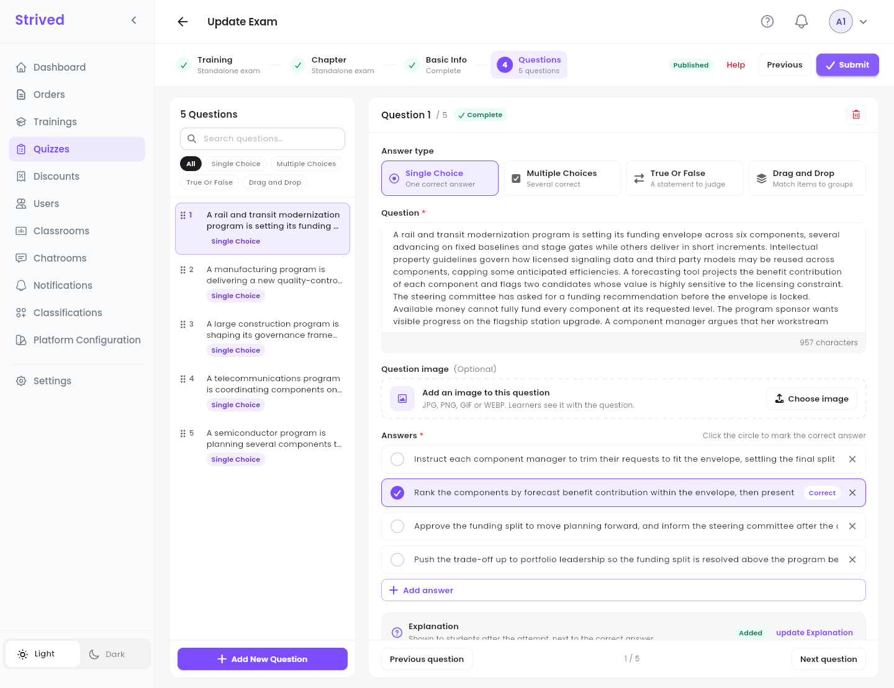
</Frame>

<Steps>
  <Step title="Add a question">
    Click **Add New Question** at the bottom of the list.
  </Step>
  <Step title="Choose the Answer type">
    **Single Choice** (one correct answer), **Multiple Choices** (several correct), **True Or
    False** (a statement to judge) or **Drag and Drop** (match items to groups). Each
    one is explained below, with a screenshot.
  </Step>
  <Step title="Write the question">
    Type the **Question**. You can add a **Question image** (JPG, PNG, GIF or WEBP) with **Choose
    image**.
  </Step>
  <Step title="Write the answers">
    Fill in the answers and mark the right one (or ones). How depends on the type: see **The four
    answer types** below.
  </Step>
  <Step title="Add an explanation">
    Click **Add Explanation** under the answers, write why the right answer is right (bold, colors
    and lists are available) and click the button at the bottom of the window. The question then
    shows **Added**, and **update Explanation** opens it again. Learners read it after their
    attempt, next to the correct answer.

    <Frame caption="The explanation of a question, opened with update Explanation.">
      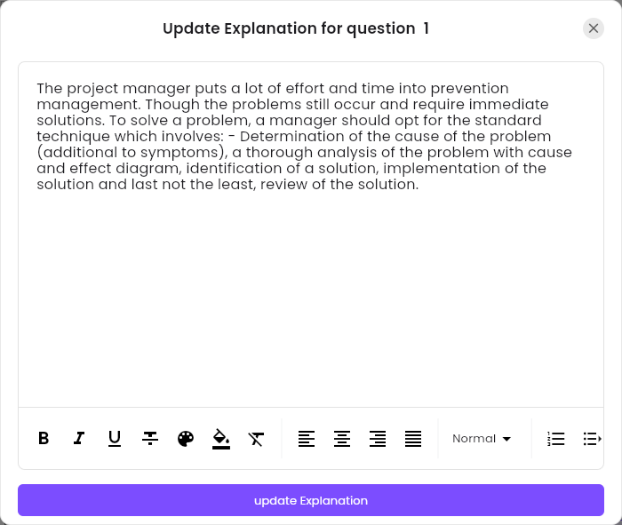
    </Frame>
  </Step>
  <Step title="Submit">
    When every question is complete, click **Submit** at the top right.
  </Step>
</Steps>

The list on the left shows every question with its type. Filter it by type, search it with
**Search questions…**, drag the handles to reorder, and use **Previous question** / **Next
question** to move through them. A question with something missing is flagged: the editor will not
submit until it is fixed. The bin icon at the top right of a question deletes it.

### The four answer types

The **Answer type** at the top of a question decides what you fill in and what learners do. A
question is right or wrong as a whole: learners get no half points.

| Answer type | Use it for | Learners | Counted right when |
| :-- | :-- | :-- | :-- |
| **Single Choice** | One right answer among several | Pick one answer | They pick the right answer |
| **Multiple Choices** | Two or more right answers | Tick several answers | They tick every right answer and no wrong one |
| **True Or False** | A statement that is true or false | Pick **True** or **False** | They pick the right one |
| **Drag and Drop** | Sorting items into groups | Drag each item into a group | Every group holds exactly its own items |

Switching a question to another type starts its answers over. Switching back to the type it was
saved with brings its saved answers back.

### Single Choice

<Frame caption="A Single Choice question, with The project charter marked Correct.">
  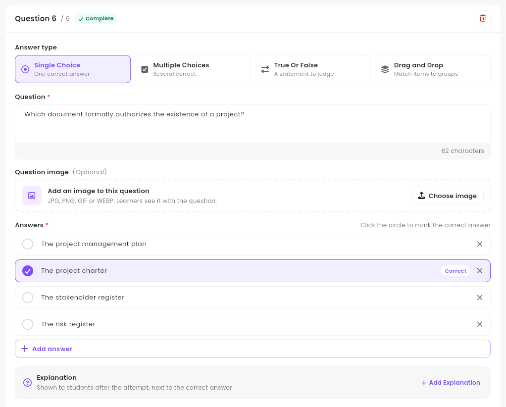
</Frame>

A new question starts with three empty answers: type them, click **Add answer** for more, and use
the ✕ to remove one. Click the circle in front of the right answer: it turns purple and shows
**Correct**. Only one answer can be marked. The question shows **Complete** once every answer is
typed and one is marked.

### Multiple Choices

<Frame caption="A Multiple Choices question, with two of its four answers marked correct.">
  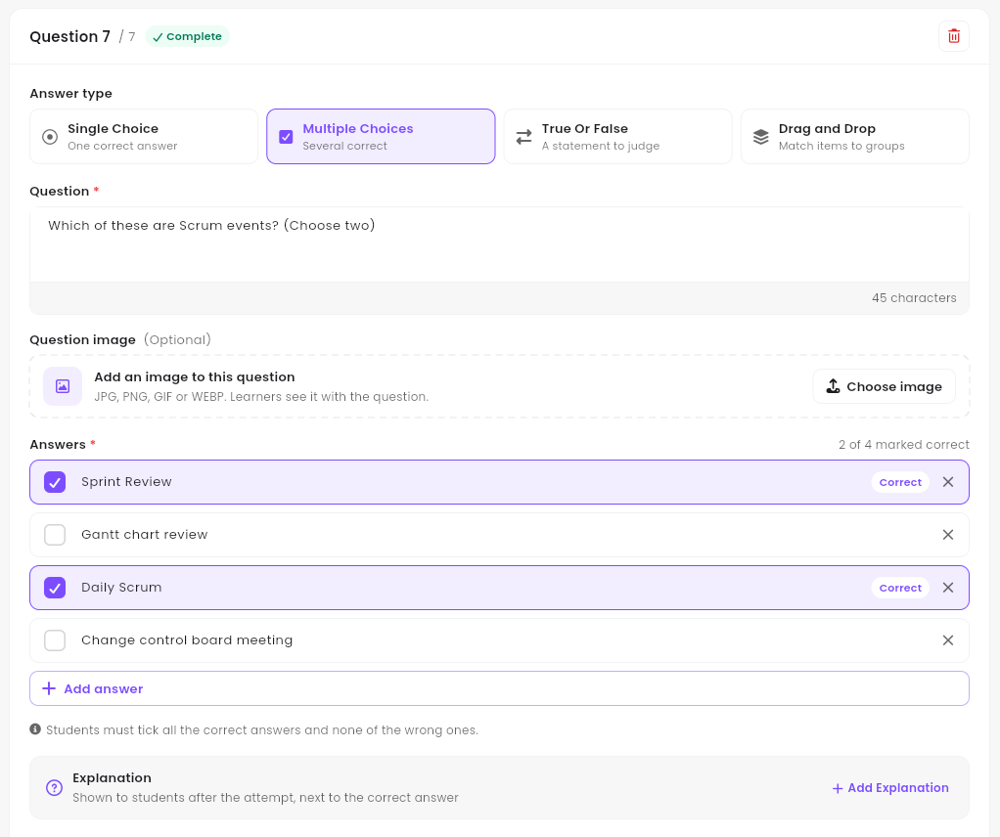
</Frame>

Tick the box in front of each right answer: it shows **Correct**, and the count at the top right
follows (**2 of 4 marked correct**). Mark at least two answers; for a question with one right
answer, use **Single Choice**. During the exam, learners see how many answers to tick (**Please
select 2 answer(s)**). The note under the answers recalls the rule: they must tick all the correct
answers and none of the wrong ones.

### True Or False

<Frame caption="A True Or False question, with True as the correct answer.">
  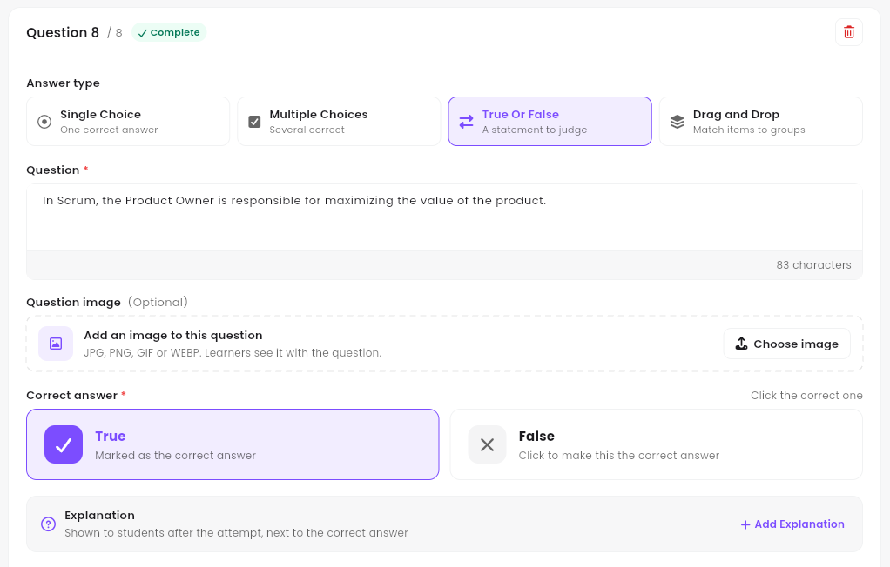
</Frame>

Write a statement in **Question**. The two answers, **True** and **False**, are already there:
under **Correct answer**, click the right one. It turns purple and shows **Marked as the correct
answer**.

### Drag and Drop

<Frame caption="A Drag and Drop question, with four items sorted into two groups.">
  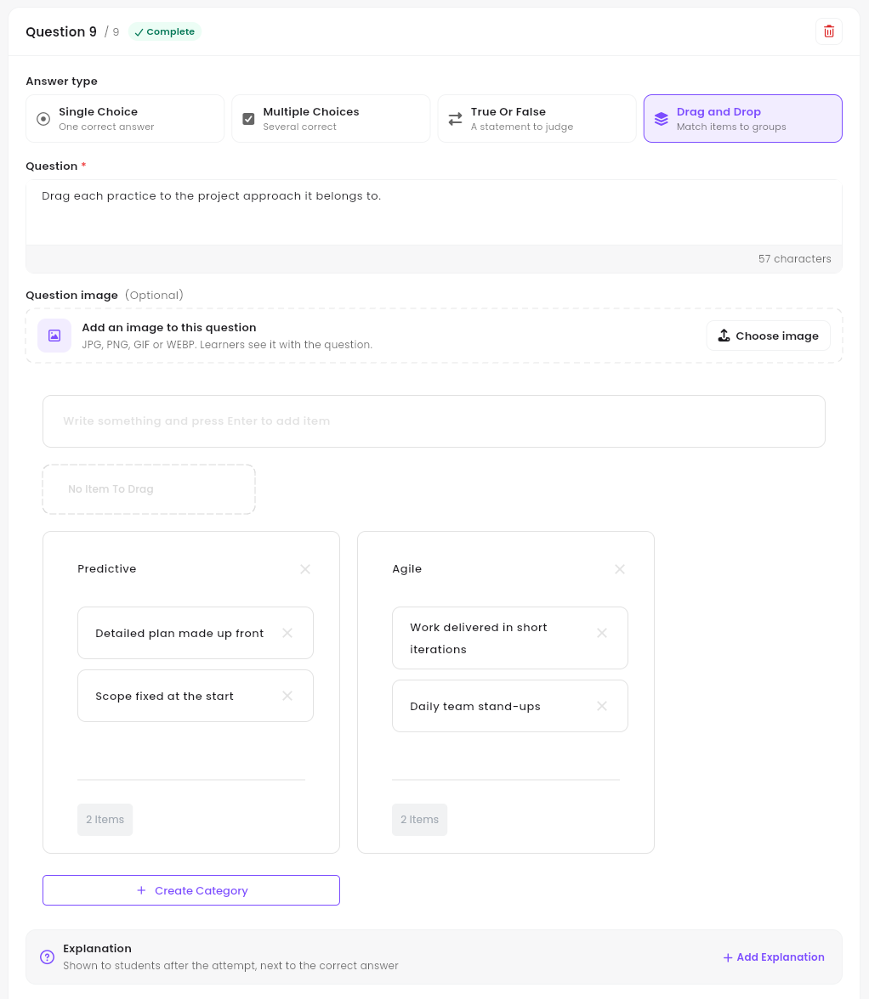
</Frame>

1. **Add the items.** Type one in **Write something and press Enter to add item** and press
   **Enter**: it joins the items to place, under the field. The ✕ on an item deletes it.
2. **Name the groups.** Two are there to start, **Group 1** and **Group 2**: click a name to change
   it. **Create Category** adds a group, and the ✕ next to a name removes it (a question keeps at
   least two groups).
3. **Drag each item onto its group.** The count at the bottom of the group follows (**2 Items**).
   The ✕ on an item inside a group sends it back to the items to place.

The question is complete once no item is left to place and every group has a name and at least one
item. If it still shows **Needs attention** after the last item, go to another question and back.
Learners see the group names and all the items mixed together, and drag each item into a group.

<Note>
  **Preview all the questions** shows a Drag and Drop question the way learners get it, without
  its answer.
</Note>

<Tip>
  Have your questions in a file already? **⋯ → Import Questions** on the exam's row imports them
  from a JSON file. To get a backup, the cloud icon at the top right of the tab offers **Single
  Export** (one exam or quiz) and **Export All** (all of them in a ZIP file).
</Tip>

---

## Step 6 — Publish and give access

- **Publish**: open **⋯** on the row and click **Publish**. The exam appears in the **Exam
  Catalog** (a quiz appears in its training's chapter). **Draft** hides it again.
- **Give an exam without an order**: **⋯ → Assign learners**, tick the learners, **Confirm**. It
  appears in their **My Exam Simulator**. **Unassign learners** removes it.
- **Change it later**: **⋯ → Update** opens the same four steps. The header shows whether the exam
  is **Published**.

---

## Good to know

<AccordionGroup>
  <Accordion title="When do learners see the explanations?">
    After an attempt: in **Review Answers**, each question has a **See Explanation** button next to
    the right answer.
  </Accordion>
  <Accordion title="How many attempts do learners get?">
    The number set in **Max Attempts**; 0 means unlimited. Each start of the exam uses one attempt.
  </Accordion>
  <Accordion title="Where do I give several exams and trainings at once?">
    With a **voucher**: see [Vouchers and coupons](/admin-guide/vouchers-and-coupons).
  </Accordion>
</AccordionGroup>
