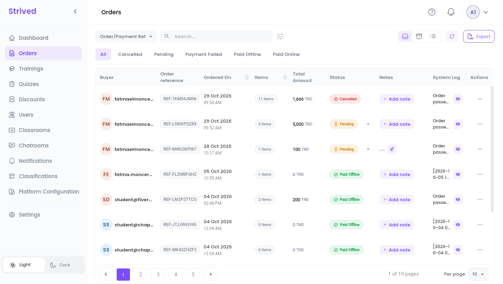
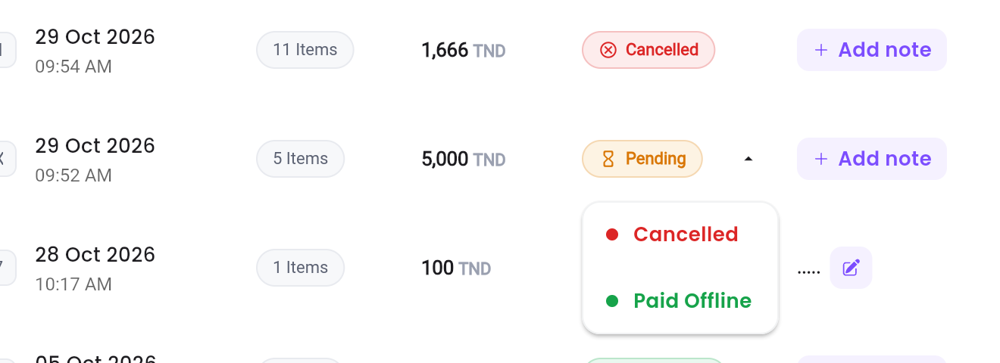
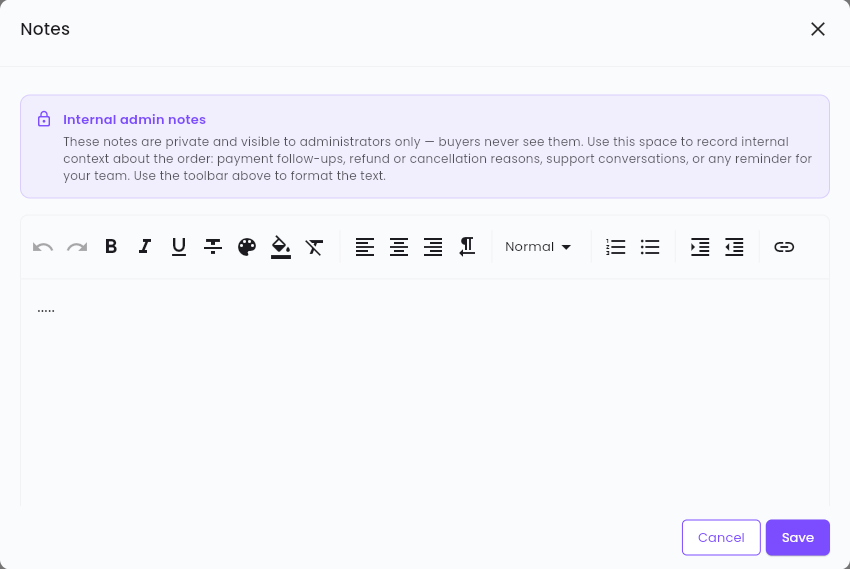
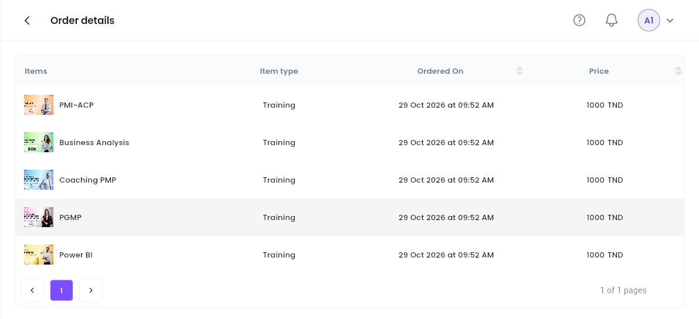

Every time a learner orders a training or an exam from the cart, an order appears in **Orders**.
This guide shows you how to follow it until it is paid, and how to keep track of it afterwards.

<Note>
  Everything below is for the **web app** on a computer, signed in as an **Admin**. Amounts are in
  Tunisian dinars (TND).
</Note>

---

## Table of contents

- **Step 1 — Open the orders list**
- **Step 2 — Find an order**
- **Step 3 — Confirm or cancel a payment**
- **Step 4 — Add an internal note**
- **Step 5 — Read the order's details and system log**
- **Step 6 — Archive or export orders**
- **Good to know**

---

## Step 1 — Open the orders list

Click **Orders** in the sidebar.

<Frame caption="Orders: one row per order, newest first.">
  
</Frame>

| Column | What it shows |
| :-- | :-- |
| **Buyer** | The learner who placed the order. |
| **Order reference** | The order's unique reference, e.g. `REF-7KM54JMINK`. The learner sees the same one in their **Orders History**. |
| **Ordered On** | Date and time of the order. |
| **Items** | How many trainings and exams the order holds. |
| **Total Amount** | What the learner has to pay for the order. |
| **Status** | Where the payment stands (see the table in Step 3). |
| **Notes** | Your team's internal notes (Step 4). |
| **System Log** | What the platform recorded about the order. The eye opens the full log (Step 5). |
| **Actions** | **⋯** opens **Preview** and, for a paid order, **Archive**. |

---

## Step 2 — Find an order

<Steps>
  <Step title="Choose what you search by">
    The list on the left of the search box sets what you type: **Order/Payment Ref**, **Training**,
    **Exam** or **Learner**.
  </Step>
  <Step title="Type in Search…">
    The table filters as you type.
  </Step>
  <Step title="Filter by status">
    The tabs below the search box show **All** orders, or only the **Cancelled**, **Pending**,
    **Payment Failed**, **Paid Offline** or **Paid Online** ones. The sliders icon next to the
    search box hides or shows these tabs.
  </Step>
</Steps>

The round-arrow button (**Refresh Data**) reloads the list, for example after a learner has just
ordered.

---

## Step 3 — Confirm or cancel a payment

A **Pending** order is waiting for an offline payment: bank transfer, cash at your offices, cheque,
and so on. Once the money has arrived:

<Steps>
  <Step title="Open the status list">
    Click the small arrow next to the **Pending** badge.
  </Step>
  <Step title="Pick the new status">
    **Paid Offline** confirms the payment. **Cancelled** cancels the order.
  </Step>
  <Step title="Confirm">
    The platform asks *"Are you sure you want to Confirm the Payment ?"* (or *"Are you sure you
    want to cancel This Payment ?"*). Confirm, and the badge changes.
  </Step>
</Steps>

<Frame caption="The status list of a pending order.">
  
</Frame>

What happens next:

- **Paid Offline**: the learner gets the trainings and exams of the order straight away, earns the
  loyalty points they carry, and receives an in-app notification *"Order Accepted"*. If the learner
  already owned one of the items through another paid order, the platform removes it from this
  order and writes it in the system log.
- **Cancelled**: the learner receives an in-app notification *"Order Cancelled"* asking them to
  contact support.

| Status | Meaning | Can you change it? |
| :-- | :-- | :-- |
| **Pending** | Ordered with **Order Now**, waiting for an offline payment. | Yes: **Paid Offline** or **Cancelled**. |
| **Pending Online** | An online payment was started but not confirmed yet. | No, the payment provider updates it. |
| **Payment Failed** | The online payment was refused or abandoned. | No. |
| **Paid Offline** | You confirmed the payment. | No. |
| **Paid Online** | The online payment went through. | No. |
| **Cancelled** | The order was cancelled. | No. |

<Warning>
  Confirm a payment only once the money has really arrived: the learner gets access to the content
  at once, and a paid order can no longer go back to **Pending** or **Cancelled**.
</Warning>

---

## Step 4 — Add an internal note

Click **+ Add note** in the **Notes** column (or the pencil next to an existing note).

<Frame caption="The Notes window.">
  
</Frame>

Notes are **private**: only administrators see them, never the buyer. Use them for payment
follow-ups, the reason for a refund or a cancellation, a support conversation, or a reminder for
your team. The toolbar formats the text (bold, colors, lists, links, and so on). Click **Save**.

---

## Step 5 — Read the order's details and system log

- **What was ordered**: **⋯ → Preview** opens **Order details**, with each item, its type
  (**Training** or exam), the order date and its price.

<Frame caption="Order details.">
  
</Frame>

- **What happened**: the eye in the **System Log** column opens the log, one numbered line per
  event, for example *"Order passed by '…' with coupon 'N/A' at 2026-10-04 14:48:10"*. The copy
  icon at the top of the window copies the whole log.

---

## Step 6 — Archive or export orders

- **Archive**: **⋯ → Archive** moves a paid order out of the main list. Find it again with the
  **Archived** icon at the top right, and bring it back with **Restore**. Pending and cancelled
  orders cannot be archived.
- **Export**: click **Export** at the top right, tick the orders you want in **Export orders**
  (the search box finds them by reference), then **Confirm**. You get a ZIP file with one PDF per
  order.

---

## Good to know

<AccordionGroup>
  <Accordion title="A learner paid but cannot see their training">
    Check the order's status: access opens only once it is **Paid Offline** or **Paid Online**. If
    it is still **Pending**, confirm the payment (Step 3).
  </Accordion>
  <Accordion title="A learner ordered the same item twice">
    The platform refuses a new order while an older one holding the same item is still **Pending**:
    the learner has to pay or cancel the first one. If two paid orders hold the same item, the
    duplicate is removed when the second one is confirmed, and the system log says so.
  </Accordion>
  <Accordion title="Where do I see a coupon used on an order?">
    In the system log: the *"Order passed by …"* line names the coupon, or `N/A` when there was
    none.
  </Accordion>
  <Accordion title="Online payments">
    Online orders (**Pending Online**, **Paid Online**, **Payment Failed**) get an extra menu item,
    **Flouci - Payment Details**, which opens the payment page recorded in the order's notes.
  </Accordion>
</AccordionGroup>
