A **training** is a course sold in the catalog: a presentation, a price, and chapters full of
lessons (documents or videos). This guide walks you through creating one, filling it, publishing
it, and managing who can follow it.

<Note>
  Everything below is for the **web app** on a computer, signed in as an **Admin**. The
  screenshots show the trainings of the test platform.
</Note>

---

## Table of contents

- **Step 1 — Open the trainings list**
- **Step 2 — Create a training: Basic Info**
- **Step 3 — Build the course content**
- **Step 4 — Write a lesson**
- **Step 5 — Preview and publish**
- **Step 6 — Give learners access**
- **Step 7 — Notify the learners**
- **Step 8 — Archive, export and import**
- **Good to know**

---

## Step 1 — Open the trainings list

Click **Trainings** in the sidebar.

<Frame caption="Trainings: one row per training.">
  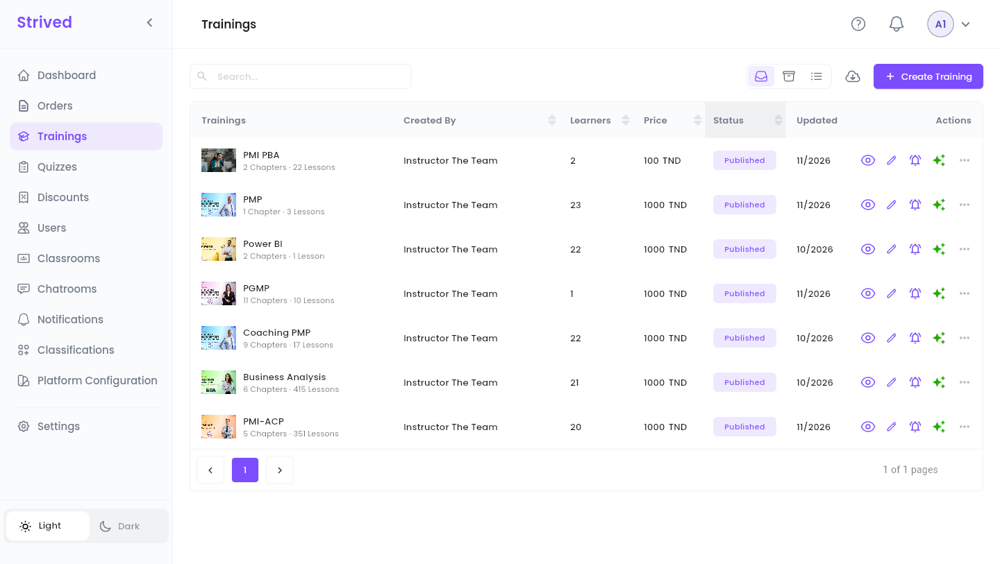
</Frame>

| Column | What it shows |
| :-- | :-- |
| **Trainings** | Cover, title, and how many chapters and lessons it holds. |
| **Created By** | The instructor who teaches it. |
| **Learners** | How many learners have access to it. |
| **Price** | The price in TND. |
| **Status** | **Published** (visible in the catalog) or **Draft** (hidden). |
| **Updated** | Month of the last change. |

The icons at the end of a row are shortcuts: the eye (**Preview**), the pen (**Update**), the bell
(**Notify learners**, grey when the training has no learners yet) and the sparkles, green when the
**AI Assistant** is enabled for this training (hover it: *"AI Assistant: enabled"*). **⋯** opens
every action:

<Frame caption="The ⋯ menu of a training.">
  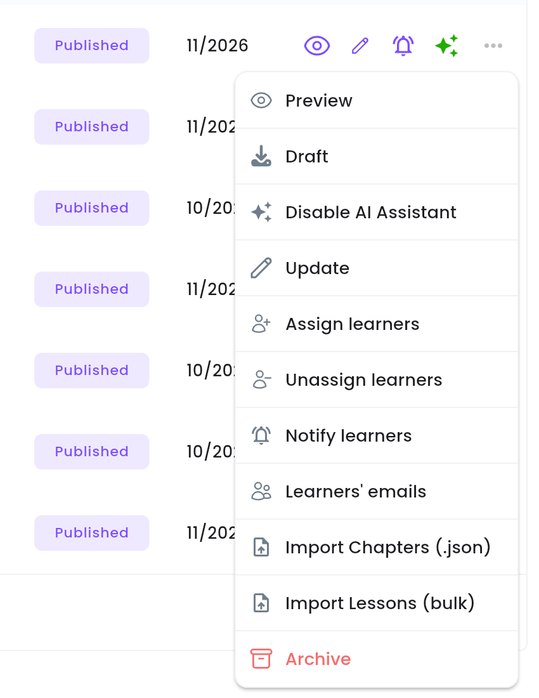
</Frame>

| Action | What it does |
| :-- | :-- |
| **Preview** | Opens the training as learners see it (Step 5). |
| **Draft** / **Publish** | Hides the training from the catalog, or publishes it (Step 5). |
| **Disable AI Assistant** / **Enable AI Assistant** | Turns the AI assistant of the course player off or on for this training. |
| **Update** | Opens the training editor (Steps 2 to 4). |
| **Assign learners** / **Unassign learners** | Gives learners access without an order, or removes it (Step 6). |
| **Notify learners** | Sends an in-app message to everyone who follows the training (Step 7). |
| **Learners' emails** | Lists the e-mail addresses of the training's learners. |
| **Import Chapters (.json)** / **Import Lessons (bulk)** | Adds content from files (Step 8). |
| **Archive** | Removes the training from the list (Step 8). |

---

## Step 2 — Create a training: Basic Info

Click **Create Training** at the top right. The editor has two steps, shown at the top:
**1 Basic Info** and **2 Course Content**.

<Frame caption="A new training: the editor opens on Basic Info, with a checklist on the right.">
  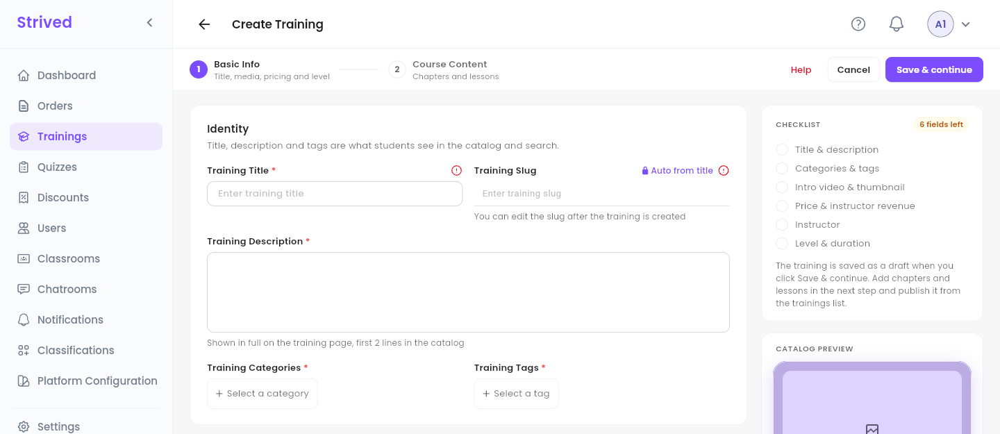
</Frame>

The **Checklist** on the right ticks each part as you fill it (*"6 fields left"* at the start, then
*"Ready to continue"*), and the **Catalog Preview** below it shows the card learners will see.
Here is the same page filled in, for an existing training:

<Frame caption="Basic Info, filled in.">
  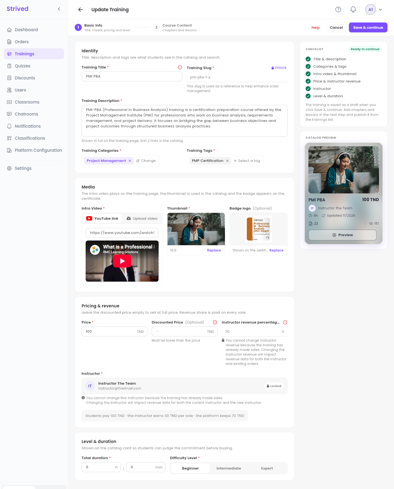
</Frame>

<Steps>
  <Step title="Identity">
    **Training Title** and **Training Description** (shown in full on the training page, first two
    lines in the catalog). The **Training Slug**, the training's short web name, is filled **Auto
    from title**. Pick at least one item in **Training Categories** and in **Training Tags** — see
    [Categories and tags](/admin-guide/categories-and-tags).
  </Step>
  <Step title="Media">
    **Intro Video**: paste a **YouTube link** (a preview appears below it) or switch to **Upload
    video**. **Thumbnail**: the 16:9 cover used in the catalog (**Pick image**). **Badge logo**
    (optional): shown on the certificate.
  </Step>
  <Step title="Pricing & revenue">
    **Price** in TND, an optional **Discounted Price** (it must be lower than the price), and the
    **Instructor revenue percentage**. The line underneath sums it up, e.g. *"Students pay 100 TND ·
    the instructor earns 30 TND per sale · the platform keeps 70 TND"*.
  </Step>
  <Step title="Instructor">
    **Select an Instructor**: the person who teaches the training.
  </Step>
  <Step title="Level & duration">
    **Total duration** in hours and minutes, and the **Difficulty Level**: **Beginner**,
    **Intermediate** or **Expert**.
  </Step>
  <Step title="Save & continue">
    Click **Save & continue** at the top right. The training is saved **as a draft**: it does not
    appear in the catalog yet, so you can fill it in quietly.
  </Step>
</Steps>

<Warning>
  Once a training has sold, its **Instructor** and its **Instructor revenue percentage** are
  locked: changing them would distort the revenue of the instructor and of the existing orders.
  The editor shows a padlock and explains why.
</Warning>

---

## Step 3 — Build the course content

Step 2, **Course Content**, shows the **Curriculum** on the left and an editing panel on the right.

<Frame caption="Course Content: the curriculum on the left, a new chapter on the right.">
  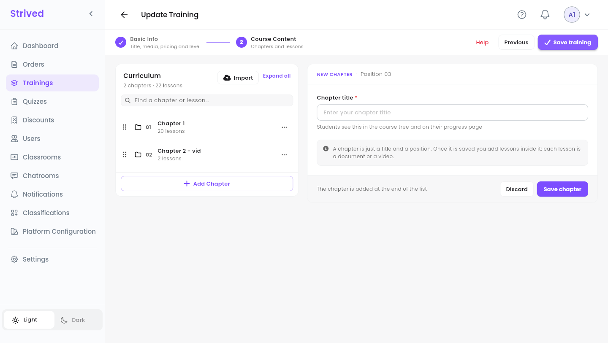
</Frame>

<Steps>
  <Step title="Add a chapter">
    Click **Add Chapter**, type the **Chapter title** (learners see it in the course tree and on
    their progress page), then **Save chapter**. A chapter is only a title and a position: the
    lessons go inside it.
  </Step>
  <Step title="Add lessons to the chapter">
    Open the chapter's **⋯** menu and choose **Add Lesson** (the same menu has **Rename chapter**
    and **Delete chapter**). Step 4 explains the lesson form.
  </Step>
  <Step title="Reorder">
    Drag a chapter or a lesson by its handle (the six dots on the left) to move it.
  </Step>
  <Step title="Save the training">
    When the curriculum is ready, click **Save training** at the top right. **Previous** goes back
    to Basic Info.
  </Step>
</Steps>

The **Find a chapter or lesson…** box searches the curriculum, **Expand all** opens every chapter,
and **Import** adds chapters from a file (Step 8).

---

## Step 4 — Write a lesson

<Frame caption="A new lesson in chapter 01.">
  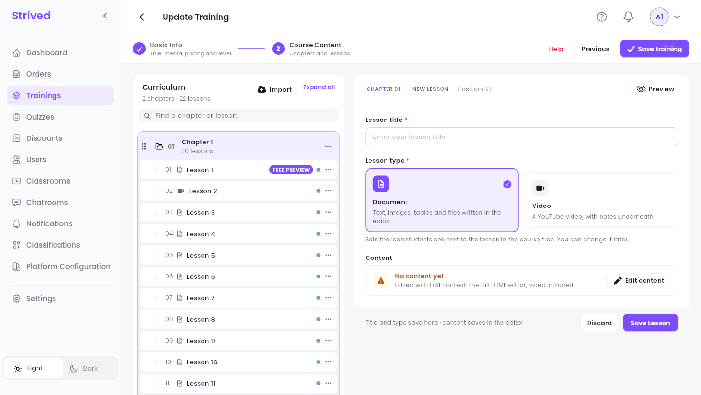
</Frame>

<Steps>
  <Step title="Title and type">
    Type the **Lesson title** and choose the **Lesson type**: **Document** (text, images, tables and
    files written in the editor) or **Video** (a YouTube video, with notes underneath). The type
    sets the icon learners see in the course tree, and you can change it later.
  </Step>
  <Step title="For a video: the source">
    Paste a **YouTube link**, or switch to **Embed code** and paste the embed code. Any YouTube
    address works; the platform wraps the video in the standard player. Uploaded MP4 files are not
    supported for lessons yet: use YouTube (an unlisted video works).
  </Step>
  <Step title="Write the content">
    Click **Edit content** to open the full editor, write the lesson, then click **Save Lesson** at
    the top of the editor.
  </Step>
  <Step title="Save">
    Back in the form, click **Save Lesson**. The title and type are saved here, the content in the
    editor.
  </Step>
</Steps>

<Frame caption="Editing an existing video lesson.">
  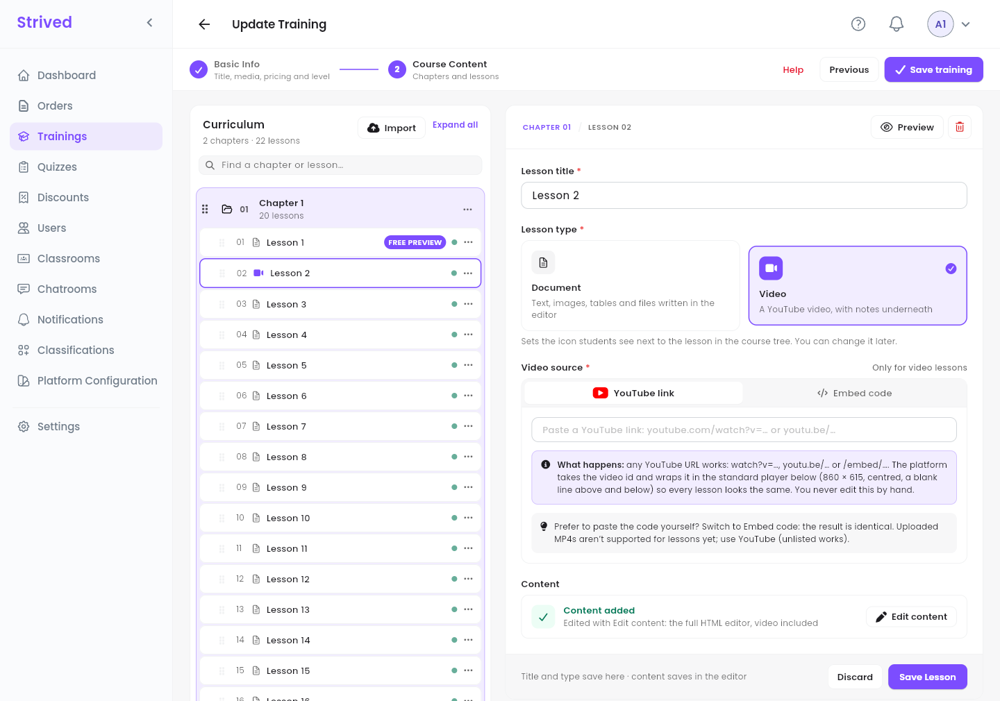
</Frame>

<Frame caption="The lesson editor (Edit content).">
  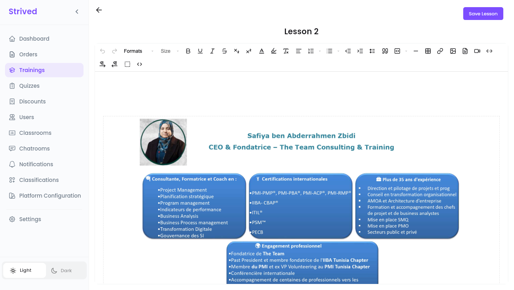
</Frame>

In the curriculum, each lesson shows a dot: **green** when it has content (*"Content added"*),
**orange** when it is still empty (*"No content yet"*). The lesson's **⋯** menu offers
**Preview**, **Edit** and **Delete**.

<Tip>
  The first lesson of chapter 1 carries a **FREE PREVIEW** badge: visitors can always watch it
  before buying, to sample the training. Put a good introduction there.
</Tip>

---

## Step 5 — Preview and publish

**⋯ → Preview** (or the eye) opens the training page as learners see it in the catalog: category,
level, views, learners, instructor, presentation video, price and **This training includes**.

<Frame caption="Previewing a training.">
  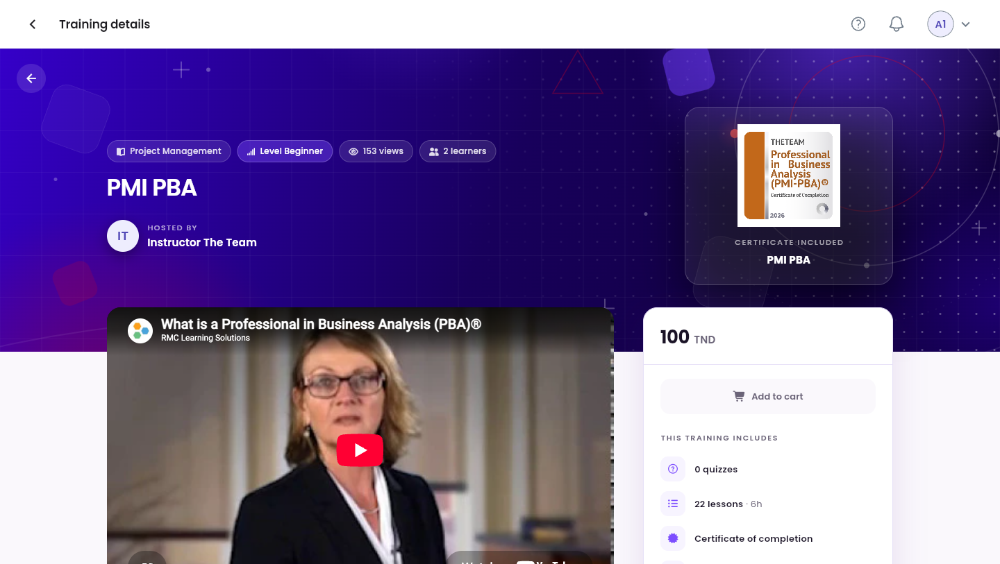
</Frame>

When everything is ready, open **⋯** on the training's row and click **Publish**. Its status turns
**Published** and it appears in the learners' catalog. **Draft** in the same menu hides it again.

---

## Step 6 — Give learners access

Learners normally get a training by ordering it. You can also give it to them directly, without an
order:

<Steps>
  <Step title="Open Assign learners">
    **⋯ → Assign learners**.
  </Step>
  <Step title="Tick the learners">
    Search by name or e-mail in **Search for a learner**, and tick everyone who should get the
    training.
  </Step>
  <Step title="Confirm">
    Click **Confirm**. The training appears in their **My Content → My Trainings**.
  </Step>
</Steps>

<Frame caption="Assign learners.">
  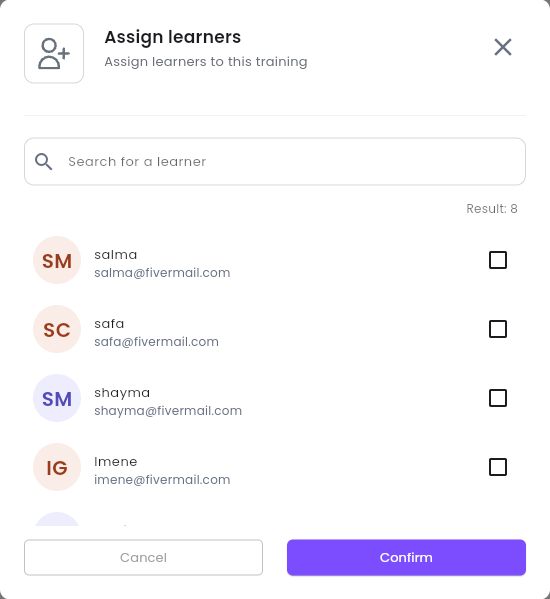
</Frame>

**⋯ → Unassign learners** works the same way and removes the access.

<Tip>
  To give a learner several trainings and exams at once, by e-mail, create a **voucher** instead —
  see [Vouchers and coupons](/admin-guide/vouchers-and-coupons).
</Tip>

---

## Step 7 — Notify the learners

Click the bell on the row (or **⋯ → Notify learners**).

<Frame caption="Notify learners.">
  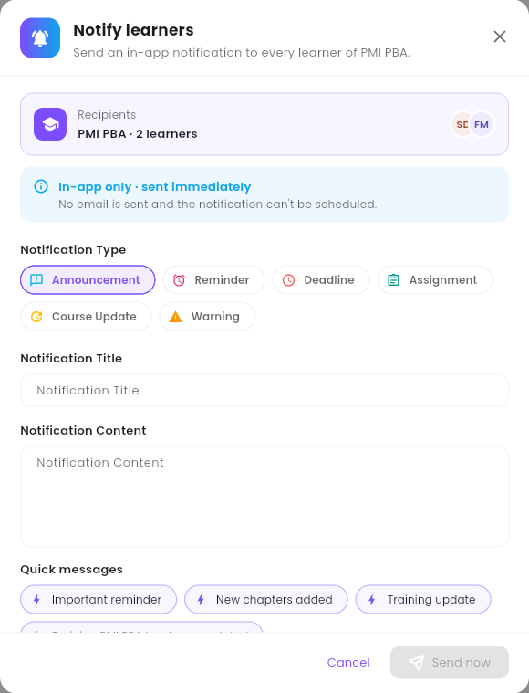
</Frame>

<Steps>
  <Step title="Check the recipients">
    **Recipients** shows the training and how many learners will get the message.
  </Step>
  <Step title="Pick a Notification Type">
    **Announcement**, **Reminder**, **Deadline**, **Assignment**, **Course Update** or **Warning**.
  </Step>
  <Step title="Write the message">
    Fill in **Notification Title** and **Notification Content**, or start from one of the **Quick
    messages** (**Important reminder**, **New chapters added**, **Training update**, and so on).
  </Step>
  <Step title="Send">
    Click **Send now**.
  </Step>
</Steps>

<Note>
  This message is **in-app only** and **sent immediately**: no e-mail goes out and it cannot be
  scheduled. For e-mails or scheduled messages, use **Notifications** in the sidebar — see
  [Send notifications](/admin-guide/send-notifications).
</Note>

---

## Step 8 — Archive, export and import

- **Archive**: **⋯ → Archive** removes the training from the list. Find it with the **Archived**
  icon at the top right, then **Restore** it, or **Delete** it for good.
- **Export**: the cloud icon next to **Create Training** opens **Export Training**. Pick a training,
  confirm, and a backup of it downloads as `<training>_backup.zip`.
- **Import Chapters (.json)**: adds chapters from JSON files, for example from another training's
  export. The window explains the steps under **How to import chapters**.
- **Import Lessons (bulk)**: turns images into lessons, one image per lesson, in file-name order
  (name them `01-…`, `02-…`, and so on). Choose the chapter, drop the images (PNG, JPG, WEBP or GIF),
  adjust the titles, and upload.

---

## Good to know

<AccordionGroup>
  <Accordion title="Can I change a training after it is published?">
    Yes. **Update** opens the same editor. Learners see the changes as soon as you save. Only the
    instructor and the revenue percentage are locked once the training has sold.
  </Accordion>
  <Accordion title="Where do quizzes come in?">
    A quiz belongs to a chapter of a training: you create it from **Quizzes** and attach it to the
    training and chapter there. See [Manage exams and quizzes](/admin-guide/manage-exams-and-quizzes).
  </Accordion>
  <Accordion title="What does the learner need for the certificate?">
    Every lesson completed and every quiz of the training passed. The badge logo you upload in
    **Media** appears on the certificate.
  </Accordion>
  <Accordion title="I left the editor without saving">
    The chapters and lessons you did not save are lost. Save each chapter and lesson as you go,
    then **Save training** at the end.
  </Accordion>
</AccordionGroup>
