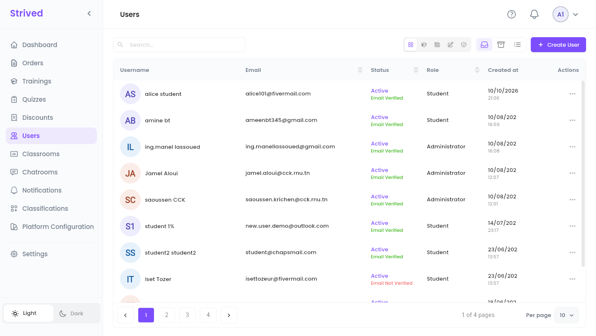
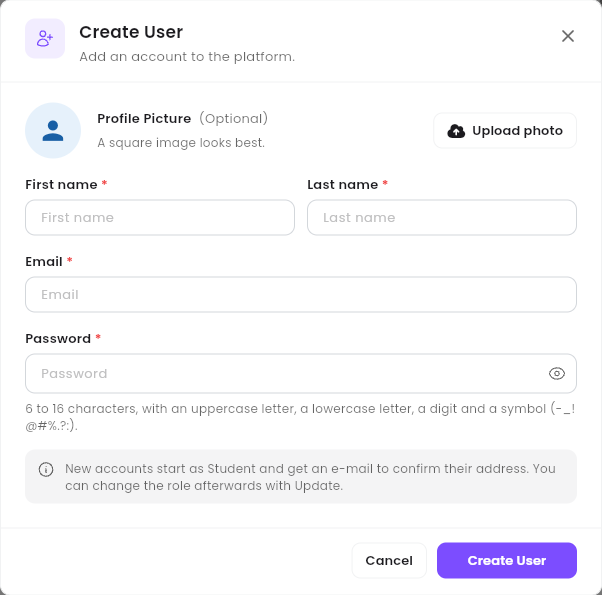
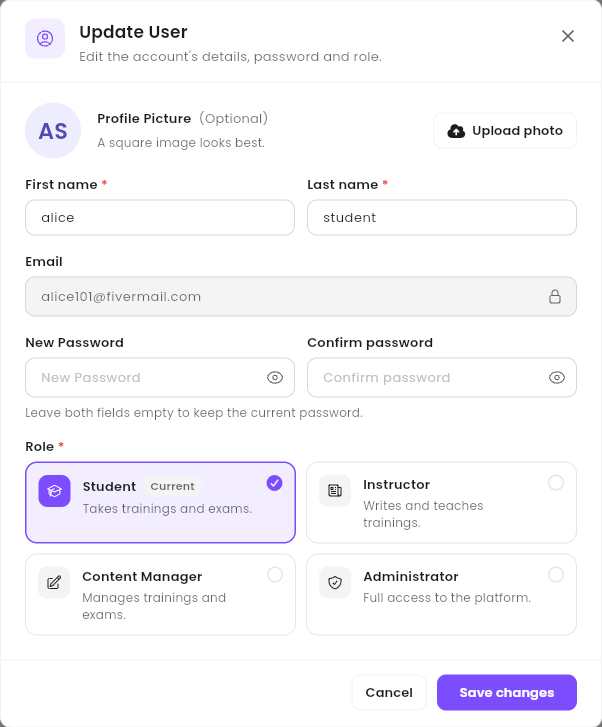
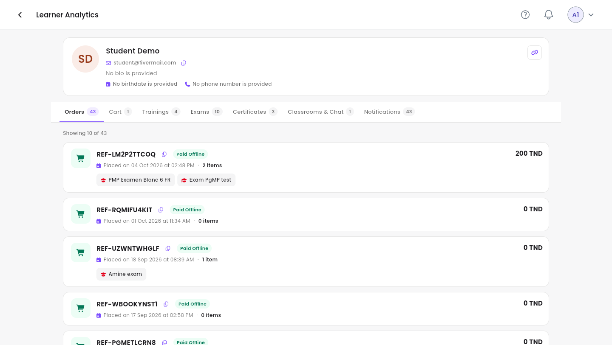
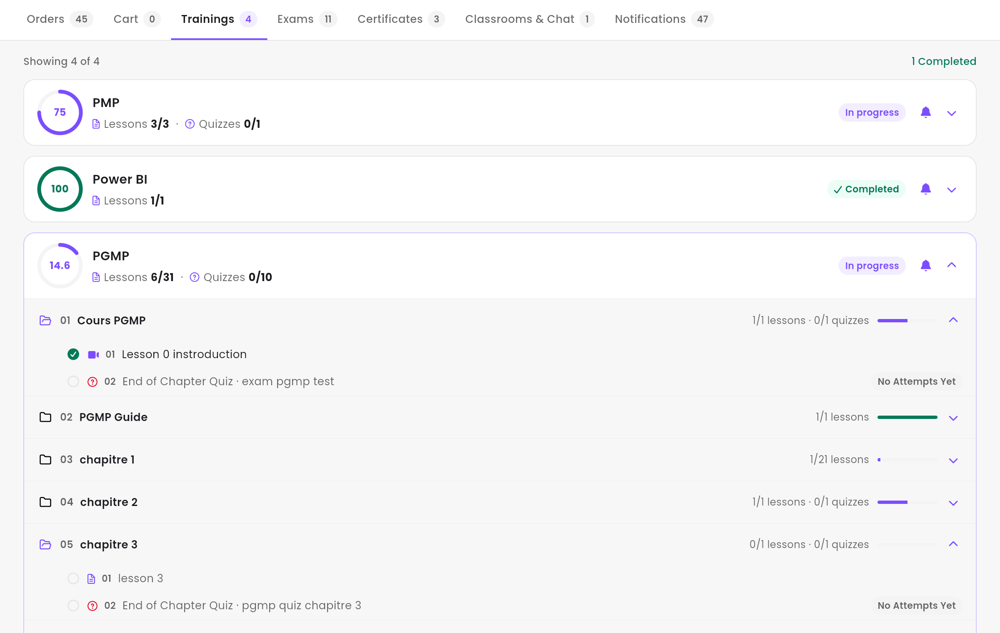
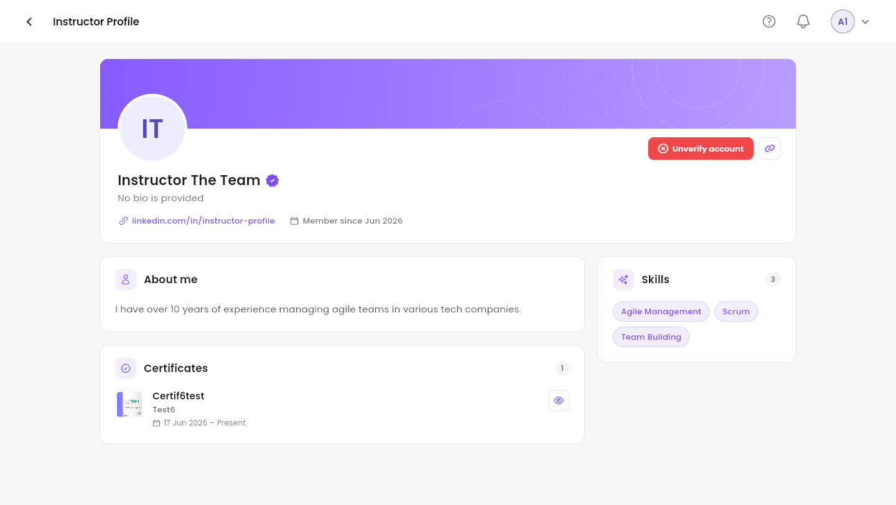

**Users** lists every account of the platform: learners, instructors, content managers and
admins. This guide shows you how to create and update accounts, and where to see what a learner
has done.

<Note>
  Everything below is for the **web app** on a computer, signed in as an **Admin**.
</Note>

---

## Table of contents

- **Step 1 — Find a user**
- **Step 2 — Create an account**
- **Step 3 — Update an account and change its role**
- **Step 4 — Look up a learner's activity**
- **Step 5 — Manage an instructor**
- **Step 6 — Ban or archive an account**
- **Good to know**

---

## Step 1 — Find a user

Click **Users** in the sidebar.

<Frame caption="Users.">
  
</Frame>

- **Search…** finds a user by name or e-mail.
- The five icons to the left of **Active** / **Archived** / **All records** filter by role:
  **All**, **Students**, **Instructors**, **Content Managers** and **Admins**.

| Column | What it shows |
| :-- | :-- |
| **Username** | First and last name. |
| **Email** | The address the user signs in with. |
| **Status** | **Active**, and whether the e-mail is confirmed (**Email Verified** in green, **Email Not Verified** in red). |
| **Role** | **Student**, **Instructor**, **Content Manager** or **Administrator**. |
| **Created at** | When the account was created. |

---

## Step 2 — Create an account

Click **Create User** at the top right.

<Frame caption="Create User.">
  
</Frame>

<Steps>
  <Step title="Profile picture (optional)">
    **Upload photo**. A square image looks best.
  </Step>
  <Step title="Name and e-mail">
    **First name**, **Last name** and **Email**.
  </Step>
  <Step title="Password">
    6 to 16 characters, with an uppercase letter, a lowercase letter, a digit and a symbol
    (`-_!@#%.?:`). The eye shows what you typed.
  </Step>
  <Step title="Create">
    Click **Create User**.
  </Step>
</Steps>

New accounts start as **Student** and receive an e-mail to confirm their address. To make someone
an instructor or an admin, change the role afterwards (Step 3).

---

## Step 3 — Update an account and change its role

Open **⋯ → Update** on the user's row.

<Frame caption="Update User.">
  
</Frame>

- **First name** and **Last name** can be changed. The **Email** is locked.
- **New Password** / **Confirm password** set a new password. Leave both empty to keep the current
  one.
- **Role**: pick **Student** (takes trainings and exams), **Instructor** (writes and teaches
  trainings), **Content Manager** (manages trainings and exams) or **Administrator** (full access to
  the platform). **Current** marks the role the user has now.

Click **Save changes**.

<Warning>
  **Administrator** gives full access to the platform, including orders, payments and every user.
  Give it only to people who need it.
</Warning>

---

## Step 4 — Look up a learner's activity

On a student's row, open **⋯ → Learner Analytics**.

<Frame caption="Learner Analytics.">
  
</Frame>

The card at the top shows the learner's name, e-mail, bio, date of birth and phone number (the copy
icons copy the e-mail and the phone number). The tabs below give the full picture, each with a
counter:

| Tab | What you find |
| :-- | :-- |
| **Orders** | Every order with its reference, status, date, items and amount. |
| **Cart** | What is waiting in the learner's cart. |
| **Trainings** | The trainings the learner has access to, with their progress chapter by chapter (see below). |
| **Exams** | The exams the learner has access to. |
| **Certificates** | The certificates the learner has earned. |
| **Classrooms & Chat** | The classrooms the learner belongs to. |
| **Notifications** | The notifications the learner has received. |

### Follow a learner's progress in a training

Open the **Trainings** tab: one row per training the learner has access to. Click a row to open
the training, then click a chapter to see its lessons and quizzes.

<Frame caption="The Trainings tab, with the PGMP training and two of its chapters opened.">
  
</Frame>

Each training row shows:

| Part of the row | What it tells you |
| :-- | :-- |
| **The ring** | The overall progress in percent: finished lessons and passed quizzes, out of all the lessons and quizzes of the training. |
| **Lessons** | Lessons finished out of the total (**6/31**). |
| **Quizzes** | Quizzes passed out of the total (**0/10**). Only shown when the training has quizzes. |
| **The status** | **Not started**, **In progress** or **Completed**. The counter above the list (**1 Completed**) adds up the finished trainings. |
| **The bell** (**Reminder**) | Sends the learner a reminder to finish the training (see below). |

Inside an opened training, each chapter shows what is done (**1/1 lessons · 0/1 quizzes**) with a
small bar, green once the whole chapter is done. In an opened chapter:

- a **green tick** marks a finished lesson or a passed quiz; an **empty circle** marks a lesson the
  learner hasn't finished or a quiz they haven't passed yet;
- the icon before the name gives the lesson type (video, document…), and **End of Chapter Quiz**
  marks the chapter's quizzes;
- the pill at the end of a quiz row gives the learner's result: **Passed · 85%**, **Best 40%**
  (tried, not passed yet), or **No Attempts Yet**.

A quiz counts as done only once it is passed, that is with a score at or above its passing
percentage. When the training has a final quiz, it is listed after the chapters under
**Final quiz**.

**Remind a learner.** The bell opens a **Reminder** window with a ready-made message: pick the
language (**English**, **French** or **Arabic**), adjust the title and the text if needed, then
**Confirm**. The learner gets it as a notification in the app and by e-mail.

<Tip>
  A learner calls about a payment or a missing training? Start here: **Orders** and **Trainings**
  usually answer the question.
</Tip>

---

## Step 5 — Manage an instructor

An instructor's **⋯** menu has two extra items.

**Set Revenue** opens **Instructor Revenue**: type the instructor's default **Revenue** percentage
(for example `30`), then **Confirm**. This is the share of each sale the instructor earns. Set it
before you create a training or an exam for this instructor: the editor refuses to continue while
it is missing (*"Missing Revenue for Selected Instructor"*).

**Preview profile** opens the **Instructor Profile**: bio, LinkedIn link, **About me**,
**Skills** and **Certificates**.

<Frame caption="An instructor's profile.">
  
</Frame>

A verified instructor shows a purple badge next to their name. **Unverify account** removes it;
on an unverified instructor the button verifies the account.

---

## Step 6 — Ban or archive an account

| Action | What it does | How to undo it |
| :-- | :-- | :-- |
| **Ban** | Blocks the account: the user can no longer use the platform. The platform asks *"Are you sure you want to Ban this user ?"* first. | **⋯ → Unban** |
| **Archive** | Removes the account from the list. | **Archived** icon, then **Restore** |

---

## Good to know

<AccordionGroup>
  <Accordion title="Can I change a user's e-mail?">
    No: the e-mail is the login and stays locked in **Update User**. Create a new account with the
    right e-mail if needed.
  </Accordion>
  <Accordion title="A user forgot their password">
    Set a new one in **⋯ → Update** (Step 3), fill in **New Password** and **Confirm password**, and
    give it to them.
  </Accordion>
  <Accordion title="How do I give a learner a training without an order?">
    From **Trainings**: **⋯ → Assign learners** — see
    [Manage trainings](/admin-guide/manage-trainings). For several trainings and exams at once, use a
    voucher — see [Vouchers and coupons](/admin-guide/vouchers-and-coupons).
  </Accordion>
  <Accordion title="A quiz shows 1 attempt(s) next to No Attempts Yet">
    The learner started the quiz but never finished it. **attempt(s)** counts every attempt, even
    unfinished ones, while the pill only shows a score for finished attempts, hence **No Attempts
    Yet**. The quiz stays not passed until the learner finishes an attempt with a passing score.
  </Accordion>
</AccordionGroup>
