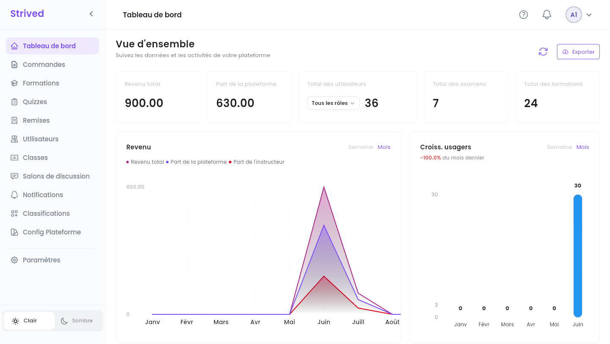
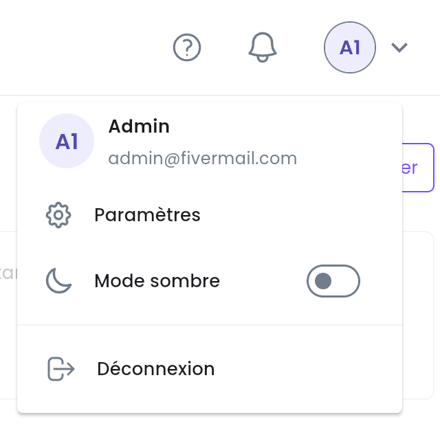
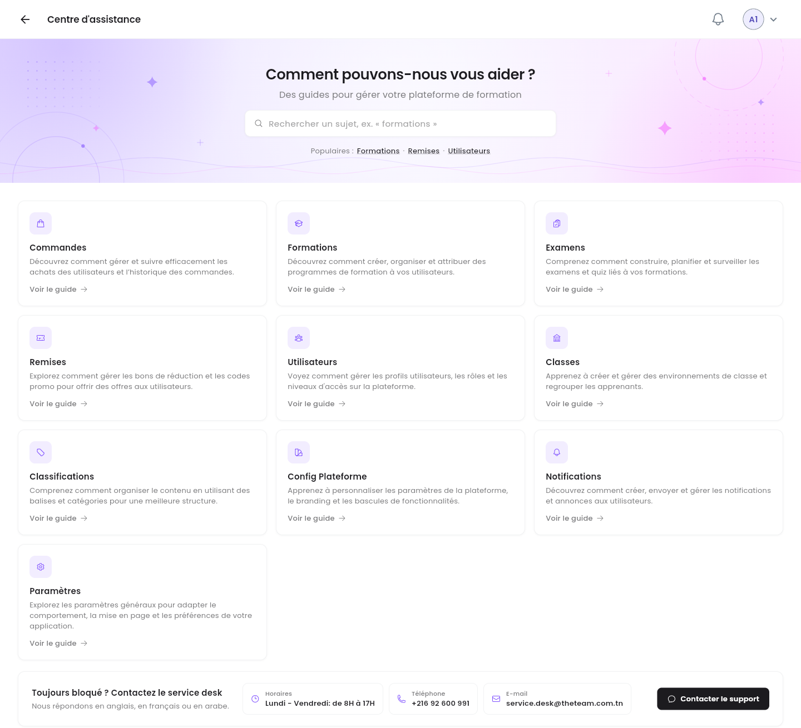

Ce guide présente l'espace administrateur de la plateforme : où se trouve chaque outil, ce que
vous apprend le tableau de bord, et les commandes qui fonctionnent de la même façon sur toutes les
listes de l'admin.

<Note>
  Tout ce qui suit concerne l'**application web** sur ordinateur, avec un compte **Admin**. Les
  captures viennent de la plateforme de test : vos chiffres, vos formations et vos utilisateurs
  seront différents.
</Note>

---

## Sommaire

- **Étape 1 — La barre latérale et la barre du haut**
- **Étape 2 — Lire le tableau de bord**
- **Étape 3 — Exporter le revenu**
- **Étape 4 — Obtenir de l'aide**
- **Les commandes communes à toutes les listes**
- **Bon à savoir**

---

## Étape 1 — La barre latérale et la barre du haut

Après la connexion, la plateforme s'ouvre sur le **Tableau de bord**. La barre latérale, à gauche,
mène à tous les outils de l'admin :

<Frame caption="Le tableau de bord de l'admin, avec la barre latérale à gauche.">
  
</Frame>

| Élément de la barre latérale | Ce que vous y faites | Guide |
| :-- | :-- | :-- |
| **Tableau de bord** | Les chiffres clés et les graphiques de la plateforme. | Cette page |
| **Commandes** | Confirmer ou annuler des paiements, ajouter des notes internes, exporter des commandes. | [Gérer les commandes](/admin-guide/gerer-les-commandes) |
| **Formations** | Créer des formations, construire leurs chapitres et leurs leçons, les publier, y donner accès aux apprenants. | [Gérer les formations](/admin-guide/gerer-les-formations) |
| **Quizzes** | Créer des examens indépendants (examens blancs) et des quiz rattachés à une formation. | [Gérer les examens et les quiz](/admin-guide/gerer-les-examens-et-quiz) |
| **Remises** | Créer des vouchers (bons), un accès gratuit envoyé par e-mail, et des coupons de réduction. | [Vouchers et coupons](/admin-guide/vouchers-et-coupons) |
| **Utilisateurs** | Créer des comptes, changer des rôles, consulter l'activité d'un apprenant. | [Gérer les utilisateurs](/admin-guide/gerer-les-utilisateurs) |
| **Classes** | Réunir des apprenants autour d'un formateur, avec un contenu commun et un salon de discussion de groupe. | [Classes et salons de discussion](/admin-guide/classes-et-salons-de-discussion) |
| **Salons de discussion** | Lire et modérer les discussions de groupe de toutes les classes. | [Classes et salons de discussion](/admin-guide/classes-et-salons-de-discussion) |
| **Notifications** | Envoyer une notification dans l'application à des utilisateurs, à des rôles ou à toute l'entreprise. | [Envoyer des notifications](/admin-guide/envoyer-des-notifications) |
| **Classifications** | Gérer les catégories et les étiquettes utilisées dans le catalogue. | [Catégories et étiquettes](/admin-guide/categories-et-tags) |

**Config Plateforme** et **Paramètres** (votre profil, votre mot de passe, votre langue, vos
notifications et l'authentification à deux facteurs) ne sont pas traités dans ce guide.

Deux autres commandes se trouvent dans la barre latérale :

- La **flèche** à côté du logo **Strived** réduit la barre latérale à ses icônes, ce qui laisse
  plus de place aux tableaux larges. Cliquez de nouveau dessus pour la déplier.
- **Clair** / **Sombre**, en bas, change le thème.

### La barre du haut

<Frame caption="Le menu de l'avatar, en haut à droite.">
  
</Frame>

| Icône | Ce qu'elle fait |
| :-- | :-- |
| **?** | Ouvre le **Centre d'assistance** (Étape 4). |
| Cloche | Vos dernières notifications. **Voir tout** ouvre la liste complète. |
| Avatar (vos initiales) | Affiche votre nom et votre e-mail, avec **Paramètres**, **Mode sombre** et **Déconnexion**. |

---

## Étape 2 — Lire le tableau de bord

La **Vue d'ensemble** résume la plateforme en un coup d'œil.

| Carte / graphique | Ce qu'il montre |
| :-- | :-- |
| **Revenu total** | Tout ce qui a été payé pour des formations et des examens, en TND. |
| **Part de la plateforme** | La part de ce revenu que garde la plateforme, après la part des formateurs. |
| **Total des utilisateurs** | Le nombre de comptes. La liste **Tous les rôles** limite le décompte aux **Apprenants**, **Formateurs**, **Gestionnaires de contenu** ou **Administrateurs**. |
| **Total des examens** / **Total des formations** | Le nombre d'examens et de formations sur la plateforme. |
| **Revenu** | Le **Revenu total**, la **Part de la plateforme** et la **Part de l'instructeur** dans le temps. Passez de **Semaine** à **Mois** en haut à droite du graphique. |
| **Croiss. usagers** | Les nouveaux comptes par semaine ou par mois, et l'évolution par rapport au mois précédent (par exemple `+20.0% du mois dernier`). |

Le bouton à flèche ronde à côté d'**Exporter** (**Actualiser les données**) recharge les chiffres
sans recharger la page.

<Tip>
  Sur un ordinateur portable, les graphiques sont plus larges que l'écran. Faites défiler un
  graphique vers la droite pour voir les derniers mois de l'année.
</Tip>

---

## Étape 3 — Exporter le revenu

Cliquez sur **Exporter** en haut à droite du tableau de bord, puis choisissez **En PDF** ou
**En CSV**. Le fichier contient les chiffres du revenu et se télécharge aussitôt. Le CSV s'ouvre
dans Excel ou Google Sheets.

---

## Étape 4 — Obtenir de l'aide

Cliquez sur **?** dans la barre du haut.

<Frame caption="Le Centre d'assistance de l'admin.">
  
</Frame>

- Cherchez un sujet, ou utilisez les raccourcis **Populaires :** (**Formations**, **Remises**,
  **Utilisateurs**).
- Chaque carte couvre un outil de l'admin (**Commandes**, **Formations**, **Examens**, **Remises**,
  **Utilisateurs**, **Classes**, **Classifications**, **Config Plateforme**, **Notifications**,
  **Paramètres**). **Voir le guide** ouvre son guide vidéo.
- **Toujours bloqué ? Contactez le service desk** donne les horaires, le numéro de téléphone et
  l'e-mail du service desk. **Contacter le support** ouvre un e-mail prêt à envoyer. Le service
  desk répond en anglais, en français ou en arabe.

---

## Les commandes communes à toutes les listes

Les commandes, les formations, les examens, les remises, les utilisateurs, les classes et les
classifications s'affichent tous dans des tableaux qui fonctionnent de la même façon :

| Commande | Ce qu'elle fait |
| :-- | :-- |
| Champ **Recherche…** | Filtre le tableau au fil de la saisie. |
| Trois icônes à côté du bouton principal : **Actif**, **Archivé**, **Tous les éléments** | Affichent les éléments actifs, les éléments archivés, ou les deux. |
| En-tête de colonne avec des flèches | Cliquez dessus pour trier selon cette colonne. Cliquez de nouveau pour inverser l'ordre. |
| **⋯** au bout d'une ligne | Les actions de la ligne (visualiser, modifier, archiver, etc.). |
| Pages en bas, **Par page** | Parcourez les résultats et choisissez combien de lignes affiche une page. |

<Note>
  **Archiver** masque un élément sans le supprimer : il passe dans la vue **Archivé**, où
  **Restaurer** le fait revenir. Depuis cette vue, les formations archivées peuvent aussi être
  supprimées définitivement.
</Note>

---

## Bon à savoir

<AccordionGroup>
  <Accordion title="Admin, gestionnaire de contenu, formateur : qui voit quoi ?">
    Un **Admin** accède à tous les outils de cette page. Un **Gestionnaire de contenu** travaille
    sur les formations et les examens. Un **Formateur** rédige et enseigne ses propres formations.
    Vous changez le rôle d'un utilisateur depuis **Utilisateurs** : voir
    [Gérer les utilisateurs](/admin-guide/gerer-les-utilisateurs).
  </Accordion>
  <Accordion title="D'où viennent les montants ?">
    Des commandes marquées **Payé hors ligne** ou **Payé en ligne**. Une commande en attente ou
    annulée ne compte pas. Voir [Gérer les commandes](/admin-guide/gerer-les-commandes).
  </Accordion>
  <Accordion title="Les chiffres semblent dépassés">
    Cliquez sur **Actualiser les données** (la flèche ronde à côté d'**Exporter**). Les chiffres
    sont rechargés depuis le serveur.
  </Accordion>
</AccordionGroup>
