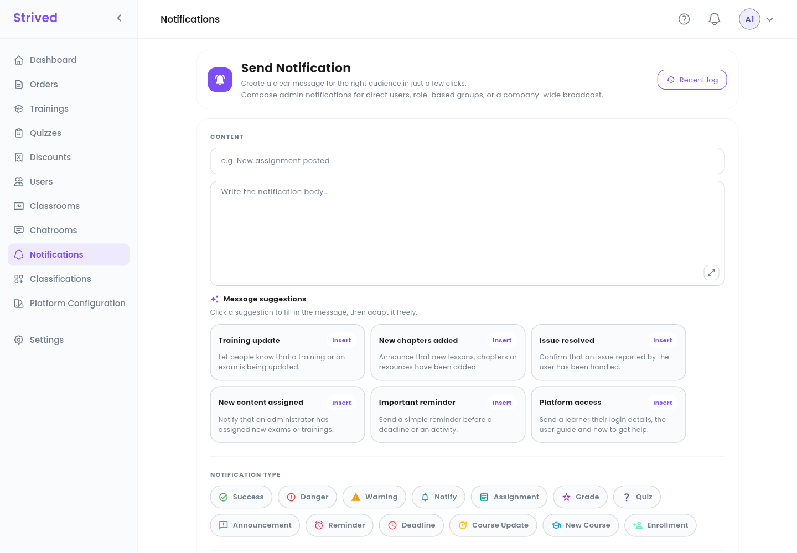
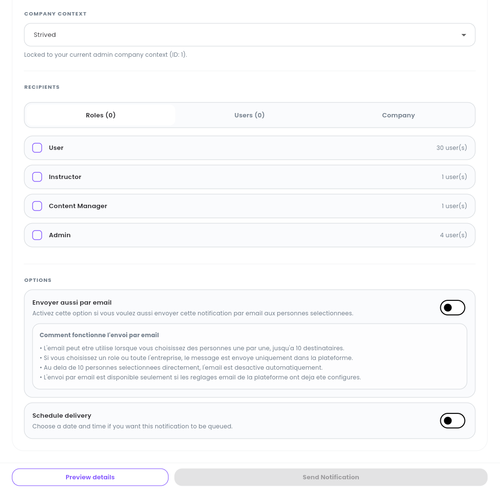
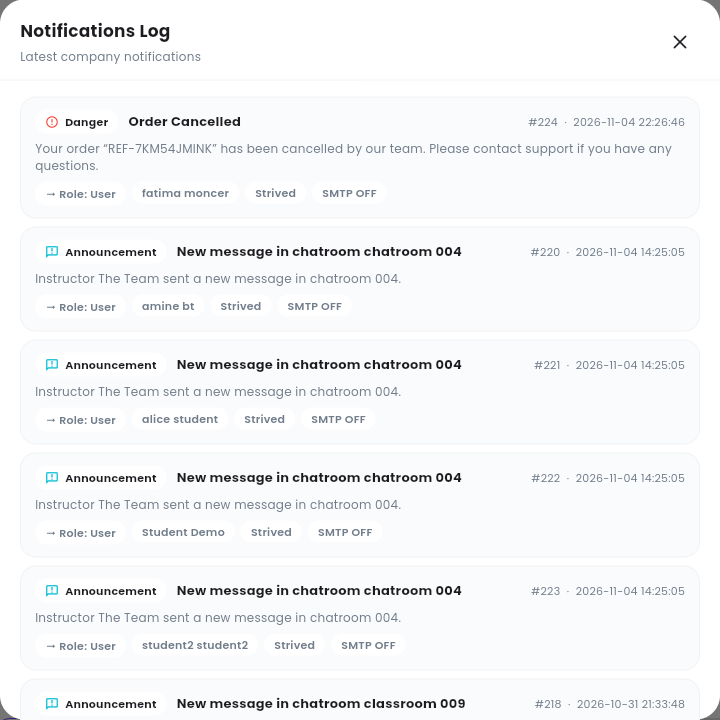

**Notifications** in the sidebar sends a message that appears in the bell of the people you choose,
inside the app. Use it for announcements, reminders, deadlines or news about the platform.

<Note>
  Everything below is for the **web app** on a computer, signed in as an **Admin**. To message only
  the learners of one training or one classroom, the bell on its row is quicker — see
  [Manage trainings](/admin-guide/manage-trainings) and
  [Classrooms and chatrooms](/admin-guide/classrooms-and-chatrooms).
</Note>

---

## Table of contents

- **Step 1 — Write the message**
- **Step 2 — Choose the type**
- **Step 3 — Choose the recipients**
- **Step 4 — Options: e-mail and scheduling**
- **Step 5 — Check and send**
- **Step 6 — Read the log**
- **Good to know**

---

## Step 1 — Write the message

Click **Notifications** in the sidebar.

<Frame caption="Send Notification: content, suggestions and type.">
  
</Frame>

Under **Content**, type the title (e.g. *New assignment posted*) and the body. The arrows at the
bottom right of the body enlarge the text area.

Short on words? Click one of the **Message suggestions** (**Training update**, **New chapters
added**, **Issue resolved**, **New content assigned**, **Important reminder**, **Platform
access**): **Insert** fills in the message, which you then adapt freely.

---

## Step 2 — Choose the type

Under **Notification Type**, pick the one that fits: **Success**, **Danger**, **Warning**,
**Notify**, **Assignment**, **Grade**, **Quiz**, **Announcement**, **Reminder**, **Deadline**,
**Course Update**, **New Course** or **Enrollment**. The type sets the icon and color the
recipients see.

**Company Context** shows your company. It is locked to the company you administer.

---

## Step 3 — Choose the recipients

<Frame caption="Recipients and options.">
  
</Frame>

Under **Recipients**, three tabs:

| Tab | Who receives it |
| :-- | :-- |
| **Roles** | Everyone with the roles you tick: **User** (learners), **Instructor**, **Content Manager**, **Admin**. Each line shows how many people it covers. |
| **Users** | Only the people you pick one by one. |
| **Company** | Everyone in the company. |

The number in brackets on each tab counts what you have selected.

---

## Step 4 — Options: e-mail and scheduling

Two switches under **Options**:

- **Send by e-mail too** (the switch at the top of **Options**): the recipients also get the
  notification by e-mail. This only works when you pick people one by one in **Users**, up to
  **10** recipients, and when the platform's e-mail settings are configured. With a role or the
  whole company, the message stays in the app.
- **Schedule delivery**: choose a date and time, and the notification waits in a queue until then.

<Note>
  For now the e-mail option is written in French in the app ("Envoyer aussi par email", with the
  explanation "Comment fonctionne l'envoi par email"). It works the same way as described above.
</Note>

---

## Step 5 — Check and send

Click **Preview details** at the bottom to check the message and its recipients, then **Send
Notification**. The button stays grey until the message and the recipients are filled in.

---

## Step 6 — Read the log

Click **Recent log** at the top right.

<Frame caption="The Notifications Log.">
  
</Frame>

The log lists the latest notifications of the company, newest first: type, title, text, number and
date, who received it (role and name), the company, and whether an e-mail went out (**SMTP OFF**
when it did not). It includes the notifications the platform sends on its own, such as *"Order
Cancelled"* or *"New message in chatroom …"*.

---

## Good to know

<AccordionGroup>
  <Accordion title="Where do recipients see the notification?">
    In the bell of the top bar; **View All** opens their full list of notifications.
  </Accordion>
  <Accordion title="Can I write to a single learner?">
    Yes: open the **Users** tab and pick only that person. You can then also send it by e-mail.
  </Accordion>
  <Accordion title="Why is the e-mail switch disabled?">
    You selected a role, the whole company, or more than 10 people. E-mail only goes to people picked
    one by one in **Users**, 10 at most.
  </Accordion>
</AccordionGroup>
