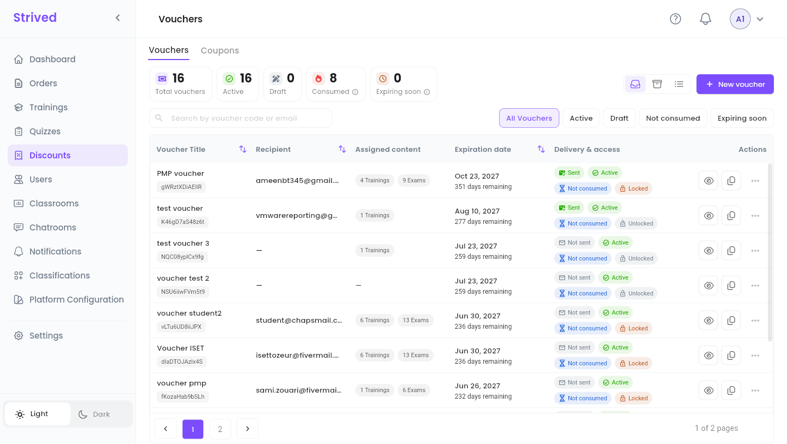
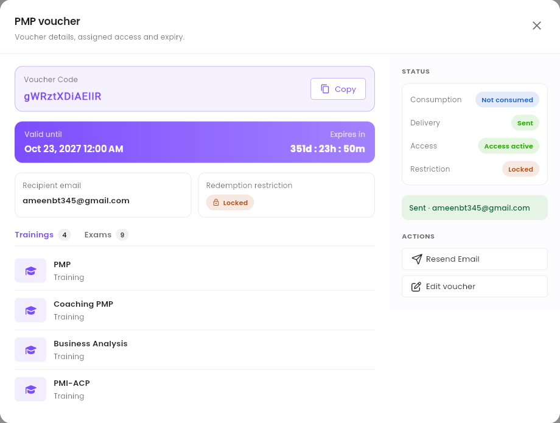
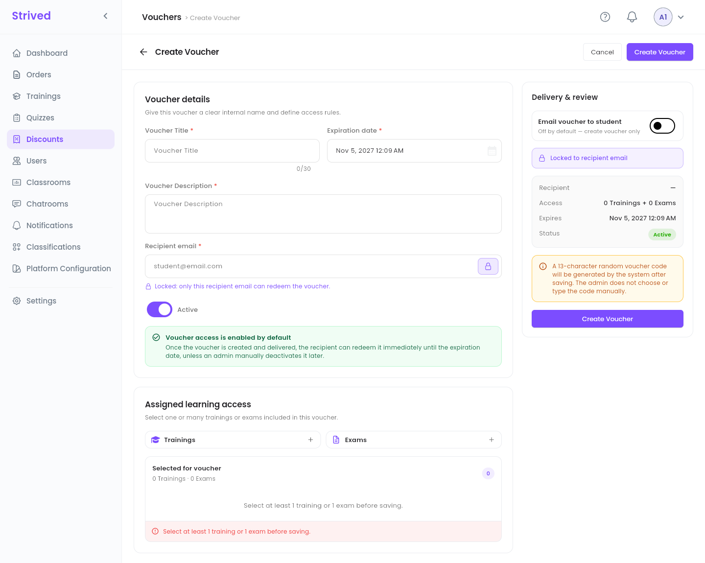
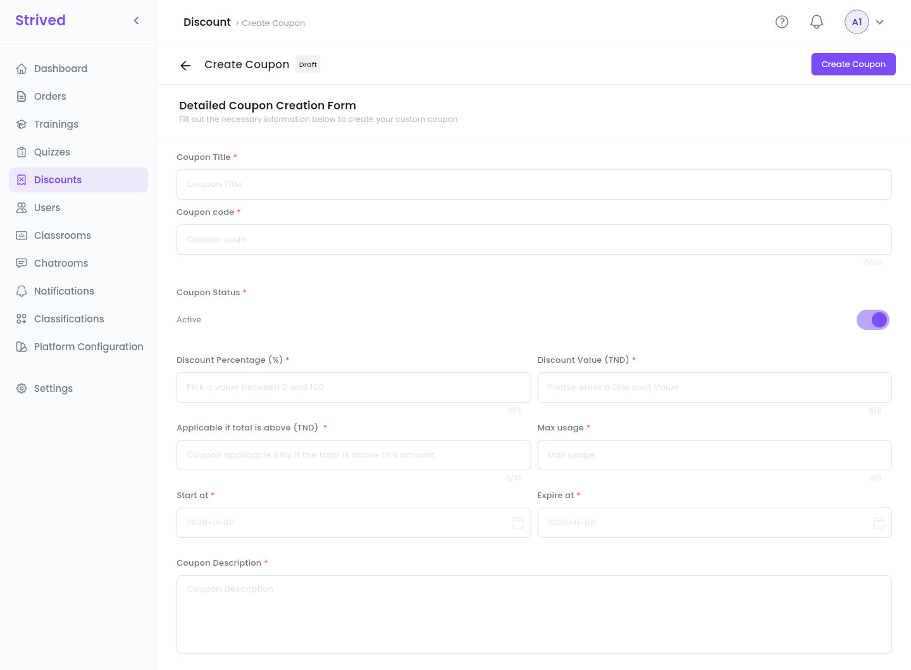

**Discounts** in the sidebar holds two different tools:

| | **Voucher** | **Coupon** |
| :-- | :-- | :-- |
| What it does | Unlocks a set of trainings and exams **for free**. | Takes a **discount** off the cart total. |
| How the learner gets it | By **e-mail**, with a code generated by the platform. | You share the code; the learner types it in the cart. |
| Where the learner uses it | **Apply voucher** on their dashboard. | **Promotions** in the cart, before ordering. |
| Who can use it | One recipient (when it is locked to their e-mail). | Anyone, up to the **Max usage**. |

<Note>
  Everything below is for the **web app** on a computer, signed in as an **Admin**. The learner's
  side is explained in the student guides
  [Use a voucher](/student-guide/use-a-voucher) and [Buy a training or an exam](/student-guide/buy-a-training).
</Note>

---

## Table of contents

- **Step 1 — Open the vouchers**
- **Step 2 — Check a voucher**
- **Step 3 — Create a voucher**
- **Step 4 — Send, update or archive a voucher**
- **Step 5 — Create a coupon**
- **Good to know**

---

## Step 1 — Open the vouchers

Click **Discounts** in the sidebar. The **Vouchers** tab opens first.

<Frame caption="Discounts → Vouchers.">
  
</Frame>

**The counters** at the top: **Total vouchers**, **Active**, **Draft**, **Consumed** (every
voucher already used, archived ones included) and **Expiring soon** (vouchers that expire within the
next 7 days).

**The filters**: search by voucher code or e-mail, or click **All Vouchers**, **Active**,
**Draft**, **Not consumed** or **Expiring soon**.

| Column | What it shows |
| :-- | :-- |
| **Voucher Title** | Its internal name, with the code underneath. |
| **Recipient** | The e-mail it was made for (`—` when there is none). |
| **Assigned content** | How many trainings and exams it unlocks. |
| **Expiration date** | When it stops working, and how many days remain. |
| **Delivery & access** | **Sent** / **Not sent** (e-mail), **Active** / **Draft** (can it be redeemed?), **Not consumed** / **Consumed**, **Locked** / **Unlocked** (see Step 3). |
| **Actions** | The eye opens the voucher (Step 2), the copy icon copies its code, **⋯** opens the other actions. |

---

## Step 2 — Check a voucher

Click the eye on a row.

<Frame caption="A voucher's details.">
  
</Frame>

You find the **Voucher Code** (with **Copy**), the date it is **Valid until** and a countdown, the
**Recipient email**, the **Redemption restriction**, and the **Trainings** and **Exams** it
unlocks. The **Status** panel sums up **Consumption**, **Delivery**, **Access** and
**Restriction**. **Resend Email** sends the voucher to the recipient again, **Edit voucher** opens
it for changes.

---

## Step 3 — Create a voucher

Click **New voucher** at the top right.

<Frame caption="Create Voucher.">
  
</Frame>

<Steps>
  <Step title="Voucher details">
    Give the voucher a **Voucher Title** (an internal name, 30 characters at most), an **Expiration
    date** and a **Voucher Description**.
  </Step>
  <Step title="The recipient">
    Type the **Recipient email**. With the padlock on (the default), the voucher is **locked**:
    *"only this recipient email can redeem the voucher."* Click the padlock to unlock it.
  </Step>
  <Step title="Active or not">
    **Active** is on by default: the recipient can redeem the voucher as soon as they get it, until
    the expiration date. Turn it off to create it as a draft.
  </Step>
  <Step title="Assigned learning access">
    Click **+** next to **Trainings** and next to **Exams** to pick what the voucher unlocks. You
    need at least one training or one exam.
  </Step>
  <Step title="Delivery">
    In **Delivery & review**, turn on **Email voucher to student** to e-mail it right away. It is off
    by default: the voucher is only created.
  </Step>
  <Step title="Create">
    Check the summary (**Recipient**, **Access**, **Expires**, **Status**) and click **Create
    Voucher**.
  </Step>
</Steps>

<Note>
  You do not choose the code: the platform generates a random 13-character code when you save.
</Note>

---

## Step 4 — Send, update or archive a voucher

The **⋯** menu of a row offers:

| Action | What it does |
| :-- | :-- |
| **Preview** | Opens the voucher's details (Step 2). |
| **Update** | Changes its title, dates, recipient, access or content. |
| **Send email** | E-mails the voucher to its recipient. **Delivery** turns **Sent**. |
| **Archive** | Removes it from the list. Find it with the **Archived** icon, and **Restore** it from there. |

---

## Step 5 — Create a coupon

Open the **Coupons** tab and click **Add Coupon**.

<Frame caption="Create Coupon.">
  
</Frame>

<Steps>
  <Step title="Name the coupon">
    **Coupon Title**, and the **Coupon code** learners will type (50 characters at most).
  </Step>
  <Step title="Status">
    **Coupon Status**: **Active** lets learners use it right away.
  </Step>
  <Step title="The discount">
    Fill in **either** a **Discount Percentage (%)** (between 0 and 100) **or** a **Discount Value
    (TND)**. As soon as you type in one, the other is disabled.
  </Step>
  <Step title="The conditions">
    **Applicable if total is above (TND)**: the minimum cart total. **Max usage**: how many times the
    coupon can be used in all. **Start at** / **Expire at**: when it works.
  </Step>
  <Step title="Create">
    Add a **Coupon Description** and click **Create Coupon**.
  </Step>
</Steps>

Give the code to your learners. They type it in the cart, under **Promotions**, then **Apply**.

---

## Good to know

<AccordionGroup>
  <Accordion title="The learner says the voucher does not work">
    Open it (Step 2) and check: is it **Active**, not expired, not **Consumed** already? If it is
    **Locked**, the learner must be signed in with the **Recipient email**. The learner sees the
    reason in the app, e.g. *"Voucher has expired."* or *"Voucher has already been used."*
  </Accordion>
  <Accordion title="The voucher e-mail did not arrive">
    Ask the learner to check their spam folder, then use **Resend Email** (or **⋯ → Send email**).
    You can also copy the code with the copy icon and send it yourself.
  </Accordion>
  <Accordion title="Voucher or Assign learners?">
    Both give content for free. **Assign learners** (on a training or an exam) acts at once on
    accounts that already exist. A **voucher** bundles several trainings and exams and travels by
    e-mail, so the recipient redeems it whenever they are ready.
  </Accordion>
</AccordionGroup>
