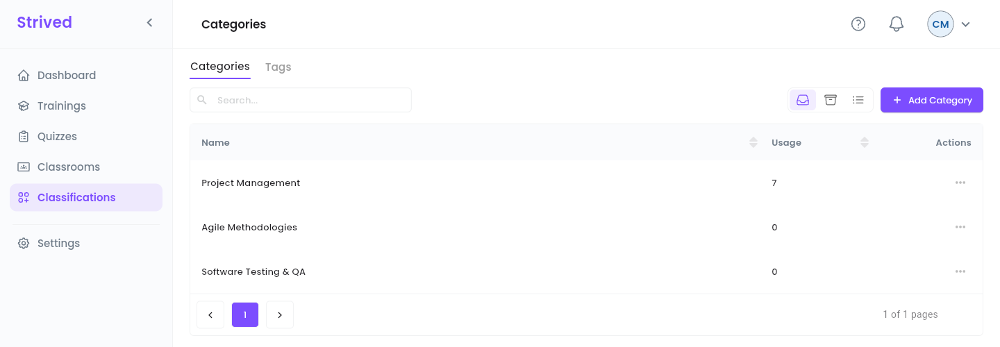
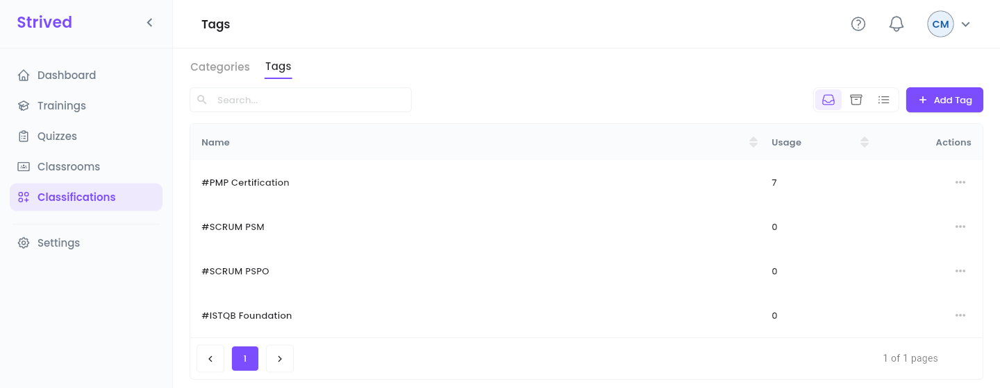

**Categories** and **tags** organize the catalog: every training needs at least one of each, and
every exam needs a category. Learners use them to browse and filter the Marketplace.

| | **Category** | **Tag** |
| :-- | :-- | :-- |
| What it is | A broad subject area, e.g. *Project Management*. | A precise keyword, e.g. *#PMP Certification*. |
| Used by | Trainings and exams. | Trainings. |

<Note>
  Everything below is for the **web app** on a computer, signed in as a **Content Manager**.
</Note>

---

## Table of contents

- **Step 1 — Open the categories**
- **Step 2 — Add or rename a category**
- **Step 3 — Manage the tags**
- **Good to know**

---

## Step 1 — Open the categories

Click **Classifications** in the sidebar. The **Categories** tab opens first.

<Frame caption="Classifications → Categories.">
  
</Frame>

Each row shows the category's **Name** and its **Usage**: how many items are classified under it.

---

## Step 2 — Add or rename a category

<Steps>
  <Step title="Add">
    Click **Add Category**, type the **Category name**, then **Confirm**. The category is available
    at once in the training and exam editors.
  </Step>
  <Step title="Rename">
    Open **⋯ → Update** on the row and change the name. Every training and exam that uses it shows
    the new name.
  </Step>
</Steps>

---

## Step 3 — Manage the tags

Open the **Tags** tab. It works the same way: **Add Tag**, and **⋯ → Update** to rename. Tags are
shown with a `#` in front of their name.

<Frame caption="Classifications → Tags.">
  
</Frame>

---

## Good to know

<AccordionGroup>
  <Accordion title="How do I remove a category or a tag?">
    Archiving is reserved to admins. Ask an admin, after moving the trainings and exams that use it
    to another category.
  </Accordion>
  <Accordion title="Where are they used?">
    In the training editor (**Basic Info → Identity**: **Training Categories**, **Training Tags**)
    and the exam editor (**Exam Category**).
  </Accordion>
</AccordionGroup>
