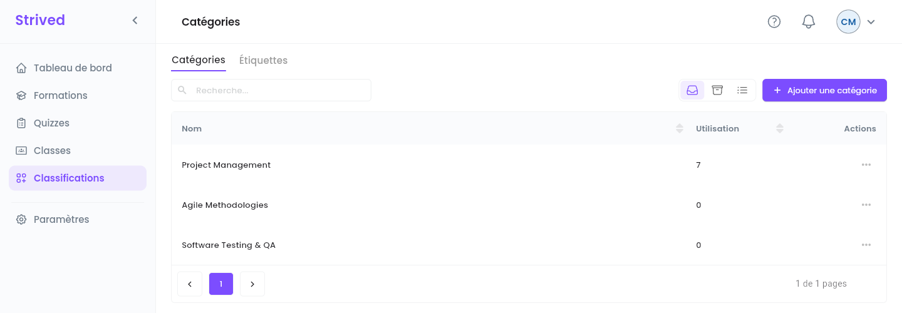
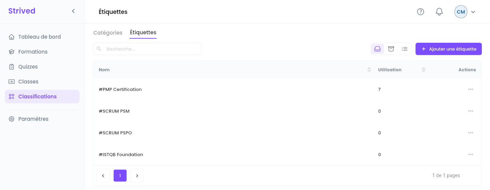

Les **catégories** et les **étiquettes** (tags) organisent le catalogue : chaque formation a besoin
d'au moins une de chaque, et chaque examen d'une catégorie. Les apprenants s'en servent pour
parcourir et filtrer la Marketplace.

| | **Catégorie** | **Étiquette** |
| :-- | :-- | :-- |
| Ce que c'est | Un grand domaine, par exemple *Project Management*. | Un mot-clé précis, par exemple *#PMP Certification*. |
| Utilisée par | Les formations et les examens. | Les formations. |

<Note>
  Tout ce qui suit concerne l'**application web** sur ordinateur, avec un compte **Gestionnaire de
  contenu**.
</Note>

---

## Sommaire

- **Étape 1 — Ouvrir les catégories**
- **Étape 2 — Ajouter ou renommer une catégorie**
- **Étape 3 — Gérer les étiquettes**
- **Bon à savoir**

---

## Étape 1 — Ouvrir les catégories

Cliquez sur **Classifications** dans la barre latérale. L'onglet **Catégories** s'ouvre en premier.

<Frame caption="Classifications → Catégories.">
  
</Frame>

Chaque ligne affiche le **Nom** de la catégorie et son **Utilisation** : le nombre d'éléments
classés sous cette catégorie.

---

## Étape 2 — Ajouter ou renommer une catégorie

<Steps>
  <Step title="Ajoutez">
    Cliquez sur **Ajouter une catégorie**, saisissez le **Nom de la catégorie**, puis cliquez sur
    **Confirmer**. La catégorie est aussitôt disponible dans les éditeurs de formations et
    d'examens.
  </Step>
  <Step title="Renommez">
    Ouvrez **⋯ → Modifier** sur la ligne et changez le nom. Toutes les formations et tous les
    examens qui l'utilisent affichent le nouveau nom.
  </Step>
</Steps>

---

## Étape 3 — Gérer les étiquettes

Ouvrez l'onglet **Étiquettes**. Il fonctionne de la même façon : **Ajouter une étiquette**, et
**⋯ → Modifier** pour renommer. Les étiquettes s'affichent avec un `#` devant leur nom.

<Frame caption="Classifications → Étiquettes.">
  
</Frame>

---

## Bon à savoir

<AccordionGroup>
  <Accordion title="Comment supprimer une catégorie ou une étiquette ?">
    L'archivage est réservé aux admins. Demandez à un admin, après avoir déplacé vers une autre
    catégorie les formations et les examens qui l'utilisent.
  </Accordion>
  <Accordion title="Où sont-elles utilisées ?">
    Dans l'éditeur de formation (**Détails → Identité** : **Catégorie de formation**, **Étiquettes
    de formation**) et dans l'éditeur d'examen (**Catégorie d'examen**).
  </Accordion>
</AccordionGroup>
