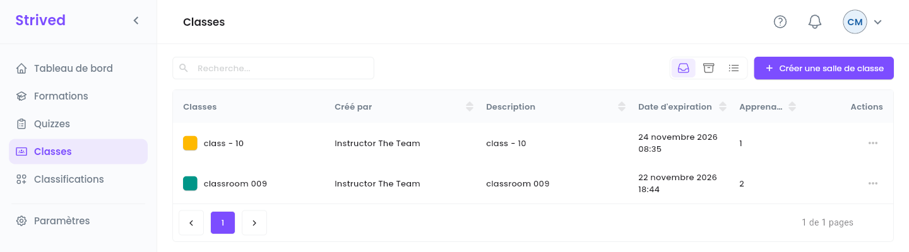
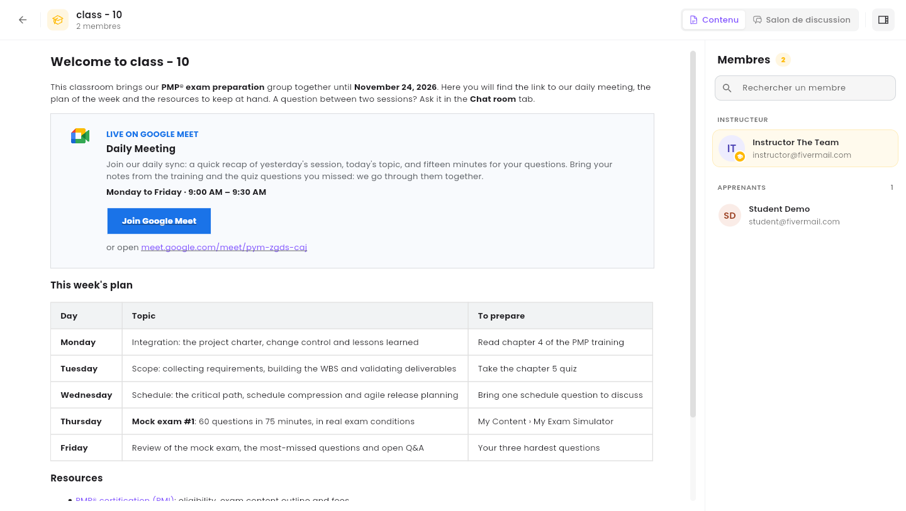

Une **classe** réunit un groupe d'apprenants et un formateur, pour une période donnée, autour d'une
page de contenu et d'une discussion de groupe facultative. En tant que gestionnaire de contenu, vous
pouvez consulter toutes les classes et modifier leurs informations et leur contenu.

<Note>
  Tout ce qui suit concerne l'**application web** sur ordinateur, avec un compte **Gestionnaire de
  contenu**.
</Note>

---

## Sommaire

- **Étape 1 — Ouvrir les classes**
- **Étape 2 — Prévisualiser une classe**
- **Étape 3 — Modifier une classe**
- **Bon à savoir**

---

## Étape 1 — Ouvrir les classes

Cliquez sur **Classes** dans la barre latérale.

<Frame caption="Classes.">
  
</Frame>

Chaque ligne affiche la couleur et le nom de la classe, son formateur (**Créé par**), la
**Description**, la **Date d'expiration** et le nombre d'**Apprenants**. **⋯** propose
**Visualiser** et **Modifier**.

---

## Étape 2 — Prévisualiser une classe

**⋯ → Visualiser** ouvre la classe telle que la voient ses membres.

<Frame caption="L'aperçu d'une classe.">
  
</Frame>

- **Contenu** / **Salon de discussion**, en haut à droite, passent de la page de contenu à la
  discussion de groupe.
- Le panneau **Membres** liste l'**Instructeur** et les **Apprenants**, avec **Rechercher un
  membre**. L'icône tout en haut à droite le masque ou l'affiche.

---

## Étape 3 — Modifier une classe

**⋯ → Modifier** ouvre l'éditeur de classe, avec trois onglets :

| Onglet | Ce que vous modifiez |
| :-- | :-- |
| **Détails** | **Titre de la salle de classe**, **Description de la salle de classe**, **Couleur du thème de la salle de classe**, **Date d'expiration** et **Apprenants**. |
| **Salon de discussion** | Le résumé de la discussion de groupe de la classe, et **Créer le salon** si elle n'en a pas encore. |
| **Contenu** | La page de la classe, dans un éditeur de texte enrichi : planning, consignes, ressources. |

Passez d'un onglet à l'autre avec **Page suivante** / **Précédent**, puis cliquez sur
**Enregistrer** sur le dernier.

<Warning>
  **Créer une salle de classe** ne fonctionne pas encore pour les gestionnaires de contenu : le
  formulaire n'a pas de champ **Instructeur**, et **Enregistrer et continuer** répond *« Une erreur
  s'est produite — Something went wrong »*. Rien n'est créé. En attendant le correctif, demandez à
  un admin (ou au formateur) de créer la classe, puis modifiez-la ici.
</Warning>

---

## Bon à savoir

<AccordionGroup>
  <Accordion title="Puis-je lire ou modérer les salons de discussion ?">
    La vue **Salon de discussion** de l'aperçu affiche la discussion de la classe. La modération
    (empêcher les apprenants d'écrire, effacer l'historique ou supprimer un salon) est faite par le
    formateur ou un admin, depuis **Salons de discussion**.
  </Accordion>
  <Accordion title="Puis-je archiver une classe ?">
    Non, l'archivage est réservé aux admins.
  </Accordion>
</AccordionGroup>
