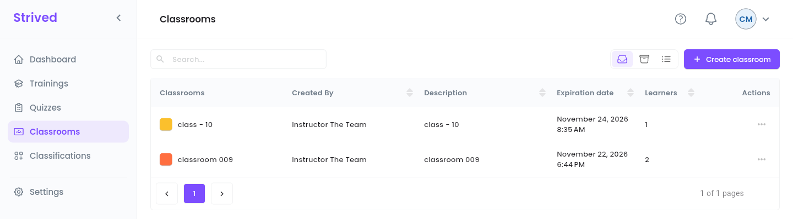
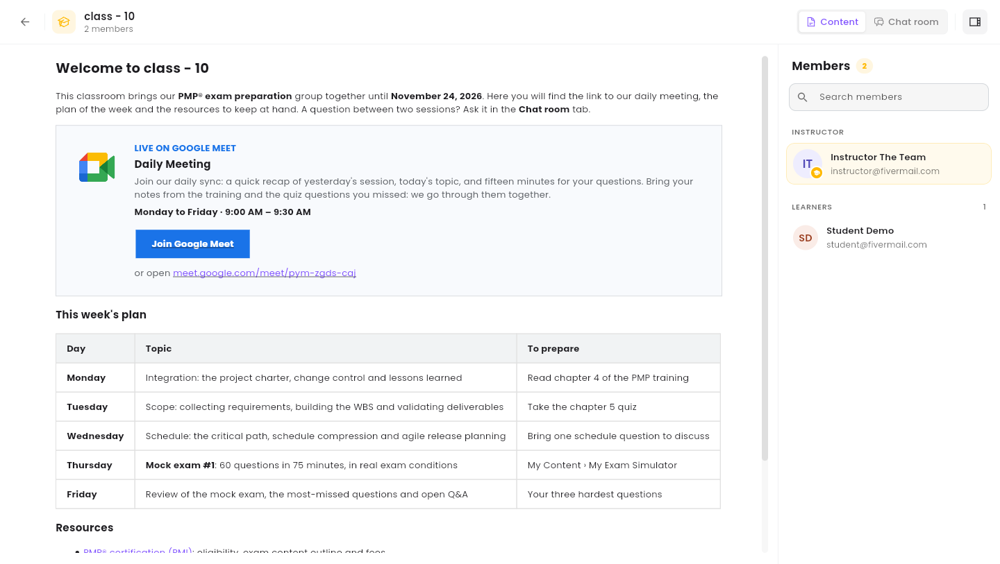

A **classroom** brings a group of learners together with an instructor, for a set period, around a
content page and an optional group chat. As a content manager you can look at every classroom and
update its details and content.

<Note>
  Everything below is for the **web app** on a computer, signed in as a **Content Manager**.
</Note>

---

## Table of contents

- **Step 1 — Open the classrooms**
- **Step 2 — Preview a classroom**
- **Step 3 — Update a classroom**
- **Good to know**

---

## Step 1 — Open the classrooms

Click **Classrooms** in the sidebar.

<Frame caption="Classrooms.">
  
</Frame>

Each row shows the classroom's color and name, its instructor (**Created By**), the
**Description**, the **Expiration date** and the number of **Learners**. **⋯** offers **Preview**
and **Update**.

---

## Step 2 — Preview a classroom

**⋯ → Preview** opens the classroom as its members see it.

<Frame caption="Previewing a classroom.">
  
</Frame>

- **Content** / **Chat room** at the top right switch between the content page and the group chat.
- The **Members** panel lists the **Instructor** and the **Learners**, with **Search members**. The
  icon at the far top right hides or shows it.

---

## Step 3 — Update a classroom

**⋯ → Update** opens the classroom editor, with three tabs:

| Tab | What you change |
| :-- | :-- |
| **Basic Info** | **Classroom Title**, **Classroom Description**, **Classroom Theme Color**, **Expiration date** and **Learners**. |
| **Chatroom** | The summary of the classroom's group chat, and **Create chatroom** if it has none yet. |
| **Content** | The classroom page, in a rich-text editor: schedule, instructions, resources. |

Move between the tabs with **Next page** / **Previous**, then click **Save** on the last one.

<Warning>
  **Create classroom** does not work for content managers yet: the form has no **Instructor** field,
  and **Save & next** answers *"An Error Has Occurred — Something went wrong"*. Nothing is created.
  Until it is fixed, ask an admin (or the instructor) to create the classroom, then update it here.
</Warning>

---

## Good to know

<AccordionGroup>
  <Accordion title="Can I read or moderate the chatrooms?">
    The **Chat room** view of the preview shows the classroom's chat. Moderation (stopping learners
    from writing, wiping or deleting a chatroom) is done by the instructor or an admin from
    **Chatrooms**.
  </Accordion>
  <Accordion title="Can I archive a classroom?">
    No, archiving is reserved to admins.
  </Accordion>
</AccordionGroup>
