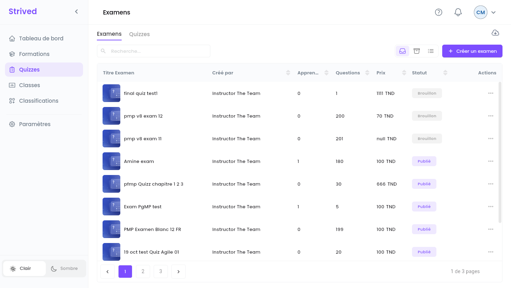
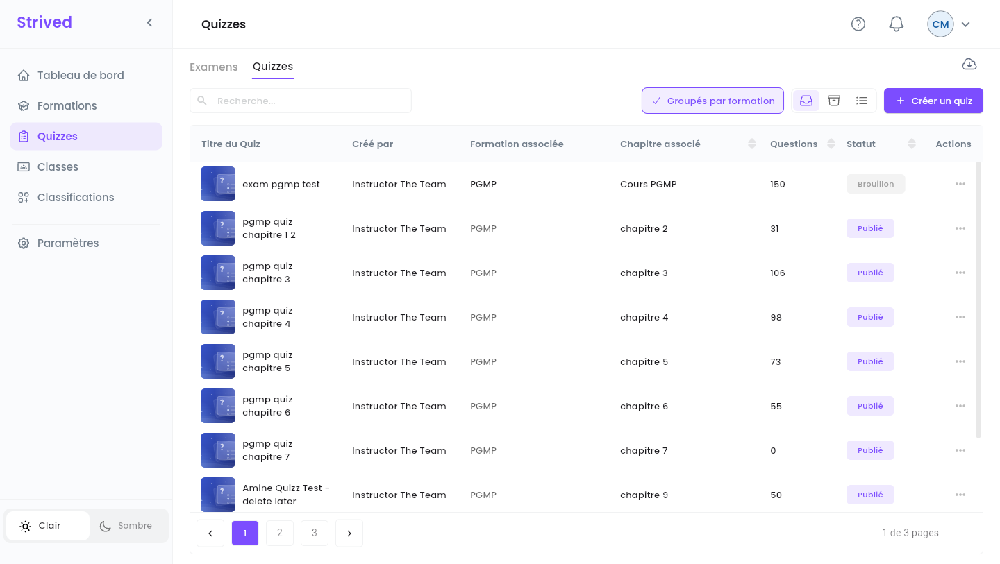
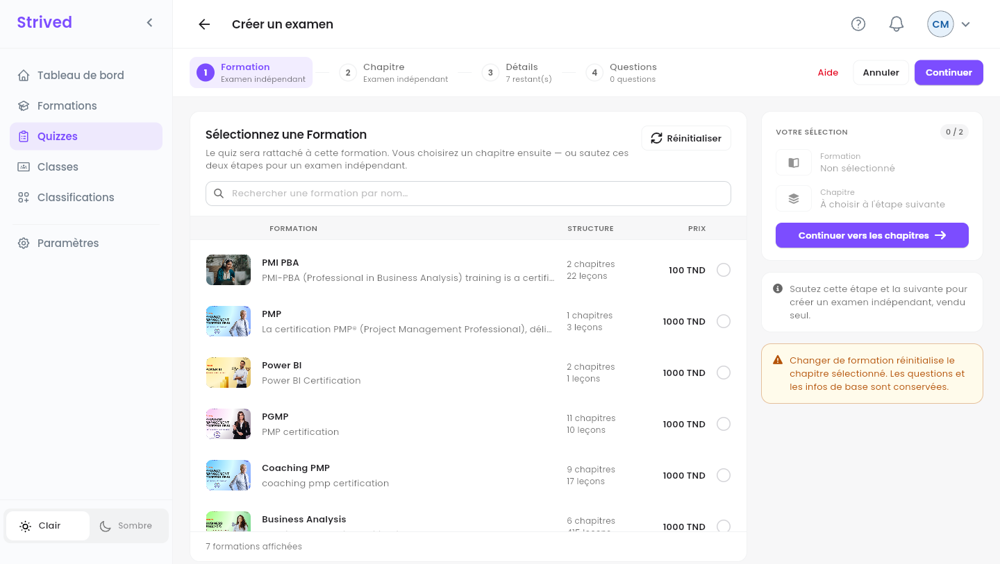
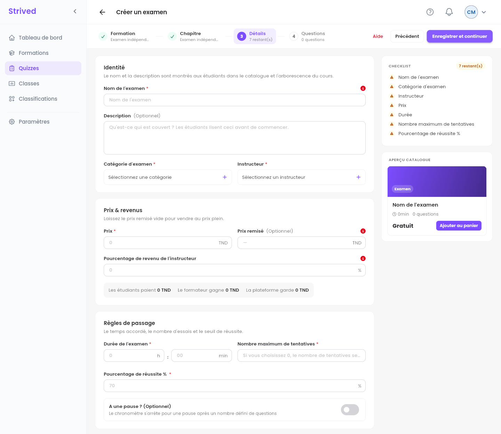
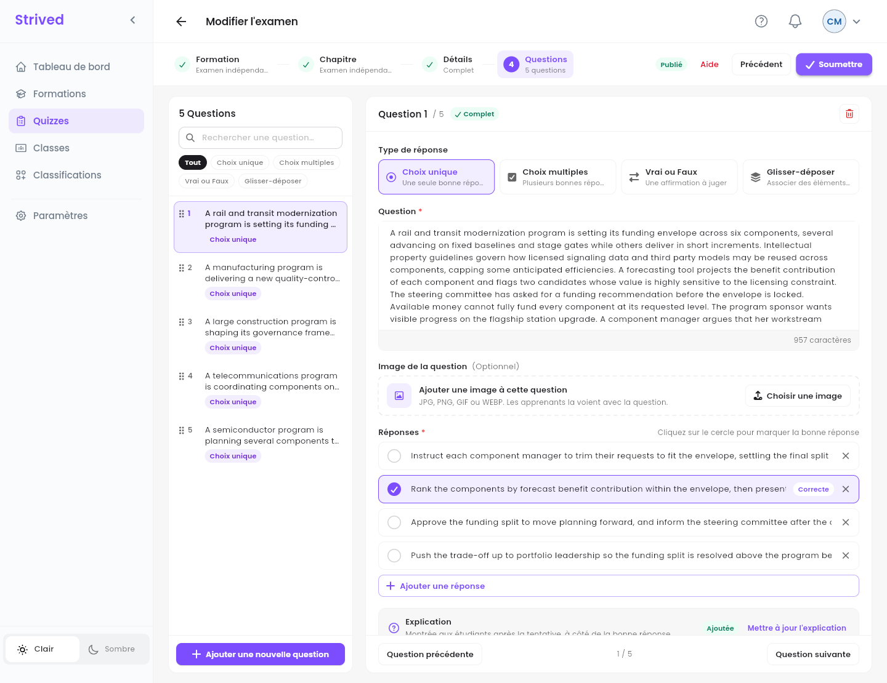
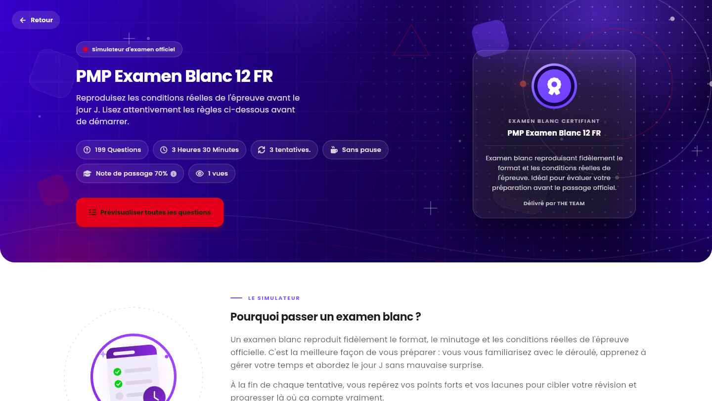

**Quizzes**, dans la barre latérale, regroupe deux sortes de tests, construits avec le même
éditeur :

| | **Examen** | **Quiz** |
| :-- | :-- | :-- |
| Ce que c'est | Un examen blanc indépendant, vendu seul dans le **Catalogue des examens**. | Un test à l'intérieur d'une formation, placé dans l'un de ses chapitres. |
| Les apprenants le trouvent dans | **Mon contenu → Mon simulateur d'examens**. | Le panneau **Contenu du cours** de la formation. |
| A son propre prix | Oui. | Non : il est fourni avec la formation. |

<Note>
  Tout ce qui suit concerne l'**application web** sur ordinateur, avec un compte **Gestionnaire de
  contenu**.
</Note>

---

## Sommaire

- **Étape 1 — Ouvrir les examens et les quiz**
- **Étape 2 — Formation et Chapitre**
- **Étape 3 — Détails**
- **Étape 4 — Rédiger les questions**
- **Étape 5 — Vérifier et publier**
- **Bon à savoir**

---

## Étape 1 — Ouvrir les examens et les quiz

Cliquez sur **Quizzes** dans la barre latérale. Deux onglets se trouvent en haut : **Examens** et
**Quizzes**.

<Frame caption="L'onglet Examens.">
  
</Frame>

<Frame caption="L'onglet Quizzes, groupé par formation.">
  
</Frame>

Chaque ligne affiche le formateur (**Créé par**), les **Apprenants**, le nombre de **Questions**, le
**Prix** (examens) ou la **Formation associée** et le **Chapitre associé** (quiz), et le **Statut**.
Le menu **⋯** propose **Visualiser**, **Brouillon** / **Publier**, **Modifier** et **Importer des
questions** (depuis un fichier JSON). L'icône de nuage en haut à droite exporte des examens ou des
quiz en sauvegarde.

---

## Étape 2 — Formation et Chapitre

Cliquez sur **Créer un examen** (dans l'onglet **Examens**) ou sur **Créer un quiz** (dans l'onglet
**Quizzes**). L'éditeur a quatre étapes : **Formation**, **Chapitre**, **Détails** et
**Questions**.

<Frame caption="Étape 1 : choisissez une formation, ou passez cette étape pour un examen indépendant.">
  
</Frame>

- **Pour un quiz** : cochez la formation, cliquez sur **Continuer vers les chapitres**, puis
  choisissez le chapitre.
- **Pour un examen** : ne choisissez rien et cliquez deux fois sur **Continuer**. Les étapes
  affichent **Examen indépendant**.

---

## Étape 3 — Détails

<Frame caption="Étape 3 : Détails.">
  
</Frame>

| Section | Champs |
| :-- | :-- |
| **Identité** | **Nom de l'examen**, **Description** (facultative), **Catégorie d'examen** et **Instructeur**. |
| **Prix & revenus** | **Prix**, **Prix remisé** facultatif, **Pourcentage de revenu de l'instructeur**. |
| **Règles de passage** | **Durée de l'examen**, **Nombre maximum de tentatives** (0 signifie illimité), **Pourcentage de réussite %** (70 par défaut) et **A une pause ? (Optionnel)** (une pause, chronomètre arrêté, après un nombre défini de questions). |

Cliquez sur **Enregistrer et continuer** : l'examen est créé **en brouillon** et l'étape
**Questions** s'ouvre.

---

## Étape 4 — Rédiger les questions

<Frame caption="Étape 4 : Questions.">
  
</Frame>

<Steps>
  <Step title="Ajoutez une question">
    **Ajouter une nouvelle question**, en bas de la liste.
  </Step>
  <Step title="Type de réponse">
    **Choix unique**, **Choix multiples**, **Vrai ou Faux** ou **Glisser-déposer**.
  </Step>
  <Step title="Question et réponses">
    Saisissez la **Question** (une **Image de la question** facultative peut l'accompagner),
    saisissez les réponses et cliquez sur le rond devant la bonne : elle affiche **Correcte**.
  </Step>
  <Step title="Explication">
    Montrée aux apprenants après leur tentative, à côté de la bonne réponse.
  </Step>
  <Step title="Soumettez">
    Quand toutes les questions sont complètes, cliquez sur **Soumettre**.
  </Step>
</Steps>

La liste de gauche filtre les questions par type, les recherche et les réordonne par
glisser-déposer. Une question incomplète est signalée, et l'éditeur refuse de soumettre tant
qu'elle n'est pas corrigée.

---

## Étape 5 — Vérifier et publier

**⋯ → Visualiser** ouvre la page de l'examen telle que la voient les apprenants. **Prévisualiser
toutes les questions** parcourt chaque question avec sa bonne réponse et son explication, sans rien
enregistrer.

<Frame caption="L'aperçu d'un examen.">
  
</Frame>

Quand il est prêt, ouvrez **⋯** sur sa ligne et cliquez sur **Publier** : l'examen apparaît dans le
**Catalogue des examens** (un quiz apparaît dans le chapitre de sa formation). **Brouillon** le
masque de nouveau.

<Tip>
  Avant de publier un examen, vérifiez son prix, sa durée et ses tentatives, et que chaque question
  a une bonne réponse et une explication.
</Tip>

---

## Bon à savoir

<AccordionGroup>
  <Accordion title="Puis-je donner un examen à un apprenant ?">
    Non, attribuer des examens à des apprenants revient aux admins.
  </Accordion>
  <Accordion title="Puis-je archiver un examen ?">
    Non, l'archivage est réservé aux admins. Utilisez **Brouillon** pour le retirer du catalogue.
  </Accordion>
</AccordionGroup>
