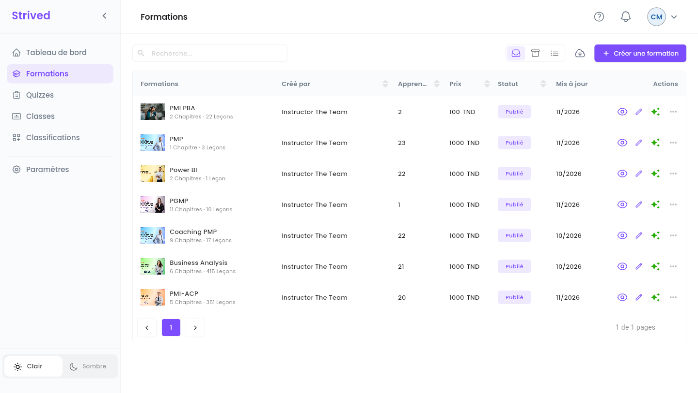
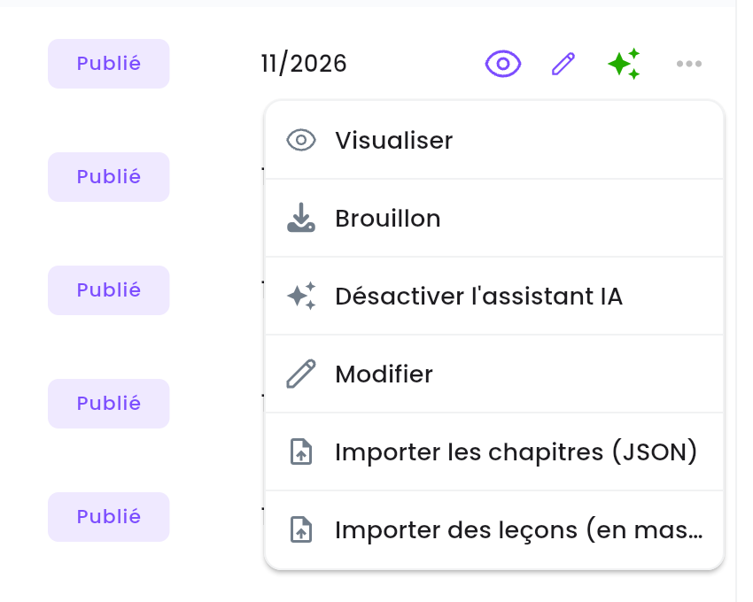
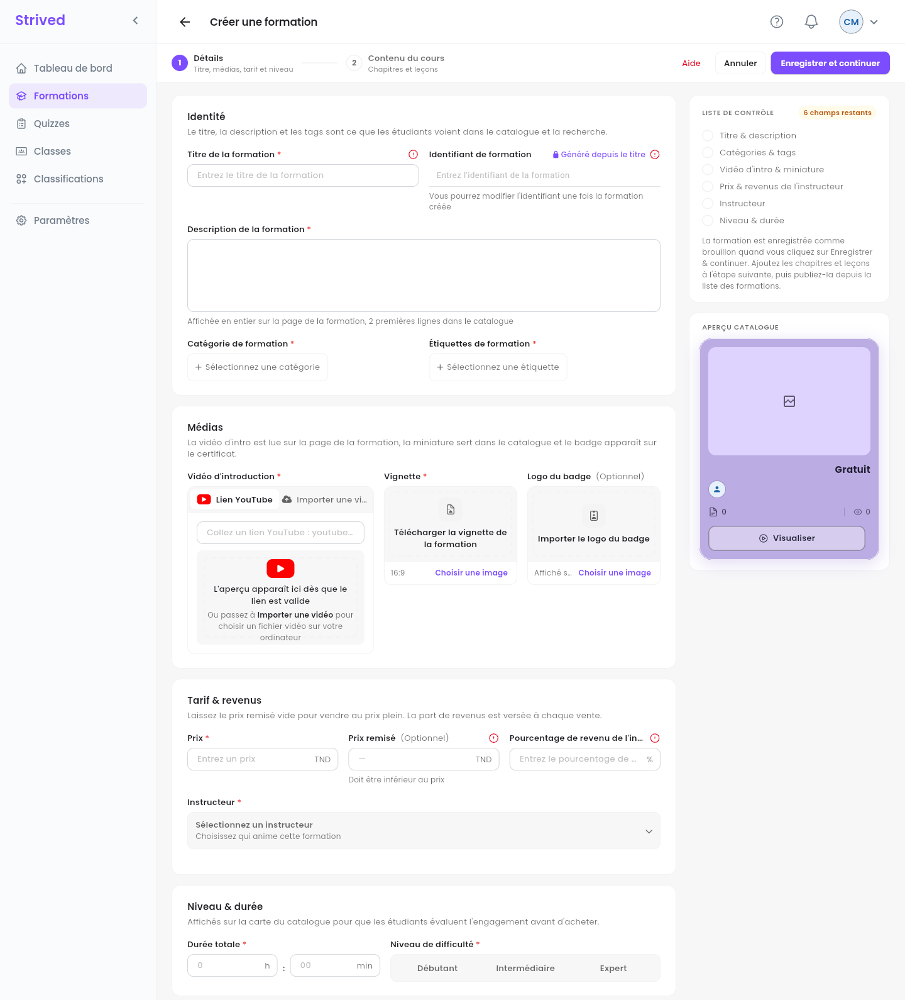
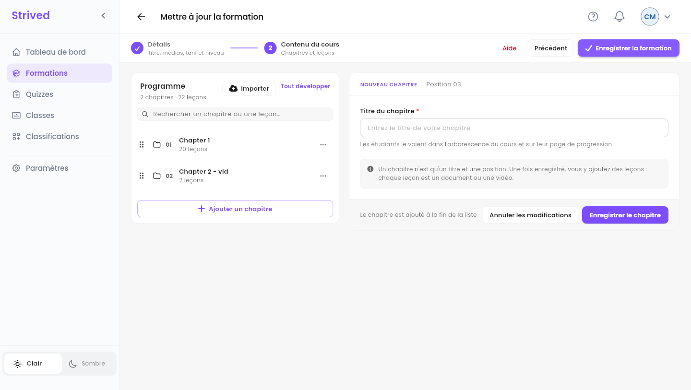
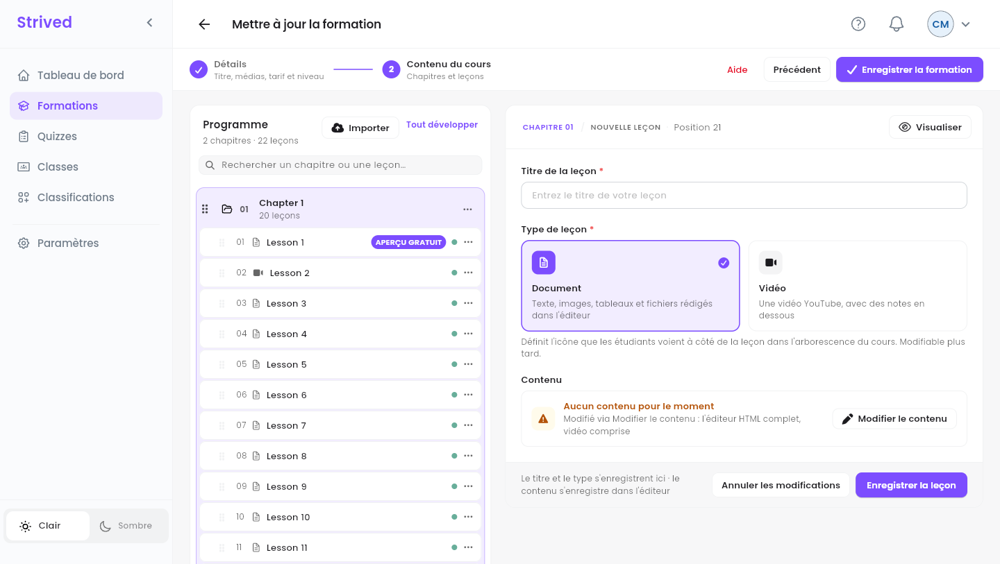

En tant que gestionnaire de contenu, vous pouvez créer une formation pour n'importe quel formateur,
vérifier et modifier celles qu'ils rédigent, et décider du moment où elles apparaissent dans le
catalogue.

<Note>
  Tout ce qui suit concerne l'**application web** sur ordinateur, avec un compte **Gestionnaire de
  contenu**.
</Note>

---

## Sommaire

- **Étape 1 — Ouvrir les formations**
- **Étape 2 — Créer une formation : Détails**
- **Étape 3 — Construire le contenu du cours**
- **Étape 4 — Rédiger une leçon**
- **Étape 5 — Vérifier et publier**
- **Étape 6 — Exporter et importer**
- **Bon à savoir**

---

## Étape 1 — Ouvrir les formations

Cliquez sur **Formations** dans la barre latérale.

<Frame caption="Formations.">
  
</Frame>

Chaque ligne affiche la formation, son formateur (**Créé par**), ses **Apprenants**, son **Prix**,
son **Statut** (**Publié** ou **Brouillon**) et le mois de sa dernière modification (**Mis à
jour**). Les icônes au bout d'une ligne sont des raccourcis : l'œil (**Visualiser**) et le crayon
(**Modifier**) ; les étincelles sont vertes quand l'**Assistant IA** est activé. **⋯** ouvre toutes
les actions :

<Frame caption="Le menu ⋯ d'une formation.">
  
</Frame>

| Action | Ce qu'elle fait |
| :-- | :-- |
| **Visualiser** | Ouvre la formation telle que la voient les apprenants (Étape 5). |
| **Brouillon** / **Publier** | Masque la formation du catalogue, ou la publie (Étape 5). |
| **Désactiver l'assistant IA** / **Activer l'assistant IA** | Désactive ou active l'assistant IA du lecteur de cours pour cette formation. |
| **Modifier** | Ouvre l'éditeur de formation (Étapes 2 à 4). |
| **Importer les chapitres (JSON)** / **Importer des leçons (en masse)** | Ajoute du contenu à partir de fichiers (Étape 6). |

Les icônes **Actif** / **Archivé** / **Tous les éléments**, en haut à droite, filtrent la liste.
L'archivage lui-même est fait par un admin.

---

## Étape 2 — Créer une formation : Détails

Cliquez sur **Créer une formation** en haut à droite. L'éditeur a deux étapes : **1 Détails** et
**2 Contenu du cours**.

<Frame caption="Créer une formation → Détails.">
  
</Frame>

<Steps>
  <Step title="Identité">
    **Titre de la formation**, **Description de la formation**, **Catégorie de formation** et
    **Étiquettes de formation**. L'**Identifiant de formation** est **Généré depuis le titre**.
  </Step>
  <Step title="Médias">
    **Vidéo d'introduction** (un **Lien YouTube** ou **Importer une vidéo**), la **Vignette** 16:9,
    et un **Logo du badge** facultatif, affiché sur le certificat des apprenants.
  </Step>
  <Step title="Tarif & revenus">
    **Prix**, **Prix remisé** facultatif (inférieur au prix), et le **Pourcentage de revenu de
    l'instructeur** : la part du formateur sur chaque vente.
  </Step>
  <Step title="Instructeur">
    **Sélectionnez un instructeur** : la personne qui anime la formation. Si l'éditeur refuse avec
    *« Revenu manquant pour l'instructeur sélectionné »*, un admin doit d'abord fixer le
    pourcentage de revenu de ce formateur.
  </Step>
  <Step title="Niveau & durée">
    **Durée totale** et **Niveau de difficulté** (**Débutant**, **Intermédiaire** ou **Expert**).
  </Step>
  <Step title="Enregistrer et continuer">
    La formation est enregistrée **en brouillon** et l'étape **Contenu du cours** s'ouvre.
  </Step>
</Steps>

La **Liste de contrôle**, à droite, compte ce qui reste à remplir, et l'**Aperçu catalogue** montre
la carte que verront les apprenants.

<Warning>
  Dès qu'une formation a été vendue, son formateur et son pourcentage de revenu sont verrouillés :
  les changer fausserait les commandes passées. L'éditeur affiche un cadenas.
</Warning>

---

## Étape 3 — Construire le contenu du cours

<Frame caption="Contenu du cours.">
  
</Frame>

<Steps>
  <Step title="Ajoutez un chapitre">
    **Ajouter un chapitre**, saisissez le **Titre du chapitre**, puis **Enregistrer le chapitre**.
  </Step>
  <Step title="Ajoutez des leçons">
    Le menu **⋯** du chapitre propose **Ajouter une leçon**, **Renommer le chapitre** et
    **Supprimer le chapitre**.
  </Step>
  <Step title="Réorganisez">
    Faites glisser les chapitres et les leçons par leur poignée (les six points).
  </Step>
  <Step title="Enregistrez la formation">
    Cliquez sur **Enregistrer la formation** en haut à droite.
  </Step>
</Steps>

---

## Étape 4 — Rédiger une leçon

<Frame caption="Une nouvelle leçon.">
  
</Frame>

Saisissez le **Titre de la leçon**, choisissez **Document** ou **Vidéo** (un lien YouTube ou un
code d'intégration), cliquez sur **Modifier le contenu** pour la rédiger dans l'éditeur complet,
puis sur **Enregistrer la leçon**. Dans le programme, une pastille **verte** signale une leçon qui a
du contenu, une **orange** une leçon encore vide. La première leçon du chapitre 1 est toujours un
**APERÇU GRATUIT** pour les visiteurs.

---

## Étape 5 — Vérifier et publier

Avant de publier, ouvrez la formation avec l'œil (**Visualiser**) et vérifiez-la comme le ferait un
apprenant : titre, vidéo, prix, ce que **Cette formation inclut**, et les leçons.

<Frame caption="L'aperçu d'une formation.">
  
</Frame>

Ouvrez ensuite **⋯** sur sa ligne et cliquez sur **Publier** : le statut passe à **Publié** et la
formation apparaît dans le catalogue. **Brouillon**, dans le même menu, la masque de nouveau, par
exemple pendant qu'elle est retravaillée.

<Tip>
  Liste de vérification : chaque leçon a une pastille verte, la vignette et la vidéo d'introduction
  sont en place, le prix et le formateur sont corrects, et les catégories et les étiquettes aident
  les apprenants à la trouver.
</Tip>

---

## Étape 6 — Exporter et importer

- **Exporter** : l'icône de nuage à côté de **Créer une formation** télécharge une sauvegarde de la
  formation que vous choisissez, sous le nom `<formation>_backup.zip`.
- **Importer les chapitres (JSON)** : ajoute des chapitres depuis des fichiers JSON, par exemple
  l'export d'une autre formation.
- **Importer des leçons (en masse)** : transforme des images en leçons, une image par leçon, dans
  l'ordre des noms de fichier (`01-…`, `02-…`).

---

## Bon à savoir

<AccordionGroup>
  <Accordion title="Un formateur a terminé une formation : que dois-je faire ?">
    Retrouvez-la dans **Formations** (statut **Brouillon**), vérifiez-la avec **Visualiser**,
    corrigez ce qui doit l'être avec **Modifier**, puis **⋯ → Publier**.
  </Accordion>
  <Accordion title="Puis-je donner une formation à un apprenant, ou notifier ses apprenants ?">
    Non, ces actions reviennent aux admins et aux formateurs. Demandez à un admin.
  </Accordion>
</AccordionGroup>
