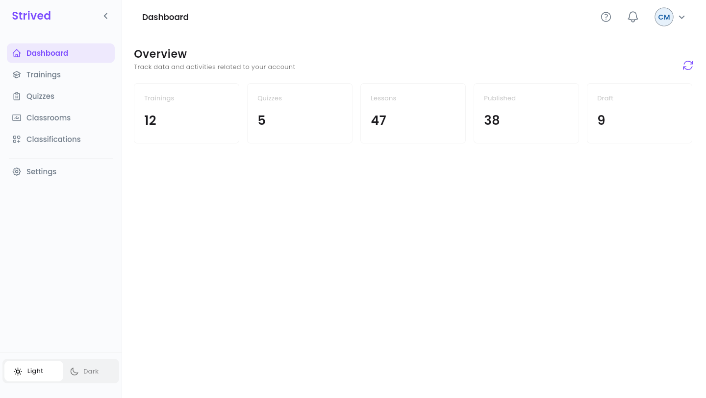
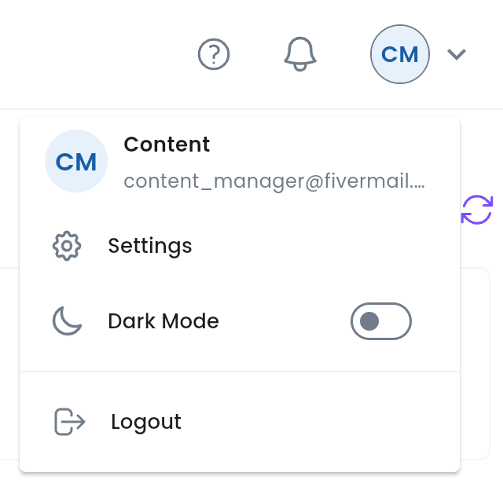
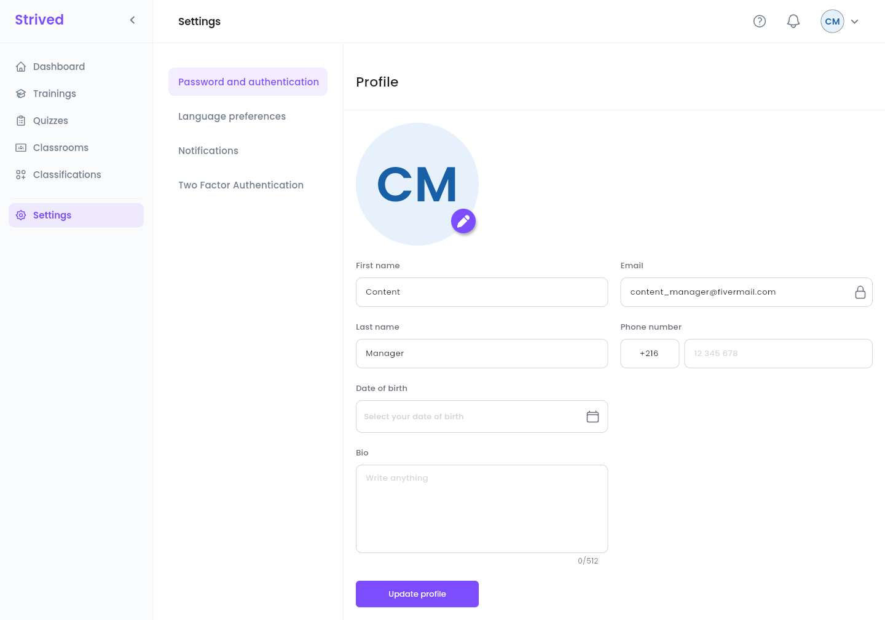
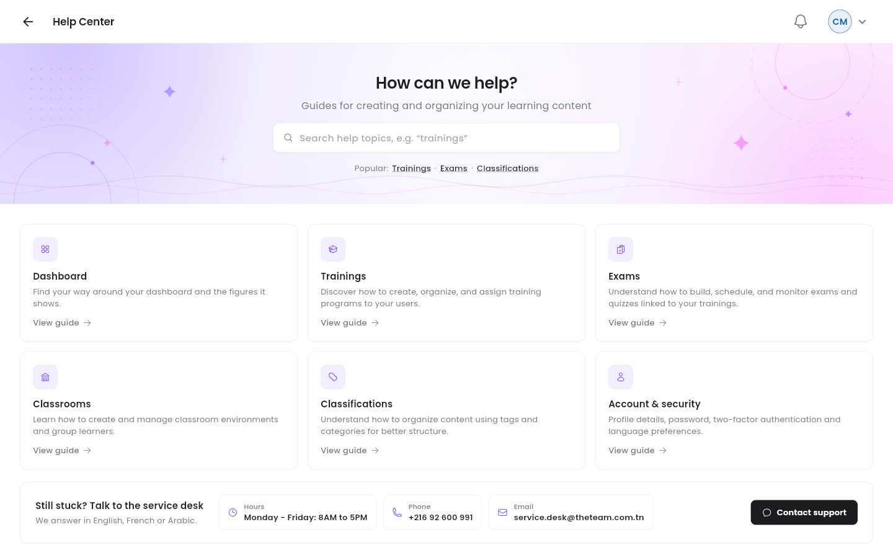

A **content manager** looks after the catalog: trainings, exams, quizzes, classrooms, categories
and tags. This guide shows where each tool lives and how your role fits with the instructors' and
the admins'.

<Note>
  Everything below is for the **web app** on a computer, signed in with a **Content Manager**
  account. The screenshots come from the test platform.
</Note>

---

## Table of contents

- **Step 1 — The sidebar and the top bar**
- **Step 2 — The dashboard**
- **Step 3 — Your profile**
- **Step 4 — Get help**
- **Who does what**
- **Good to know**

---

## Step 1 — The sidebar and the top bar

After you sign in, the platform opens on the **Dashboard**. The sidebar on the left leads to every
tool you have:

<Frame caption="The content manager dashboard, with the sidebar on the left.">
  
</Frame>

| Sidebar item | What you do there | Guide |
| :-- | :-- | :-- |
| **Dashboard** | An overview of the catalog. | This page |
| **Trainings** | Create, update, publish and unpublish trainings; build their chapters and lessons. | [Manage trainings](/content-manager-guide/manage-trainings) |
| **Quizzes** | Create, update, publish and unpublish exams and quizzes; write their questions. | [Manage exams and quizzes](/content-manager-guide/manage-exams-and-quizzes) |
| **Classrooms** | Look at the classrooms, their content and members. | [Classrooms](/content-manager-guide/classrooms) |
| **Classifications** | Add and rename the categories and tags of the catalog. | [Categories and tags](/content-manager-guide/categories-and-tags) |
| **Settings** | Your profile (Step 3). | This page |

At the bottom of the sidebar, **Light** / **Dark** switches the theme, and the **arrow** next to the
**Strived** logo folds the sidebar down to icons.

### The top bar

<Frame caption="The avatar menu, top right.">
  
</Frame>

| Icon | What it does |
| :-- | :-- |
| **?** | Opens the **Help Center** (Step 4). |
| Bell | Your latest notifications. |
| Avatar (your initials) | Shows your name and e-mail, with **Settings**, **Dark Mode** and **Logout**. |

---

## Step 2 — The dashboard

The **Overview** has five cards: **Trainings**, **Quizzes**, **Lessons**, **Published** and
**Draft**. The round-arrow button at the top right reloads them.

<Warning>
  For now the dashboard shows **sample figures**: the server does not send the content manager's
  overview yet, so the five numbers are the same for everyone and do not reflect the catalog. Use
  the **Trainings** and **Quizzes** lists, with their **Status** column, for the real picture.
</Warning>

---

## Step 3 — Your profile

Click **Settings** in the sidebar (or **Settings** in the avatar menu). The **Profile** page opens.

<Frame caption="Settings → Profile.">
  
</Frame>

<Steps>
  <Step title="Photo (optional)">
    Click the purple pencil on your photo.
  </Step>
  <Step title="Your details">
    **First name**, **Last name**, **Phone number** (country code, then the number), **Date of
    birth** and **Bio**. The **Email** (padlock) cannot be changed.
  </Step>
  <Step title="Save">
    Click **Update profile**.
  </Step>
</Steps>

The other settings pages (password, language, notifications, two-factor authentication) are not
covered in this guide.

---

## Step 4 — Get help

Click **?** in the top bar.

<Frame caption="The content manager Help Center.">
  
</Frame>

- Search a topic, or use the **Popular:** shortcuts (**Trainings**, **Exams**, **Classifications**).
- Six cards cover **Dashboard**, **Trainings**, **Exams**, **Classrooms**, **Classifications** and
  **Account & security**. **View guide** opens the video guide of the topic.
- **Still stuck? Talk to the service desk** gives the service desk's hours, phone number and
  e-mail. **Contact support** opens an e-mail ready to send. The service desk answers in English,
  French or Arabic.

---

## Who does what

| Task | Instructor | Content manager | Admin |
| :-- | :-- | :-- | :-- |
| Create and update trainings, exams and quizzes | Their own | ✓ | ✓ |
| **Publish** / unpublish (**Draft**) them | — | ✓ | ✓ |
| Turn the **AI Assistant** on or off for a training | — | ✓ | ✓ |
| Choose the instructor and the revenue percentage | — | ✓ | ✓ |
| Add and rename categories and tags | — | ✓ | ✓ |
| Archive and delete content | — | — | ✓ |
| Give learners access, notify learners, vouchers, orders | Notify only | — | ✓ |

<Note>
  Instructors cannot publish: when one of them finishes a training or an exam, it waits as a
  **Draft** until you or an admin publish it. Check the **Draft** rows of your lists regularly.
</Note>

---

## Good to know

<AccordionGroup>
  <Accordion title="I need to archive a training or give it to a learner">
    Those actions are reserved to admins. Ask an admin of the platform.
  </Accordion>
  <Accordion title="Can I change my e-mail?">
    No, it is your login. Contact an admin if it has to change.
  </Accordion>
</AccordionGroup>
