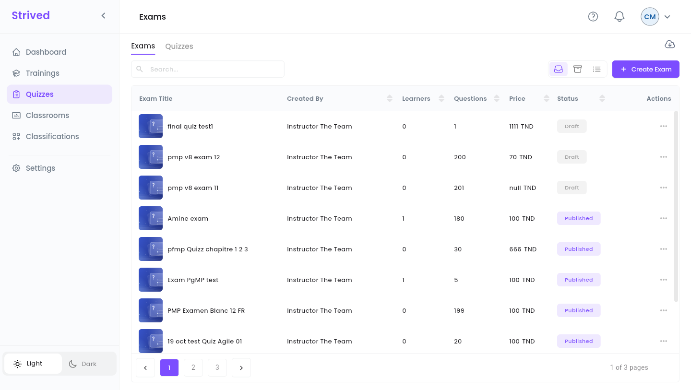
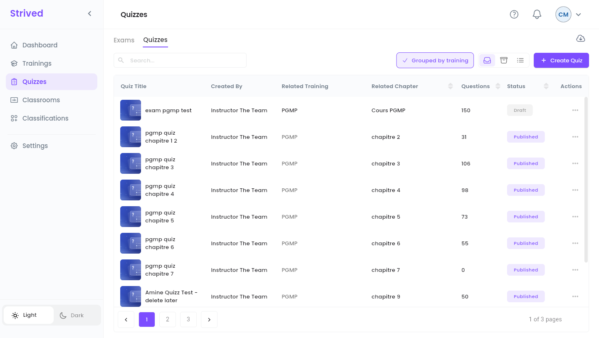
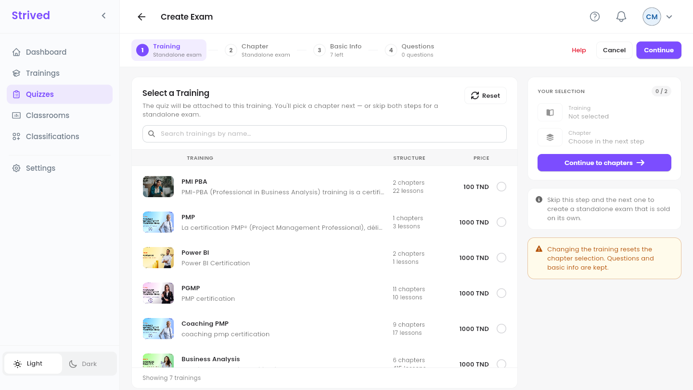
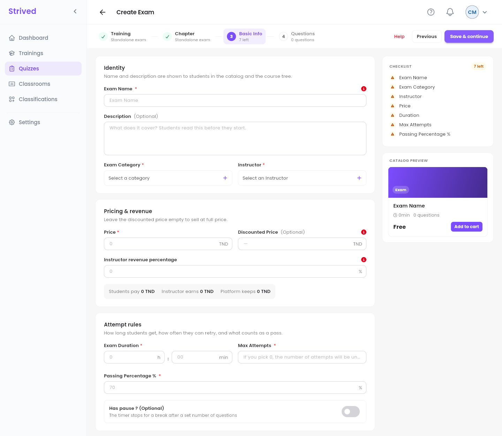
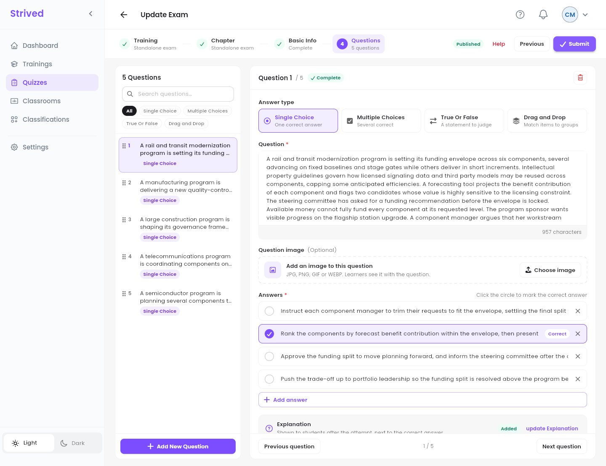
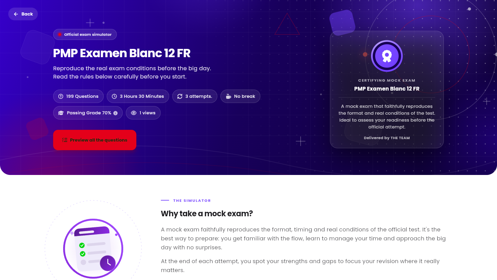

**Quizzes** in the sidebar holds two kinds of tests, built with the same editor:

| | **Exam** | **Quiz** |
| :-- | :-- | :-- |
| What it is | A standalone mock exam, sold on its own in the **Exam Catalog**. | A test inside a training, placed in one of its chapters. |
| Learners find it in | **My Content → My Exam Simulator**. | The training's **Course Content** panel. |
| Has its own price | Yes. | No: it comes with the training. |

<Note>
  Everything below is for the **web app** on a computer, signed in as a **Content Manager**.
</Note>

---

## Table of contents

- **Step 1 — Open the exams and quizzes**
- **Step 2 — Training and Chapter**
- **Step 3 — Basic Info**
- **Step 4 — Write the questions**
- **Step 5 — Review and publish**
- **Good to know**

---

## Step 1 — Open the exams and quizzes

Click **Quizzes** in the sidebar. Two tabs sit at the top: **Exams** and **Quizzes**.

<Frame caption="The Exams tab.">
  
</Frame>

<Frame caption="The Quizzes tab, grouped by training.">
  
</Frame>

Each row shows the instructor (**Created By**), the **Learners**, the number of **Questions**, the
**Price** (exams) or the **Related Training** and **Related Chapter** (quizzes), and the
**Status**. The **⋯** menu offers **Preview**, **Draft** / **Publish**, **Update** and **Import
Questions** (from a JSON file). The cloud icon at the top right exports exams or quizzes as a
backup.

---

## Step 2 — Training and Chapter

Click **Create Exam** (on the **Exams** tab) or **Create Quiz** (on the **Quizzes** tab). The editor
has four steps: **Training**, **Chapter**, **Basic Info** and **Questions**.

<Frame caption="Step 1: pick a training, or skip it for a standalone exam.">
  
</Frame>

- **For a quiz**: tick the training, click **Continue to chapters**, then pick the chapter.
- **For an exam**: pick nothing and click **Continue** twice. The steps show **Standalone exam**.

---

## Step 3 — Basic Info

<Frame caption="Step 3: Basic Info.">
  
</Frame>

| Section | Fields |
| :-- | :-- |
| **Identity** | **Exam Name**, **Description** (optional), **Exam Category** and **Instructor**. |
| **Pricing & revenue** | **Price**, optional **Discounted Price**, **Instructor revenue percentage**. |
| **Attempt rules** | **Exam Duration**, **Max Attempts** (0 means unlimited), **Passing Percentage %** (70 by default) and **Has pause ?** (a break, timer stopped, after a set number of questions). |

Click **Save & continue**: the exam is created **as a draft** and the **Questions** step opens.

---

## Step 4 — Write the questions

<Frame caption="Step 4: Questions.">
  
</Frame>

<Steps>
  <Step title="Add a question">
    **Add New Question** at the bottom of the list.
  </Step>
  <Step title="Answer type">
    **Single Choice**, **Multiple Choices**, **True Or False** or **Drag and Drop**.
  </Step>
  <Step title="Question and answers">
    Type the **Question** (an optional **Question image** can go with it), type the answers and click
    the circle in front of the right one: it shows **Correct**.
  </Step>
  <Step title="Explanation">
    Shown to learners after their attempt, next to the correct answer.
  </Step>
  <Step title="Submit">
    When every question is complete, click **Submit**.
  </Step>
</Steps>

The list on the left filters the questions by type, searches them and reorders them by drag and
drop. A question with something missing is flagged, and the editor will not submit until it is
fixed.

---

## Step 5 — Review and publish

**⋯ → Preview** opens the exam page as learners see it. **Preview all the questions** goes through
every question with its correct answer and explanation, without recording anything.

<Frame caption="Previewing an exam.">
  
</Frame>

When it is ready, open **⋯** on its row and click **Publish**: the exam appears in the **Exam
Catalog** (a quiz appears in its training's chapter). **Draft** hides it again.

<Tip>
  Before publishing an exam, check its price, its duration and attempts, and that every question has
  a correct answer and an explanation.
</Tip>

---

## Good to know

<AccordionGroup>
  <Accordion title="Can I give an exam to a learner?">
    No, assigning exams to learners belongs to admins.
  </Accordion>
  <Accordion title="Can I archive an exam?">
    No, archiving is reserved to admins. Use **Draft** to take it out of the catalog.
  </Accordion>
</AccordionGroup>
