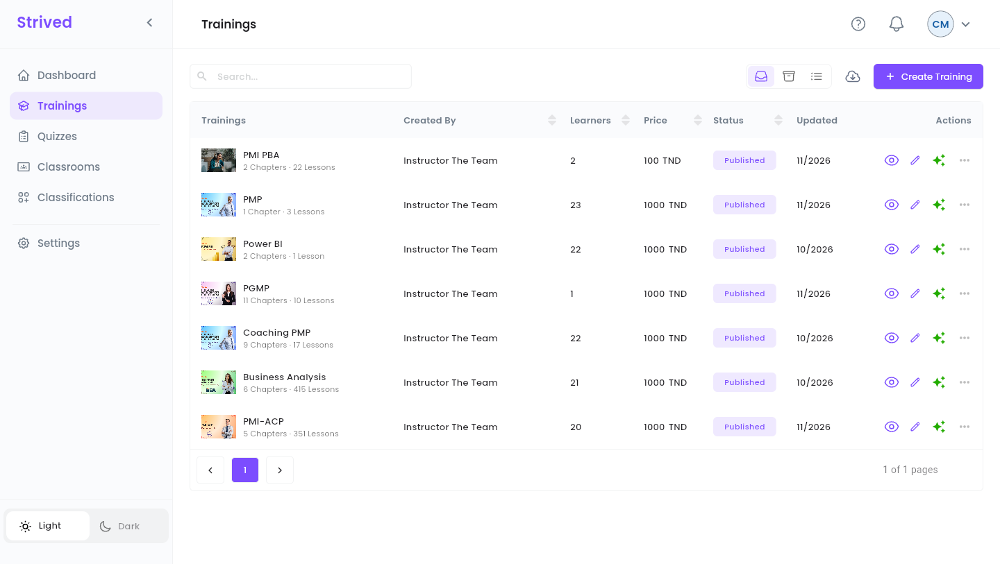
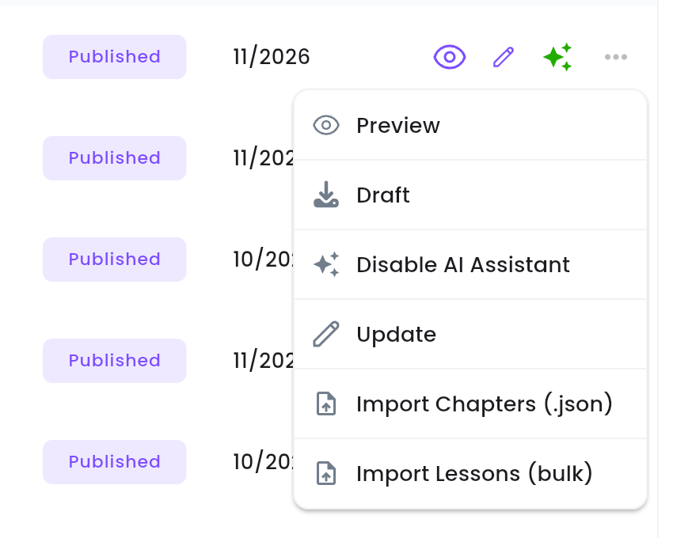
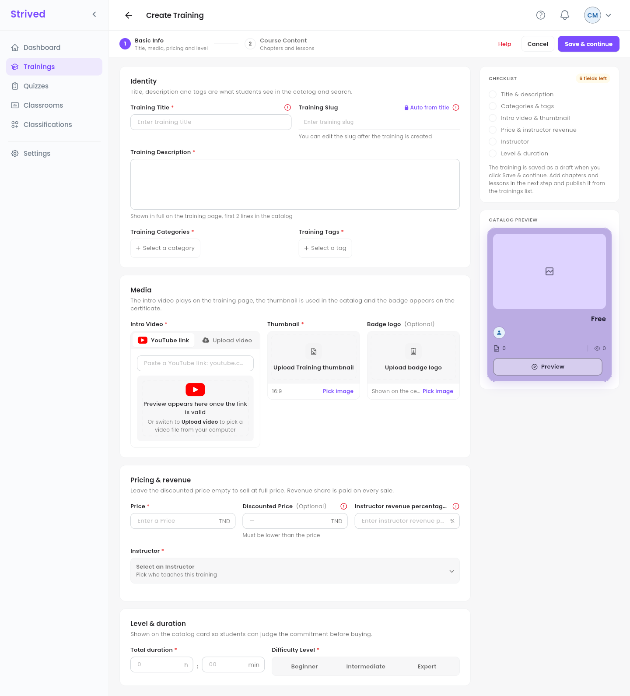
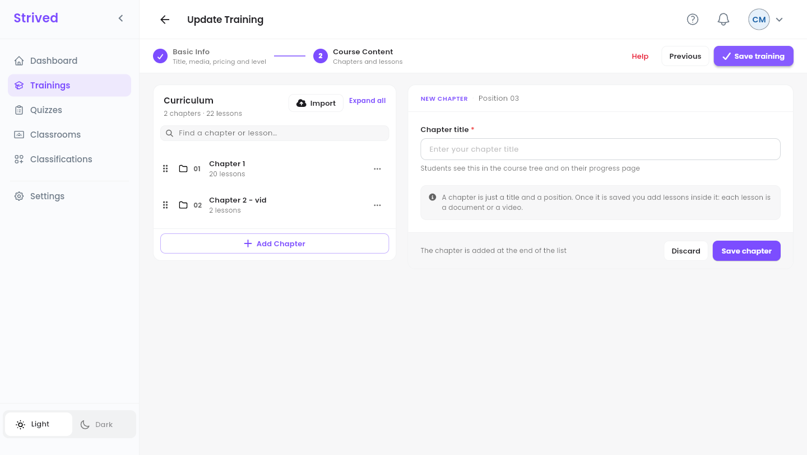
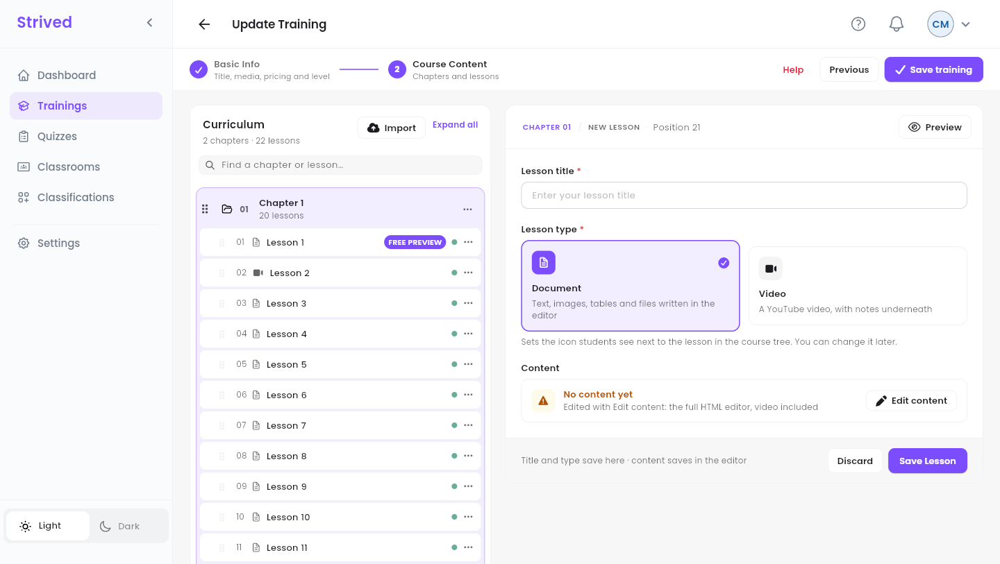
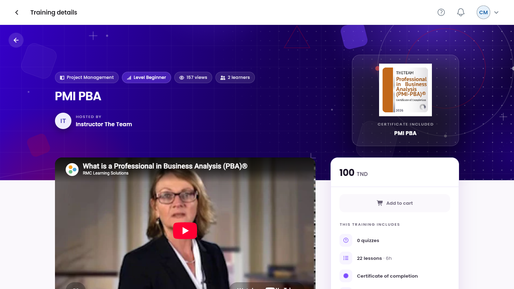

As a content manager you can create a training for any instructor, review and update the ones they
write, and decide when they appear in the catalog.

<Note>
  Everything below is for the **web app** on a computer, signed in as a **Content Manager**.
</Note>

---

## Table of contents

- **Step 1 — Open the trainings**
- **Step 2 — Create a training: Basic Info**
- **Step 3 — Build the course content**
- **Step 4 — Write a lesson**
- **Step 5 — Review and publish**
- **Step 6 — Export and import**
- **Good to know**

---

## Step 1 — Open the trainings

Click **Trainings** in the sidebar.

<Frame caption="Trainings.">
  
</Frame>

Each row shows the training, its instructor (**Created By**), its **Learners**, **Price**,
**Status** (**Published** or **Draft**) and the month it was last **Updated**. The icons at the end
of a row are shortcuts: the eye (**Preview**) and the pen (**Update**); the sparkles are green when
the **AI Assistant** is enabled. **⋯** opens every action:

<Frame caption="The ⋯ menu of a training.">
  
</Frame>

| Action | What it does |
| :-- | :-- |
| **Preview** | Opens the training as learners see it (Step 5). |
| **Draft** / **Publish** | Hides the training from the catalog, or publishes it (Step 5). |
| **Disable AI Assistant** / **Enable AI Assistant** | Turns the course player's AI assistant off or on for this training. |
| **Update** | Opens the training editor (Steps 2 to 4). |
| **Import Chapters (.json)** / **Import Lessons (bulk)** | Adds content from files (Step 6). |

The **Active** / **Archived** / **All records** icons at the top right filter the list. Archiving
itself is done by an admin.

---

## Step 2 — Create a training: Basic Info

Click **Create Training** at the top right. The editor has two steps: **1 Basic Info** and
**2 Course Content**.

<Frame caption="Create Training → Basic Info.">
  
</Frame>

<Steps>
  <Step title="Identity">
    **Training Title**, **Training Description**, **Training Categories** and **Training Tags**. The
    **Training Slug** is filled **Auto from title**.
  </Step>
  <Step title="Media">
    **Intro Video** (a **YouTube link** or **Upload video**), the 16:9 **Thumbnail**, and an
    optional **Badge logo** shown on the learners' certificate.
  </Step>
  <Step title="Pricing & revenue">
    **Price**, optional **Discounted Price** (lower than the price), and the **Instructor revenue
    percentage**: the instructor's share of each sale.
  </Step>
  <Step title="Instructor">
    **Select an Instructor**: the person who teaches the training. If the editor refuses with
    *"Missing Revenue for Selected Instructor"*, an admin must first set that instructor's revenue
    percentage.
  </Step>
  <Step title="Level & duration">
    **Total duration** and **Difficulty Level** (**Beginner**, **Intermediate** or **Expert**).
  </Step>
  <Step title="Save & continue">
    The training is saved **as a draft** and the **Course Content** step opens.
  </Step>
</Steps>

The **Checklist** on the right counts what is left, and the **Catalog Preview** shows the card
learners will see.

<Warning>
  Once a training has sold, its instructor and revenue percentage are locked: changing them would
  distort past orders. The editor shows a padlock.
</Warning>

---

## Step 3 — Build the course content

<Frame caption="Course Content.">
  
</Frame>

<Steps>
  <Step title="Add a chapter">
    **Add Chapter**, type the **Chapter title**, then **Save chapter**.
  </Step>
  <Step title="Add lessons">
    The chapter's **⋯** menu offers **Add Lesson**, **Rename chapter** and **Delete chapter**.
  </Step>
  <Step title="Reorder">
    Drag chapters and lessons by their handle (the six dots).
  </Step>
  <Step title="Save the training">
    Click **Save training** at the top right.
  </Step>
</Steps>

---

## Step 4 — Write a lesson

<Frame caption="A new lesson.">
  
</Frame>

Type the **Lesson title**, choose **Document** or **Video** (a YouTube link or embed code), click
**Edit content** to write it in the full editor, then **Save Lesson**. In the curriculum a **green**
dot means the lesson has content, an **orange** one that it is still empty. The first lesson of
chapter 1 is always a **FREE PREVIEW** for visitors.

---

## Step 5 — Review and publish

Before publishing, open the training with the eye (**Preview**) and check it as a learner would:
title, video, price, what **This training includes**, and the lessons.

<Frame caption="Previewing a training.">
  
</Frame>

Then open **⋯** on its row and click **Publish**: the status turns **Published** and the training
appears in the catalog. **Draft** in the same menu hides it again, for example while it is being
reworked.

<Tip>
  Review checklist: every lesson has a green dot, the thumbnail and intro video are set, the price
  and the instructor are right, and the categories and tags help learners find it.
</Tip>

---

## Step 6 — Export and import

- **Export**: the cloud icon next to **Create Training** downloads a backup of a training you pick,
  as `<training>_backup.zip`.
- **Import Chapters (.json)**: adds chapters from JSON files, such as another training's export.
- **Import Lessons (bulk)**: turns images into lessons, one image per lesson, in file-name order
  (`01-…`, `02-…`).

---

## Good to know

<AccordionGroup>
  <Accordion title="An instructor finished a training: what do I do?">
    Find it in **Trainings** (status **Draft**), review it with **Preview**, fix what needs fixing
    with **Update**, then **⋯ → Publish**.
  </Accordion>
  <Accordion title="Can I give a training to a learner, or notify its learners?">
    No, those actions belong to admins and instructors. Ask an admin.
  </Accordion>
</AccordionGroup>
