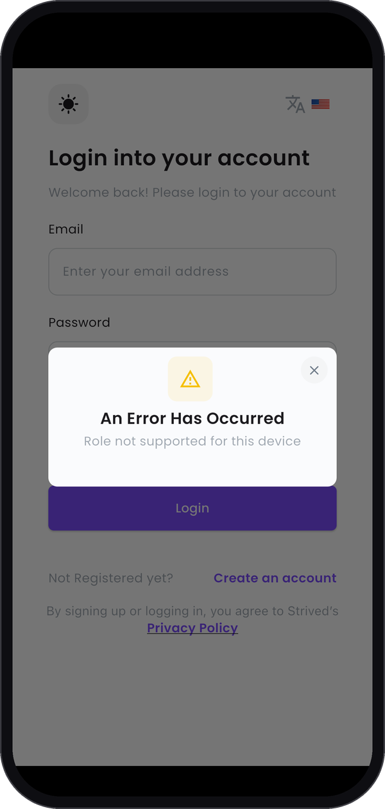

The Strived mobile app is made for students and instructors. Content managers work in the web app
on a computer, where all their tools are.

---

## What you see on a phone

If you log in to the app with a content manager account, the app signs you out right away. It shows **An
Error Has Occurred** with the message **Role not supported for this device**, on top of the login
screen.

<Columns cols={3}>
  <Frame caption="The message on a phone.">
    
  </Frame>
</Columns>

Nothing is wrong with your account: the message only means that this role isn't in the app.

---

## What to do instead

Open Strived in a browser on a computer and log in with the same e-mail and password. The **Open
Strived** button at the top of this site takes you there.

---

## What your users see

Learners and instructors do have the app. To see its screens, or to help someone who uses it, read
the [student](/student-guide/mobile-app) and [instructor](/instructor-guide/mobile-app) guides.
