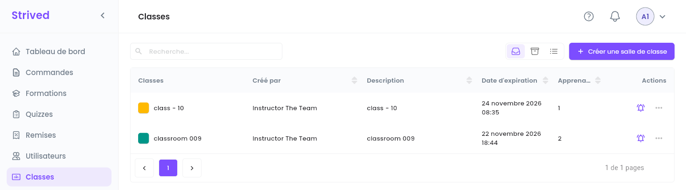
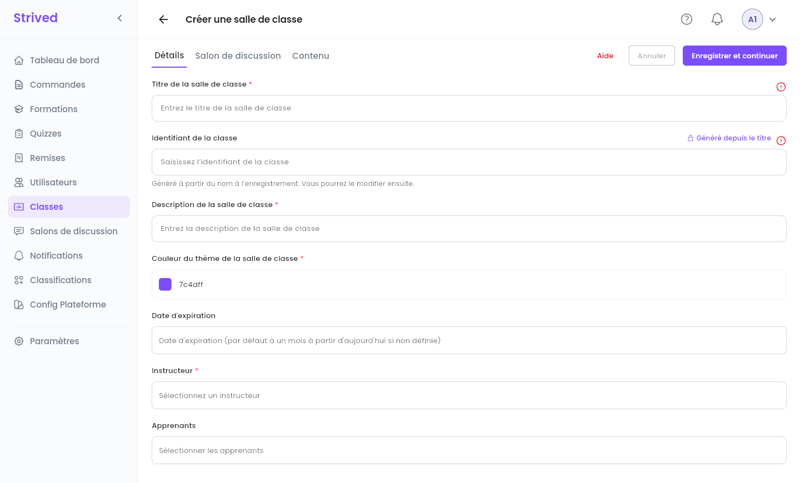
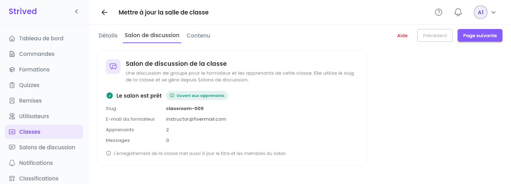
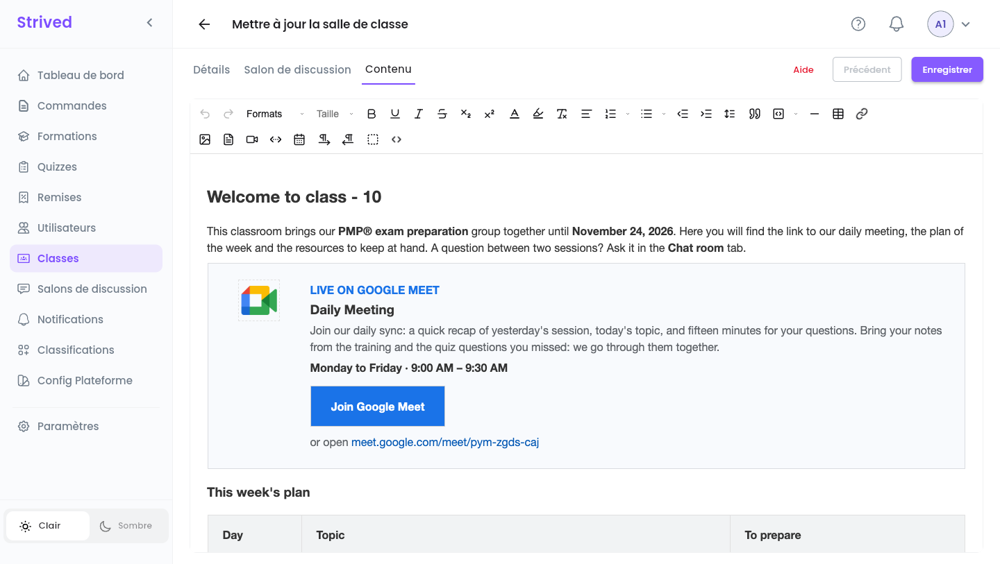
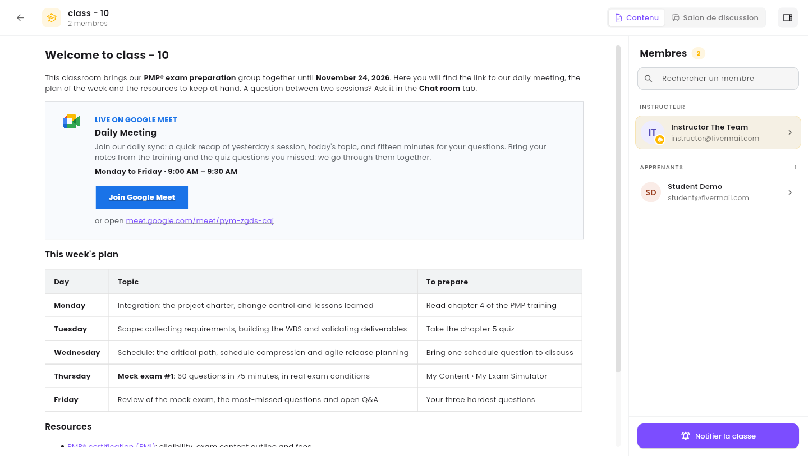
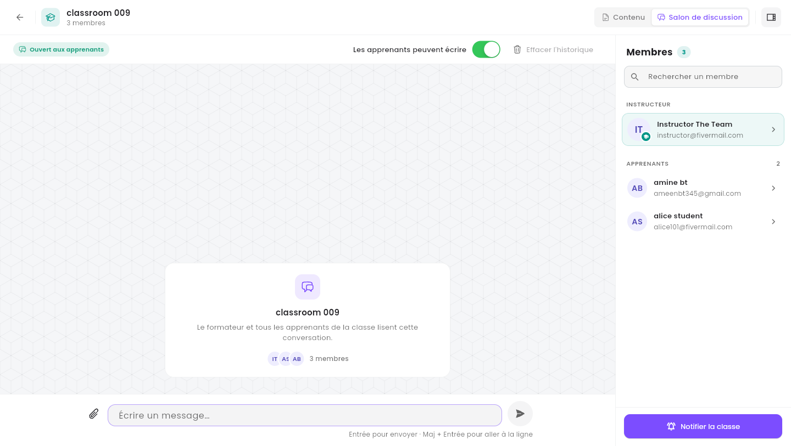
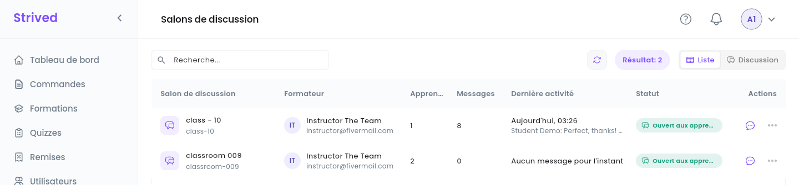
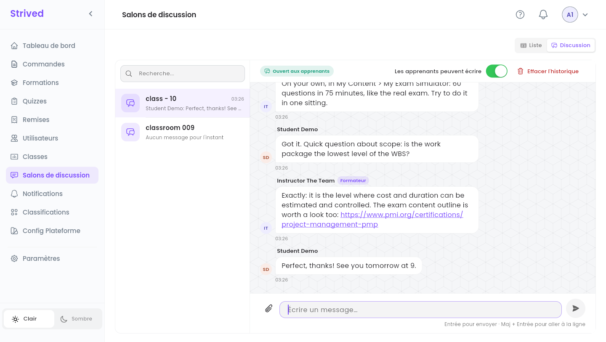
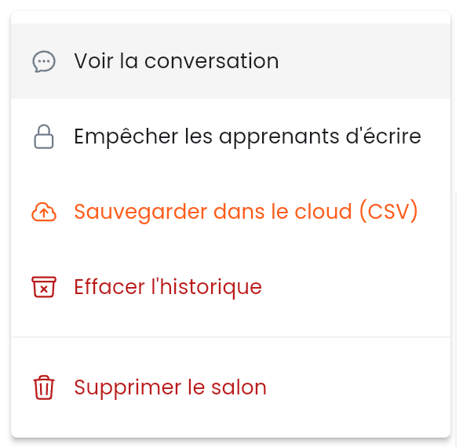

Une **classe** réunit un groupe d'apprenants et un formateur, pour une durée donnée. Elle a une
page de contenu et, si vous en créez un, un **salon de discussion** : une discussion de groupe pour
le formateur et les apprenants. Ce guide couvre les deux.

<Note>
  Tout ce qui suit concerne l'**application web** sur ordinateur, avec un compte **Admin**. Les
  apprenants trouvent leurs classes dans **Mon contenu → Classrooms & Chat** : voir le guide
  étudiant [Classes et salons de discussion](/fr/student-guide/classrooms-and-chat).
</Note>

---

## Sommaire

- **Étape 1 — Ouvrir les classes**
- **Étape 2 — Créer une classe**
- **Étape 3 — Ajouter le salon de discussion et le contenu**
- **Étape 4 — Visualiser une classe et notifier ses membres**
- **Étape 5 — Lire les salons de discussion**
- **Étape 6 — Modérer un salon de discussion**
- **Bon à savoir**

---

## Étape 1 — Ouvrir les classes

Cliquez sur **Classes** dans la barre latérale.

<Frame caption="Classes.">
  
</Frame>

Chaque ligne affiche la couleur et le nom de la classe, le formateur (**Créé par**), la
**Description**, la **Date d'expiration** et le nombre d'**Apprenants**. La cloche envoie un
message à la classe (Étape 4), et **⋯** propose **Visualiser**, **Modifier**, **Notifier la
classe** et **Archiver**.

---

## Étape 2 — Créer une classe

Cliquez sur **Créer une salle de classe** en haut à droite. L'éditeur a trois onglets : **Détails**,
**Salon de discussion** et **Contenu**.

<Frame caption="Créer une salle de classe → Détails.">
  
</Frame>

<Steps>
  <Step title="Nommez-la et décrivez-la">
    **Titre de la salle de classe** et **Description de la salle de classe**. L'**Identifiant de la
    classe** (son nom court sur le web) est généré à partir du titre à l'enregistrement ; vous
    pourrez le modifier ensuite.
  </Step>
  <Step title="Choisissez une couleur">
    **Couleur du thème de la salle de classe** : la couleur de l'icône de la classe, pour les
    apprenants et dans votre liste.
  </Step>
  <Step title="Fixez la date de fin">
    **Date d'expiration**. Laissée vide, elle vaut par défaut un mois à partir d'aujourd'hui.
  </Step>
  <Step title="Ajoutez les personnes">
    **Instructeur** : la personne qui anime la classe. **Apprenants** : tous ceux qui y participent.
  </Step>
  <Step title="Enregistrer et continuer">
    Cliquez sur **Enregistrer et continuer**. La classe est créée et l'onglet **Salon de
    discussion** s'ouvre.
  </Step>
</Steps>

---

## Étape 3 — Ajouter le salon de discussion et le contenu

<Frame caption="L'onglet Salon de discussion, une fois le salon créé.">
  
</Frame>

<Steps>
  <Step title="Créez le salon de discussion (facultatif)">
    Tant que la classe n'a pas de salon, l'onglet résume le salon à venir : **Titre**, **Slug**,
    **E-mail du formateur** et **E-mails des apprenants**. Cliquez sur **Créer le salon**. Vous
    pouvez aussi passer cette étape et le créer plus tard depuis **Modifier**. Une fois le salon
    créé, l'onglet affiche **Le salon est prêt** avec son **Slug**, l'**E-mail du formateur** et
    le nombre d'**Apprenants** et de **Messages**.
  </Step>
  <Step title="Rédigez le contenu">
    **Page suivante** ouvre **Contenu** : un éditeur de texte enrichi (texte, images, tableaux,
    fichiers, vidéos, liens). Rédigez ce que les apprenants doivent trouver dans la classe :
    planning, consignes, ressources.
  </Step>
  <Step title="Enregistrez">
    Cliquez sur **Enregistrer**.
  </Step>
</Steps>

Pour modifier une classe plus tard, utilisez **⋯ → Modifier** : les trois mêmes onglets, avec
**Page suivante** / **Précédent**, et un seul **Enregistrer** à la fin. L'enregistrement met aussi
à jour le titre et les membres du salon de discussion.

### L'éditeur de contenu

<Frame caption="Contenu : l'éditeur de texte enrichi, ici avec la page de class - 10.">
  
</Frame>

| Boutons | Ce qu'ils font |
| :-- | :-- |
| **Formats**, **Taille** | Titres, styles de paragraphe et taille du texte. |
| Gras, souligné, italique, barré, indice, exposant | Les styles de texte. |
| Couleur du texte, surlignage, effacer le formatage | Les couleurs, et la suppression de tous les styles de la sélection. |
| Alignement, listes numérotées et à puces, retrait, hauteur de ligne | La mise en page des paragraphes. |
| Citation, bloc de code, ligne horizontale, tableau, lien | Les blocs, les tableaux et les liens. |
| Image, PDF, vidéo, intégration, Google Agenda | Les images et les PDF sont envoyés vers le stockage cloud, dans le dossier de la classe. **Intégrer** accepte un code `<iframe>` ou un lien (YouTube, Google Drive…). |
| De gauche à droite / de droite à gauche, voir les blocs, voir le code (`<>`) | Le sens d'écriture, le contour des blocs, et le HTML de la page. |

<Tip>
  La page des apprenants garde les titres, les listes, les couleurs du texte, les liens, les images
  et les **tableaux** avec leurs bordures et leurs couleurs de fond. Pour dessiner une carte ou un
  bouton, utilisez un tableau, comme la carte Google Meet ci-dessus : l'éditeur supprime les styles
  pour lesquels il n'a pas d'outil (marges intérieures, coins arrondis, `<div>` ou boutons stylés).
  Après l'enregistrement, vérifiez le résultat avec **⋯ → Visualiser**.
</Tip>

<Accordion title="Réutiliser la carte Google Meet">
  Ouvrez la vue du code (`<>`), collez le HTML ci-dessous à l'endroit où doit aller la carte, et
  changez le lien (il apparaît deux fois), les jours et les horaires. Refermez la vue du code et
  cliquez sur **Enregistrer**. Gardez une description d'environ deux lignes : sur la page des
  apprenants, un tableau n'est pas plus large que ce qu'exige son texte.

  ```html
  <table style="width: 100%; border: 1px solid #dadce0; background-color: #f8fafd">
    <tbody>
      <tr>
        <td style="border: 0"><p style="margin: 0 10px">&nbsp;</p></td>
        <td style="border: 0; text-align: center; vertical-align: top">
          <p style="margin: 0; line-height: 18px"><br></p>
          
        </td>
        <td style="border: 0"><p style="margin: 0 7px">&nbsp;</p></td>
        <td style="border: 0; vertical-align: top">
          <p style="margin: 20px 24px 2px 0"><span style="color: #1a73e8"><strong>EN DIRECT SUR GOOGLE MEET</strong></span></p>
          <h3 style="margin: 0 24px 4px 0">Réunion quotidienne</h3>
          <p style="margin: 0 24px 6px 0"><span style="color: #5f6368">Notre point quotidien : un rappel de la séance d'hier, le sujet du jour et quinze minutes pour vos questions. Apportez vos notes de la formation et les questions de quiz que vous avez ratées : nous les reprenons ensemble.</span></p>
          <p style="margin: 0 24px 14px 0"><strong>Du lundi au vendredi · 9 h 00 – 9 h 30</strong></p>
          <table style="border-collapse: collapse">
            <tbody>
              <tr>
                <td style="background-color: #1a73e8; border: 0">
                  <p style="margin: 10px 22px"><a href="https://meet.google.com/meet/pym-zgds-caj"><span style="color: #ffffff"><strong>Rejoindre Google Meet</strong></span></a></p>
                </td>
              </tr>
            </tbody>
          </table>
          <p style="margin: 10px 24px 20px 0"><span style="color: #5f6368">ou ouvrez </span><a href="https://meet.google.com/meet/pym-zgds-caj">meet.google.com/meet/pym-zgds-caj</a></p>
        </td>
      </tr>
    </tbody>
  </table>
  ```
</Accordion>

---

## Étape 4 — Visualiser une classe et notifier ses membres

**⋯ → Visualiser** ouvre la classe telle que la voient ses membres.

<Frame caption="L'aperçu d'une classe.">
  
</Frame>

- **Contenu** / **Salon de discussion**, en haut à droite, passent de la page de contenu à la
  discussion de groupe.
- Le panneau **Membres** liste l'**Instructeur** et les **Apprenants**, avec **Rechercher un
  membre**. L'icône tout en haut à droite le masque ou l'affiche.
- **Notifier la classe**, en bas, envoie une notification dans l'application à tous les membres
  (comme la cloche de la liste).

**Salon de discussion** affiche la conversation de la classe. Un salon qui vient d'être créé est
encore vide ; si la classe n'a pas encore de salon, la vue indique **Pas encore de salon** et
propose **Créer le salon**.

<Frame caption="Le salon de discussion d'une classe, encore sans message.">
  
</Frame>

---

## Étape 5 — Lire les salons de discussion

Cliquez sur **Salons de discussion** dans la barre latérale : tous les salons de la plateforme,
dans un tableau (**Liste**) ou sous forme de messagerie (**Discussion**).

<Frame caption="Salons de discussion → Liste.">
  
</Frame>

| Colonne | Ce qu'elle montre |
| :-- | :-- |
| **Salon de discussion** | Son nom et son slug. |
| **Formateur** | Le formateur de la classe. |
| **Apprenants** / **Messages** | Le nombre d'apprenants qui en font partie, le nombre de messages qu'il contient. |
| **Dernière activité** | Quand le dernier message a été publié, avec un extrait. |
| **Statut** | **Ouvert aux apprenants**, ou **Apprenants en lecture seule** quand vous les avez arrêtés (Étape 6). |

**Discussion**, en haut à droite, ouvre la vue messagerie : les salons à gauche, la conversation à
droite.

<Frame caption="Salons de discussion → Discussion.">
  
</Frame>

Vous pouvez écrire dans n'importe quel salon : tapez dans **Écrire un message…**, appuyez sur
**Entrée** pour envoyer (**Maj + Entrée** pour passer à la ligne). Le trombone joint des images :
JPG, PNG, GIF ou WEBP, 20 Mo maximum chacune, 4 par message.

---

## Étape 6 — Modérer un salon de discussion

Le menu **⋯** d'un salon (dans **Liste**) contient les outils de modération :

<Frame caption="Le menu ⋯ d'un salon de discussion.">
  
</Frame>

| Action | Ce qu'elle fait |
| :-- | :-- |
| **Voir la conversation** | Ouvre le salon dans la vue **Discussion**. |
| **Empêcher les apprenants d'écrire** | Les apprenants peuvent seulement lire ; le formateur et les admins peuvent toujours écrire. **Autoriser les apprenants à écrire** le rouvre. Dans la vue **Discussion**, l'interrupteur **Les apprenants peuvent écrire** fait la même chose. |
| **Sauvegarder dans le cloud (CSV)** | Enregistre tous les messages (expéditeur, e-mail, date, images) dans un fichier CSV sur le stockage cloud, et indique où se trouve le fichier. |
| **Effacer l'historique** | Supprime tous les messages et toutes les images du salon, pour tout le monde. |
| **Supprimer le salon** | Supprime le salon avec tous ses messages, ses images et ses membres. La classe reste, et vous pouvez lui créer un nouveau salon depuis **Modifier**. |

<Warning>
  **Effacer l'historique** et **Supprimer le salon** sont irréversibles. Lancez d'abord
  **Sauvegarder dans le cloud (CSV)** si vous risquez d'avoir besoin de la conversation plus tard.
</Warning>

---

## Bon à savoir

<AccordionGroup>
  <Accordion title="Qui peut lire un salon de discussion ?">
    Le formateur de la classe, ses apprenants et les admins. Personne d'autre ne peut l'ouvrir.
  </Accordion>
  <Accordion title="J'ai ajouté un apprenant à la classe : est-il dans le salon ?">
    Oui. L'enregistrement de la classe met aussi à jour les membres du salon.
  </Accordion>
  <Accordion title="Chaque classe a-t-elle besoin d'un salon de discussion ?">
    Non, c'est facultatif. Sans salon, les membres ne voient que la page de contenu, et **Salon de
    discussion** affiche **Pas encore de salon**. Vous pouvez le créer à tout moment.
  </Accordion>
</AccordionGroup>
