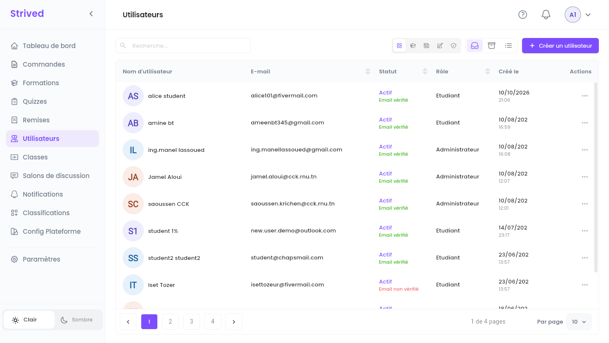
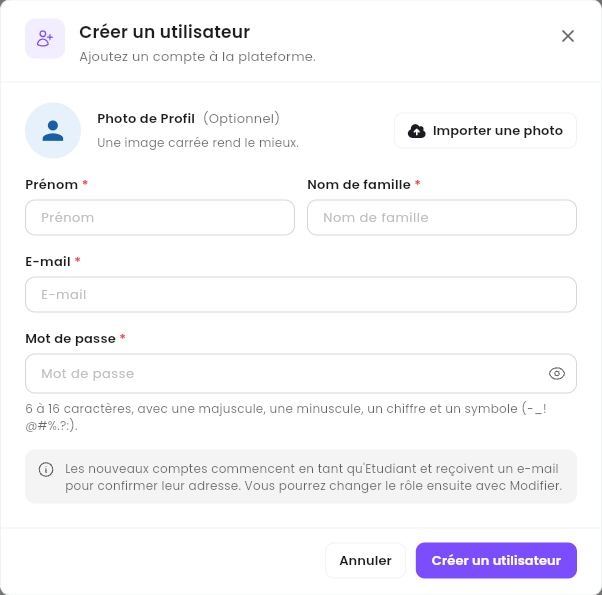
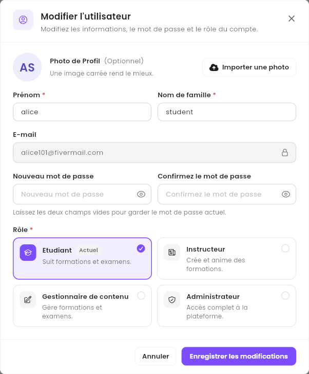
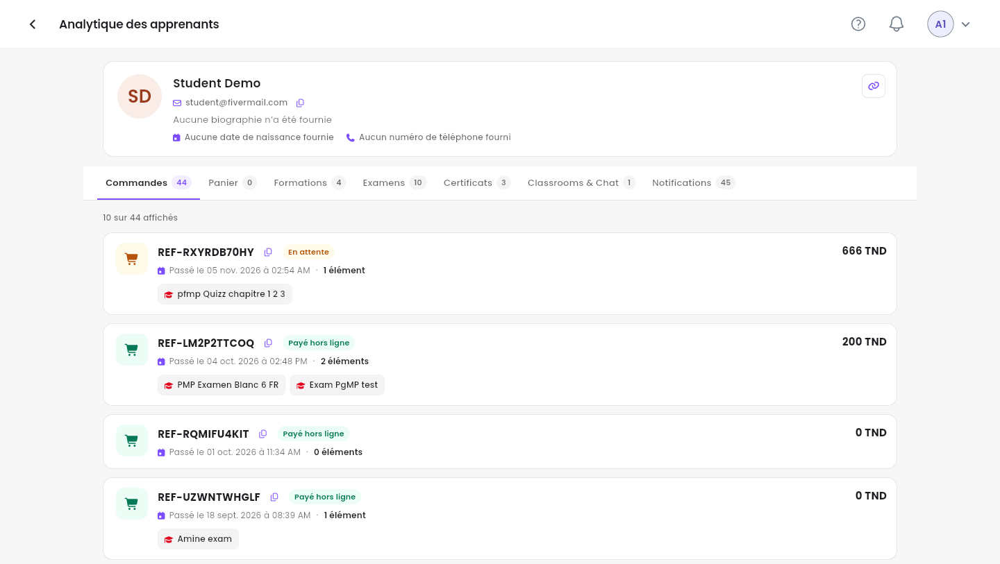

**Utilisateurs** liste tous les comptes de la plateforme : apprenants, formateurs, gestionnaires de
contenu et administrateurs. Ce guide vous montre comment créer et modifier des comptes, et où voir
ce qu'a fait un apprenant.

<Note>
  Tout ce qui suit concerne l'**application web** sur ordinateur, avec un compte **Admin**.
</Note>

---

## Sommaire

- **Étape 1 — Retrouver un utilisateur**
- **Étape 2 — Créer un compte**
- **Étape 3 — Modifier un compte et changer son rôle**
- **Étape 4 — Consulter l'activité d'un apprenant**
- **Étape 5 — Gérer un formateur**
- **Étape 6 — Bannir ou archiver un compte**
- **Bon à savoir**

---

## Étape 1 — Retrouver un utilisateur

Cliquez sur **Utilisateurs** dans la barre latérale.

<Frame caption="Utilisateurs.">
  
</Frame>

- **Recherche…** retrouve un utilisateur par nom ou par e-mail.
- Les cinq icônes à gauche de **Actif** / **Archivé** / **Tous les éléments** filtrent par rôle :
  **Tout**, **Étudiants**, **Instructeurs**, **Gestionnaires de contenu** et **Administrateurs**.

| Colonne | Ce qu'elle montre |
| :-- | :-- |
| **Nom d'utilisateur** | Le prénom et le nom. |
| **E-mail** | L'adresse avec laquelle l'utilisateur se connecte. |
| **Statut** | **Actif**, et si l'e-mail est confirmé (**Email vérifié** en vert, **Email non vérifié** en rouge). |
| **Rôle** | **Etudiant**, **Instructeur**, **Gestionnaire de contenu** ou **Administrateur**. |
| **Créé le** | La date de création du compte. |

---

## Étape 2 — Créer un compte

Cliquez sur **Créer un utilisateur** en haut à droite.

<Frame caption="Créer un utilisateur.">
  
</Frame>

<Steps>
  <Step title="Photo de profil (facultative)">
    **Importer une photo**. Une image carrée rend le mieux.
  </Step>
  <Step title="Nom et e-mail">
    **Prénom**, **Nom de famille** et **E-mail**.
  </Step>
  <Step title="Mot de passe">
    6 à 16 caractères, avec une majuscule, une minuscule, un chiffre et un symbole (`-_!@#%.?:`).
    L'œil affiche ce que vous avez saisi.
  </Step>
  <Step title="Créez">
    Cliquez sur **Créer un utilisateur**.
  </Step>
</Steps>

Les nouveaux comptes commencent en tant qu'**Etudiant** et reçoivent un e-mail pour confirmer leur
adresse. Pour faire de quelqu'un un formateur ou un admin, changez son rôle ensuite (Étape 3).

---

## Étape 3 — Modifier un compte et changer son rôle

Ouvrez **⋯ → Modifier** sur la ligne de l'utilisateur.

<Frame caption="Modifier l'utilisateur.">
  
</Frame>

- Le **Prénom** et le **Nom de famille** peuvent être changés. L'**E-mail** est verrouillé.
- **Nouveau mot de passe** / **Confirmez le mot de passe** définissent un nouveau mot de passe.
  Laissez les deux vides pour garder le mot de passe actuel.
- **Rôle** : choisissez **Etudiant** (suit des formations et des examens), **Instructeur** (crée
  et anime des formations), **Gestionnaire de contenu** (gère les formations et les examens) ou
  **Administrateur** (accès complet à la plateforme). **Actuel** signale le rôle qu'a
  l'utilisateur aujourd'hui.

Cliquez sur **Enregistrer les modifications**.

<Warning>
  **Administrateur** donne un accès complet à la plateforme, y compris aux commandes, aux paiements
  et à tous les utilisateurs. Ne le donnez qu'aux personnes qui en ont besoin.
</Warning>

---

## Étape 4 — Consulter l'activité d'un apprenant

Sur la ligne d'un étudiant, ouvrez **⋯ → Analytique des apprenants**.

<Frame caption="Analytique des apprenants.">
  
</Frame>

La carte du haut affiche le nom, l'e-mail, la biographie, la date de naissance et le numéro de
téléphone de l'apprenant (les icônes de copie copient l'e-mail et le numéro de téléphone). Les
onglets en dessous donnent la vue complète, chacun avec un compteur :

| Onglet | Ce que vous y trouvez |
| :-- | :-- |
| **Commandes** | Toutes les commandes avec leur référence, leur statut, leur date, leurs articles et leur montant. |
| **Panier** | Ce qui attend dans le panier de l'apprenant. |
| **Formations** | Les formations auxquelles l'apprenant a accès. |
| **Examens** | Les examens auxquels l'apprenant a accès. |
| **Certificats** | Les certificats obtenus par l'apprenant. |
| **Classrooms & Chat** | Les classes dont l'apprenant fait partie. |
| **Notifications** | Les notifications reçues par l'apprenant. |

<Tip>
  Un apprenant appelle au sujet d'un paiement ou d'une formation manquante ? Commencez ici :
  **Commandes** et **Formations** répondent en général à la question.
</Tip>

---

## Étape 5 — Gérer un formateur

Le menu **⋯** d'un formateur a deux entrées de plus.

**Définir les Revenus** ouvre **Revenu de l'instructeur** : saisissez le pourcentage de **Revenu**
par défaut du formateur (par exemple `30`), puis **Confirmer**. C'est la part de chaque vente que
gagne le formateur. Définissez-la avant de créer une formation ou un examen pour ce formateur :
l'éditeur refuse de continuer tant qu'elle manque (*« Revenu manquant pour l'instructeur
sélectionné »*).

**Aperçu du profil** ouvre le **Profil formateur** : biographie, lien LinkedIn, **À propos de moi**,
**Compétences** et **Certificats**.

<Frame caption="Le profil d'un formateur.">
  
</Frame>

Un formateur vérifié affiche un badge violet à côté de son nom. **Annuler la vérification du
compte** le retire ; sur un formateur non vérifié, le bouton vérifie le compte.

---

## Étape 6 — Bannir ou archiver un compte

| Action | Ce qu'elle fait | Comment l'annuler |
| :-- | :-- | :-- |
| **Interdire** | Bloque le compte : l'utilisateur ne peut plus utiliser la plateforme. La plateforme demande d'abord *« Êtes-vous sûr de vouloir interdire cet utilisateur ? »*. | **⋯ → Débannir** |
| **Archiver** | Retire le compte de la liste. | Icône **Archivé**, puis **Restaurer** |

---

## Bon à savoir

<AccordionGroup>
  <Accordion title="Puis-je changer l'e-mail d'un utilisateur ?">
    Non : l'e-mail sert d'identifiant et reste verrouillé dans **Modifier l'utilisateur**. Créez un
    nouveau compte avec le bon e-mail si nécessaire.
  </Accordion>
  <Accordion title="Un utilisateur a oublié son mot de passe">
    Définissez-en un nouveau dans **⋯ → Modifier** (Étape 3) : renseignez **Nouveau mot de passe**
    et **Confirmez le mot de passe**, puis communiquez-le-lui.
  </Accordion>
  <Accordion title="Comment donner une formation à un apprenant sans commande ?">
    Depuis **Formations** : **⋯ → Attribuer des apprenants**, voir
    [Gérer les formations](/fr/admin-guide/manage-trainings). Pour plusieurs formations et examens
    d'un coup, utilisez un voucher : voir [Vouchers et coupons](/fr/admin-guide/vouchers-and-coupons).
  </Accordion>
</AccordionGroup>
