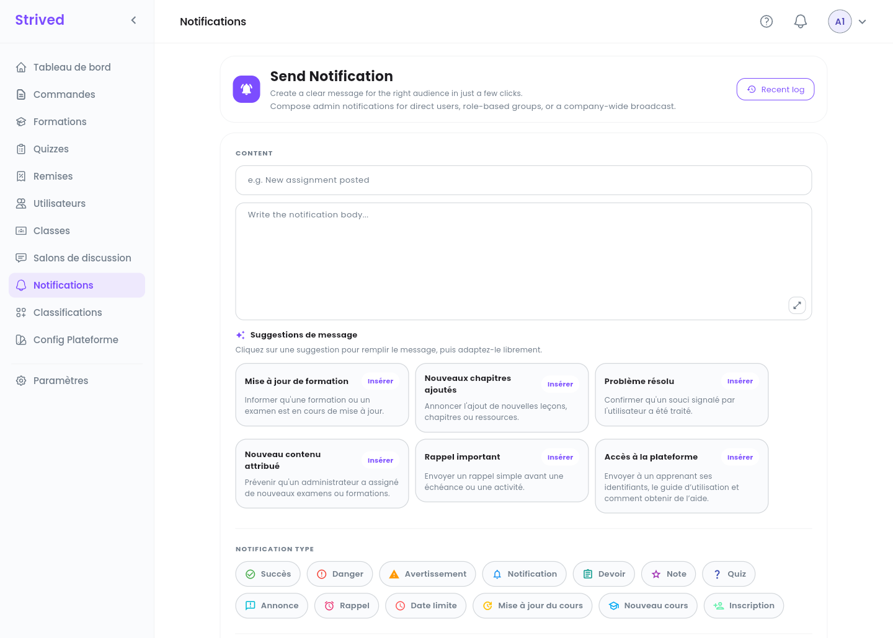
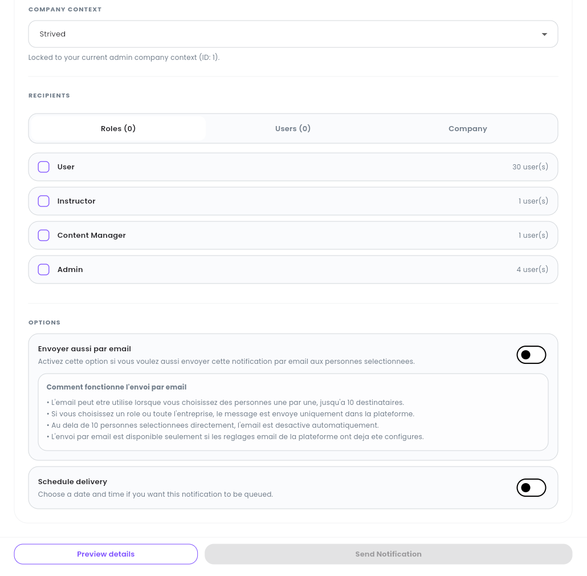
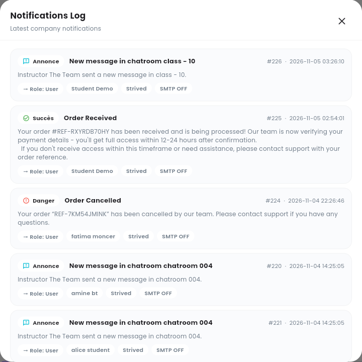

**Notifications**, dans la barre latérale, envoie un message qui apparaît dans la cloche des
personnes que vous choisissez, dans l'application. Servez-vous en pour des annonces, des rappels,
des dates limites ou des nouvelles de la plateforme.

<Note>
  Tout ce qui suit concerne l'**application web** sur ordinateur, avec un compte **Admin**. Pour
  écrire seulement aux apprenants d'une formation ou d'une classe, la cloche de sa ligne est plus
  rapide : voir [Gérer les formations](/fr/admin-guide/manage-trainings) et
  [Classes et salons de discussion](/fr/admin-guide/classrooms-and-chatrooms).
</Note>

<Note>
  Cette page est encore **en partie en anglais** dans l'application française : les titres des
  sections (**CONTENT**, **NOTIFICATION TYPE**, **RECIPIENTS**, **OPTIONS**…), les onglets des
  destinataires et les boutons gardent leur libellé anglais, cités tels quels ci-dessous. À
  l'inverse, l'option e-mail (**Envoyer aussi par email**) est en français dans toutes les langues
  de l'application.
</Note>

---

## Sommaire

- **Étape 1 — Rédiger le message**
- **Étape 2 — Choisir le type**
- **Étape 3 — Choisir les destinataires**
- **Étape 4 — Options : e-mail et programmation**
- **Étape 5 — Vérifier et envoyer**
- **Étape 6 — Consulter le journal**
- **Bon à savoir**

---

## Étape 1 — Rédiger le message

Cliquez sur **Notifications** dans la barre latérale.

<Frame caption="Send Notification : le contenu, les suggestions et le type.">
  
</Frame>

Sous **CONTENT**, saisissez le titre (par exemple *Nouveau devoir publié*) et le texte. Les flèches
en bas à droite du texte agrandissent la zone de saisie.

À court de mots ? Cliquez sur l'une des **Suggestions de message** (**Mise à jour de formation**,
**Nouveaux chapitres ajoutés**, **Problème résolu**, **Nouveau contenu attribué**, **Rappel
important**, **Accès à la plateforme**) : **Insérer** remplit le message, que vous adaptez ensuite
librement.

---

## Étape 2 — Choisir le type

Sous **NOTIFICATION TYPE**, choisissez celui qui convient : **Succès**, **Danger**,
**Avertissement**, **Notification**, **Devoir**, **Note**, **Quiz**, **Annonce**, **Rappel**,
**Date limite**, **Mise à jour du cours**, **Nouveau cours** ou **Inscription**. Le type définit
l'icône et la couleur que voient les destinataires.

**COMPANY CONTEXT** affiche votre entreprise. Il est verrouillé sur l'entreprise que vous
administrez.

---

## Étape 3 — Choisir les destinataires

<Frame caption="Les destinataires et les options.">
  
</Frame>

Sous **RECIPIENTS**, trois onglets :

| Onglet | Qui reçoit le message |
| :-- | :-- |
| **Roles** | Toutes les personnes ayant les rôles que vous cochez : **User** (les apprenants), **Instructor**, **Content Manager**, **Admin**. Chaque ligne indique combien de personnes elle couvre. |
| **Users** | Seulement les personnes que vous choisissez une à une. |
| **Company** | Toute l'entreprise. |

Le nombre entre parenthèses sur chaque onglet compte ce que vous avez sélectionné.

---

## Étape 4 — Options : e-mail et programmation

Deux interrupteurs sous **OPTIONS** :

- **Envoyer aussi par email** (l'interrupteur en haut d'**OPTIONS**) : les destinataires reçoivent
  aussi la notification par e-mail. Cela ne fonctionne que si vous choisissez les personnes une à
  une dans **Users**, **10** destinataires au maximum, et si les réglages e-mail de la plateforme
  sont configurés. Avec un rôle ou toute l'entreprise, le message reste dans l'application. Le
  cadre **Comment fonctionne l'envoi par email** rappelle ces règles.
- **Schedule delivery** : choisissez une date et une heure, et la notification attend dans une file
  jusque-là.

---

## Étape 5 — Vérifier et envoyer

Cliquez sur **Preview details** en bas pour vérifier le message et ses destinataires, puis sur
**Send Notification**. Le bouton reste gris tant que le message et les destinataires ne sont pas
renseignés.

---

## Étape 6 — Consulter le journal

Cliquez sur **Recent log** en haut à droite.

<Frame caption="Le journal des notifications (Notifications Log).">
  
</Frame>

Le journal liste les dernières notifications de l'entreprise, la plus récente en premier : type,
titre, texte, numéro et date, qui l'a reçue (rôle et nom), l'entreprise, et si un e-mail est parti
(**SMTP OFF** quand ce n'est pas le cas). Il comprend les notifications que la plateforme envoie
d'elle-même, comme *« Order Cancelled »* ou *« New message in chatroom … »*.

---

## Bon à savoir

<AccordionGroup>
  <Accordion title="Où les destinataires voient-ils la notification ?">
    Dans la cloche de la barre du haut ; **Voir tout** ouvre la liste complète de leurs
    notifications.
  </Accordion>
  <Accordion title="Puis-je écrire à un seul apprenant ?">
    Oui : ouvrez l'onglet **Users** et choisissez seulement cette personne. Vous pouvez alors aussi
    l'envoyer par e-mail.
  </Accordion>
  <Accordion title="Pourquoi l'interrupteur e-mail est-il désactivé ?">
    Vous avez choisi un rôle, toute l'entreprise, ou plus de 10 personnes. L'e-mail ne part qu'aux
    personnes choisies une à une dans **Users**, 10 au maximum.
  </Accordion>
</AccordionGroup>
