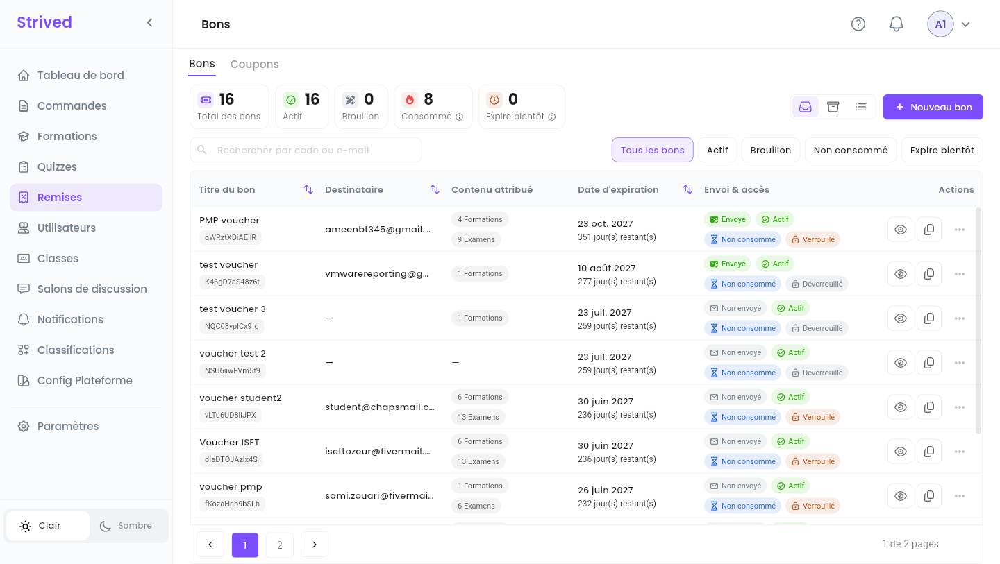
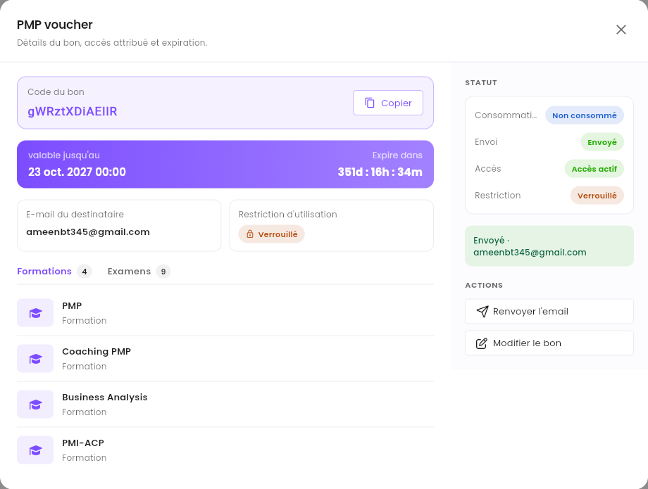
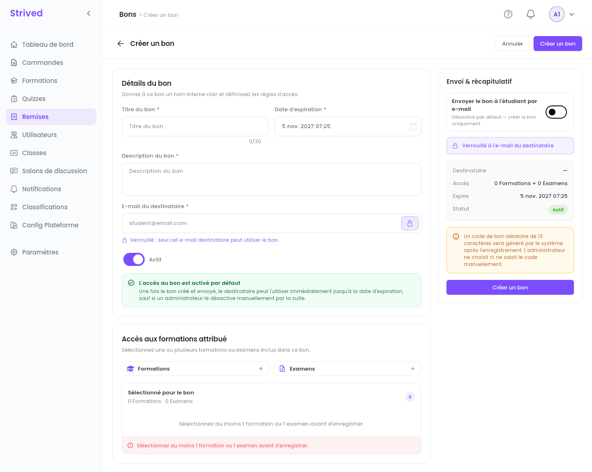
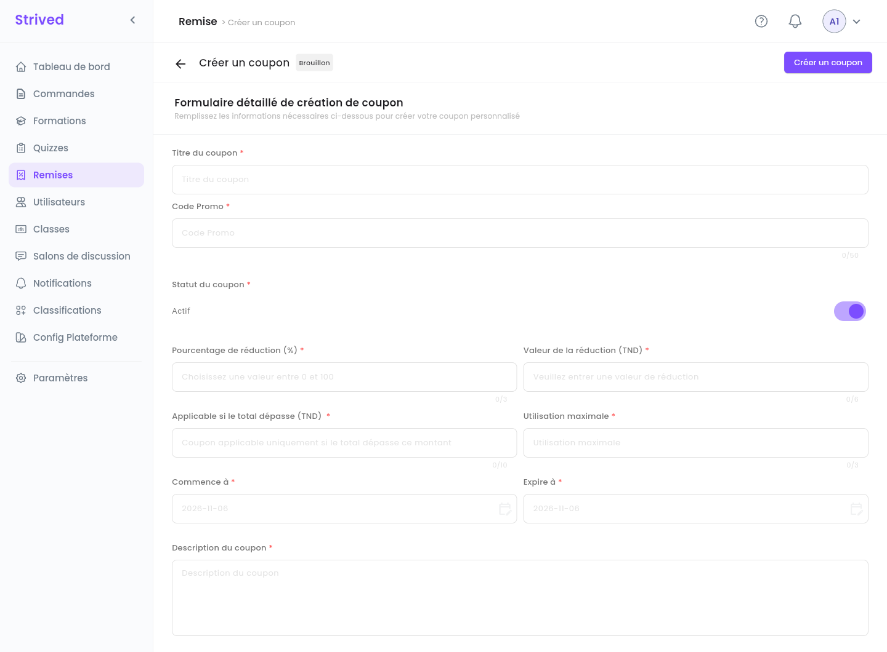

**Remises**, dans la barre latérale, regroupe deux outils différents :

| | **Voucher (bon)** | **Coupon** |
| :-- | :-- | :-- |
| Ce qu'il fait | Débloque **gratuitement** un ensemble de formations et d'examens. | Retire une **réduction** du total du panier. |
| Comment l'apprenant le reçoit | Par **e-mail**, avec un code généré par la plateforme. | Vous communiquez le code ; l'apprenant le saisit dans le panier. |
| Où l'apprenant l'utilise | **Appliquer un bon**, sur son tableau de bord. | **Promotions**, dans le panier, avant de commander. |
| Qui peut l'utiliser | Un seul destinataire (quand il est verrouillé sur son e-mail). | Tout le monde, jusqu'à l'**Utilisation maximale**. |

<Note>
  Tout ce qui suit concerne l'**application web** sur ordinateur, avec un compte **Admin**. Le côté
  apprenant est expliqué dans les guides étudiants
  [Utiliser un voucher (bon)](/fr/student-guide/use-a-voucher) et
  [Acheter une formation ou un examen](/fr/student-guide/buy-a-training).
</Note>

<Tip>
  Dans l'application en français, un voucher s'appelle un **Bon** (**Nouveau bon**, **Titre du
  bon**, **Code du bon**…). C'est le même outil.
</Tip>

---

## Sommaire

- **Étape 1 — Ouvrir les vouchers**
- **Étape 2 — Consulter un voucher**
- **Étape 3 — Créer un voucher**
- **Étape 4 — Envoyer, modifier ou archiver un voucher**
- **Étape 5 — Créer un coupon**
- **Bon à savoir**

---

## Étape 1 — Ouvrir les vouchers

Cliquez sur **Remises** dans la barre latérale. L'onglet **Bons** s'ouvre en premier.

<Frame caption="Remises → Bons.">
  
</Frame>

**Les compteurs**, en haut : **Total des bons**, **Actif**, **Brouillon**, **Consommé** (tous les
vouchers déjà utilisés, archivés compris) et **Expire bientôt** (les vouchers qui expirent dans les
7 prochains jours).

**Les filtres** : cherchez par code de voucher ou par e-mail, ou cliquez sur **Tous les bons**,
**Actif**, **Brouillon**, **Non consommé** ou **Expire bientôt**.

| Colonne | Ce qu'elle montre |
| :-- | :-- |
| **Titre du bon** | Son nom interne, avec le code en dessous. |
| **Destinataire** | L'e-mail pour lequel il a été créé (`—` s'il n'y en a pas). |
| **Contenu attribué** | Le nombre de formations et d'examens qu'il débloque. |
| **Date d'expiration** | Quand il cesse de fonctionner, et le nombre de jours restants. |
| **Envoi & accès** | **Envoyé** / **Non envoyé** (e-mail), **Actif** / **Brouillon** (peut-il être utilisé ?), **Non consommé** / **Consommé**, **Verrouillé** / **Déverrouillé** (voir l'Étape 3). |
| **Actions** | L'œil ouvre le voucher (Étape 2), l'icône de copie copie son code, **⋯** ouvre les autres actions. |

---

## Étape 2 — Consulter un voucher

Cliquez sur l'œil d'une ligne.

<Frame caption="Le détail d'un voucher.">
  
</Frame>

Vous y trouvez le **Code du bon** (avec **Copier**), la date jusqu'à laquelle il est valable et un
compte à rebours, l'**E-mail du destinataire**, la **Restriction d'utilisation**, et les
**Formations** et **Examens** qu'il débloque. Le panneau **Statut** résume **Consommation**,
**Envoi**, **Accès** et **Restriction**. **Renvoyer l'email** renvoie le voucher au destinataire,
**Modifier le bon** l'ouvre pour le modifier.

---

## Étape 3 — Créer un voucher

Cliquez sur **Nouveau bon** en haut à droite.

<Frame caption="Créer un bon.">
  
</Frame>

<Steps>
  <Step title="Les détails du voucher">
    Donnez au voucher un **Titre du bon** (un nom interne, 30 caractères au maximum), une **Date
    d'expiration** et une **Description du bon**.
  </Step>
  <Step title="Le destinataire">
    Saisissez l'**E-mail du destinataire**. Avec le cadenas fermé (par défaut), le voucher est
    **verrouillé** : *« seul cet e-mail destinataire peut utiliser le bon. »* Cliquez sur le
    cadenas pour le déverrouiller.
  </Step>
  <Step title="Actif ou non">
    **Actif** est activé par défaut : le destinataire peut utiliser le voucher dès qu'il le reçoit,
    jusqu'à la date d'expiration. Désactivez-le pour créer le voucher en brouillon.
  </Step>
  <Step title="Accès aux formations attribué">
    Cliquez sur **+** à côté de **Formations** et à côté d'**Examens** pour choisir ce que le voucher
    débloque. Il faut au moins une formation ou un examen.
  </Step>
  <Step title="L'envoi">
    Dans **Envoi & récapitulatif**, activez **Envoyer le bon à l'étudiant par e-mail** pour l'envoyer
    tout de suite. C'est désactivé par défaut : le voucher est seulement créé.
  </Step>
  <Step title="Créez">
    Vérifiez le récapitulatif (**Destinataire**, **Accès**, **Expire**, **Statut**) et cliquez sur
    **Créer un bon**.
  </Step>
</Steps>

<Note>
  Vous ne choisissez pas le code : la plateforme génère un code aléatoire de 13 caractères à
  l'enregistrement.
</Note>

---

## Étape 4 — Envoyer, modifier ou archiver un voucher

Le menu **⋯** d'une ligne propose :

| Action | Ce qu'elle fait |
| :-- | :-- |
| **Visualiser** | Ouvre le détail du voucher (Étape 2). |
| **Modifier** | Change son titre, ses dates, son destinataire, son accès ou son contenu. |
| **Envoyer un e-mail** | Envoie le voucher à son destinataire par e-mail. **Envoi** passe à **Envoyé**. |
| **Archiver** | Le retire de la liste. Retrouvez-le avec l'icône **Archivé**, et faites-le revenir depuis là avec **Restaurer**. |

---

## Étape 5 — Créer un coupon

Ouvrez l'onglet **Coupons** et cliquez sur **Ajouter un coupon**.

<Frame caption="Créer un coupon.">
  
</Frame>

<Steps>
  <Step title="Nommez le coupon">
    Le **Titre du coupon**, et le code que les apprenants saisiront, dans le champ **Code Promo**
    (50 caractères au maximum).
  </Step>
  <Step title="Le statut">
    **Statut du coupon** : **Actif** permet aux apprenants de l'utiliser tout de suite.
  </Step>
  <Step title="La réduction">
    Renseignez **soit** un **Pourcentage de réduction (%)** (entre 0 et 100), **soit** une **Valeur
    de la réduction (TND)**. Dès que vous saisissez l'un, l'autre est désactivé.
  </Step>
  <Step title="Les conditions">
    **Applicable si le total dépasse (TND)** : le total minimum du panier. **Utilisation
    maximale** : combien de fois le coupon peut être utilisé au total. **Commence à** /
    **Expire à** : quand il fonctionne.
  </Step>
  <Step title="Créez">
    Ajoutez une **Description du coupon** et cliquez sur **Créer un coupon**.
  </Step>
</Steps>

Communiquez le code à vos apprenants. Ils le saisissent dans le panier, sous **Promotions**, puis
cliquent sur **Appliquer**.

---

## Bon à savoir

<AccordionGroup>
  <Accordion title="L'apprenant dit que le voucher ne fonctionne pas">
    Ouvrez-le (Étape 2) et vérifiez : est-il **Actif**, non expiré, pas déjà **Consommé** ? S'il est
    **Verrouillé**, l'apprenant doit être connecté avec l'**E-mail du destinataire**. L'apprenant
    voit la raison dans l'application, par exemple *« Le bon a expiré. »* ou *« Le bon a déjà été
    utilisé. »*
  </Accordion>
  <Accordion title="L'e-mail du voucher n'est pas arrivé">
    Demandez à l'apprenant de vérifier ses courriers indésirables, puis utilisez **Renvoyer
    l'email** (ou **⋯ → Envoyer un e-mail**). Vous pouvez aussi copier le code avec l'icône de copie
    et l'envoyer vous-même.
  </Accordion>
  <Accordion title="Voucher ou Attribuer des apprenants ?">
    Les deux donnent du contenu gratuitement. **Attribuer des apprenants** (sur une formation ou un
    examen) agit tout de suite sur des comptes qui existent déjà. Un **voucher** regroupe plusieurs
    formations et examens et voyage par e-mail : le destinataire l'utilise quand il est prêt.
  </Accordion>
</AccordionGroup>
