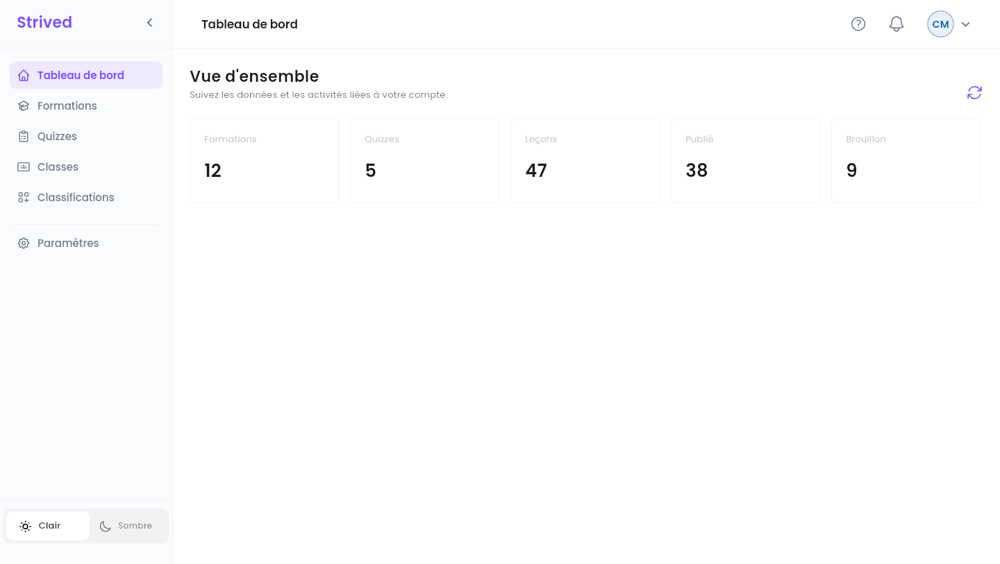
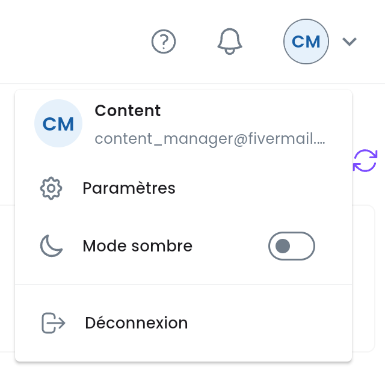
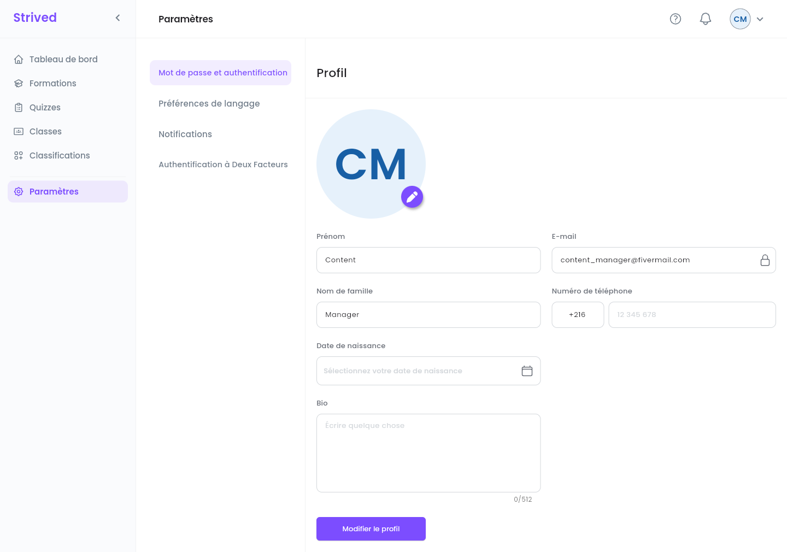
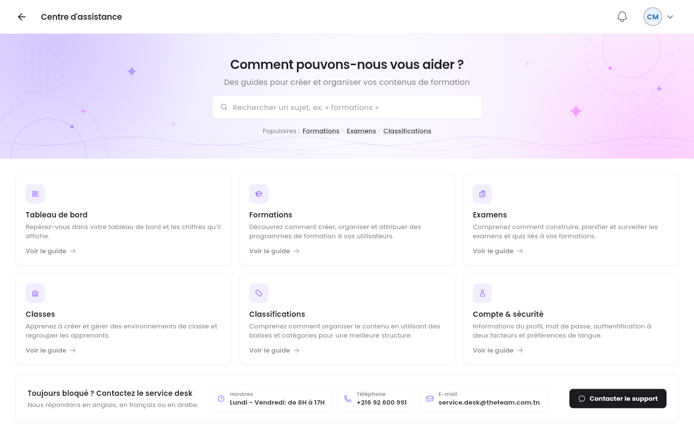

Un **gestionnaire de contenu** s'occupe du catalogue : formations, examens, quiz, classes,
catégories et étiquettes. Ce guide montre où se trouve chaque outil et comment votre rôle
s'articule avec celui des formateurs et des admins.

<Note>
  Tout ce qui suit concerne l'**application web** sur ordinateur, avec un compte **Gestionnaire de
  contenu**. Les captures d'écran viennent de la plateforme de test.
</Note>

---

## Sommaire

- **Étape 1 — La barre latérale et la barre du haut**
- **Étape 2 — Le tableau de bord**
- **Étape 3 — Votre profil**
- **Étape 4 — Obtenir de l'aide**
- **Qui fait quoi**
- **Bon à savoir**

---

## Étape 1 — La barre latérale et la barre du haut

Après la connexion, la plateforme s'ouvre sur le **Tableau de bord**. La barre latérale, à gauche,
mène à chacun de vos outils :

<Frame caption="Le tableau de bord du gestionnaire de contenu, avec la barre latérale à gauche.">
  
</Frame>

| Élément de la barre latérale | Ce que vous y faites | Guide |
| :-- | :-- | :-- |
| **Tableau de bord** | Une vue d'ensemble du catalogue. | Cette page |
| **Formations** | Créez, modifiez, publiez et dépubliez des formations ; construisez leurs chapitres et leurs leçons. | [Gérer les formations](/fr/content-manager-guide/manage-trainings) |
| **Quizzes** | Créez, modifiez, publiez et dépubliez des examens et des quiz ; rédigez leurs questions. | [Gérer les examens et les quiz](/fr/content-manager-guide/manage-exams-and-quizzes) |
| **Classes** | Consultez les classes, leur contenu et leurs membres. | [Classes](/fr/content-manager-guide/classrooms) |
| **Classifications** | Ajoutez et renommez les catégories et les étiquettes du catalogue. | [Catégories et étiquettes](/fr/content-manager-guide/categories-and-tags) |
| **Paramètres** | Votre profil (Étape 3). | Cette page |

En bas de la barre latérale, **Clair** / **Sombre** change le thème, et la **flèche** à côté du logo
**Strived** réduit la barre latérale à ses icônes.

### La barre du haut

<Frame caption="Le menu de l'avatar, en haut à droite.">
  
</Frame>

| Icône | Ce qu'elle fait |
| :-- | :-- |
| **?** | Ouvre le **Centre d'assistance** (Étape 4). |
| Cloche | Vos dernières notifications. |
| Avatar (vos initiales) | Affiche votre nom et votre e-mail, avec **Paramètres**, **Mode sombre** et **Déconnexion**. |

---

## Étape 2 — Le tableau de bord

La **Vue d'ensemble** compte cinq cartes : **Formations**, **Quizzes**, **Leçons**, **Publié** et
**Brouillon**. Le bouton à flèche ronde, en haut à droite (**Actualiser les données**), les
recharge.

<Warning>
  Pour l'instant, le tableau de bord affiche des **chiffres d'exemple** : le serveur n'envoie pas
  encore la vue d'ensemble du gestionnaire de contenu, si bien que les cinq nombres sont les mêmes
  pour tout le monde et ne reflètent pas le catalogue. Pour avoir les vrais chiffres, utilisez les
  listes **Formations** et **Quizzes**, avec leur colonne **Statut**.
</Warning>

---

## Étape 3 — Votre profil

Cliquez sur **Paramètres** dans la barre latérale (ou sur **Paramètres** dans le menu de
l'avatar). La page **Profil** s'ouvre.

<Frame caption="Paramètres → Profil.">
  
</Frame>

<Steps>
  <Step title="Photo (facultatif)">
    Cliquez sur le crayon violet de votre photo.
  </Step>
  <Step title="Vos informations">
    **Prénom**, **Nom de famille**, **Numéro de téléphone** (l'indicatif du pays, puis le numéro),
    **Date de naissance** et **Bio**. L'**E-mail** (cadenas) ne peut pas être modifié.
  </Step>
  <Step title="Enregistrez">
    Cliquez sur **Modifier le profil**.
  </Step>
</Steps>

Les autres pages des paramètres (mot de passe, langue, notifications, authentification à deux
facteurs) ne sont pas couvertes par ce guide.

---

## Étape 4 — Obtenir de l'aide

Cliquez sur **?** dans la barre du haut.

<Frame caption="Le Centre d'assistance du gestionnaire de contenu.">
  
</Frame>

- Recherchez un sujet, ou utilisez les raccourcis **Populaires :** (**Formations**, **Examens**,
  **Classifications**).
- Six cartes couvrent **Tableau de bord**, **Formations**, **Examens**, **Classes**,
  **Classifications** et **Compte & sécurité**. **Voir le guide** ouvre le guide vidéo du sujet.
- **Toujours bloqué ? Contactez le service desk** donne les horaires, le numéro de téléphone et
  l'e-mail du service desk. **Contacter le support** ouvre un e-mail prêt à envoyer. Le service desk
  répond en anglais, en français ou en arabe.

---

## Qui fait quoi

| Tâche | Formateur | Gestionnaire de contenu | Admin |
| :-- | :-- | :-- | :-- |
| Créer et modifier des formations, des examens et des quiz | Les siens | ✓ | ✓ |
| Les **Publier** / les dépublier (**Brouillon**) | — | ✓ | ✓ |
| Activer ou désactiver l'**Assistant IA** d'une formation | — | ✓ | ✓ |
| Choisir le formateur et le pourcentage de revenu | — | ✓ | ✓ |
| Ajouter et renommer des catégories et des étiquettes | — | ✓ | ✓ |
| Archiver et supprimer du contenu | — | — | ✓ |
| Donner accès à des apprenants, notifier les apprenants, vouchers (bons), commandes | Notifier seulement | — | ✓ |

<Note>
  Les formateurs ne peuvent pas publier : quand l'un d'eux termine une formation ou un examen, il
  attend en **Brouillon** jusqu'à ce que vous ou un admin le publiiez. Consultez régulièrement les
  lignes **Brouillon** de vos listes.
</Note>

---

## Bon à savoir

<AccordionGroup>
  <Accordion title="Je dois archiver une formation ou la donner à un apprenant">
    Ces actions sont réservées aux admins. Demandez à un admin de la plateforme.
  </Accordion>
  <Accordion title="Puis-je changer mon e-mail ?">
    Non, c'est votre identifiant de connexion. Contactez un admin s'il doit changer.
  </Accordion>
</AccordionGroup>
