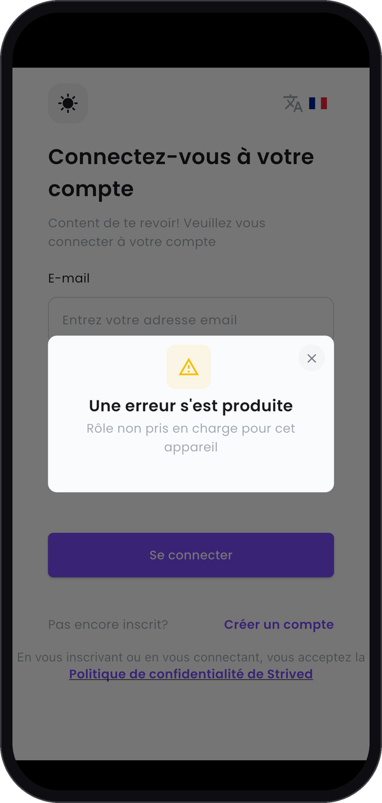

L'application mobile Strived est faite pour les apprenants et les formateurs. Les gestionnaires de
contenu travaillent sur l'application web, sur ordinateur, où se trouvent tous leurs outils.

---

## Ce que vous voyez sur un téléphone

Si vous vous connectez à l'application avec un compte gestionnaire de contenu, l'application vous
déconnecte aussitôt. Elle affiche **Une erreur s'est produite** avec le message **Rôle non pris en
charge pour cet appareil**, par-dessus l'écran de connexion.

<Columns cols={3}>
  <Frame caption="Le message sur un téléphone.">
    
  </Frame>
</Columns>

Votre compte n'a aucun problème : le message veut seulement dire que ce rôle n'est pas dans
l'application.

---

## Que faire à la place

Ouvrez Strived dans un navigateur sur ordinateur et connectez-vous avec le même e-mail et le même mot
de passe. Le bouton **Ouvrir Strived**, en haut de ce site, vous y emmène.

---

## Ce que voient vos utilisateurs

Les apprenants et les formateurs ont bien l'application. Pour voir ses écrans, ou pour aider quelqu'un
qui l'utilise, lisez les guides de l'[apprenant](/fr/student-guide/mobile-app) et du
[formateur](/fr/instructor-guide/mobile-app).
