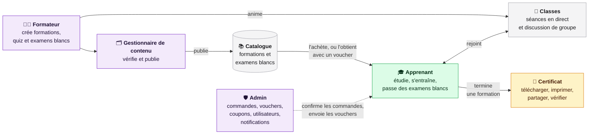
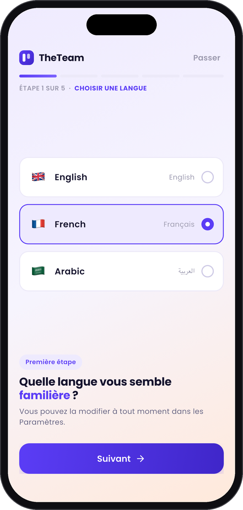
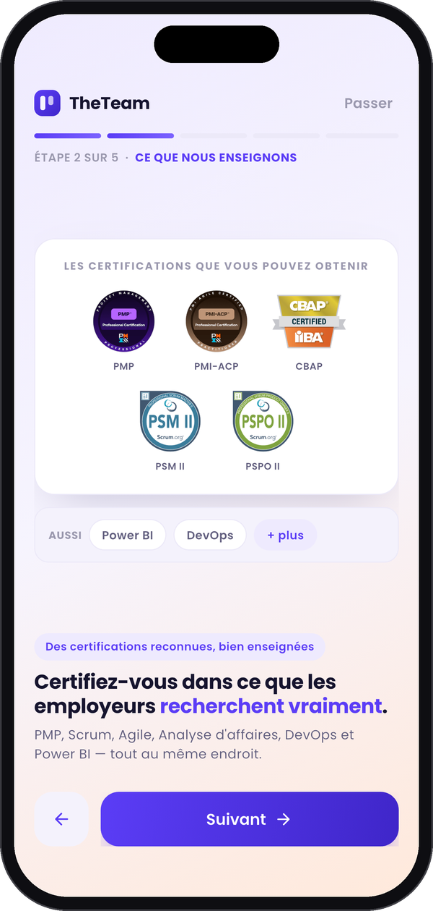
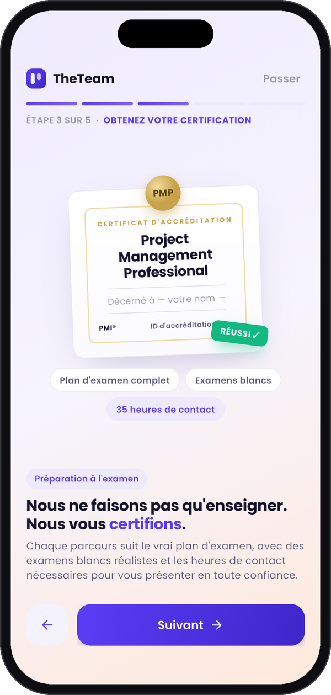
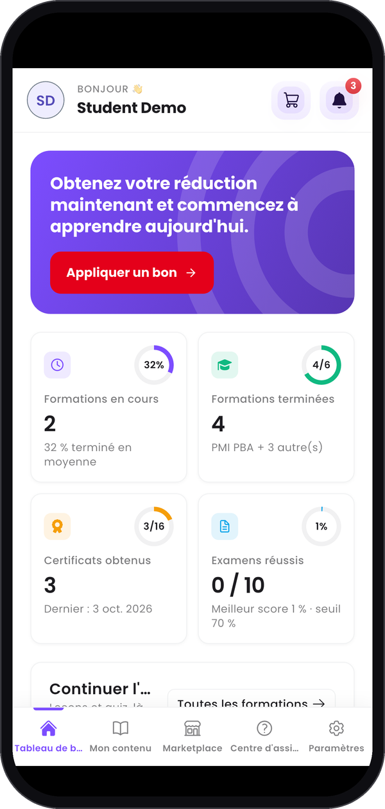
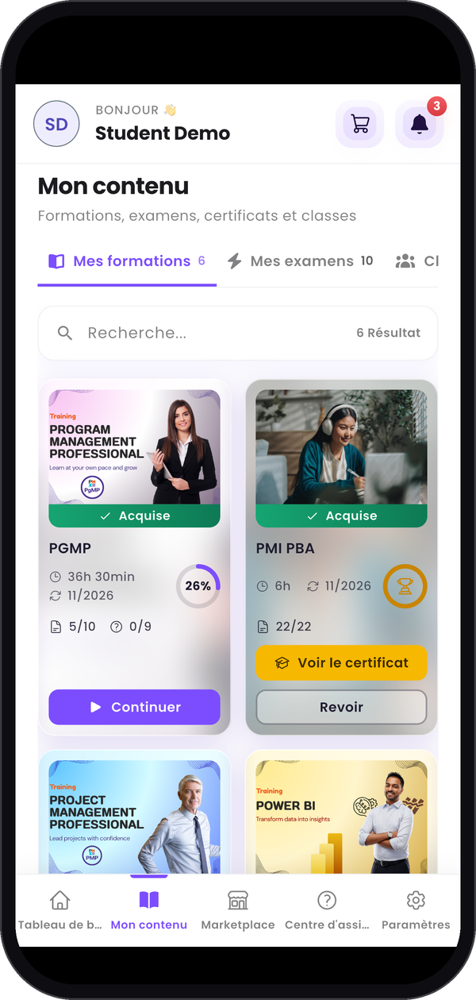
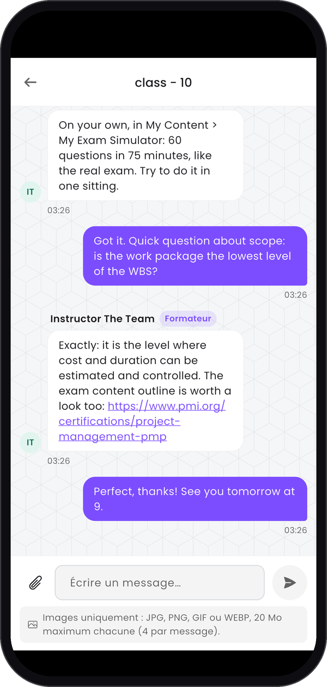
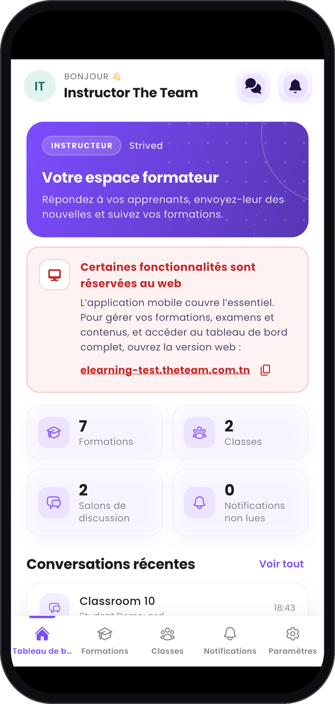
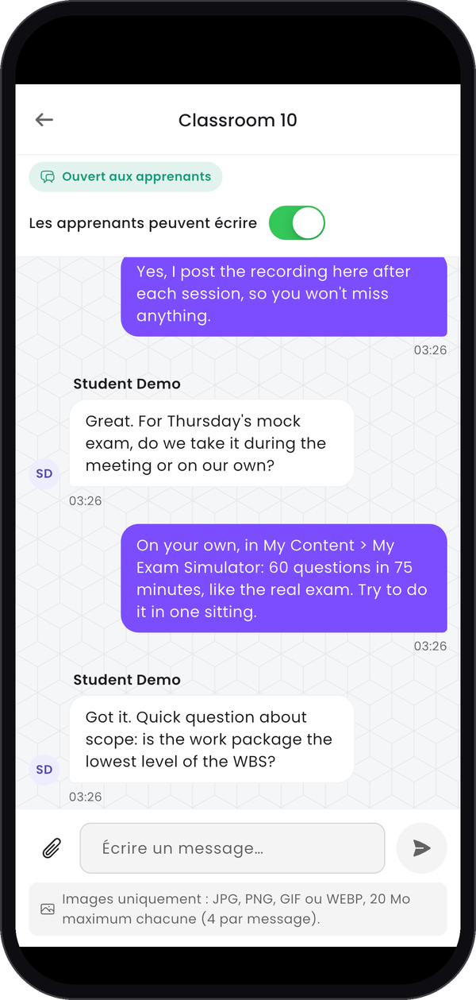

<Info>
  **Le LMS qui prépare les professionnels aux certifications internationales en gestion de projet,
  agilité, analyse métier et business intelligence, en associant formation avec formateur et
  apprentissage en autonomie.**
</Info>

**Strived** est une plateforme d'e-learning conçue par THE TEAM. L'apprenant étudie à son rythme,
s'entraîne sur des examens blancs construits comme le vrai examen de certification, retrouve son
formateur dans des classes en direct, et repart avec un certificat. En coulisses, les formateurs
écrivent le contenu, les gestionnaires de contenu tiennent le catalogue, et les admins font tourner
la plateforme : commandes, vouchers (bons), coupons de réduction, utilisateurs et notifications.

<Frame caption="Le tableau de bord d'un apprenant : formations en cours, certificats, examens, classement et activité.">
  
</Frame>

---

## Comment fonctionne Strived

Quatre rôles se partagent la plateforme. Les formateurs créent le contenu, les gestionnaires de
contenu et les admins le publient, les apprenants y accèdent et apprennent, et la plateforme délivre
les certificats.

Un admin peut aussi faire tout ce que fait un gestionnaire de contenu.

---

## Ce que fait chaque rôle

| Rôle | En bref | Ce qu'il fait sur Strived |
| :-- | :-- | :-- |
| **Apprenant** | Apprend et se certifie | Achète des formations et des examens dans la Marketplace ou les débloque avec un voucher (bon), suit les leçons et les quiz, passe des examens blancs et revoit la correction, rejoint ses classes et leur discussion, et télécharge ses certificats. |
| **Formateur** | Enseigne | Construit son profil public, crée des formations, des quiz et des examens blancs, anime ses classes et leur discussion, prévient ses apprenants, et suit les ventes de son contenu et sa part de chaque commande. |
| **Gestionnaire de contenu** | Tient le catalogue | Crée et modifie les formations et les examens des formateurs, les publie ou les dépublie, modifie les classes, et range le catalogue avec les catégories et les tags. |
| **Admin** | Fait tourner la plateforme | Tout ce que fait le gestionnaire de contenu, plus les commandes et les paiements, les vouchers (bons) et les coupons de réduction, les comptes et les rôles, les classes et les salons de discussion, et les notifications aux utilisateurs. |

---

## Ce que reçoivent les apprenants

<CardGroup cols={2}>
  <Card title="Des formations en autonomie" icon="book-open">
    Des chapitres de leçons en vidéo et en document, avec des quiz, un lecteur de cours qui reprend
    là où l'apprenant s'est arrêté, et une barre de progression sur chaque formation.
  </Card>
  <Card title="Un simulateur d'examens" icon="stopwatch">
    Des examens blancs construits comme le vrai : même minuteur, même nombre de questions, même
    seuil de réussite. Chaque tentative se revoit question par question, avec les explications.
  </Card>
  <Card title="Des classes avec formateur" icon="users">
    Une page par groupe, où le formateur publie le lien de la séance en direct, le programme et les
    ressources, et une discussion de groupe avec le formateur.
  </Card>
  <Card title="Des certificats" icon="award">
    Délivrés quand la formation est terminée, prêts à être téléchargés, imprimés et partagés, et
    vérifiables en ligne.
  </Card>
  <Card title="De la motivation" icon="trophy">
    Un tableau de bord de sa progression et un classement. Les meilleurs apprenants gagnent des
    coupons de réduction.
  </Card>
  <Card title="Trois langues" icon="language">
    Toute l'application existe en anglais, en français et en arabe.
  </Card>
</CardGroup>

## Strived sur téléphone

Les apprenants ont aussi Strived en application mobile pour iPhone et Android. À la première
ouverture, une courte visite d'accueil leur demande leur langue et leur montre à quoi Strived les
prépare. Ils retrouvent ensuite le même tableau de bord, les mêmes formations et la discussion de
leurs classes que sur le web, et leur progression les suit d'un appareil à l'autre. Les formateurs
ont leur propre espace dans l'application ; les gestionnaires de contenu et les admins travaillent
sur l'application web.

{/* Liens des stores : remplacer les deux href="#" ci-dessous par les vraies adresses (idem dans index.mdx). */}

  
  

### Pour les apprenants

<Columns cols={3}>
  <Frame caption="Étape 1 : choisir la langue.">
    
  </Frame>
  <Frame caption="Étape 2 : ce que Strived enseigne.">
    
  </Frame>
  <Frame caption="Étape 3 : se certifier.">
    
  </Frame>
  <Frame caption="Le tableau de bord de l'apprenant.">
    
  </Frame>
  <Frame caption="Mes formations et leur progression.">
    
  </Frame>
  <Frame caption="La discussion avec le formateur.">
    
  </Frame>
</Columns>

Tous les écrans sont dans le guide de l'apprenant : [Application mobile](/fr/student-guide/mobile-app).

### Pour les formateurs

Le téléphone couvre l'essentiel du quotidien d'un formateur : répondre aux apprenants, leur envoyer
des nouvelles et garder un œil sur les formations et les classes. La création et la modification du
contenu restent sur le web. Voir le guide du formateur :
[Application mobile](/fr/instructor-guide/mobile-app).

<Columns cols={3}>
  <Frame caption="Le tableau de bord du formateur.">
    
  </Frame>
  <Frame caption="Notifier les apprenants ou copier leurs e-mails.">
    
  </Frame>
  <Frame caption="Répondre dans la discussion de la classe.">
    
  </Frame>
</Columns>

### Pour les gestionnaires de contenu et les admins

Ces deux rôles travaillent sur l'application web, sur ordinateur : l'application mobile ne s'ouvre
pas pour eux. Voir [gestionnaires de contenu](/fr/content-manager-guide/mobile-app) et
[admins](/fr/admin-guide/mobile-app).

## Ce que reçoit l'organisation

<CardGroup cols={2}>
  <Card title="Une marketplace" icon="store">
    Un catalogue de formations et d'examens blancs avec des catégories, un panier et des coupons de
    réduction. Les commandes payées par virement, en espèces ou par chèque sont confirmées par un
    admin.
  </Card>
  <Card title="Des vouchers (bons)" icon="ticket">
    Un voucher donne à un apprenant l'accès gratuit à un ensemble de formations et d'examens, envoyé
    par e-mail. Pratique pour une entreprise qui inscrit toute une équipe.
  </Card>
  <Card title="Une part des ventes pour les formateurs" icon="chart-line">
    Chaque formateur touche une part des ventes de son contenu et la suit sur sa propre page de
    ventes, avec des exports PDF et CSV.
  </Card>
  <Card title="De la communication" icon="bell">
    Des notifications dans l'application, envoyées à des utilisateurs choisis, à un rôle ou à toute
    l'entreprise, aussi par e-mail, tout de suite ou plus tard.
  </Card>
</CardGroup>

## Bientôt : l'assistant IA

Un assistant IA arrive bientôt dans le lecteur de cours. L'apprenant lui pose ses questions sur la
formation qu'il suit, et l'assistant répond à partir du contenu de cette formation, en indiquant
sous chaque réponse les parties du cours qu'il a utilisées. Il sait aussi donner le plan de toute
la formation, résumer une séance, dégager les points clés, expliquer une notion avec un exemple ou
interroger l'apprenant sur le cours, en français ou en anglais. Seuls les apprenants inscrits à la
formation y ont accès.

<Frame caption="L'assistant IA à l'œuvre sur une formation PMP.">
  <iframe
    src="https://www.youtube-nocookie.com/embed/GmlSoXiWilY"
    title="L'assistant IA de Strived répond aux questions sur une formation PMP"
    style={{ width: "100%", aspectRatio: "16 / 9", border: 0 }}
    allow="accelerometer; autoplay; clipboard-write; encrypted-media; gyroscope; picture-in-picture; web-share"
    referrerPolicy="strict-origin-when-cross-origin"
    allowFullScreen
  ></iframe>
</Frame>

---

## Lire les guides

Chaque guide parcourt l'application web étape par étape, avec une capture d'écran pour chaque
étape. Chaque rôle a aussi une page **Application mobile** pour le téléphone.

<CardGroup cols={2}>
  <Card title="Apprenant" icon="graduation-cap" href="/fr/student-guide/first-steps">
    Se connecter, suivre ses formations, passer des examens blancs, obtenir ses certificats et
    acheter de nouvelles formations.
  </Card>
  <Card title="Formateur" icon="chalkboard-user" href="/fr/instructor-guide/get-started">
    Construire son profil public, créer des formations et des examens, animer ses classes et suivre
    ses ventes.
  </Card>
  <Card title="Gestionnaire de contenu" icon="folder-gear" href="/fr/content-manager-guide/get-started">
    Publier les formations et les examens, modifier les classes, ranger les catégories et les tags.
  </Card>
  <Card title="Admin" icon="user-shield" href="/fr/admin-guide/get-started">
    Gérer les commandes, les formations, les examens, les vouchers (bons) et les coupons, les
    utilisateurs, les classes et les notifications.
  </Card>
</CardGroup>

<Callout icon="building" color="#7625C2">
  **Pensé pour votre organisation.** Strived est hautement personnalisable pour les entreprises et
  les organismes de formation : votre nom, votre logo et vos couleurs sur toute la plateforme, des
  certificats avec votre signature et votre cachet, des e-mails envoyés à votre nom, et votre propre
  catalogue de formations et d'examens. Dites-nous ce dont vos équipes ont besoin, et nous
  adapterons Strived pour elles.
</Callout>

<Tip>
  Besoin d'aide ? Ouvrez le **Centre d'assistance** dans l'application ou écrivez à
  [service.desk@theteam.com.tn](mailto:service.desk@theteam.com.tn).
</Tip>
