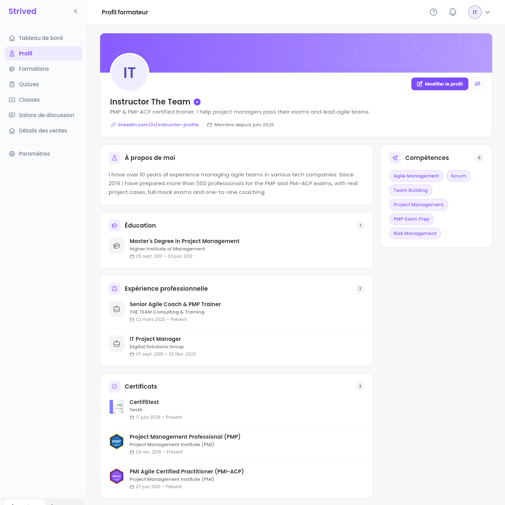
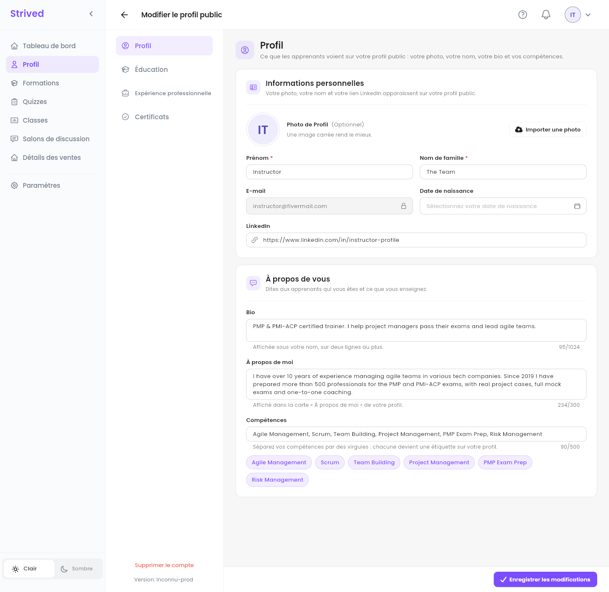
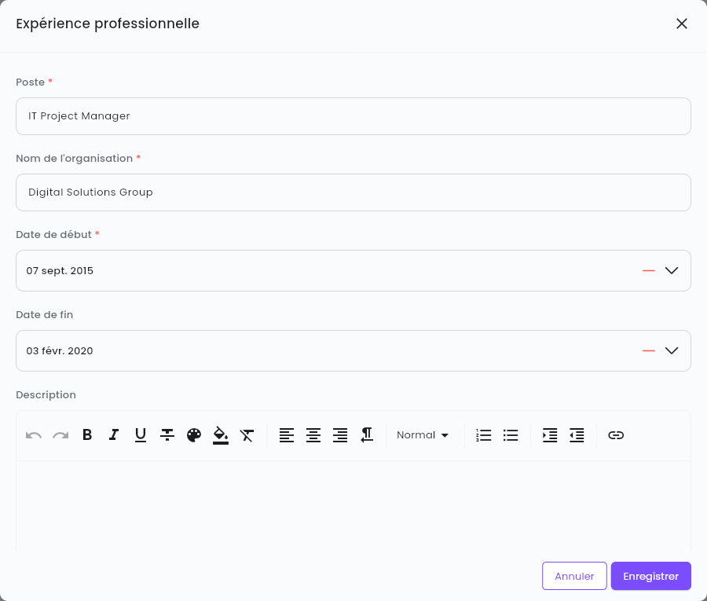
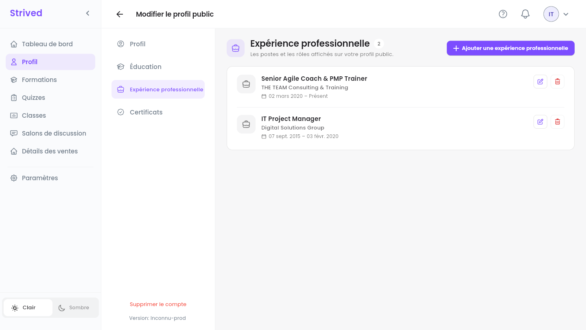
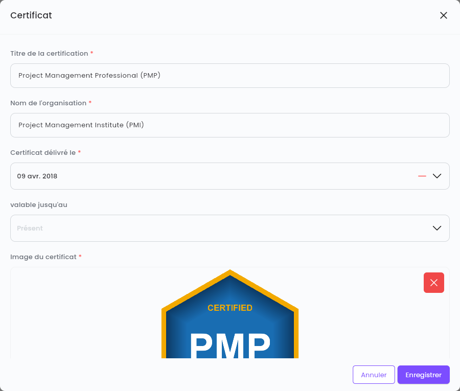
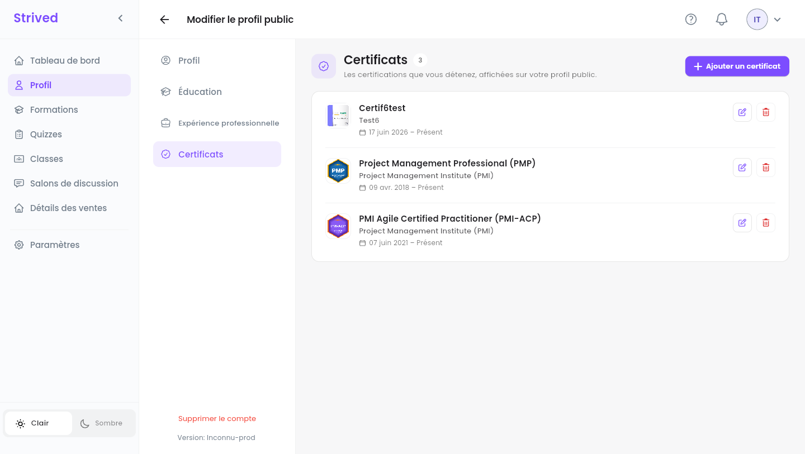

Votre **profil public** est ce que voient les apprenants quand ils regardent qui anime une
formation. Un profil complet, avec vos certifications et votre expérience, inspire confiance avant
l'achat.

<Note>
  Tout ce qui suit concerne l'**application web** sur ordinateur. Les captures d'écran montrent le
  profil du compte formateur de test.
</Note>

---

## Sommaire

- **Étape 1 — Consulter votre profil**
- **Étape 2 — Modifier vos informations, votre bio et vos compétences**
- **Étape 3 — Ajouter vos diplômes et votre expérience professionnelle**
- **Étape 4 — Ajouter vos certificats et leurs badges**
- **Étape 5 — Partager votre profil**
- **Bon à savoir**

---

## Étape 1 — Consulter votre profil

Cliquez sur **Profil** dans la barre latérale.

<Frame caption="Votre profil public.">
  
</Frame>

| Partie | Ce qu'elle montre |
| :-- | :-- |
| En-tête | Votre photo (ou vos initiales), votre nom, le badge violet si un admin vous a vérifié, votre **Bio**, votre lien LinkedIn et **Membre depuis**. |
| **À propos de moi** | Une présentation plus longue de vous et de ce que vous enseignez. |
| **Compétences** | Vos compétences, sous forme de tags. |
| **Éducation** | Vos diplômes et vos écoles. |
| **Expérience professionnelle** | Les postes et les rôles que vous avez occupés. |
| **Certificats** | Vos certifications, chacune avec l'image de son badge. |

Cliquez sur **Modifier le profil** en haut à droite pour changer n'importe lequel de ces éléments.

---

## Étape 2 — Modifier vos informations, votre bio et vos compétences

**Modifier le profil public** a quatre sections à gauche : **Profil**, **Éducation**,
**Expérience professionnelle** et **Certificats**. **Profil** s'ouvre en premier.

<Frame caption="Modifier le profil public → Profil.">
  
</Frame>

<Steps>
  <Step title="Informations personnelles">
    **Importer une photo** (une image carrée rend le mieux), **Prénom**, **Nom de famille**,
    **Date de naissance** et **LinkedIn**. L'**E-mail** ne peut pas être modifié.
  </Step>
  <Step title="Bio">
    Une ou deux lignes affichées sous votre nom, par exemple *« Formateur certifié PMP et PMI-ACP.
    J'aide les chefs de projet à réussir leurs examens et à diriger des équipes agiles. »*
  </Step>
  <Step title="À propos de moi">
    Une courte présentation, 300 caractères au maximum : votre expérience, ce que vous enseignez,
    comment vous l'enseignez.
  </Step>
  <Step title="Compétences">
    Séparez-les par des virgules : chacune devient un tag, et les tags apparaissent sous le champ
    au fil de la saisie.
  </Step>
  <Step title="Enregistrer">
    Cliquez sur **Enregistrer les modifications** en bas à droite. *« Votre profil a été mis à
    jour. »* le confirme.
  </Step>
</Steps>

---

## Étape 3 — Ajouter vos diplômes et votre expérience professionnelle

Les deux sections fonctionnent de la même façon. Ouvrez **Expérience professionnelle** (ou
**Éducation**) et cliquez sur **Ajouter une expérience professionnelle** (ou **Ajouter une
formation**).

<Frame caption="Ajouter une expérience professionnelle.">
  
</Frame>

<Steps>
  <Step title="Quoi et où">
    Pour un poste : **Poste** et **Nom de l'organisation**. Pour un diplôme : **Éducation** (le
    diplôme) et **Nom de l’université**.
  </Step>
  <Step title="Quand">
    Choisissez la **Date de début**. Laissez la **Date de fin** vide s'il s'agit de votre poste
    actuel : le profil affiche **Présent**. La date de début doit précéder la date de fin.
  </Step>
  <Step title="Description (facultatif)">
    Quelques lignes sur le poste ou le diplôme, avec la barre de mise en forme.
  </Step>
  <Step title="Enregistrer">
    Cliquez sur **Enregistrer**. L'entrée apparaît aussitôt sur votre profil public.
  </Step>
</Steps>

<Frame caption="Votre expérience professionnelle.">
  
</Frame>

Le crayon à côté d'une entrée la modifie, la corbeille la supprime (après confirmation).

---

## Étape 4 — Ajouter vos certificats et leurs badges

Ouvrez **Certificats** et cliquez sur **Ajouter un certificat**.

<Frame caption="Ajouter un certificat avec son badge.">
  
</Frame>

<Steps>
  <Step title="La certification">
    **Titre de la certification** (par exemple *Project Management Professional (PMP)*) et **Nom
    de l'organisation** (par exemple *Project Management Institute (PMI)*).
  </Step>
  <Step title="Les dates">
    **Certificat délivré le**, et **valable jusqu'au** s'il expire. Laissé vide, le profil affiche
    **Présent**.
  </Step>
  <Step title="Le badge">
    Sous **Image du certificat**, cliquez sur **Choisir un fichier** et choisissez le badge ou une
    photo du certificat. L'image est obligatoire. La croix rouge la retire si vous vous êtes
    trompé de fichier.
  </Step>
  <Step title="Enregistrer">
    Cliquez sur **Enregistrer**.
  </Step>
</Steps>

<Frame caption="Vos certificats, chacun avec son badge.">
  
</Frame>

---

## Étape 5 — Partager votre profil

Sur votre profil, le bouton lien à côté de **Modifier le profil** copie l'adresse de votre profil
(*« Le lien de profil a été copié avec succès »*). Collez-la dans un e-mail, une publication ou
votre page LinkedIn.

---

## Bon à savoir

<AccordionGroup>
  <Accordion title="Que signifie le badge violet à côté de mon nom ?">
    Un admin a vérifié votre compte. Seuls les admins peuvent vérifier un formateur ou retirer
    cette vérification.
  </Accordion>
  <Accordion title="Bio ou À propos de moi : que mettre où ?">
    La **Bio** se place sous votre nom, sur deux lignes au maximum : limitez-la à une phrase.
    **À propos de moi** a sa propre carte, pour un court paragraphe.
  </Accordion>
  <Accordion title="Puis-je changer mon e-mail ?">
    Non, c'est votre identifiant de connexion. Contactez les admins de la plateforme s'il doit
    changer.
  </Accordion>
</AccordionGroup>
