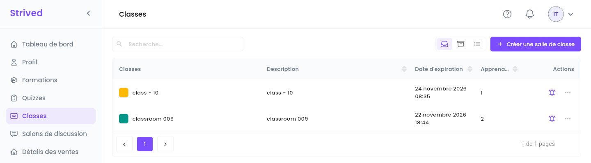
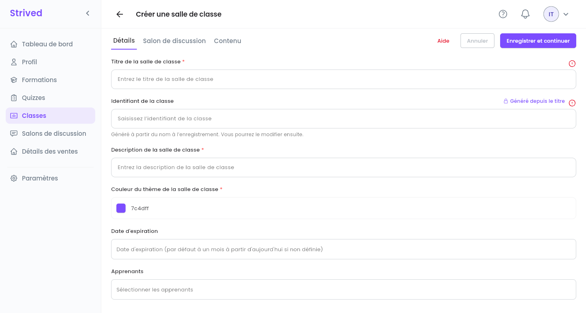
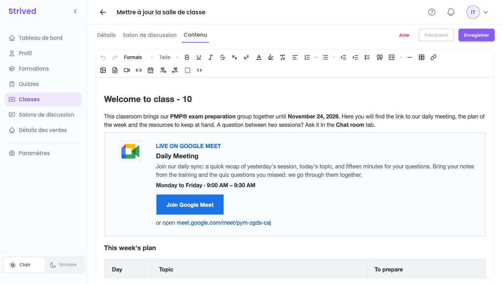
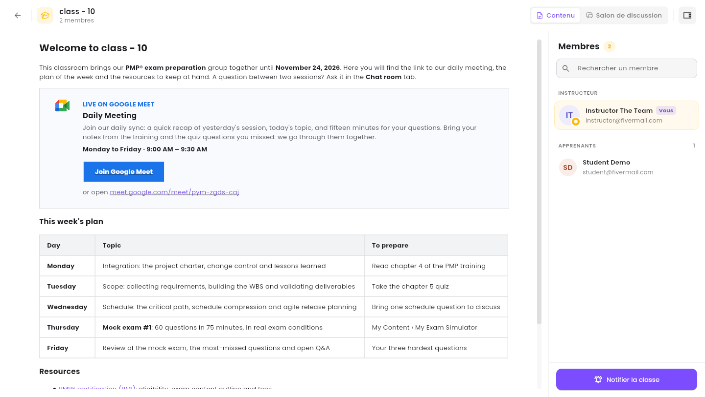
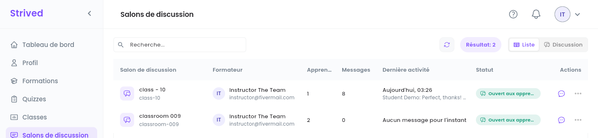
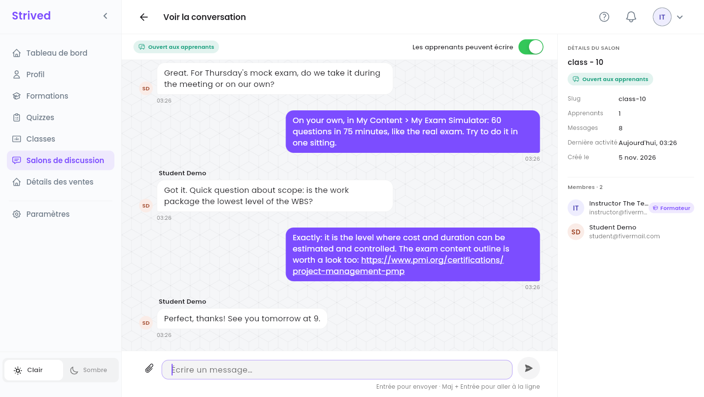

Une **classe** réunit un groupe de vos apprenants pour une période donnée. Elle a une page de
contenu et, si vous en créez un, un **salon de discussion** : une discussion de groupe entre vous et
les apprenants.

<Note>
  Tout ce qui suit concerne l'**application web** sur ordinateur, connecté avec un compte
  formateur. Les apprenants trouvent leurs classes dans **Mon contenu → Classrooms & Chat**.
</Note>

---

## Sommaire

- **Étape 1 — Ouvrir vos classes**
- **Étape 2 — Créer une classe**
- **Étape 3 — La prévisualiser et notifier ses membres**
- **Étape 4 — Animer le salon de discussion**
- **Bon à savoir**

---

## Étape 1 — Ouvrir vos classes

Cliquez sur **Classes** dans la barre latérale.

<Frame caption="Vos classes.">
  
</Frame>

Chaque ligne montre la couleur et le nom de la classe, sa **Description**, sa **Date d'expiration**
et son nombre d'**Apprenants**. La cloche envoie un message à la classe (Étape 3), et **⋯** propose
**Visualiser**, **Modifier** et **Notifier la classe**.

---

## Étape 2 — Créer une classe

Cliquez sur **Créer une salle de classe** en haut à droite. L'éditeur a trois onglets : **Détails**,
**Salon de discussion** et **Contenu**.

<Frame caption="Créer une salle de classe → Détails.">
  
</Frame>

<Steps>
  <Step title="Détails">
    **Titre de la salle de classe**, **Description de la salle de classe** et **Couleur du thème de
    la salle de classe**. L'**Identifiant de la classe** est généré à partir du titre. **Date
    d'expiration** : laissée vide, un mois à partir d'aujourd'hui. **Apprenants** : choisissez tous
    les participants. Vous êtes le formateur de la classe.
  </Step>
  <Step title="Enregistrer et continuer">
    Cliquez sur **Enregistrer et continuer** : la classe est créée et l'onglet **Salon de
    discussion** s'ouvre.
  </Step>
  <Step title="Salon de discussion (facultatif)">
    Cliquez sur **Créer le salon** pour ouvrir la discussion de groupe tout de suite, ou passez
    cette étape et créez-le plus tard depuis **Modifier**.
  </Step>
  <Step title="Contenu">
    **Page suivante** ouvre un éditeur de texte enrichi. Rédigez ce que les apprenants doivent
    trouver dans la classe : planning, consignes, ressources. Cliquez sur **Enregistrer**.
  </Step>
</Steps>

Pour modifier une classe plus tard, utilisez **⋯ → Modifier** : les trois mêmes onglets, avec un
seul **Enregistrer** à la fin. L'enregistrement met aussi à jour le titre et les membres du salon
de discussion.

### L'éditeur de contenu

<Frame caption="Contenu : l'éditeur de texte enrichi, ici avec la page de class - 10.">
  
</Frame>

| Boutons | Ce qu'ils font |
| :-- | :-- |
| **Formats**, **Taille** | Titres, styles de paragraphe et taille du texte. |
| Gras, souligné, italique, barré, indice, exposant | Styles de texte. |
| Couleur du texte, surlignage, effacer le formatage | Couleurs, et suppression de tous les styles de la sélection. |
| Alignement, listes numérotées et à puces, retrait, hauteur de ligne | La mise en page des paragraphes. |
| Citation, bloc de code, ligne horizontale, tableau, lien | Blocs, tableaux et liens. |
| Image, PDF, vidéo, intégration, Google Agenda | Les images et les PDF sont importés dans le stockage cloud, dans le dossier de la classe. **Intégrer** accepte un code `<iframe>` ou un lien (YouTube, Google Drive…). |
| De gauche à droite / de droite à gauche, voir les blocs, voir le code (`<>`) | Le sens d'écriture, le contour des blocs, et le HTML de la page. |

<Tip>
  La page des apprenants conserve les titres, les listes, les couleurs du texte, les liens, les
  images et les **tableaux** avec leurs bordures et leurs couleurs de fond. Pour dessiner une carte
  ou un bouton, utilisez un tableau, comme la carte Google Meet ci-dessus : l'éditeur supprime les
  styles pour lesquels il n'a pas d'outil (marges intérieures, coins arrondis, `<div>` ou boutons
  stylés). Après l'enregistrement, vérifiez le résultat avec **⋯ → Visualiser**.
</Tip>

<Accordion title="Réutiliser la carte Google Meet">
  Ouvrez la vue code (`<>`), collez le HTML ci-dessous à l'endroit où la carte doit apparaître, puis
  changez le lien (il apparaît deux fois), les jours et les horaires. Fermez la vue code et cliquez
  sur **Enregistrer**. Gardez une description d'environ deux lignes : sur la page des apprenants, un
  tableau n'est jamais plus large que ce que son texte demande.

  ```html
  <table style="width: 100%; border: 1px solid #dadce0; background-color: #f8fafd">
    <tbody>
      <tr>
        <td style="border: 0"><p style="margin: 0 10px">&nbsp;</p></td>
        <td style="border: 0; text-align: center; vertical-align: top">
          <p style="margin: 0; line-height: 18px"><br></p>
          
        </td>
        <td style="border: 0"><p style="margin: 0 7px">&nbsp;</p></td>
        <td style="border: 0; vertical-align: top">
          <p style="margin: 20px 24px 2px 0"><span style="color: #1a73e8"><strong>EN DIRECT SUR GOOGLE MEET</strong></span></p>
          <h3 style="margin: 0 24px 4px 0">Réunion quotidienne</h3>
          <p style="margin: 0 24px 6px 0"><span style="color: #5f6368">Notre point quotidien : un rappel de la séance d'hier, le sujet du jour et quinze minutes pour vos questions. Apportez vos notes de la formation et les questions de quiz que vous avez ratées : nous les reprenons ensemble.</span></p>
          <p style="margin: 0 24px 14px 0"><strong>Du lundi au vendredi · 9 h 00 – 9 h 30</strong></p>
          <table style="border-collapse: collapse">
            <tbody>
              <tr>
                <td style="background-color: #1a73e8; border: 0">
                  <p style="margin: 10px 22px"><a href="https://meet.google.com/meet/pym-zgds-caj"><span style="color: #ffffff"><strong>Rejoindre Google Meet</strong></span></a></p>
                </td>
              </tr>
            </tbody>
          </table>
          <p style="margin: 10px 24px 20px 0"><span style="color: #5f6368">ou ouvrez </span><a href="https://meet.google.com/meet/pym-zgds-caj">meet.google.com/meet/pym-zgds-caj</a></p>
        </td>
      </tr>
    </tbody>
  </table>
  ```
</Accordion>

---

## Étape 3 — La prévisualiser et notifier ses membres

**⋯ → Visualiser** ouvre la classe telle que la voient ses membres.

<Frame caption="Prévisualiser une classe.">
  
</Frame>

- **Contenu** / **Salon de discussion**, en haut à droite, passent de la page de contenu à la
  discussion de groupe.
- Le panneau **Membres** vous liste (**Vous**) ainsi que les **Apprenants**, avec **Rechercher un
  membre**.
- **Notifier la classe**, en bas, envoie une notification dans l'application à chaque membre, comme
  la cloche de la liste.

---

## Étape 4 — Animer le salon de discussion

Cliquez sur **Salons de discussion** dans la barre latérale : les salons de vos classes, sous forme
de tableau (**Liste**) ou de messagerie (**Discussion**).

<Frame caption="Salons de discussion → Liste.">
  
</Frame>

Le menu **⋯** d'un salon propose **Voir la conversation** et **Empêcher les apprenants d'écrire**.
L'icône en forme de bulle ouvre aussi la conversation.

<Frame caption="Une conversation.">
  
</Frame>

- Écrivez dans **Écrire un message…** et appuyez sur Entrée pour envoyer (Maj + Entrée pour aller à
  la ligne). Le trombone joint des images : JPG, PNG, GIF ou WEBP, 20 Mo maximum chacune, 4 par
  message.
- **Les apprenants peuvent écrire**, en haut : désactivez-le pour mettre le salon en lecture seule
  pour les apprenants (une annonce, un jour d'examen…). Vous pouvez toujours écrire. Réactivez-le à
  tout moment.
- **DÉTAILS DU SALON**, à droite : identifiant (slug), nombre d'apprenants et de messages, dernière
  activité, date de création, et les membres.

---

## Bon à savoir

<AccordionGroup>
  <Accordion title="Qui peut lire le salon de discussion ?">
    Vous, les apprenants de la classe et les admins de la plateforme. Personne d'autre ne peut
    l'ouvrir.
  </Accordion>
  <Accordion title="Puis-je supprimer des messages ou le salon ?">
    Non, effacer l'historique ou supprimer un salon est réservé aux admins. Contactez-les si
    besoin.
  </Accordion>
  <Accordion title="J'ai ajouté un apprenant : fait-il partie du salon ?">
    Oui. L'enregistrement de la classe met aussi à jour les membres du salon.
  </Accordion>
</AccordionGroup>
