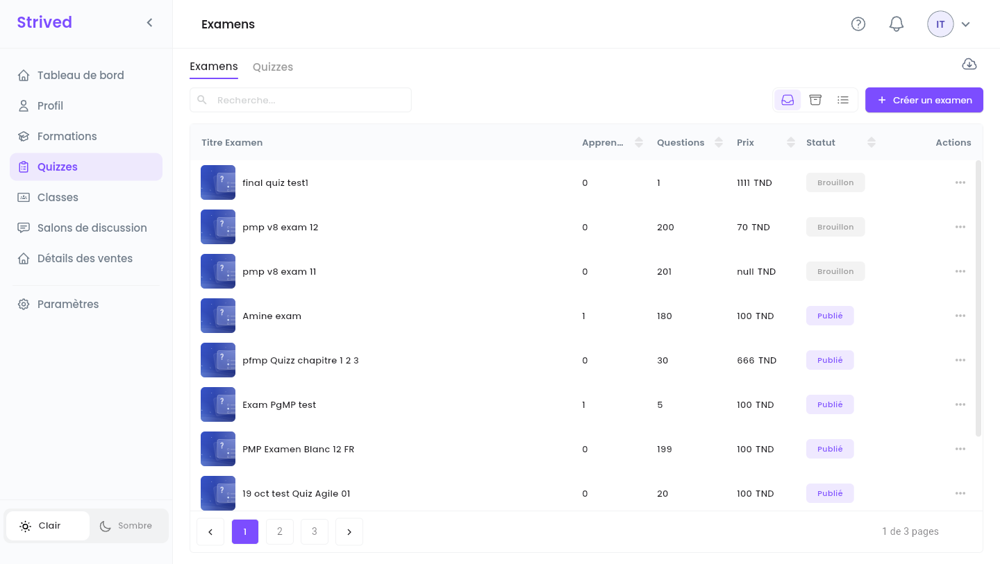
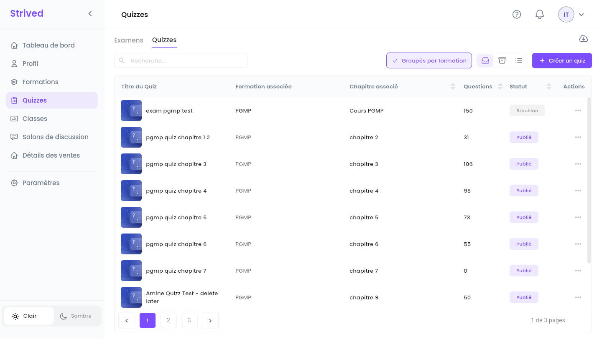
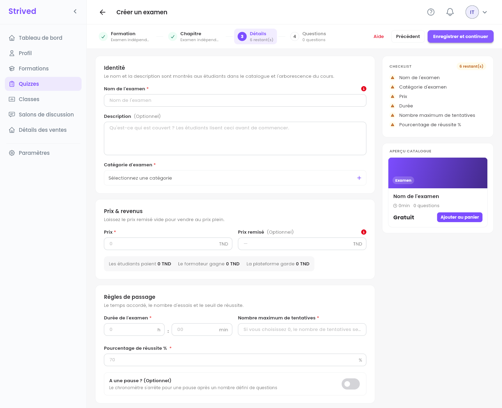
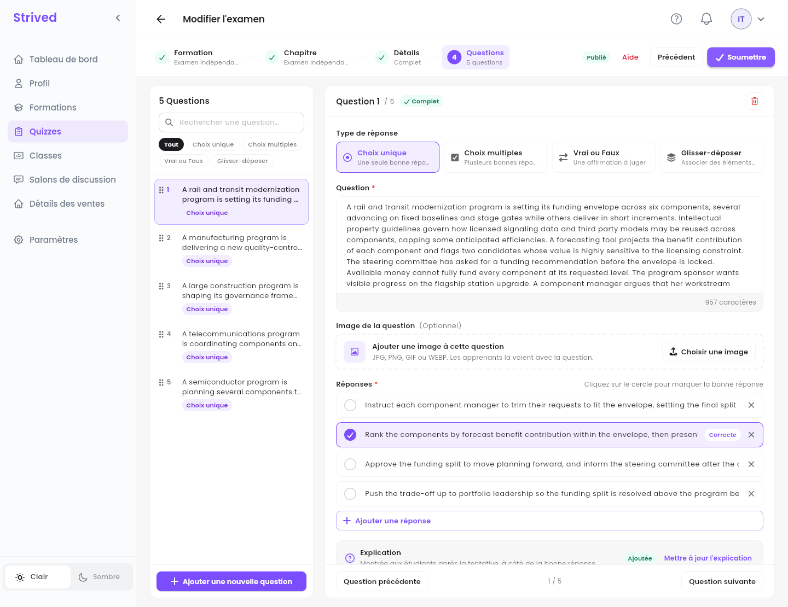
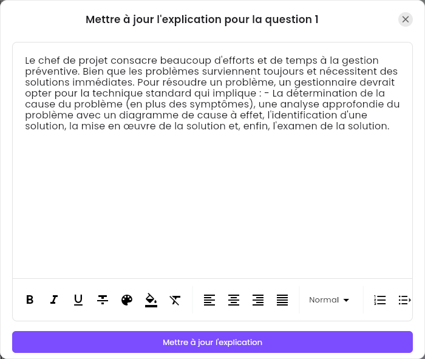
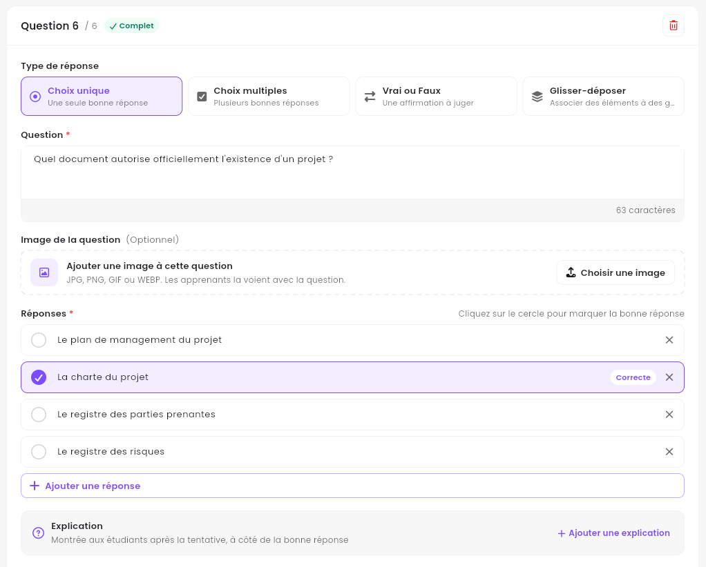
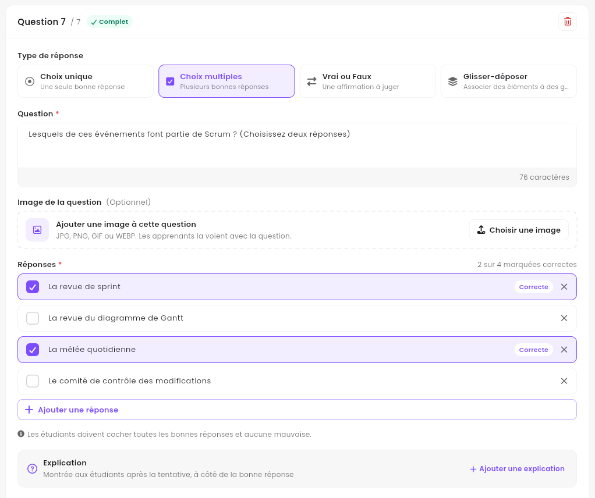
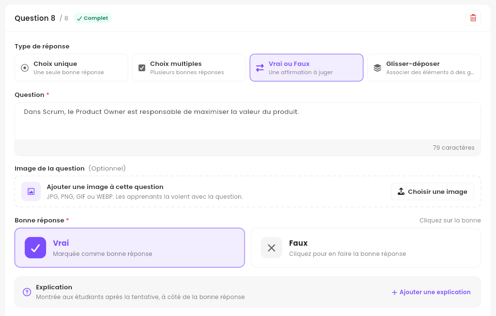
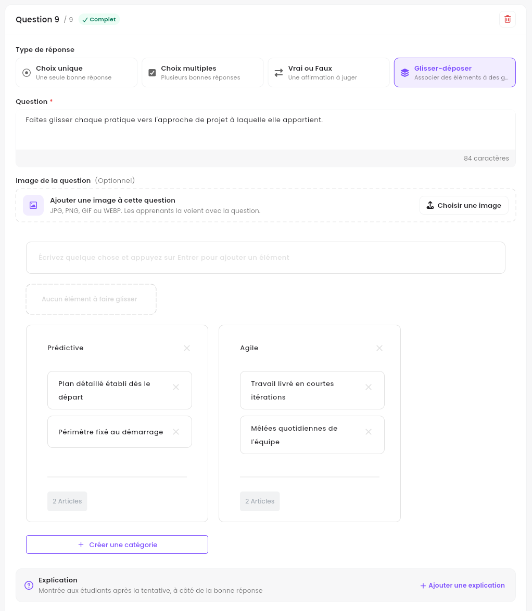

**Quizzes**, dans la barre latérale, regroupe deux types de tests, construits avec le même éditeur :

| | **Examen** | **Quiz** |
| :-- | :-- | :-- |
| Ce que c'est | Un examen blanc indépendant, vendu seul dans le **Catalogue des examens**. | Un test dans une formation, placé dans l'un de ses chapitres. |
| Les apprenants le trouvent dans | **Mon contenu → Mon simulateur d'examens**. | Le panneau **Contenu du cours** de la formation. |
| A son propre prix | Oui. | Non : il est inclus dans la formation. |

<Note>
  Tout ce qui suit concerne l'**application web** sur ordinateur, connecté avec un compte
  formateur.
</Note>

---

## Sommaire

- **Étape 1 — Ouvrir vos examens et vos quiz**
- **Étape 2 — Formation et Chapitre**
- **Étape 3 — Détails**
- **Étape 4 — Rédiger les questions**
- **Étape 5 — Le prévisualiser et le faire publier**
- **Bon à savoir**

---

## Étape 1 — Ouvrir vos examens et vos quiz

Cliquez sur **Quizzes** dans la barre latérale. Deux onglets se trouvent en haut : **Examens** et
**Quizzes**.

<Frame caption="L'onglet Examens.">
  
</Frame>

<Frame caption="L'onglet Quizzes, groupé par formation.">
  
</Frame>

Chaque ligne indique le nombre d'**Apprenants** et de **Questions**, le **Prix** (examens
seulement) et le **Statut** : **Publié** ou **Brouillon**. Dans l'onglet **Quizzes**, **Formation
associée** et **Chapitre associé** indiquent où se trouve chaque quiz. Le menu **⋯** d'une ligne
propose **Visualiser**, **Modifier** et **Importer des questions** (depuis un fichier JSON).

---

## Étape 2 — Formation et Chapitre

Cliquez sur **Créer un examen** (dans l'onglet **Examens**) ou sur **Créer un quiz** (dans l'onglet
**Quizzes**). L'éditeur a quatre étapes : **Formation**, **Chapitre**, **Détails** et **Questions**.

<Frame caption="Étape 1 : choisissez une formation, ou passez-la pour un examen indépendant.">
  
</Frame>

- **Pour un quiz** : cochez la formation à laquelle il appartient, cliquez sur **Continuer vers les
  chapitres**, puis choisissez le chapitre.
- **Pour un examen** : ne choisissez rien et cliquez deux fois sur **Continuer**. Les étapes
  affichent **Examen indépendant**.

**Réinitialiser** efface votre choix. Changer de formation réinitialise le chapitre, mais garde les
détails et les questions.

---

## Étape 3 — Détails

<Frame caption="Étape 3 : Détails.">
  
</Frame>

| Section | Champs |
| :-- | :-- |
| **Identité** | **Nom de l'examen**, **Description** (facultative, les apprenants la lisent avant de commencer) et **Catégorie d'examen**. |
| **Prix & revenus** | **Prix** et un **Prix remisé** facultatif. La ligne en dessous indique ce que paie l'étudiant, ce que vous gagnez et ce que garde la plateforme. |
| **Règles de passage** | **Durée de l'examen**, **Nombre maximum de tentatives** (0 signifie illimité), **Pourcentage de réussite %** (70 par défaut) et **A une pause ? (Optionnel)** : une pause après un nombre défini de questions, pendant laquelle le chronomètre s'arrête. |

Cliquez sur **Enregistrer et continuer** : l'examen est créé **comme brouillon** et l'étape
**Questions** s'ouvre.

---

## Étape 4 — Rédiger les questions

<Frame caption="Étape 4 : Questions.">
  
</Frame>

<Steps>
  <Step title="Ajoutez une question">
    Cliquez sur **Ajouter une nouvelle question** en bas de la liste.
  </Step>
  <Step title="Choisissez le type de réponse">
    **Type de réponse** : **Choix unique** (une seule bonne réponse), **Choix multiples** (plusieurs
    bonnes réponses), **Vrai ou Faux** (une affirmation à juger) ou **Glisser-déposer** (associer
    des éléments à des groupes). Chacun est
    présenté plus bas, avec une capture.
  </Step>
  <Step title="Rédigez la question et les réponses">
    Saisissez la **Question** et ajoutez une **Image de la question** si besoin (JPG, PNG, GIF ou
    WEBP). Remplissez ensuite les réponses et marquez la ou les bonnes : la façon de faire dépend
    du type, voir **Les quatre types de réponse** plus bas.
  </Step>
  <Step title="Ajoutez une explication">
    Cliquez sur **Ajouter une explication** sous les réponses, écrivez pourquoi la bonne réponse est
    la bonne (gras, couleurs et listes sont disponibles) et cliquez sur le bouton en bas de la
    fenêtre. La question affiche alors **Ajoutée**, et **Mettre à jour l'explication** la rouvre.
    Les apprenants la lisent après leur tentative, à côté de la bonne réponse.

    <Frame caption="L'explication d'une question, ouverte avec Mettre à jour l'explication.">
      
    </Frame>
  </Step>
  <Step title="Soumettez">
    Quand toutes les questions sont complètes, cliquez sur **Soumettre** en haut à droite.
  </Step>
</Steps>

La liste de gauche filtre les questions par type et permet de les rechercher ; faites glisser les
poignées pour les réordonner. Une question incomplète est signalée, et l'éditeur refuse de soumettre
tant qu'elle n'est pas corrigée.

### Les quatre types de réponse

Le **Type de réponse**, en haut d'une question, décide de ce que vous remplissez et de ce que font
les apprenants. Une question est juste ou fausse dans son ensemble : il n'y a pas de demi-point.

| Type de réponse | Pour | Les apprenants | Comptée juste quand |
| :-- | :-- | :-- | :-- |
| **Choix unique** | Une seule bonne réponse parmi plusieurs | Choisissent une réponse | Ils choisissent la bonne réponse |
| **Choix multiples** | Deux bonnes réponses ou plus | Cochent plusieurs réponses | Ils cochent toutes les bonnes réponses et aucune mauvaise |
| **Vrai ou Faux** | Une affirmation vraie ou fausse | Choisissent **Vrai** ou **Faux** | Ils choisissent la bonne |
| **Glisser-déposer** | Classer des éléments dans des groupes | Font glisser chaque élément dans un groupe | Chaque groupe contient exactement ses éléments |

Passer une question à un autre type remet ses réponses à zéro. Revenir au type sous lequel elle
était enregistrée rétablit ses réponses enregistrées.

### Choix unique

<Frame caption="Une question à choix unique : La charte du projet est marquée Correcte.">
  
</Frame>

Une nouvelle question commence avec trois réponses vides : saisissez-les, cliquez sur **Ajouter
une réponse** pour en ajouter, et utilisez la croix ✕ pour en retirer une. Cliquez sur le rond
devant la bonne réponse : il devient violet et affiche **Correcte**. Une seule réponse peut être
marquée. La question affiche **Complet** dès que toutes les réponses sont saisies et qu'une est
marquée.

### Choix multiples

<Frame caption="Une question à choix multiples : deux réponses sur quatre sont marquées correctes.">
  
</Frame>

Cochez la case devant chaque bonne réponse : elle affiche **Correcte**, et le compteur en haut à
droite suit (**2 sur 4 marquées correctes**). Marquez au moins deux réponses ; pour une question à
une seule bonne réponse, prenez **Choix unique**. Pendant l'examen, les apprenants voient combien
de réponses cocher (**Veuillez sélectionner 2 réponse(s)**). La note sous les réponses rappelle la
règle : ils doivent cocher toutes les bonnes réponses et aucune mauvaise.

### Vrai ou Faux

<Frame caption="Une question Vrai ou Faux : Vrai est la bonne réponse.">
  
</Frame>

Écrivez une affirmation dans **Question**. Les deux réponses, **Vrai** et **Faux**, sont déjà là :
sous **Bonne réponse**, cliquez sur la bonne. Elle devient violette et affiche **Marquée comme bonne
réponse**.

### Glisser-déposer

<Frame caption="Une question Glisser-déposer : quatre éléments classés dans deux groupes.">
  
</Frame>

1. **Ajoutez les éléments.** Saisissez-en un dans **Écrivez quelque chose et appuyez sur Entrer
   pour ajouter un élément** et appuyez sur Entrée : il rejoint les éléments à placer, sous le
   champ. La croix ✕ d'un élément le supprime.
2. **Nommez les groupes.** Deux sont là au départ, **Groupe 1** et **Groupe 2** : cliquez sur un
   nom pour le changer. **Créer une catégorie** ajoute un groupe, et la croix ✕ à côté d'un nom le
   retire (une question garde au moins deux groupes).
3. **Faites glisser chaque élément sur son groupe.** Le compteur en bas du groupe suit
   (**2 Articles** : c'est le mot qu'affiche l'application). La croix ✕ d'un élément placé dans un
   groupe le renvoie parmi les éléments à placer.

La question est complète dès qu'il ne reste aucun élément à placer et que chaque groupe a un nom et
au moins un élément. Si elle affiche encore **À compléter** après le dernier élément, passez à une
autre question puis revenez. Les apprenants voient les noms des groupes et tous les éléments
mélangés, et font glisser chaque élément dans un groupe.

<Note>
  **Prévisualiser toutes les questions** montre une question Glisser-déposer telle que la voient les
  apprenants, sans sa réponse.
</Note>

---

## Étape 5 — Le prévisualiser et le faire publier

**⋯ → Visualiser** ouvre la page de l'examen telle que la voient les apprenants (questions, durée,
tentatives, note de réussite). **Prévisualiser toutes les questions** passe en revue chaque question
avec sa bonne réponse et son explication, sans rien enregistrer.

Quand l'examen est prêt, demandez à un admin de le **publier** : il apparaît alors dans le
**Catalogue des examens** (un quiz apparaît dans le chapitre de sa formation).

---

## Bon à savoir

<AccordionGroup>
  <Accordion title="Puis-je modifier un examen plus tard ?">
    Oui : **⋯ → Modifier** ouvre les mêmes quatre étapes. L'en-tête indique s'il est **Publié**.
  </Accordion>
  <Accordion title="Puis-je importer des questions au lieu de les saisir ?">
    Oui : **⋯ → Importer des questions** sur la ligne de l'examen, puis choisissez un fichier JSON.
  </Accordion>
  <Accordion title="Combien de tentatives ont les apprenants ?">
    Le nombre indiqué dans **Nombre maximum de tentatives** ; 0 signifie illimité. Chaque démarrage
    de l'examen consomme une tentative.
  </Accordion>
</AccordionGroup>
