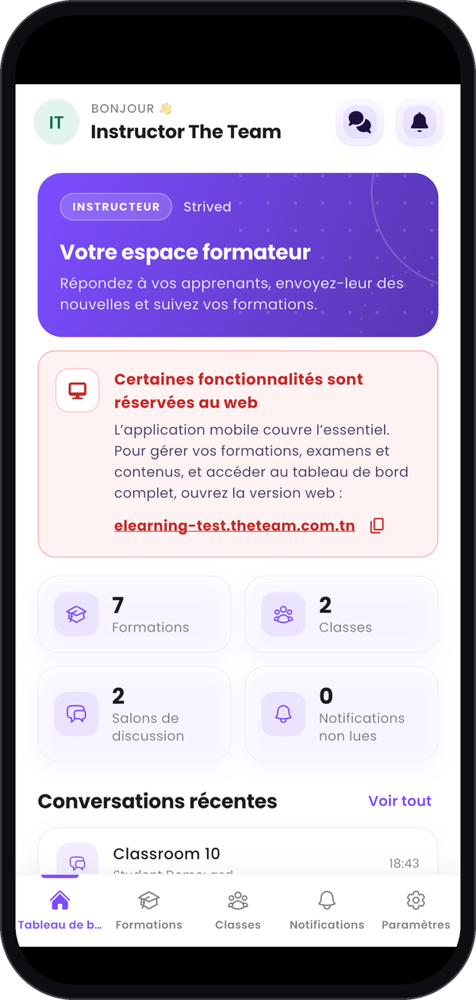
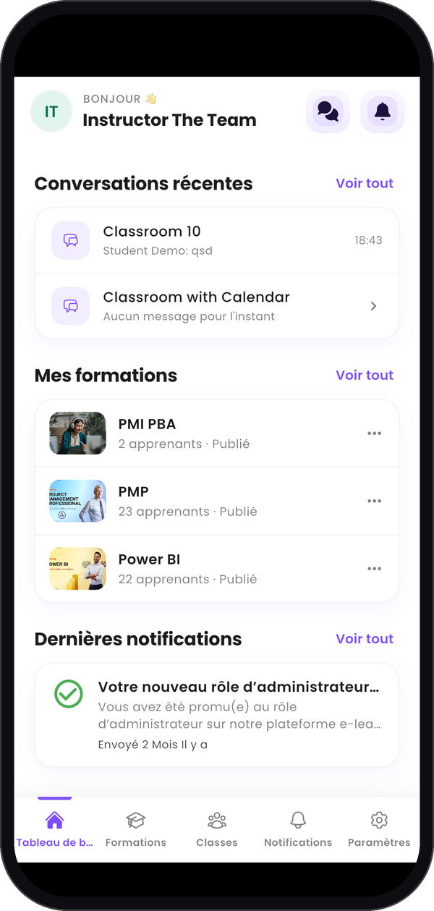
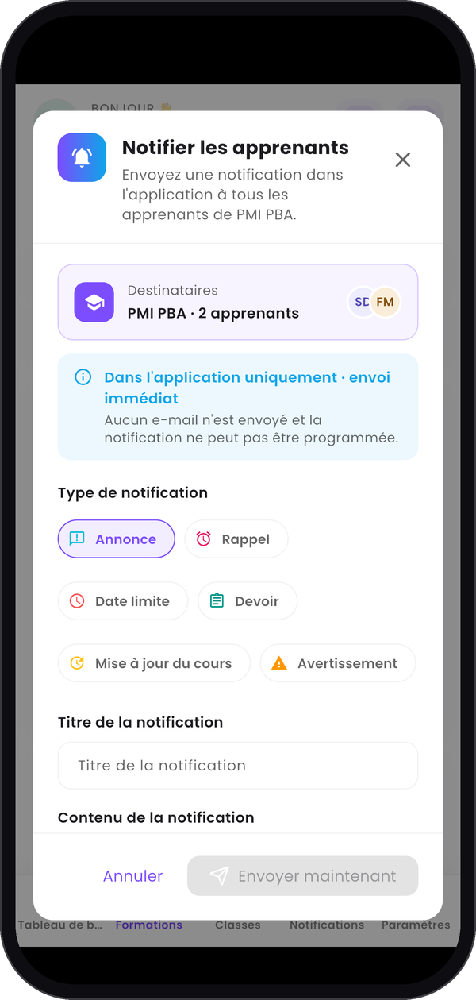
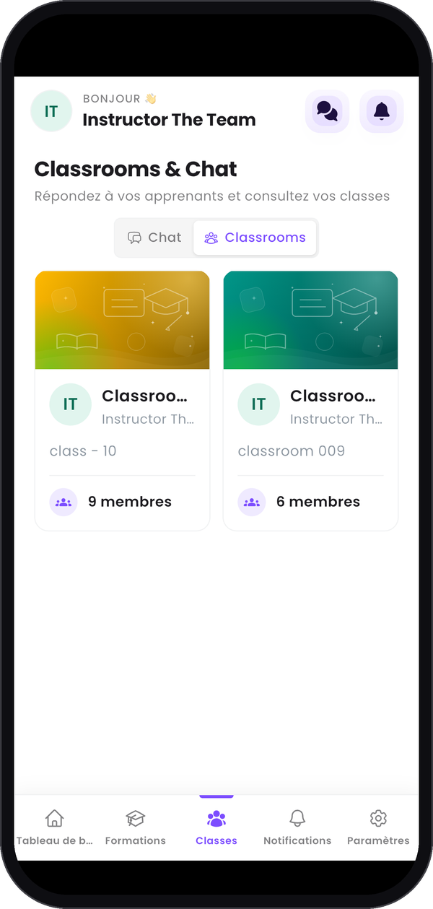
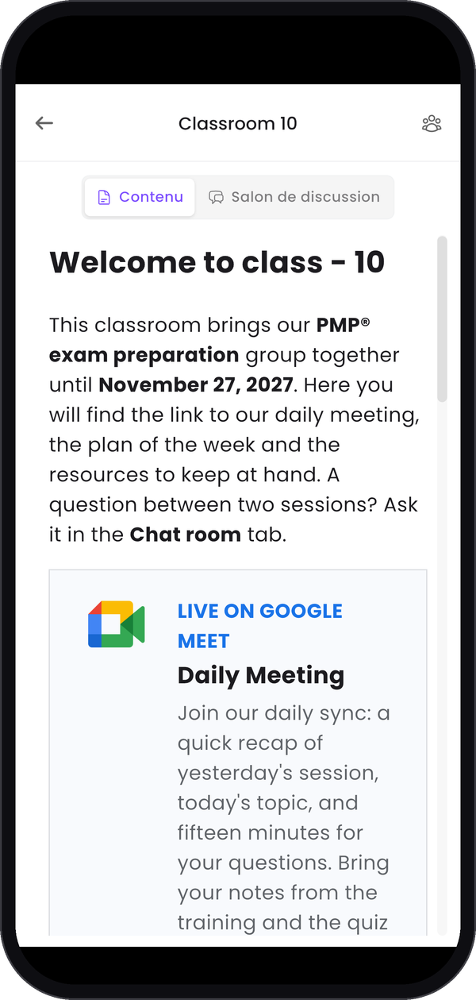
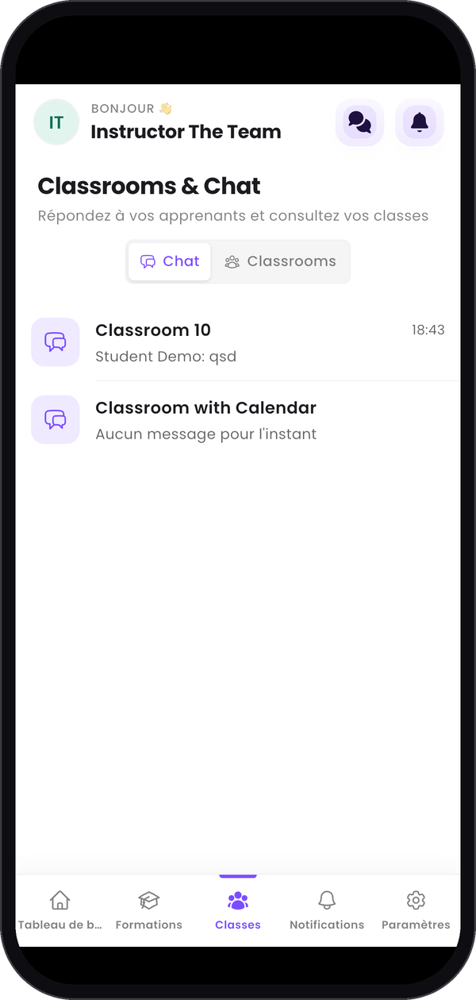
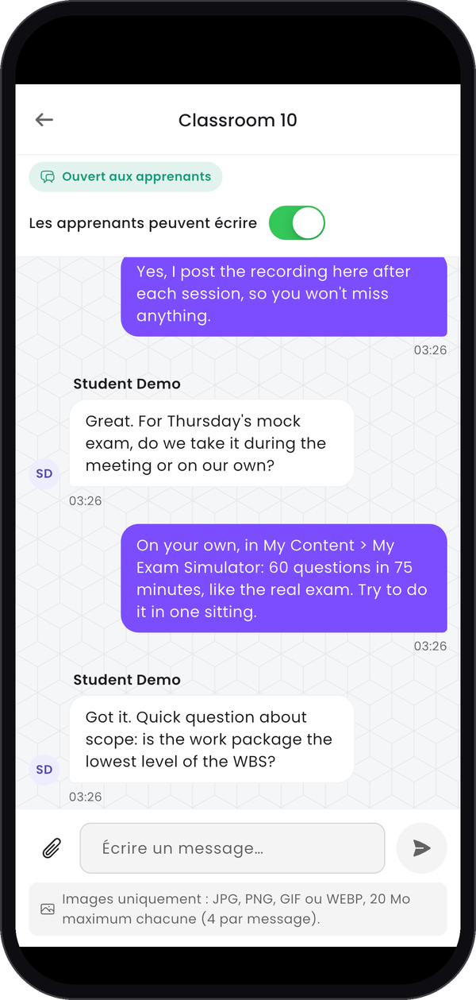
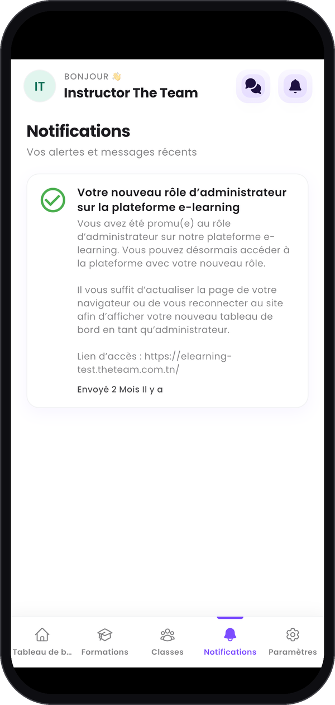
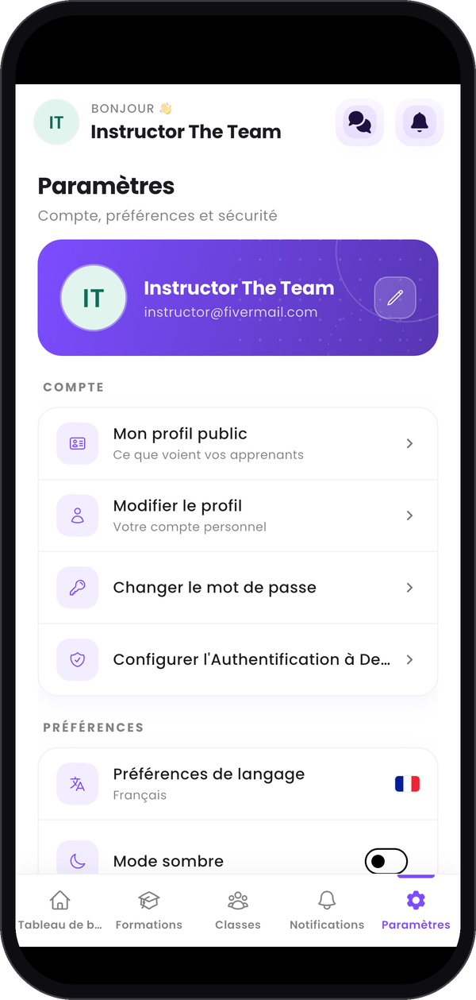
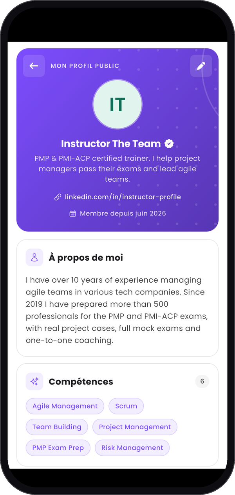

L'application mobile Strived a un espace formateur pour l'essentiel : répondre à vos apprenants, leur
envoyer des nouvelles et garder un œil sur vos formations. La création et la modification de votre
contenu restent sur le web.

<Note>
  Les captures d'écran viennent d'un iPhone, connecté avec un compte **Formateur** sur la plateforme
  de test : vos chiffres et vos formations seront différents. L'application Android a les mêmes
  onglets. **Classrooms & Chat** et le bouton **Classrooms** restent en anglais, même en français.
</Note>

---

## Sommaire

- **Étape 1 — Vous connecter**
- **Étape 2 — Lire votre tableau de bord**
- **Étape 3 — Notifier vos apprenants**
- **Étape 4 — Suivre vos classes et leur discussion**
- **Étape 5 — Notifications, paramètres et profil public**
- **Ce qui reste sur le web**
- **Bon à savoir**

---

## Étape 1 — Vous connecter

Téléchargez l'application sur l'App Store avec un iPhone, ou sur Google Play avec un téléphone
Android : les deux boutons sont sur la page [Présentation](/fr#strived-sur-téléphone). Connectez-vous
avec le même **E-mail** et le même **Mot de passe** que sur le web. L'application s'ouvre sur votre
**Tableau de bord**.

La barre en bas de l'écran compte cinq onglets :

| Onglet | Ce que vous y trouvez |
| :-- | :-- |
| **Tableau de bord** | Vos compteurs et les dernières conversations, formations et notifications. |
| **Formations** | Vos formations, pour notifier leurs apprenants ou copier leurs e-mails. |
| **Classes** | Vos classes et leurs salons de discussion. |
| **Notifications** | Vos alertes et messages récents. |
| **Paramètres** | Votre profil public, votre compte et le **Centre d'assistance**. |

Dans l'en-tête, votre avatar ouvre **Paramètres**, l'icône de discussion ouvre vos salons de
discussion et la cloche ouvre **Notifications**.

---

## Étape 2 — Lire votre tableau de bord

De haut en bas :

- **Votre espace formateur** vous accueille.
- **Certaines fonctionnalités sont réservées au web** donne l'adresse de l'application web, avec un
  bouton pour la copier.
- Quatre compteurs ouvrent leur onglet quand vous les touchez : **Formations**, **Classes**, **Salons
  de discussion** et **Notifications non lues**.
- **Conversations récentes**, **Mes formations** et **Dernières notifications** montrent les trois
  derniers éléments de chaque liste. **Voir tout** ouvre la liste complète.

Dans **Mes formations**, les trois points d'une ligne proposent **Notifier les apprenants** et
**E-mails des apprenants**.

<Columns cols={3}>
  <Frame caption="Le haut du tableau de bord.">
    
  </Frame>
  <Frame caption="Vos dernières conversations, formations et notifications.">
    
  </Frame>
</Columns>

---

## Étape 3 — Notifier vos apprenants

**Formations** liste les formations que vous enseignez, avec leur statut, leurs apprenants, leurs
leçons et leur prix. Chaque carte a deux boutons :

- **Notifier les apprenants** envoie une notification dans l'application à tous les apprenants de
  cette formation. Choisissez un **Type de notification**, remplissez **Titre de la notification** et
  **Contenu de la notification** (ou touchez l'un des **Messages rapides**), puis touchez **Envoyer
  maintenant**. Comme sur le web, c'est **Dans l'application uniquement · envoi immédiat** : aucun
  e-mail n'est envoyé et la notification ne peut pas être programmée.
- **E-mails des apprenants** liste leurs adresses. **Copier tous les e-mails** les copie séparées par
  des virgules, prêtes à coller dans les destinataires de votre e-mail.

<Columns cols={3}>
  <Frame caption="Vos formations.">
    
  </Frame>
  <Frame caption="Notifier les apprenants.">
    
  </Frame>
  <Frame caption="E-mails des apprenants.">
    
  </Frame>
</Columns>

---

## Étape 4 — Suivre vos classes et leur discussion

**Classes** ouvre **Classrooms & Chat**. Deux boutons changent la vue :

- **Classrooms** montre vos classes et leurs membres. Touchez-en une pour lire sa page : **Contenu** est
  ce que voient vos apprenants, et **Salon de discussion** ouvre sa discussion.
- **Chat** liste vos salons de discussion avec leur dernier message. Touchez-en un pour le lire et
  répondre. Vous pouvez joindre des images à un message : JPG, PNG, GIF ou WEBP, jusqu'à 20 Mo chacune,
  4 par message.

**Les apprenants peuvent écrire**, en haut d'une conversation, fonctionne comme sur le web :
désactivez-le pour mettre le salon en lecture seule pour les apprenants.

<Columns cols={3}>
  <Frame caption="Vos classes.">
    
  </Frame>
  <Frame caption="La page d'une classe.">
    
  </Frame>
  <Frame caption="Vos salons de discussion.">
    
  </Frame>
  <Frame caption="Une conversation.">
    
  </Frame>
</Columns>

---

## Étape 5 — Notifications, paramètres et profil public

**Notifications** liste vos alertes et messages récents.

**Paramètres** commence par **Mon profil public**, la page que voient vos apprenants. Vous pouvez la
lire sur le téléphone, mais vous la modifiez sur le web : voir
[Construire votre profil public](/fr/instructor-guide/build-your-public-profile). **Modifier le
profil**, dans la même liste, change votre photo et votre nom. Le **Centre d'assistance** est plus
bas.

<Columns cols={3}>
  <Frame caption="Notifications.">
    
  </Frame>
  <Frame caption="Paramètres.">
    
  </Frame>
  <Frame caption="Votre profil public.">
    
  </Frame>
</Columns>

---

## Ce qui reste sur le web

Le téléphone couvre l'essentiel. Ouvrez l'[application web](/fr/instructor-guide/get-started) sur
ordinateur pour :

- créer et modifier vos formations, examens et quiz ;
- créer et modifier vos classes ;
- modifier votre profil public ;
- voir le tableau de bord complet et suivre vos ventes.

---

## Bon à savoir

<AccordionGroup>
  <Accordion title="Comment écrire à mes apprenants par e-mail ?">
    **Notifier les apprenants** envoie uniquement des notifications dans l'application, sur le
    téléphone comme sur le web. Pour écrire par e-mail, copiez leurs adresses avec **E-mails des
    apprenants** et collez-les dans votre messagerie.
  </Accordion>
  <Accordion title="Une formation n'a pas d'apprenants : puis-je la notifier ?">
    Non. Sans apprenants, il n'y a personne à notifier, et l'application vous le dit.
  </Accordion>
  <Accordion title="Je ne vois aucune classe">
    Vos classes s'affichent dans l'application dès qu'elles existent sur le web : voir
    [Classes et salons de discussion](/fr/instructor-guide/classrooms-and-chatrooms).
  </Accordion>
</AccordionGroup>
