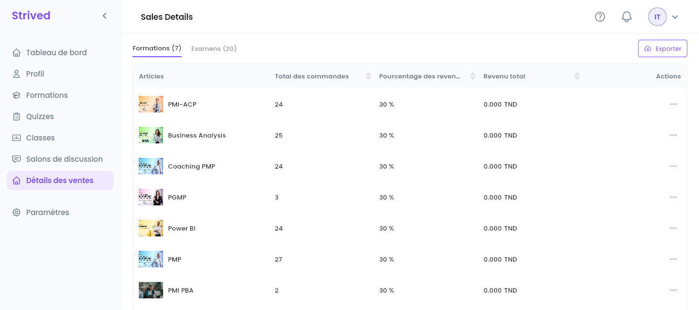
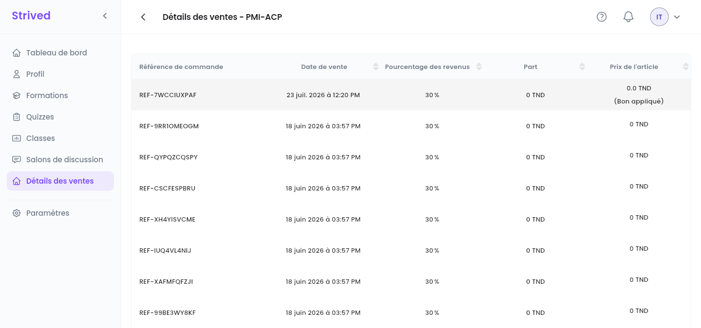

**Détails des ventes**, dans la barre latérale, liste tout ce que vous vendez, avec les commandes
derrière chaque article et votre part. Votre tableau de bord donne les totaux ; cette page donne le
détail.

<Note>
  Tout ce qui suit concerne l'**application web** sur ordinateur, connecté avec un compte
  formateur. Les montants sont en dinars tunisiens (TND).
</Note>

---

## Sommaire

- **Étape 1 — Ouvrir vos ventes**
- **Étape 2 — Voir les commandes d'un article**
- **Étape 3 — Exporter vos ventes**
- **Bon à savoir**

---

## Étape 1 — Ouvrir vos ventes

Cliquez sur **Détails des ventes** dans la barre latérale (la page s'intitule **Sales Details**,
en anglais même dans l'application en français). Deux onglets listent vos articles :
**Formations** et **Examens**, avec leur nombre entre parenthèses.

<Frame caption="Détails des ventes → Formations.">
  
</Frame>

| Colonne | Ce qu'elle montre |
| :-- | :-- |
| **Articles** | La formation ou l'examen. |
| **Total des commandes** | Le nombre de commandes qui le contiennent. |
| **Pourcentage des revenus** | Votre part de chaque vente, fixée par un admin. |
| **Revenu total** | Ce que vous avez gagné dessus. |

Cliquez sur un en-tête de colonne pour trier, par exemple sur **Total des commandes** pour voir vos
meilleures ventes.

---

## Étape 2 — Voir les commandes d'un article

Ouvrez **⋯ → Visualiser** sur une ligne.

<Frame caption="Les commandes d'une formation.">
  
</Frame>

Chaque ligne est une commande : sa **Référence de commande**, la **Date de vente**, votre
**Pourcentage des revenus**, votre **Part** en TND et le **Prix de l'article** payé par
l'apprenant. *(Bon appliqué)* sous le prix signifie que l'apprenant a obtenu l'article gratuitement
avec un voucher (bon) : cette commande ne vous rapporte donc pas de part.

---

## Étape 3 — Exporter vos ventes

Cliquez sur **Exporter** en haut à droite de **Détails des ventes**, puis sur **En PDF** ou
**En CSV**. Le CSV s'ouvre dans Excel ou Google Sheets.

---

## Bon à savoir

<AccordionGroup>
  <Accordion title="Pourquoi ma part est-elle de 0 sur certaines commandes ?">
    L'apprenant a obtenu l'article gratuitement : avec un voucher (bon), ou à un prix de 0 TND.
    Votre part est un pourcentage du prix payé.
  </Accordion>
  <Accordion title="Qui fixe mon pourcentage de revenus ?">
    Un admin, pour chaque formateur. Dès qu'une formation s'est vendue, son pourcentage est
    verrouillé pour que les commandes passées restent justes.
  </Accordion>
  <Accordion title="Où voir mes totaux ?">
    Sur votre **Tableau de bord** : **Revenu total**, **Revenus des formations** et **Revenus des
    examens**, avec des graphiques par semaine ou par mois — voir
    [Se repérer](/fr/instructor-guide/get-started).
  </Accordion>
</AccordionGroup>
