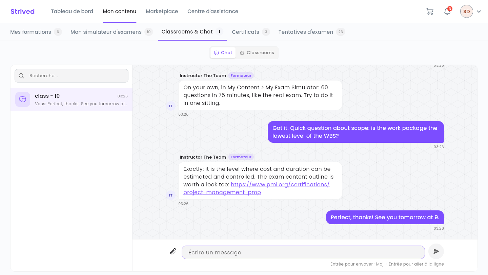
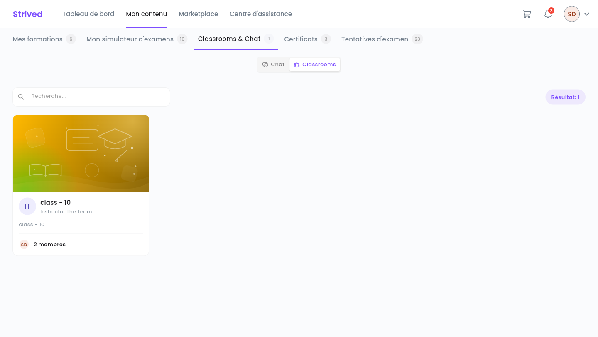
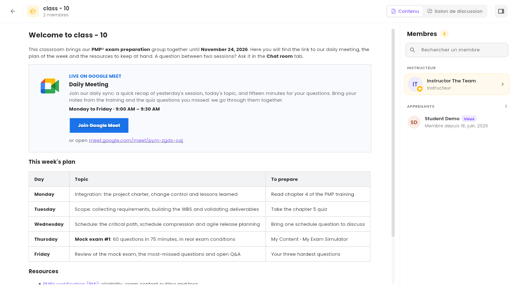
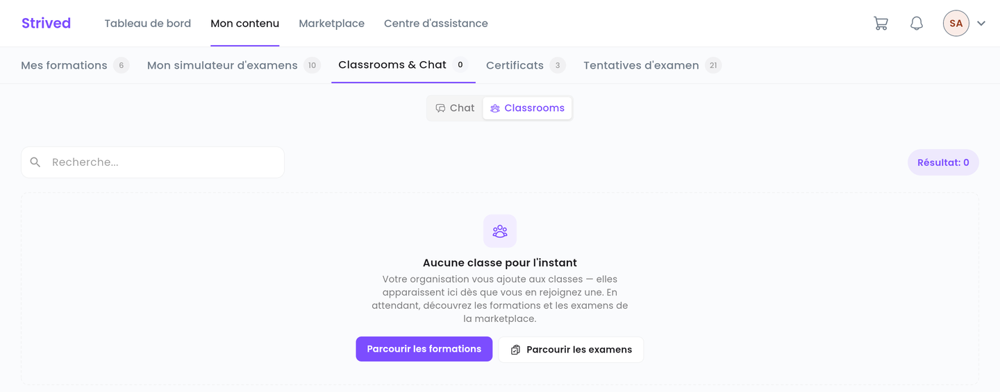

Une **classe** est votre espace partagé avec un formateur et un groupe d'apprenants. Chaque classe
peut avoir son **salon de discussion**. Ce guide vous montre où les trouver et comment écrire.

<Note>
  Tout ce qui suit concerne l'**application web** sur ordinateur. C'est votre organisation qui vous
  ajoute aux classes : vous ne pouvez pas les rejoindre vous-même.
</Note>

---

## Sommaire

- **Étape 1 — Ouvrir Classrooms & Chat**
- **Étape 2 — Discuter dans un salon**
- **Étape 3 — Ouvrir une classe**
- **Bon à savoir**

---

## Étape 1 — Ouvrir Classrooms & Chat

Cliquez sur **Mon contenu**, puis sur l'onglet **Classrooms & Chat** (adresse
`/student-my-content/classrooms`). Deux boutons en haut de la page passent d'une vue à l'autre :

- **Chat** — vos salons de discussion ;
- **Classrooms** — vos classes.

---

## Étape 2 — Discuter dans un salon

<Frame caption="La vue Chat : vos salons à gauche, la conversation à droite.">
  
</Frame>

<Steps>
  <Step title="Choisissez un salon">
    La liste de gauche affiche vos salons et leur dernier message. Le champ **Recherche…** les
    filtre par nom.
  </Step>
  <Step title="Écrivez votre message">
    Tapez dans **Écrire un message…**, puis appuyez sur **Entrée** pour l'envoyer. **Maj + Entrée**
    passe à la ligne sans envoyer.
  </Step>
  <Step title="Joignez une image (facultatif)">
    Cliquez sur le trombone. Formats acceptés : JPG, PNG, GIF ou WEBP, 20 Mo maximum par image,
    4 images par message.
  </Step>
</Steps>

<Callout type="info">
  Le formateur et tous les apprenants de la classe lisent la conversation : n'y partagez rien de
  personnel.
</Callout>

---

## Étape 3 — Ouvrir une classe

Cliquez sur **Classrooms**. Chaque carte affiche le nom de la classe, son formateur et son nombre
de membres. Le champ **Recherche…** filtre les cartes.

<Frame caption="La vue Classrooms : une carte par classe dont vous faites partie.">
  
</Frame>

Cliquez sur une carte pour ouvrir la classe :

<Frame caption="Une classe : son contenu à gauche, ses membres à droite.">
  
</Frame>

| Élément | Contenu |
| :-- | :-- |
| **Contenu** | La page que votre formateur rédige pour le groupe : le lien de la réunion (**Join Google Meet** dans l'exemple ci-dessus), le planning de la semaine, des documents (PDF, fichiers), des ressources. |
| **Salon de discussion** | Le salon de la classe, comme dans la vue **Chat**. |
| Panneau **Membres** | Le formateur et les apprenants du groupe. **Rechercher un membre** retrouve quelqu'un ; le bouton en haut à droite masque ou affiche le panneau. |

Si vous n'appartenez encore à aucune classe, la vue affiche **Aucune classe pour l'instant** :

<Frame caption="La vue Classrooms quand vous n'êtes inscrit à aucune classe.">
  
</Frame>

---

## Bon à savoir

<AccordionGroup>
  <Accordion title="Comment savoir qu'on m'a écrit ?">
    La cloche de la barre du haut affiche vos notifications : nouveau message dans un salon, ajout
    à une classe, etc. **Voir tout** ouvre la liste complète.
  </Accordion>
  <Accordion title="Je ne vois pas ma classe">
    Votre organisation ne vous y a peut-être pas encore ajouté. Contactez votre formateur ou le
    support depuis le **Centre d'assistance**.
  </Accordion>
</AccordionGroup>
