Strived existe aussi en application pour iPhone et Android. Ce guide parcourt ses écrans onglet par
onglet, pour que vous sachiez où tout se trouve sur votre téléphone. Vous vous connectez avec le même
compte que sur le web, et votre progression vous suit d'un appareil à l'autre.

<Note>
  Les captures d'écran viennent d'un iPhone, sur la plateforme de test : vos formations et vos
  chiffres seront différents. L'application Android a les mêmes onglets. L'application affiche
  **Classrooms & Chat**, **Classrooms** et **Marketplace** en anglais, même en français.
</Note>

---

## Sommaire

- **Étape 1 — Installer l'application et vous connecter**
- **Étape 2 — Vous repérer**
- **Étape 3 — Lire votre tableau de bord**
- **Étape 4 — Ouvrir vos formations, examens et certificats**
- **Étape 5 — Rejoindre vos classes**
- **Étape 6 — Parcourir la Marketplace**
- **Étape 7 — Obtenir de l'aide et changer vos réglages**
- **Bon à savoir**

---

## Étape 1 — Installer l'application et vous connecter

<Steps>
  <Step title="Installer Strived">
    Téléchargez l'application sur l'App Store avec un iPhone, ou sur Google Play avec un téléphone
    Android. Les deux boutons sont sur la page [Présentation](/fr#strived-sur-téléphone).
  </Step>
  <Step title="Suivre la visite d'accueil">
    À la première ouverture, une courte visite vous demande votre langue (anglais, français ou
    arabe) et vous montre à quoi Strived vous prépare.
  </Step>
  <Step title="Vous connecter">
    Saisissez votre **E-mail** et votre **Mot de passe**, puis touchez **Se connecter**. Nouveau sur
    Strived ? Touchez **Créer un compte**. Mot de passe perdu ? Touchez **Mot de passe oublié**.
  </Step>
</Steps>

<Columns cols={3}>
  <Frame caption="La visite commence par votre langue.">
    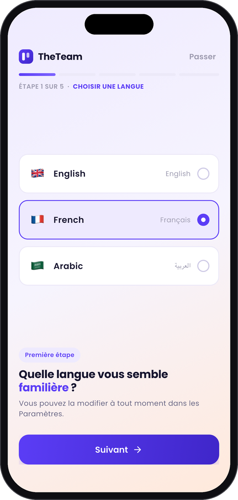
  </Frame>
  <Frame caption="Elle montre les certifications préparées.">
    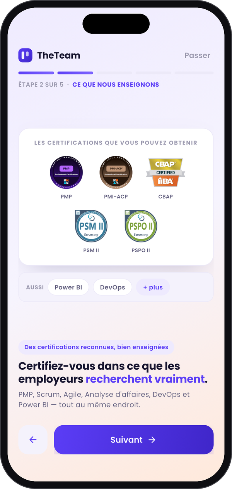
  </Frame>
  <Frame caption="Puis vous vous connectez.">
    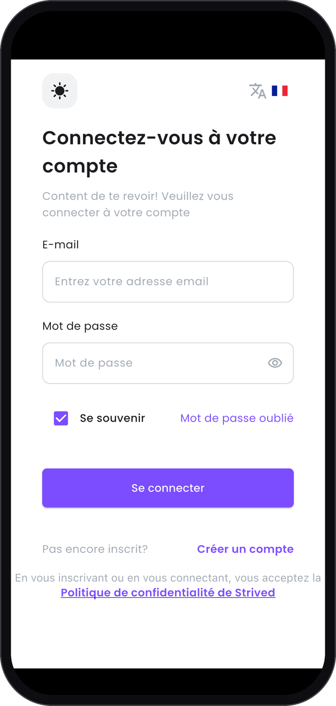
  </Frame>
</Columns>

---

## Étape 2 — Vous repérer

La barre en bas de l'écran compte cinq onglets :

| Onglet | Ce que vous y trouvez |
| :-- | :-- |
| **Tableau de bord** | Votre progression, vos formations en cours et le classement. |
| **Mon contenu** | Vos formations, examens, classes et discussions, certificats et tentatives d'examen. |
| **Marketplace** | Les formations, les examens et les instructeurs du catalogue. |
| **Centre d'assistance** | Les guides d'aide et les coordonnées du service desk. |
| **Paramètres** | Votre profil, votre mot de passe, l'authentification à deux facteurs, la langue, le mode sombre et les notifications. |

L'en-tête reste le même sur chaque onglet : votre avatar ouvre **Paramètres**, l'icône du panier
ouvre votre **Panier d'achat** et la cloche ouvre vos **Notifications**.

---

## Étape 3 — Lire votre tableau de bord

Le **Tableau de bord** est l'écran qui s'ouvre à la connexion. De haut en bas :

- **Appliquer un bon**, sur le bandeau violet, utilise un voucher (bon) reçu par e-mail. Voir
  [Utiliser un voucher (bon)](/fr/student-guide/use-a-voucher).
- Quatre cartes donnent vos chiffres : **Formations en cours**, **Formations terminées**,
  **Certificats obtenus** et **Examens réussis**.
- **Continuer l'apprentissage** liste vos formations. **Reprendre** vous ramène là où vous vous êtes
  arrêté.
- **Classement** montre votre rang et vos points parmi les autres apprenants.

Touchez la cloche en haut à droite pour lire vos **Notifications** : vos commandes, les messages de
vos classes et les nouvelles de vos formateurs.

<Columns cols={3}>
  <Frame caption="Le haut du tableau de bord.">
    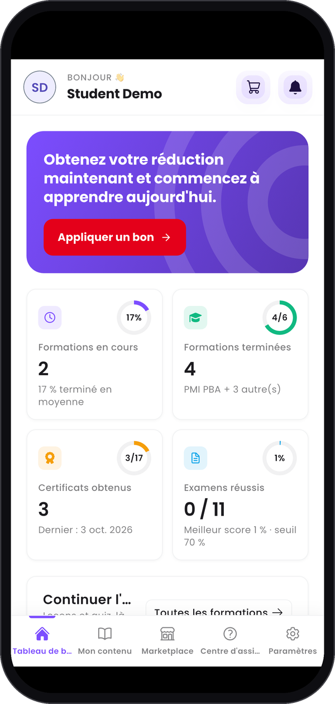
  </Frame>
  <Frame caption="Le classement, plus bas.">
    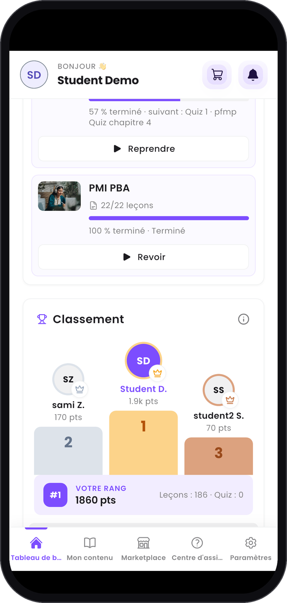
  </Frame>
  <Frame caption="Vos notifications.">
    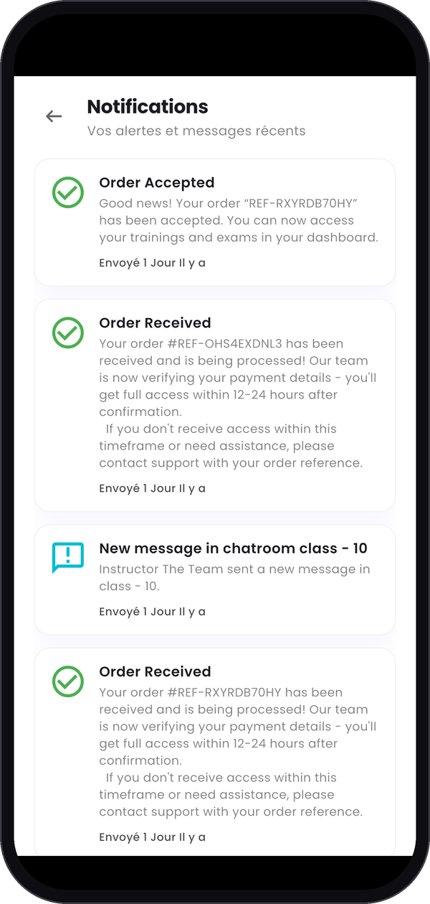
  </Frame>
</Columns>

---

## Étape 4 — Ouvrir vos formations, examens et certificats

**Mon contenu** réunit tout ce que vous possédez. Faites glisser la rangée d'onglets du haut pour
tous les voir :

| Onglet | Ce que vous y faites |
| :-- | :-- |
| **Mes formations** | Suivez votre progression. **Continuer** ouvre la leçon où vous vous êtes arrêté, **Revoir** reparcourt une formation terminée, **Voir le certificat** ouvre le certificat obtenu. |
| **Mes examens** | Retrouvez vos examens, groupés par catégorie. L'application conseille de les passer sur le web (voir **Bon à savoir**). |
| **Classrooms & Chat** | Rejoignez vos classes et leur discussion : voir l'**Étape 5**. |
| **Certificats** | Copiez l'identifiant unique de chaque certificat, **Visualisez**-le, ou ouvrez la page qui le vérifie avec **Vérifiez votre certificat**. |
| **Tentatives d'examen** | Retrouvez chaque tentative, groupée par examen ou par date si vous le souhaitez, et touchez **Revoir** pour la reparcourir. |

<Columns cols={3}>
  <Frame caption="Mes formations.">
    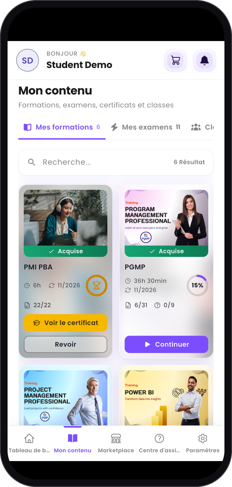
  </Frame>
  <Frame caption="Mes examens.">
    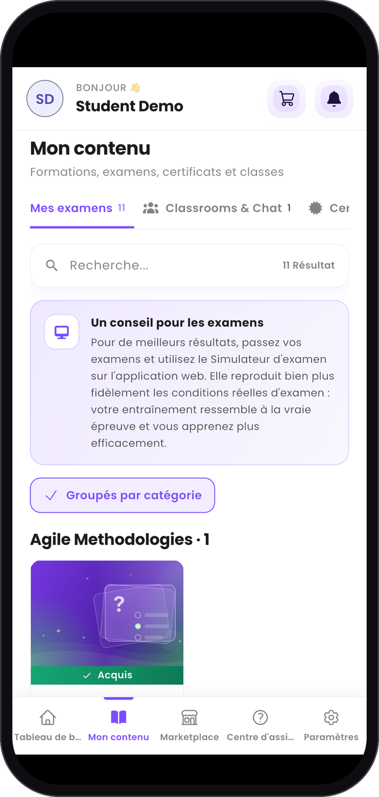
  </Frame>
  <Frame caption="Certificats.">
    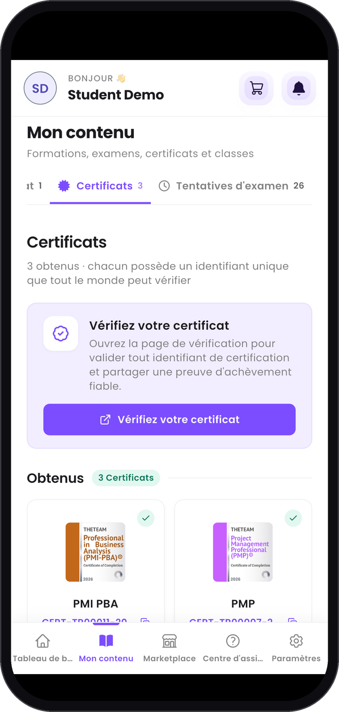
  </Frame>
  <Frame caption="Tentatives d'examen.">
    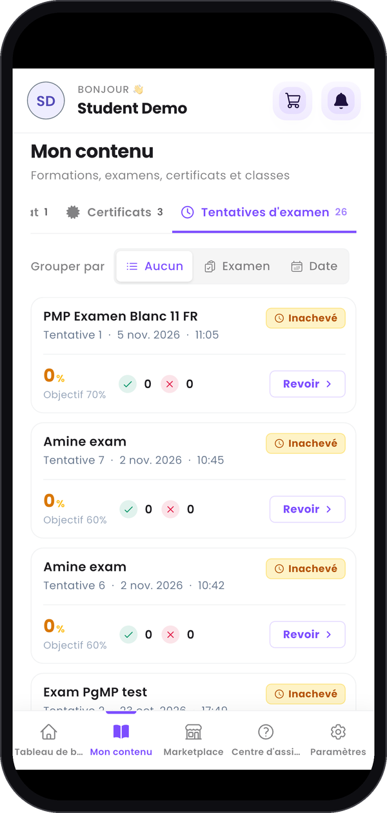
  </Frame>
</Columns>

---

## Étape 5 — Rejoindre vos classes

Dans **Mon contenu**, ouvrez l'onglet **Classrooms & Chat**. Deux boutons changent la vue :

- **Chat** liste les salons de discussion de vos classes, avec leur dernier message. Touchez-en un
  pour le lire et écrire à votre groupe.
- **Classrooms** liste vos classes. Touchez-en une pour ouvrir sa page, avec le contenu du formateur
  (lien de la session en direct, programme, ressources), et **Salon de discussion** pour passer à sa
  discussion.

<Columns cols={3}>
  <Frame caption="Vos salons de discussion.">
    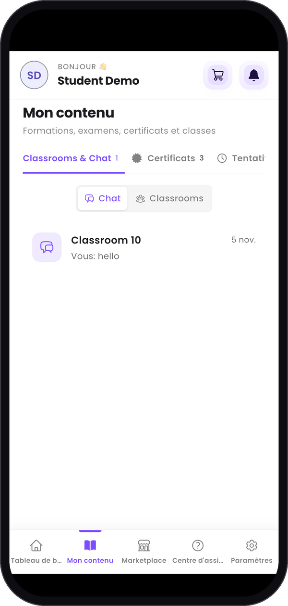
  </Frame>
  <Frame caption="La page d'une classe.">
    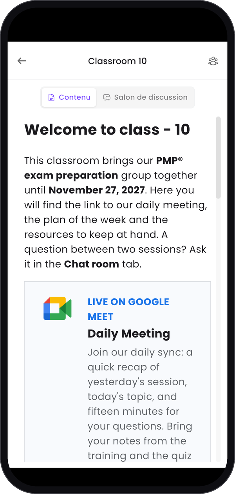
  </Frame>
  <Frame caption="Une conversation avec votre formateur.">
    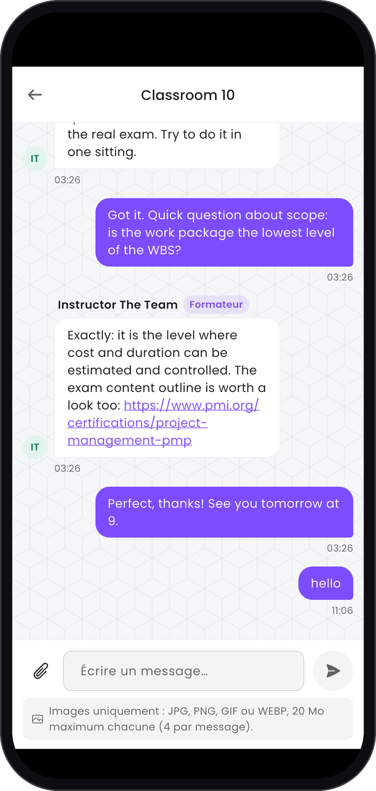
  </Frame>
</Columns>

---

## Étape 6 — Parcourir la Marketplace

La **Marketplace** compte trois onglets : **Formations**, **Examens** et **Instructeurs**. Utilisez
**Recherche...** et **Filtres** pour affiner la liste, puis **Visualisez** une formation ou touchez
**Ajouter au panier**.

L'icône du panier, dans l'en-tête, ouvre votre **Panier d'achat**, où **Coupon** applique un code de
réduction. La commande se passe ensuite comme sur le web : voir
[Acheter une formation ou un examen](/fr/student-guide/buy-a-training).

<Columns cols={3}>
  <Frame caption="La Marketplace.">
    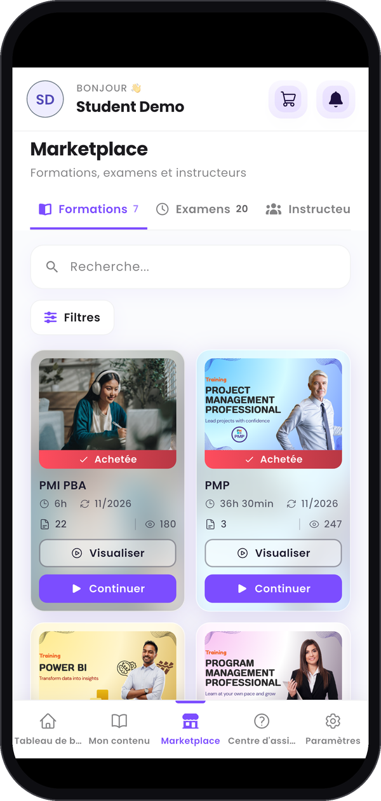
  </Frame>
  <Frame caption="Votre panier.">
    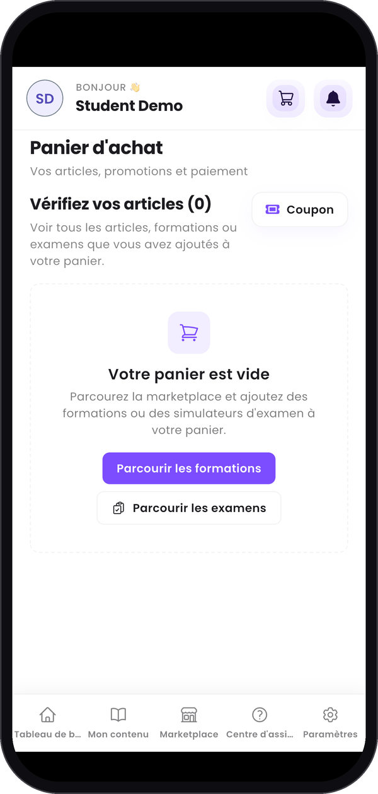
  </Frame>
</Columns>

---

## Étape 7 — Obtenir de l'aide et changer vos réglages

Le **Centre d'assistance** réunit les guides d'aide par sujet. Faites une recherche, ou descendez
jusqu'à **Toujours bloqué ? Contactez le service desk** pour ses horaires, son numéro de téléphone et
son e-mail.

**Paramètres** regroupe votre compte : **Modifier le profil**, **Changer le mot de passe**,
**Configurer l'Authentification à Deux Facteurs**, **Préférences de langage**, **Mode sombre** et
**Notifications**. Descendez pour trouver **Déconnexion**. Voir
[Gérer votre compte](/fr/student-guide/manage-your-account) pour les détails.

<Columns cols={3}>
  <Frame caption="Le Centre d'assistance.">
    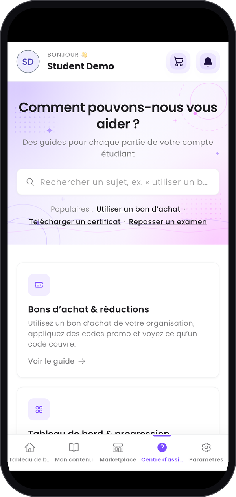
  </Frame>
  <Frame caption="Vos réglages.">
    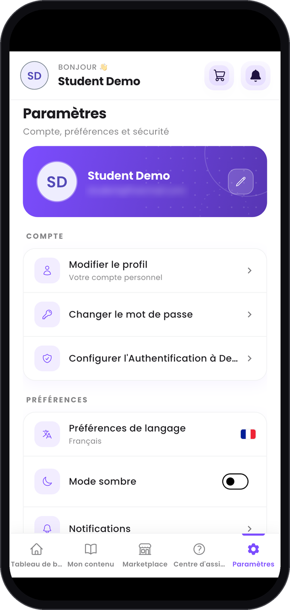
  </Frame>
</Columns>

---

## Bon à savoir

<AccordionGroup>
  <Accordion title="Ma progression me suit-elle du téléphone au web ?">
    Oui. C'est le même compte des deux côtés : vos leçons, certificats et tentatives d'examen sont
    les mêmes partout où vous vous connectez.
  </Accordion>
  <Accordion title="Puis-je passer mes examens sur le téléphone ?">
    L'application conseille le web. **Un conseil pour les examens**, en haut de **Mes examens**,
    explique pourquoi : le Simulateur d'examen sur le web reproduit bien plus fidèlement les
    conditions réelles d'examen.
  </Accordion>
  <Accordion title="Comment changer la langue de l'application ?">
    Dans **Paramètres**, touchez **Préférences de langage**.
  </Accordion>
  <Accordion title="Les autres guides sont-ils valables sur le téléphone ?">
    Ils suivent l'application web sur ordinateur : leurs captures sont donc différentes de
    l'application. Servez-vous de cette page pour trouver le bon onglet.
  </Accordion>
</AccordionGroup>
