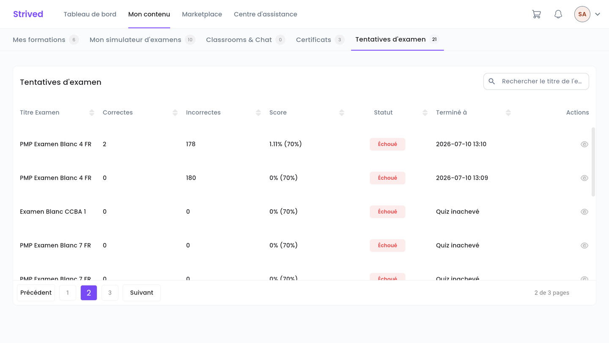
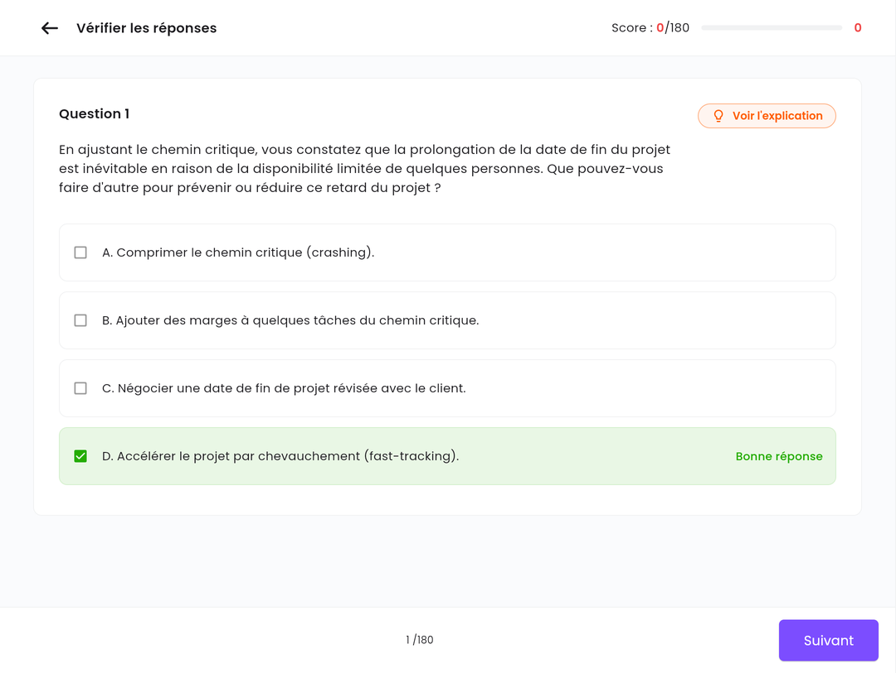

Chaque passage d'un examen blanc est enregistré. Ce guide vous montre où retrouver vos tentatives
et comment relire la correction pour progresser.

<Note>
  Tout ce qui suit concerne l'**application web** sur ordinateur. Vous verrez vos propres
  tentatives et vos propres scores.
</Note>

---

## Sommaire

- **Étape 1 — Ouvrir Tentatives d'examen**
- **Étape 2 — Lire le tableau**
- **Étape 3 — Revoir la correction**
- **Bon à savoir**

---

## Étape 1 — Ouvrir Tentatives d'examen

Cliquez sur **Mon contenu** dans la barre du haut, puis sur l'onglet **Tentatives d'examen**
(adresse `/student-my-content/attempts`). Le bouton **Voir mes tentatives** de la page d'un examen
mène au même endroit.

<Frame caption="Mon contenu → Tentatives d'examen : un passage par ligne.">
  
</Frame>

---

## Étape 2 — Lire le tableau

| Colonne | Signification |
| :-- | :-- |
| **Titre Examen** | L'examen blanc passé. |
| **Correctes** / **Incorrectes** | Le nombre de bonnes et de mauvaises réponses. |
| **Score** | Votre score, suivi entre parenthèses du seuil de réussite, ex. `1.11% (70%)`. |
| **Statut** | **Succès** si vous avez atteint le seuil, **Échoué** sinon. |
| **Terminé à** | La date de soumission, ou **Quiz inachevé** pour une tentative démarrée mais jamais soumise. |
| **Actions** | L'icône œil ouvre la correction. |

<Tip>
  Le champ **Rechercher le titre de l'examen** filtre la liste, et les flèches des en-têtes la
  trient. Les boutons **Précédent** / **Suivant** en bas changent de page.
</Tip>

---

## Étape 3 — Revoir la correction

Cliquez sur l'icône œil d'une tentative. L'écran **Vérifier les réponses** s'ouvre :

<Frame caption="La correction d'une tentative : la bonne réponse est surlignée en vert.">
  
</Frame>

- En haut : votre **Score**, en nombre de bonnes réponses sur le total (par exemple `Score : 126/180`).
- Au centre : la question, avec la **Bonne réponse** surlignée en vert.
- **Voir l'explication** affiche le commentaire du formateur sur cette question ;
  **Retour à la revue des réponses** revient à la question.
- **Suivant** et **Précédent** en bas parcourent les questions.
- À droite, le **Panneau de questions** liste tous les numéros. Les filtres **Tout**,
  **Correcte** et **Incorrecte** vous aident à cibler vos erreurs.

---

## Bon à savoir

<AccordionGroup>
  <Accordion title="Pourquoi une tentative affiche-t-elle « Quiz inachevé » et 0 % ?">
    L'examen a été démarré puis quitté, ou la page a été rechargée, sans soumission. La tentative
    compte quand même dans le nombre de tentatives utilisées.
  </Accordion>
  <Accordion title="Une question n'a pas d'explication">
    Le formateur n'en a pas rédigé pour cette question : l'écran affiche alors
    *« Aucune explication n'a été fournie »*.
  </Accordion>
  <Accordion title="Comment repasser un examen ?">
    Revenez dans **Mon simulateur d'examens** et ouvrez l'examen : la pastille des tentatives
    indique combien il vous en reste. Voir [Passer un examen blanc](/fr/student-guide/take-a-mock-exam).
  </Accordion>
</AccordionGroup>
