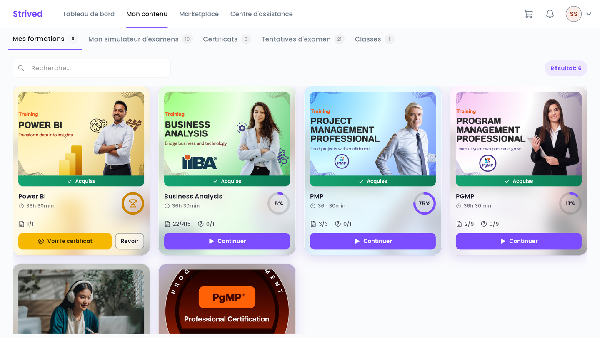
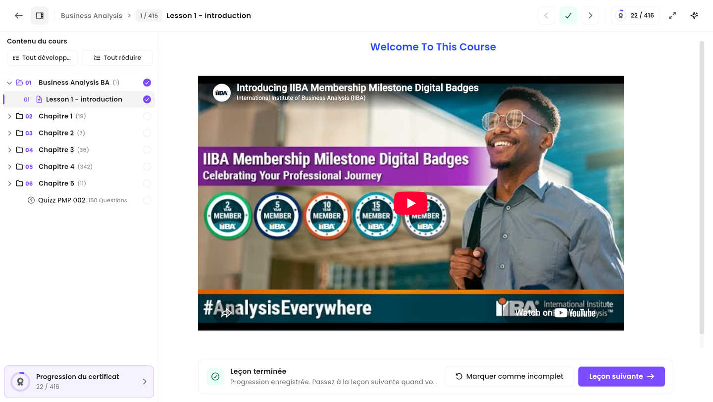
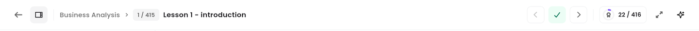
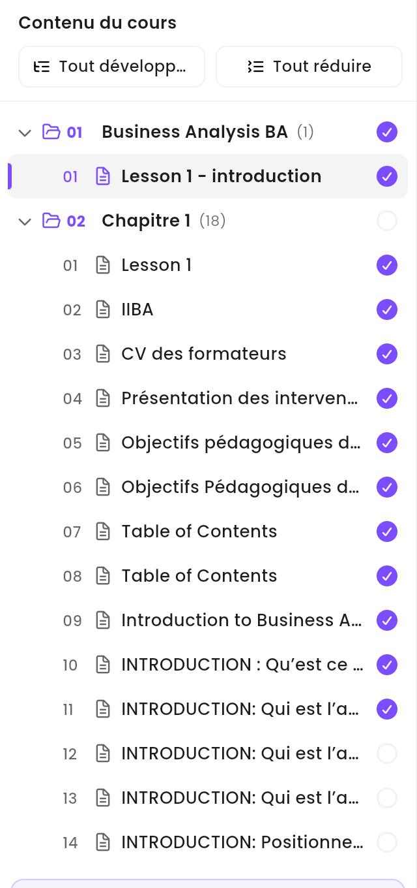
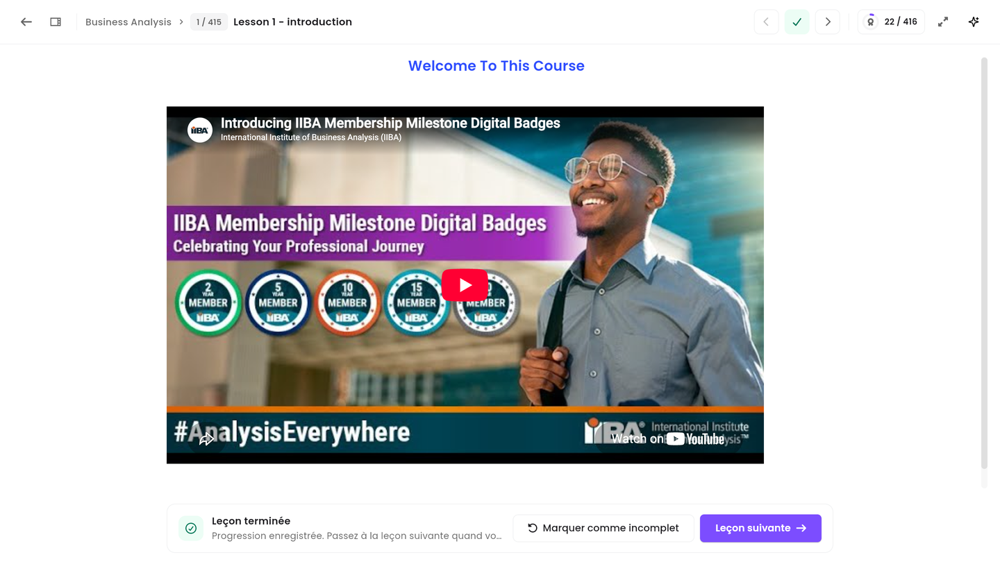
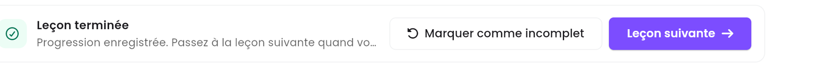
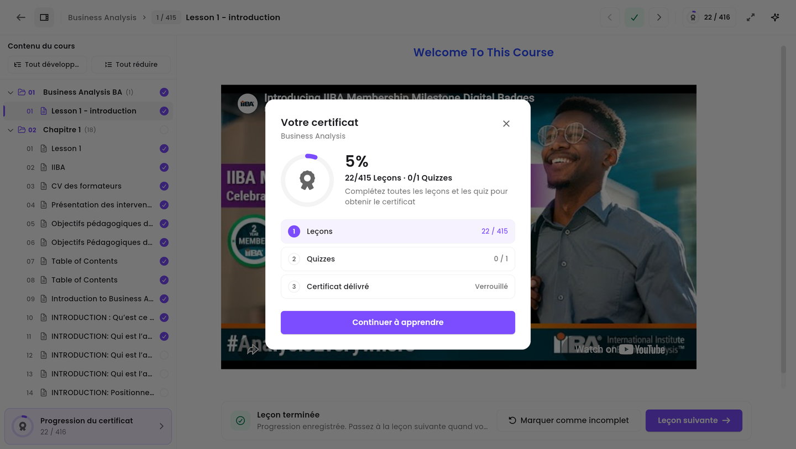

Ce guide vous montre comment ouvrir l'une de vos formations dans un navigateur web, étudier ses
leçons et passer de l'une à l'autre grâce au panneau de navigation **Contenu du cours**.

<Note>
  Tout ce qui suit concerne l'**application web** sur ordinateur. Les captures d'écran ont été
  prises sur une vraie formation : sur votre écran, vous verrez vos propres formations et votre
  propre progression.
</Note>

---

## Sommaire

- **Étape 1 — Ouvrir Mes formations**
- **Étape 2 — Choisir la formation à étudier**
- **Étape 3 — Se repérer dans le lecteur de cours**
- **Étape 4 — Naviguer entre les leçons avec le panneau Contenu du cours**
- **Étape 5 — Étudier une leçon et la marquer comme terminée**
- **Étape 6 — Suivre votre progression vers le certificat**
- **Bon à savoir**

---

## Étape 1 — Ouvrir Mes formations

<Steps>
  <Step title="Cliquez sur Mon contenu dans la barre du haut">
    La barre tout en haut de la page est le menu principal : **Tableau de bord**, **Mon contenu**,
    **Marketplace** et **Centre d'assistance**. Cliquez sur **Mon contenu**.
  </Step>
  <Step title="Restez sur l'onglet Mes formations">
    Une deuxième rangée d'onglets apparaît en dessous : **Mes formations**,
    **Mon simulateur d'examens**, **Certificats**, **Tentatives d'examen** et **Classes**.
    **Mes formations** est le premier et s'ouvre par défaut. Le petit nombre gris à côté de chaque
    onglet indique combien d'éléments il contient.
  </Step>
</Steps>

<Frame caption="Mon contenu → Mes formations : toutes vos formations, avec leur progression.">
  
</Frame>

La barre d'adresse affiche `/student-my-content/trainings`. Vous pouvez l'ajouter à vos favoris
pour revenir directement sur cette page.

<Tip>
  Vous avez beaucoup de formations ? Utilisez le champ **Rechercher…** au-dessus des cartes pour
  les filtrer par nom.
</Tip>

---

## Étape 2 — Choisir la formation à étudier

Chaque formation est présentée sous forme de carte. Voici ce qu'elle vous indique :

<Frame caption="Une carte de formation : visuel, titre, durée, progression et ce qu'il reste à faire.">
  
</Frame>

| Sur la carte | Signification |
| :-- | :-- |
| Bandeau vert **Acquise** | Vous avez accès à cette formation. |
| Titre | Le nom de la formation, par exemple *Business Analysis*. |
| Horloge, ex. `36h 30min` | La durée totale de la formation. |
| Cercle, ex. `5%` | La part que vous avez déjà terminée. |
| Icône page, ex. `22/415` | Les leçons terminées, sur le total. |
| Icône point d'interrogation, ex. `0/1` | Les quiz réussis, sur le total. |
| **Continuer** | Ouvre la formation là où vous vous êtes arrêté. |

Cliquez sur **Continuer** pour ouvrir la formation.

<Note>
  Lorsque vous avez tout terminé, **Continuer** est remplacé par **Voir le certificat** et
  **Revoir**. **Revoir** rouvre les leçons en lecture seule pour les reparcourir.
</Note>

---

## Étape 3 — Se repérer dans le lecteur de cours

La formation s'ouvre dans le **lecteur de cours**. Son adresse ressemble à
`/student-my-content/student-training-details/2`, où le nombre est l'identifiant de la formation.

<Frame caption="Le lecteur de cours : panneau de navigation à gauche, leçon au centre, barre d'outils en haut.">
  
</Frame>

Le lecteur comporte trois zones :

1. **La barre d'outils** en haut — où vous êtes, et les boutons pour vous déplacer.
2. **Le panneau Contenu du cours** à gauche — la liste complète des chapitres, leçons et quiz.
3. **La zone de leçon** au centre — la leçon que vous êtes en train d'étudier.

### La barre d'outils, bouton par bouton

<Frame caption="La barre d'outils du lecteur de cours.">
  
</Frame>

Sur un écran d'ordinateur portable, la plupart de ces boutons n'affichent qu'une icône. Survolez-la
avec la souris pour voir son nom.

| Bouton | Rôle |
| :-- | :-- |
| **←** (tout à gauche) | **Retour à Mes formations** — quitte la formation. Votre progression est déjà enregistrée. |
| Icône panneau (à côté de la flèche) | Affiche ou masque le panneau **Contenu du cours**. |
| `Business Analysis › 1 / 415 › Lesson 1 - introduction` | Votre position : la formation, le numéro de la leçon sur le total, et son titre. |
| **‹** | **Leçon précédente**. |
| **✓** (vert lorsque la leçon est faite) | Marque la leçon en cours comme terminée, ou annule ce marquage. |
| **›** | **Leçon suivante**. |
| Pastille médaille, ex. `22 / 416` | Votre progression vers le certificat — cliquez pour le détail. |
| Icône flèches | **Plein écran** — masque le reste de la page pour n'afficher que la leçon. |
| **✦** (tout à droite) | **Assistant IA**. Il est indiqué *Bientôt disponible* et ne répond pas encore. |

<Tip>
  Sur un écran plus large, ces mêmes boutons affichent leur libellé (**Marquer comme incomplet**,
  **Suivant**, **Assistant IA**). Leur fonctionnement est identique.
</Tip>

---

## Étape 4 — Naviguer entre les leçons avec le panneau Contenu du cours

Le panneau de gauche est votre moyen de navigation dans la formation. Il liste chaque
**chapitre**, et à l'intérieur de chacun, chaque **leçon** et chaque **quiz**, dans l'ordre défini
par le formateur.

<Frame caption="Le panneau Contenu du cours, avec un chapitre ouvert.">
  
</Frame>

**Comment l'utiliser :**

<Steps>
  <Step title="Ouvrir un chapitre">
    Cliquez sur la ligne d'un chapitre — par exemple `02 Chapitre 1 (18)`. Elle se déplie et
    affiche les leçons qu'il contient. Le nombre entre parenthèses indique combien de leçons s'y
    trouvent. Cliquez à nouveau sur la ligne pour la replier.
  </Step>
  <Step title="Ouvrir une leçon">
    Cliquez sur la ligne d'une leçon : elle s'ouvre immédiatement au centre de l'écran. Vous pouvez
    aller à n'importe quelle leçon de la formation à tout moment — rien n'est verrouillé dès lors
    que la formation vous appartient.
  </Step>
  <Step title="Tout ouvrir d'un coup, ou tout refermer">
    **Tout développer** déplie tous les chapitres, **Tout réduire** les replie tous. Pratique pour
    avoir une vue d'ensemble d'une formation longue.
  </Step>
</Steps>

### Lire le panneau d'un coup d'œil

| Ce que vous voyez | Signification |
| :-- | :-- |
| Cercle violet avec une coche | Leçon terminée. |
| Cercle gris vide | Pas encore terminée. |
| Barre violette à gauche de la ligne, fond gris | La leçon que vous consultez actuellement. |
| Icône dossier + `01`, `02`, … | Un chapitre, dans l'ordre. |
| Icône page + `01`, `02`, … | Une leçon, dans l'ordre à l'intérieur de son chapitre. |
| Icône point d'interrogation, ex. `Quizz PMP 002 · 150 Questions` | Un quiz. Cliquez dessus pour le passer ou le revoir. |
| **Progression du certificat** en bas | Votre avancement vers le certificat. |

### Donner plus de place à la leçon

Cliquez sur l'icône panneau de la barre d'outils (juste à droite de la flèche de retour) pour
masquer le panneau Contenu du cours. La leçon occupe alors toute la largeur. Cliquez à nouveau
pour le faire réapparaître.

<Frame caption="La même leçon, panneau Contenu du cours masqué.">
  
</Frame>

---

## Étape 5 — Étudier une leçon et la marquer comme terminée

Lisez, regardez ou faites défiler la leçon au centre de l'écran. Une leçon peut contenir du texte,
des images, des vidéos et des documents PDF — utilisez les commandes du lecteur vidéo comme
d'habitude.

Quand vous avez fini, utilisez la barre en bas de la leçon :

<Frame caption="La barre sous une leçon déjà terminée.">
  
</Frame>

- **Leçon pas encore terminée** — la barre demande *« Vous avez terminé cette leçon ? »* avec
  *« Marquez-la comme terminée pour enregistrer votre progression et continuer. »* Cliquez sur
  **Marquer comme complet Continuer** : votre progression est enregistrée **et** la leçon suivante
  s'ouvre.
- **Leçon déjà terminée** — la barre affiche *« Leçon terminée »* et
  *« Progression enregistrée. Passez à la leçon suivante quand vous êtes prêt. »* Cliquez sur
  **Leçon suivante** pour poursuivre, ou sur **Marquer comme incomplet** si vous l'aviez marquée
  par erreur.

<Callout type="info">
  Votre progression est enregistrée immédiatement, sur le serveur. Vous pouvez fermer le navigateur
  et reprendre la formation plus tard, sur n'importe quel ordinateur, exactement là où vous vous
  êtes arrêté.
</Callout>

---

## Étape 6 — Suivre votre progression vers le certificat

Cliquez sur la pastille médaille dans la barre d'outils, ou sur **Progression du certificat** en
bas du panneau Contenu du cours.

<Frame caption="La fenêtre de progression du certificat.">
  
</Frame>

Elle affiche trois conditions, dans l'ordre :

1. **Leçons** — combien vous en avez terminées sur le total.
2. **Quiz** — combien vous en avez réussis sur le total.
3. **Certificat délivré** — reste **Verrouillé** tant que les deux premières ne sont pas remplies.

Une fois tout terminé, le bouton de cette fenêtre vous permet de récupérer votre certificat. Vous
le retrouverez ensuite dans **Mon contenu → Certificats**. En attendant, le bouton affiche
**Continuer à apprendre** et ferme simplement la fenêtre.

---

## Bon à savoir

<AccordionGroup>
  <Accordion title="Dois-je suivre les leçons dans l'ordre ?">
    Non. Dès qu'une formation vous appartient, toutes les leçons de tous les chapitres sont
    accessibles. Cliquez sur celle que vous voulez dans le panneau Contenu du cours. L'ordre ne
    compte que pour le certificat : il exige **toutes** les leçons et tous les quiz, quel que soit
    l'ordre dans lequel vous les faites.
  </Accordion>
  <Accordion title="J'ai fermé la formation — est-ce que je perds ma place ?">
    Non. Retournez dans **Mon contenu → Mes formations** et cliquez sur **Continuer** sur la carte :
    la formation se rouvre là où vous vous étiez arrêté.
  </Accordion>
  <Accordion title="Une vidéo ne se lance pas">
    Vérifiez d'abord votre connexion internet, puis rechargez la page. Si elle ne se lance toujours
    pas, utilisez le **Centre d'assistance** dans la barre du haut pour contacter le support.
  </Accordion>
  <Accordion title="Puis-je changer la langue de l'application ?">
    Oui. Cliquez sur votre avatar en haut à droite, puis sur **Langues**. L'anglais, le français et
    l'arabe sont disponibles. Toute l'application, formation comprise, bascule dans la langue
    choisie.
  </Accordion>
</AccordionGroup>
