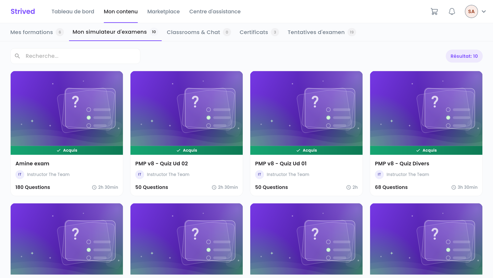
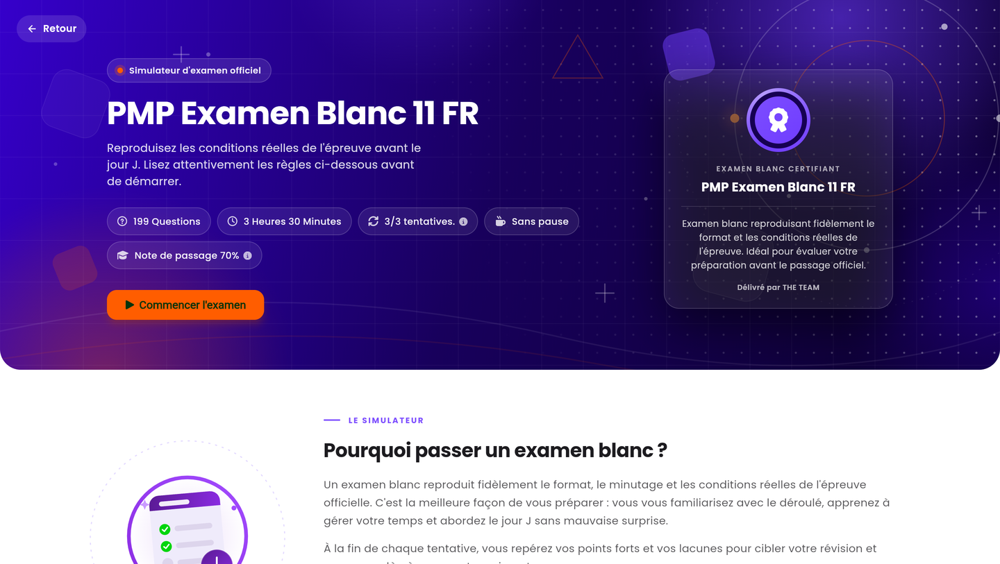
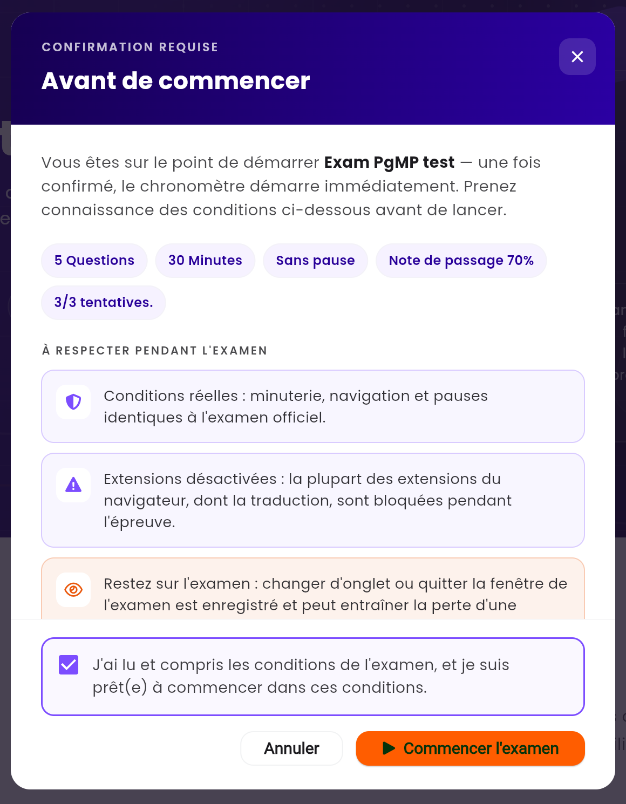

Le **simulateur d'examens** reproduit les conditions réelles d'une certification (par exemple le
PMP) : même minuteur, même nombre de questions, même seuil de réussite. Ce guide vous montre
comment passer un examen blanc du début à la fin.

<Note>
  Tout ce qui suit concerne l'**application web** sur ordinateur. Vous verrez vos propres examens.
</Note>

---

## Sommaire

- **Étape 1 — Ouvrir Mon simulateur d'examens**
- **Étape 2 — Lire la page de l'examen**
- **Étape 3 — Confirmer et démarrer**
- **Étape 4 — Répondre aux questions**
- **Étape 5 — Soumettre et voir votre score**
- **Bon à savoir**

---

## Étape 1 — Ouvrir Mon simulateur d'examens

Dans la barre du haut, cliquez sur **Mon contenu**, puis sur l'onglet **Mon simulateur d'examens**
(adresse `/student-my-content/exams`). Chaque carte indique le titre de l'examen, son formateur,
le nombre de questions et la durée. Cliquez sur une carte pour l'ouvrir.

<Frame caption="Mon contenu → Mon simulateur d'examens : les examens blancs que vous possédez.">
  
</Frame>

---

## Étape 2 — Lire la page de l'examen

<Frame caption="La page d'un examen blanc, avant de le démarrer.">
  
</Frame>

Les pastilles sous le titre résument les règles :

| Pastille | Signification |
| :-- | :-- |
| `199 Questions` | Le nombre de questions. |
| `3 Heures 30 Minutes` | Le temps dont vous disposez. |
| `3/3 tentatives.` | Les tentatives qu'il vous **reste**, sur le total autorisé. |
| **Sans pause** | L'examen n'a pas de pause programmée. Sinon, la pastille indique la pause prévue. |
| `Note de passage 70%` | Le score minimum pour réussir. |

Plus bas, la section **Conditions de l'examen** détaille les règles, et **Voir mes tentatives**
ouvre l'historique de vos passages.

---

## Étape 3 — Confirmer et démarrer

Cliquez sur **Commencer l'examen**. La fenêtre **Avant de commencer** rappelle les conditions :

<Frame caption="La fenêtre de confirmation avant le démarrage.">
  
</Frame>

<Steps>
  <Step title="Lisez les conditions">
    Minuterie et navigation identiques à l'examen officiel, extensions du navigateur (dont la
    traduction) désactivées, et obligation de rester sur la page de l'examen.
  </Step>
  <Step title="Cochez la case de confirmation">
    *« J'ai lu et compris les conditions de l'examen, et je suis prêt(e) à commencer dans ces
    conditions. »*
  </Step>
  <Step title="Cliquez sur Commencer l'examen">
    Un court compte à rebours s'affiche, puis la première question apparaît et le chronomètre
    démarre.
  </Step>
</Steps>

<Warning>
  Chaque démarrage compte comme une tentative, même si vous ne soumettez pas vos réponses.
</Warning>

---

## Étape 4 — Répondre aux questions

L'écran de l'examen comporte trois zones :

| Zone | Rôle |
| :-- | :-- |
| Barre du haut | Le titre de l'examen et le **temps restant**. |
| Centre | La question en cours et ses réponses. L'icône signet (**Marquer cette question**) la met de côté pour y revenir. **Précédent** et **Suivant** en bas changent de question. |
| **Panneau de questions** (à droite) | Tous les numéros de questions, avec les filtres **Tout**, **Répondue** et **Marqué**. Cliquez sur un numéro pour y aller. **Masquer la barre latérale** libère de la place. |

<Note>
  Si l'examen prévoit des pauses, la navigation est limitée aux questions déjà affichées : les
  suivantes se débloquent après la pause.
</Note>

---

## Étape 5 — Soumettre et voir votre score

Cliquez sur **Soumettre** en bas du **Panneau de questions**. S'il reste des questions marquées,
l'application vous le signale pour que vous les vérifiiez d'abord. Quand le temps est écoulé, vos
réponses sont soumises automatiquement.

L'écran **Vérifier les réponses** s'ouvre ensuite avec votre score et la correction de chaque
question — voir [Revoir vos tentatives d'examen](/fr/student-guide/review-your-exam-attempts).
**Recommencez** relance une nouvelle tentative s'il vous en reste.

---

## Bon à savoir

<AccordionGroup>
  <Accordion title="Puis-je recharger la page pendant l'examen ?">
    Non. Recharger la page ou la quitter interrompt l'examen et vos réponses ne sont **pas**
    soumises. Pour arrêter volontairement, utilisez **Quitter l'examen**.
  </Accordion>
  <Accordion title="Je n'ai plus de tentatives">
    La pastille affiche `0/3 tentatives.` Contactez le support depuis le **Centre d'assistance**
    si vous avez besoin de repasser l'examen.
  </Accordion>
  <Accordion title="Pourquoi la traduction de mon navigateur ne fonctionne-t-elle pas ?">
    Comme le jour de l'épreuve officielle, la plupart des extensions du navigateur, dont les outils
    de traduction, sont désactivées pendant l'examen.
  </Accordion>
  <Accordion title="Où trouver de nouveaux examens blancs ?">
    Dans **Marketplace → Catalogue des examens** — voir
    [Acheter une formation ou un examen](/fr/student-guide/buy-a-training).
  </Accordion>
</AccordionGroup>
