<Info>
  **The LMS that prepares professionals for international certifications in project management,
  agility, business analysis and business intelligence — combining instructor-led training with
  self-paced learning.**
</Info>

**Strived** is an e-learning platform made by THE TEAM. A learner studies at their own pace,
practises on mock exams built like the real certification exam, meets their instructor in live
classrooms, and leaves with a certificate. Behind the scenes, instructors write the content, content
managers keep the catalog in order, and admins run the platform: orders, vouchers, coupons, users
and notifications.

<Frame caption="A learner's dashboard: trainings in progress, certificates, exams, leaderboard and activity.">
  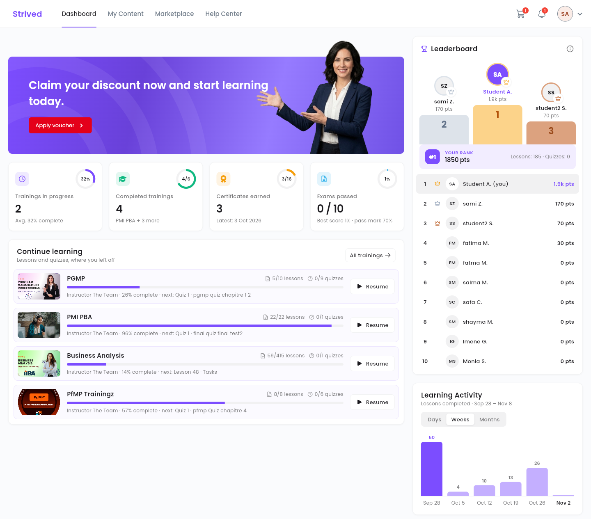
</Frame>

---

## How Strived works

Four roles share the platform. Instructors create the content, content managers and admins publish
it, learners get access to it and learn, and the platform hands out the certificates.

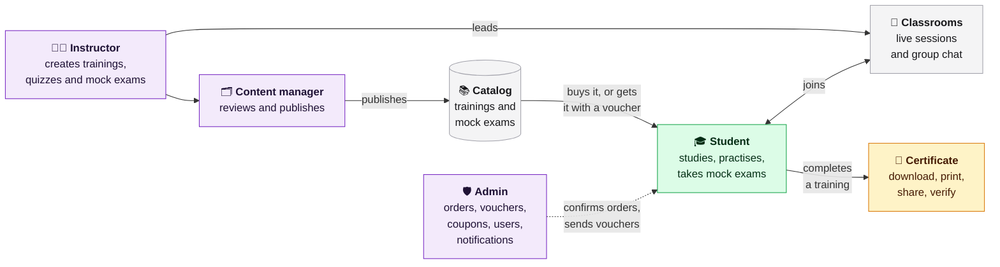

An admin can also do everything a content manager does.

---

## What each role does

| Role | In short | What they do on Strived |
| :-- | :-- | :-- |
| **Student** | Learns and gets certified | Buys trainings and exams in the Marketplace or unlocks them with a voucher, studies the lessons and quizzes, takes mock exams and reviews the correction, joins classrooms and their chat, and downloads their certificates. |
| **Instructor** | Teaches | Builds a public profile, creates trainings, quizzes and mock exams, leads classrooms and their chat, notifies their learners, and follows the sales of their content and their share of each order. |
| **Content manager** | Keeps the catalog in order | Creates and updates trainings and exams for the instructors, publishes or unpublishes them, updates classrooms, and organizes the catalog with categories and tags. |
| **Admin** | Runs the platform | Everything the content manager does, plus orders and payments, vouchers and discount coupons, user accounts and roles, classrooms and chatrooms, and notifications to users. |

---

## What learners get

<CardGroup cols={2}>
  <Card title="Self-paced trainings" icon="book-open">
    Chapters of video and document lessons with quizzes, a course player that remembers where the
    learner stopped, and a progress bar on every training.
  </Card>
  <Card title="Exam simulator" icon="stopwatch">
    Mock exams built like the real one: same timer, same number of questions, same pass mark.
    Every attempt can be reviewed question by question, with explanations.
  </Card>
  <Card title="Instructor-led classrooms" icon="users">
    One page per group, where the instructor posts the live-session link, the plan and the
    resources, and a group chat with the instructor.
  </Card>
  <Card title="Certificates" icon="award">
    Issued when a training is complete, ready to download, print and share, and verifiable online.
  </Card>
  <Card title="Motivation" icon="trophy">
    A dashboard of the learner's progress and a leaderboard. The top learners earn discount
    coupons.
  </Card>
  <Card title="Three languages" icon="language">
    The whole app is available in English, French and Arabic.
  </Card>
</CardGroup>

## Strived on the phone

Learners also have Strived as a mobile app for iPhone and Android. The first time it opens, a short
welcome tour asks for their language and shows what Strived prepares them for. Then they find the
same dashboard, trainings and classroom chat as on the web, and their progress follows them from
one device to the other. Instructors have their own space in the app; content managers and admins
work in the web app.

{/* Store links: replace the two href="#" below with the real store URLs (same in fr/index.mdx). */}

  
  

### For learners

<Columns cols={3}>
  <Frame caption="Step 1: pick a language.">
    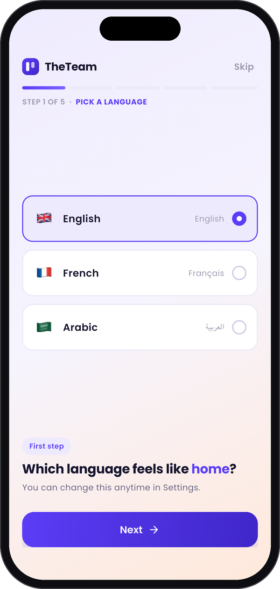
  </Frame>
  <Frame caption="Step 2: what Strived teaches.">
    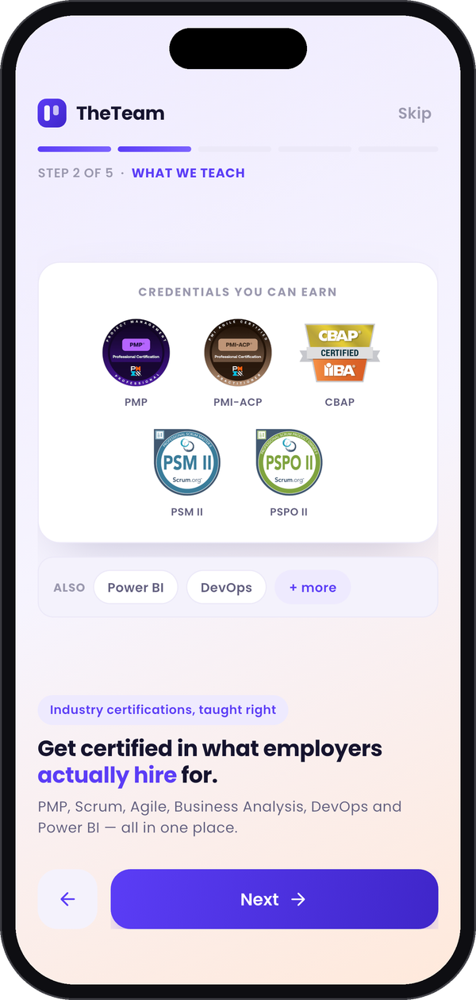
  </Frame>
  <Frame caption="Step 3: get certified.">
    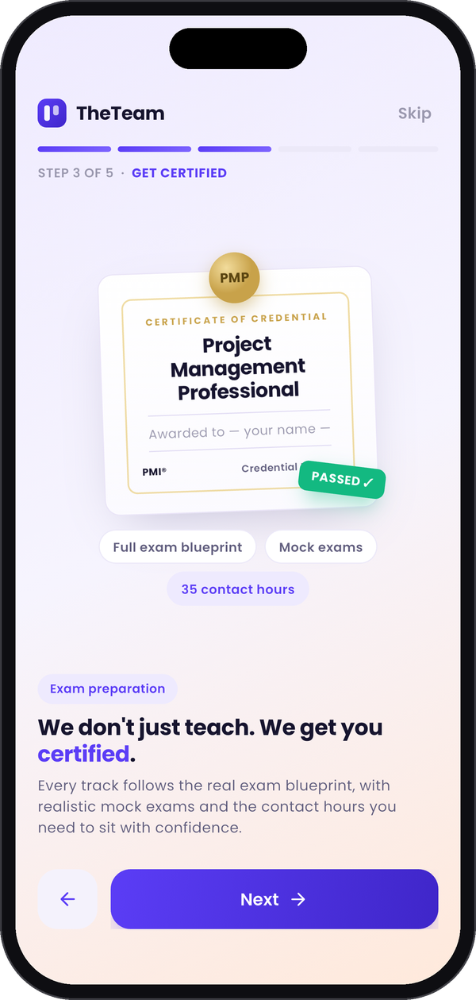
  </Frame>
  <Frame caption="The learner's dashboard.">
    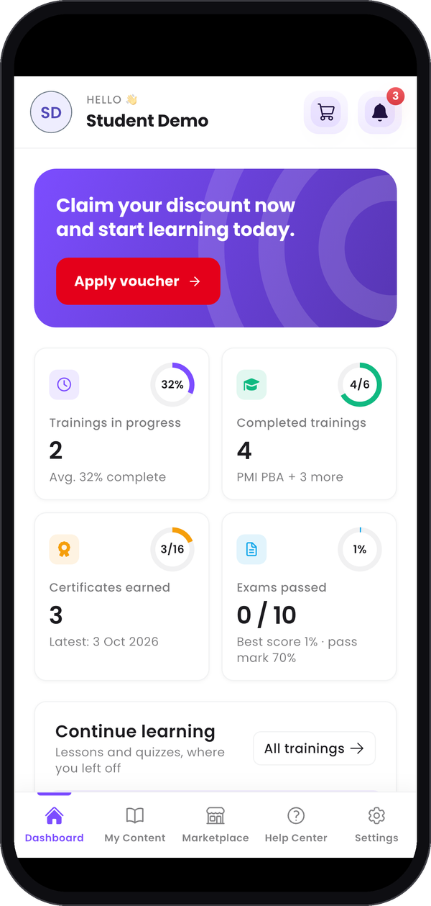
  </Frame>
  <Frame caption="My trainings and progress.">
    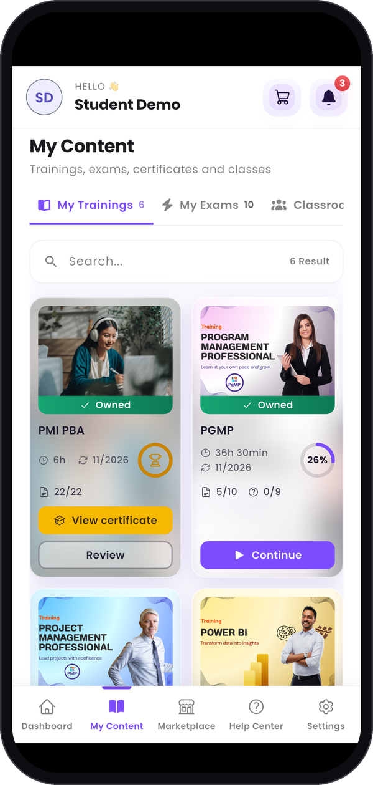
  </Frame>
  <Frame caption="Chat with the instructor.">
    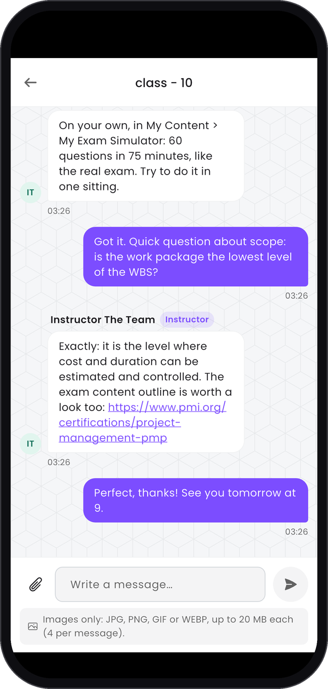
  </Frame>
</Columns>

Every screen is in the student guide: [Mobile App](/student-guide/mobile-app).

### For instructors

The phone covers an instructor's daily essentials: answer learners, send them news and keep an eye
on trainings and classrooms. Creating and editing content stays on the web. See the instructor
guide: [Mobile App](/instructor-guide/mobile-app).

<Columns cols={3}>
  <Frame caption="The instructor's dashboard.">
    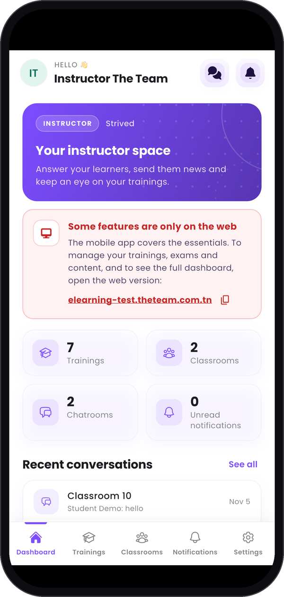
  </Frame>
  <Frame caption="Notify learners or copy their e-mails.">
    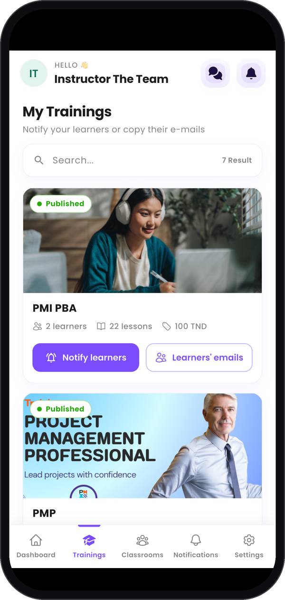
  </Frame>
  <Frame caption="Answer the classroom chat.">
    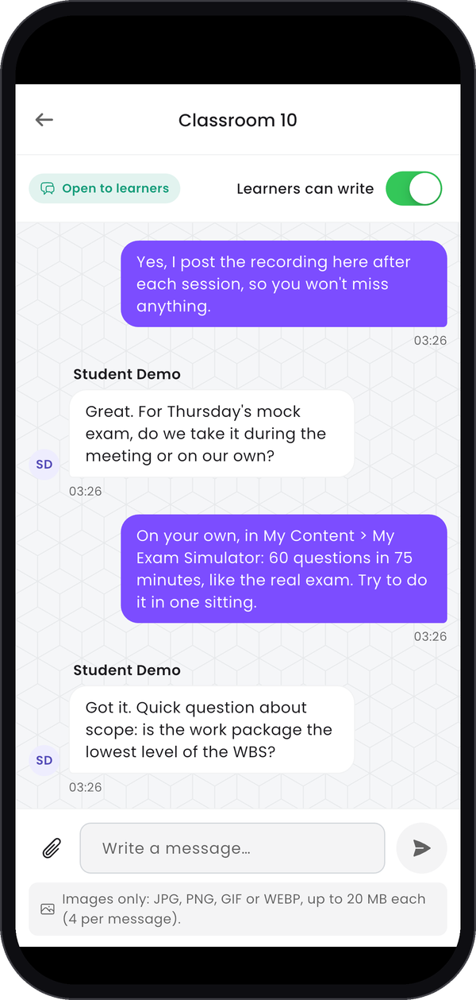
  </Frame>
</Columns>

### For content managers and admins

These two roles work in the web app on a computer: the mobile app doesn't open for them. See
[content managers](/content-manager-guide/mobile-app) and [admins](/admin-guide/mobile-app).

## What the organization gets

<CardGroup cols={2}>
  <Card title="A marketplace" icon="store">
    A catalog of trainings and mock exams with categories, a cart and discount coupons. Orders paid
    by bank transfer, in cash or by cheque are confirmed by an admin.
  </Card>
  <Card title="Vouchers" icon="ticket">
    A voucher gives a learner free access to a set of trainings and exams, sent by e-mail. Handy for
    a company that enrolls a whole team.
  </Card>
  <Card title="Instructor revenue share" icon="chart-line">
    Each instructor gets a share of the sales of their content and follows it on their own sales
    page, with PDF and CSV exports.
  </Card>
  <Card title="Communication" icon="bell">
    In-app notifications, sent to chosen users, a role or the whole company, by e-mail too, now or
    later.
  </Card>
</CardGroup>

## Coming soon: the AI assistant

An AI assistant is coming to the course player soon. Learners ask it questions about the training
they're following, and it answers from that training's own course material, listing under each
answer the parts of the course it used. It can also give the plan of the whole training, summarize
a session, pick out the key points, explain a concept with an example, or quiz the learner on the
course, in English or French. Only the learners enrolled in the training can use it.

<Frame caption="The AI assistant at work on a PMP training.">
  <iframe
    src="https://www.youtube-nocookie.com/embed/GmlSoXiWilY"
    title="The Strived AI assistant answering questions on a PMP training"
    style={{ width: "100%", aspectRatio: "16 / 9", border: 0 }}
    allow="accelerometer; autoplay; clipboard-write; encrypted-media; gyroscope; picture-in-picture; web-share"
    referrerPolicy="strict-origin-when-cross-origin"
    allowFullScreen
  ></iframe>
</Frame>

---

## Read the guides

Every guide is a step-by-step walkthrough of the web app, with a screenshot for each step. Each role
also has a **Mobile App** page for the phone.

<CardGroup cols={2}>
  <Card title="Student" icon="graduation-cap" href="/student-guide/first-steps">
    Log in, study your trainings, take mock exams, get your certificates and buy new trainings.
  </Card>
  <Card title="Instructor" icon="chalkboard-user" href="/instructor-guide/get-started">
    Build your public profile, create trainings and exams, run your classrooms and follow your sales.
  </Card>
  <Card title="Content Manager" icon="folder-gear" href="/content-manager-guide/get-started">
    Publish trainings and exams, update classrooms and keep categories and tags in order.
  </Card>
  <Card title="Admin" icon="user-shield" href="/admin-guide/get-started">
    Manage orders, trainings, exams, vouchers and coupons, users, classrooms and notifications.
  </Card>
</CardGroup>

<Callout icon="building" color="#7625C2">
  **Made to fit your organization.** Strived is highly customizable for companies and training
  organizations: your name, logo and colors across the platform, certificates with your own
  signature and stamp, e-mails sent in your name, and your own catalog of trainings and exams. Tell
  us what your teams need, and we'll shape Strived around it.
</Callout>

<Tip>
  Need help? Open the **Help Center** in the app or write to
  [service.desk@theteam.com.tn](mailto:service.desk@theteam.com.tn).
</Tip>
