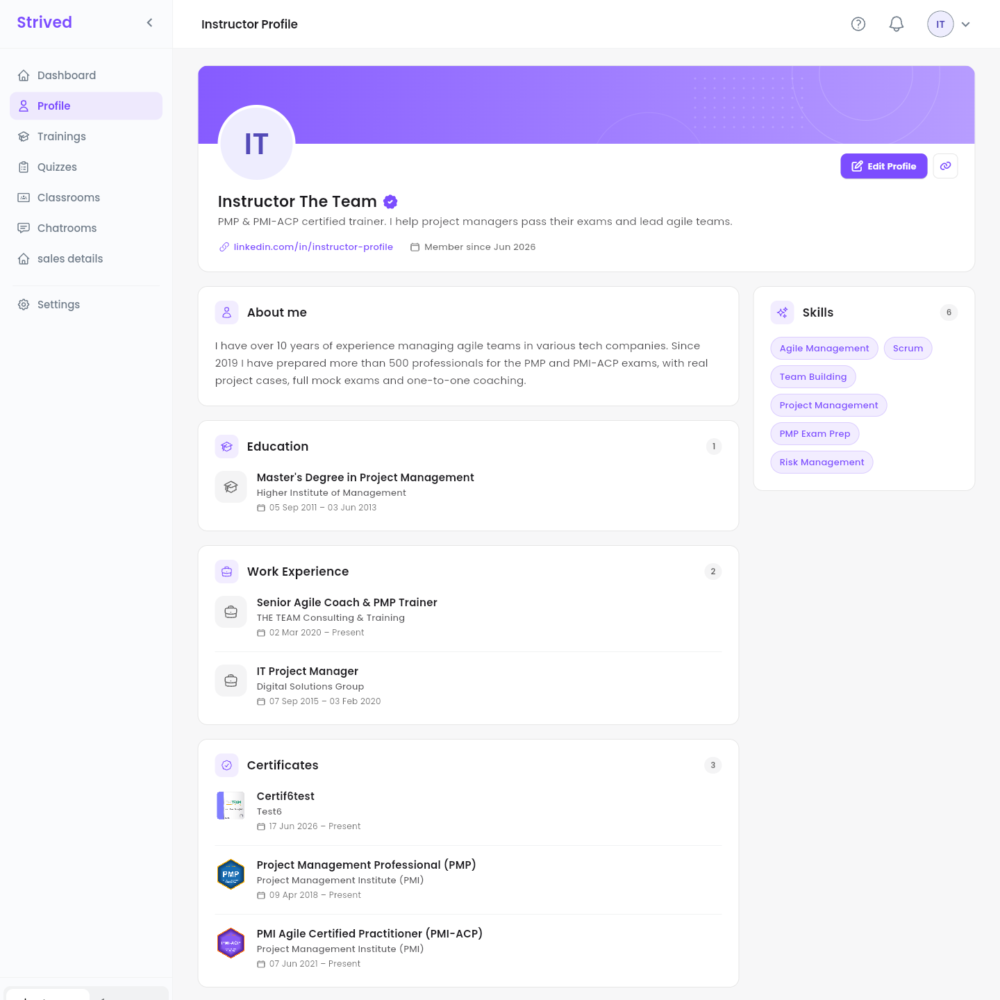
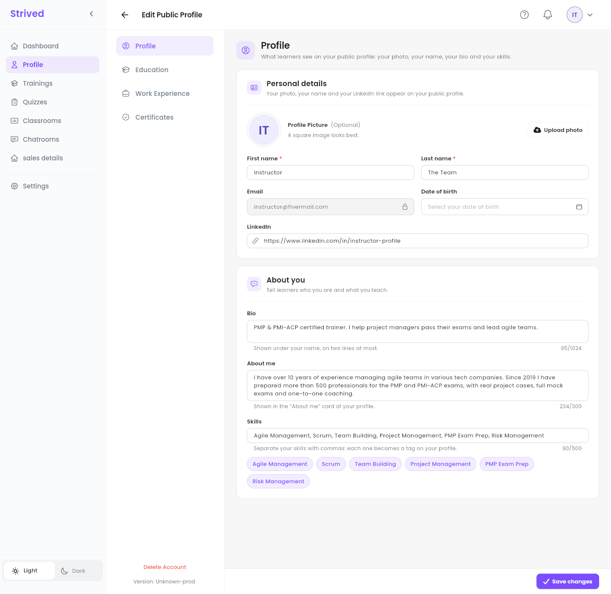
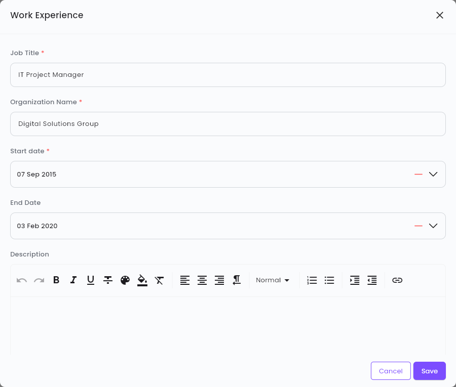
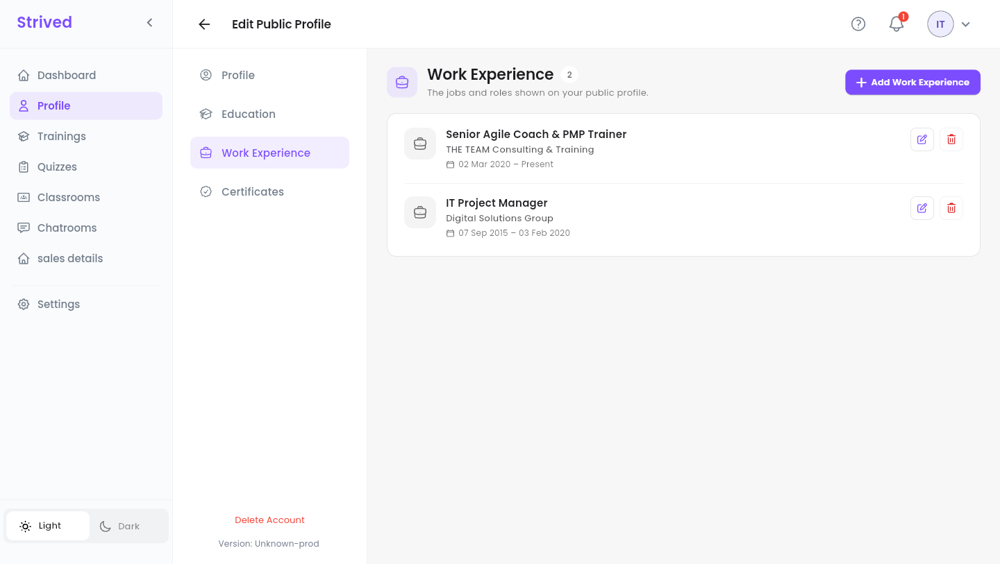
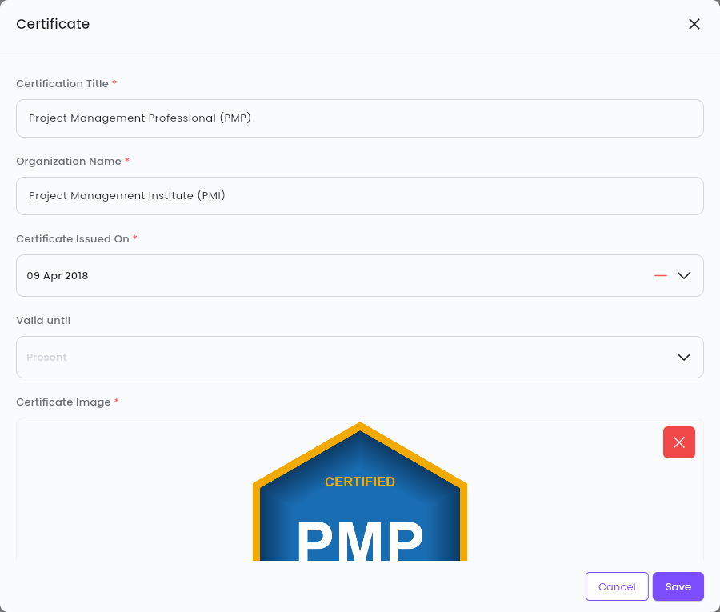
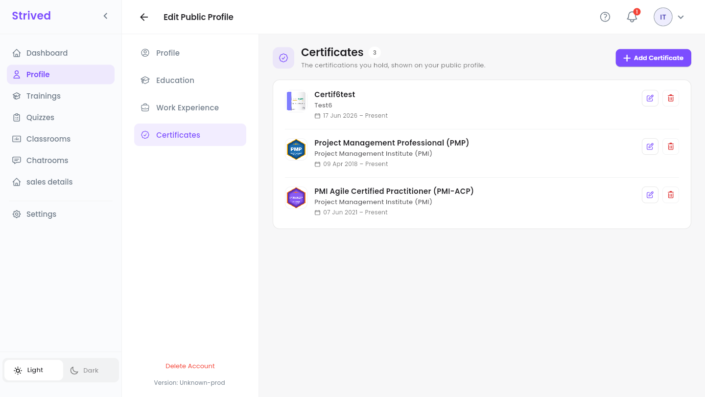

Your **public profile** is what learners see when they look at who teaches a training. A complete
profile, with your certifications and experience, builds trust before they buy.

<Note>
  Everything below is for the **web app** on a computer. The screenshots show the profile of the
  test instructor account.
</Note>

---

## Table of contents

- **Step 1 — Look at your profile**
- **Step 2 — Edit your details, bio and skills**
- **Step 3 — Add your education and work experience**
- **Step 4 — Add your certificates and their badges**
- **Step 5 — Share your profile**
- **Good to know**

---

## Step 1 — Look at your profile

Click **Profile** in the sidebar.

<Frame caption="Your public profile.">
  
</Frame>

| Part | What it shows |
| :-- | :-- |
| Header | Your photo (or initials), your name, the purple badge if an admin has verified you, your **bio**, your LinkedIn link and **Member since**. |
| **About me** | A longer presentation of you and what you teach. |
| **Skills** | Your skills, as tags. |
| **Education** | Your degrees and schools. |
| **Work Experience** | The jobs and roles you held. |
| **Certificates** | Your certifications, each with its badge image. |

Click **Edit Profile** at the top right to change any of it.

---

## Step 2 — Edit your details, bio and skills

**Edit Public Profile** has four sections on the left: **Profile**, **Education**, **Work
Experience** and **Certificates**. **Profile** opens first.

<Frame caption="Edit Public Profile → Profile.">
  
</Frame>

<Steps>
  <Step title="Personal details">
    **Upload photo** (a square image looks best), **First name**, **Last name**, **Date of birth**
    and **LinkedIn**. The **Email** cannot be changed.
  </Step>
  <Step title="Bio">
    One or two lines shown under your name, e.g. *"PMP & PMI-ACP certified trainer. I help project
    managers pass their exams and lead agile teams."*
  </Step>
  <Step title="About me">
    A short presentation, 300 characters at most: your experience, what you teach, how you teach.
  </Step>
  <Step title="Skills">
    Separate them with commas: each one becomes a tag, and the tags appear under the field as you
    type.
  </Step>
  <Step title="Save">
    Click **Save changes** at the bottom right. *"Your profile has been updated."* confirms it.
  </Step>
</Steps>

---

## Step 3 — Add your education and work experience

Both sections work the same way. Open **Work Experience** (or **Education**) and click **Add Work
Experience** (or **Add Education**).

<Frame caption="Adding a work experience.">
  
</Frame>

<Steps>
  <Step title="What and where">
    For a job: **Job Title** and **Organization Name**. For a degree: **Education** (the degree)
    and **University Name**.
  </Step>
  <Step title="When">
    Pick the **Start date**. Leave **End Date** empty if it is your current position: the profile
    shows **Present**. The start date must be before the end date.
  </Step>
  <Step title="Description (optional)">
    A few lines about the role or the degree, with the formatting toolbar.
  </Step>
  <Step title="Save">
    Click **Save**. The entry shows on your public profile straight away.
  </Step>
</Steps>

<Frame caption="Your work experience.">
  
</Frame>

The pencil next to an entry edits it, the bin deletes it (after a confirmation).

---

## Step 4 — Add your certificates and their badges

Open **Certificates** and click **Add Certificate**.

<Frame caption="Adding a certificate with its badge.">
  
</Frame>

<Steps>
  <Step title="The certification">
    **Certification Title** (e.g. *Project Management Professional (PMP)*) and **Organization
    Name** (e.g. *Project Management Institute (PMI)*).
  </Step>
  <Step title="The dates">
    **Certificate Issued On**, and **Valid until** if it expires. Left empty, the profile shows
    **Present**.
  </Step>
  <Step title="The badge">
    Under **Certificate Image**, click **Choose File** and pick the badge or a picture of the
    certificate. The image is required. The red cross removes it if you picked the wrong one.
  </Step>
  <Step title="Save">
    Click **Save**.
  </Step>
</Steps>

<Frame caption="Your certificates, each with its badge.">
  
</Frame>

---

## Step 5 — Share your profile

On your profile, the link button next to **Edit Profile** copies your profile's address (*"The
profile link was copied successfully"*). Paste it in an e-mail, a post or your LinkedIn page.

---

## Good to know

<AccordionGroup>
  <Accordion title="What does the purple badge next to my name mean?">
    An admin has verified your account. Only admins can verify or unverify an instructor.
  </Accordion>
  <Accordion title="Bio or About me: which goes where?">
    The **bio** sits under your name, on two lines at most: keep it to one sentence. **About me** is
    its own card, for a short paragraph.
  </Accordion>
  <Accordion title="Can I change my e-mail?">
    No, it is your login. Contact the platform's admins if it has to change.
  </Accordion>
</AccordionGroup>
