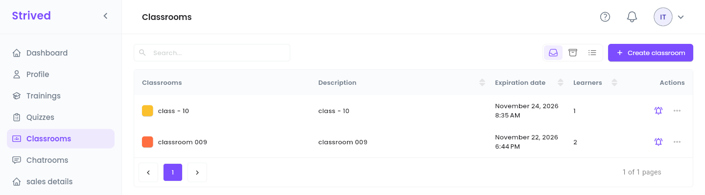
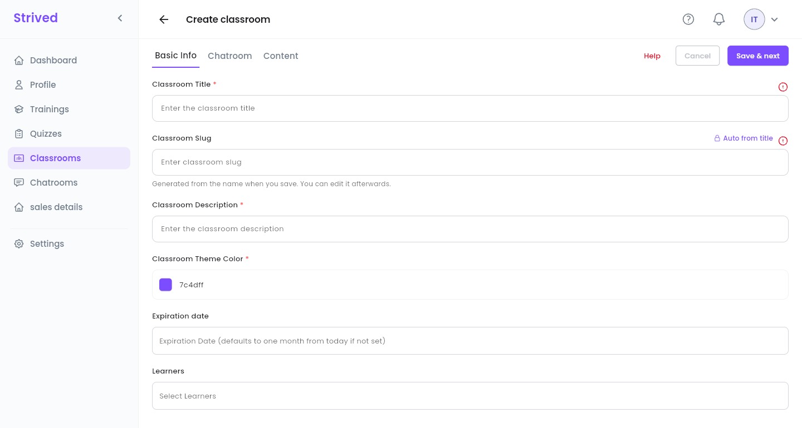
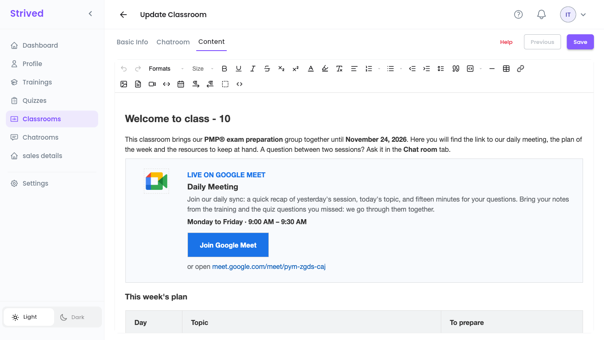
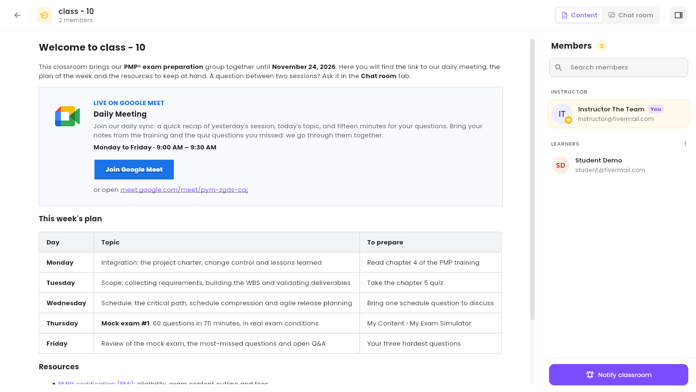
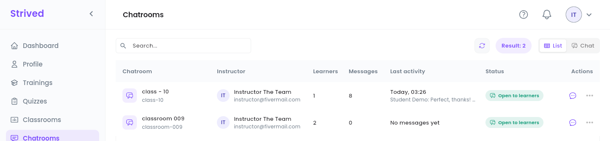
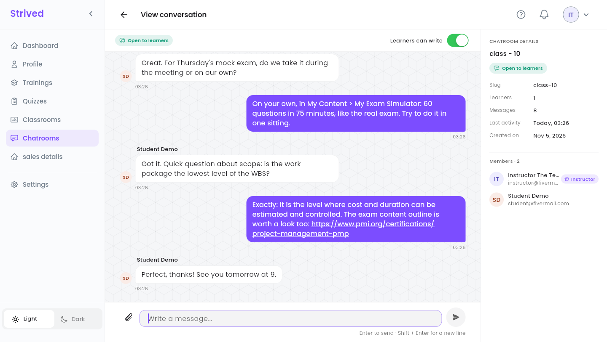

A **classroom** brings a group of your learners together for a set period. It has a content page
and, if you create one, a **chatroom**: a group chat between you and the learners.

<Note>
  Everything below is for the **web app** on a computer, signed in as an **Instructor**. Learners
  find their classrooms in **My Content → Classrooms & Chat**.
</Note>

---

## Table of contents

- **Step 1 — Open your classrooms**
- **Step 2 — Create a classroom**
- **Step 3 — Preview it and notify its members**
- **Step 4 — Lead the chatroom**
- **Good to know**

---

## Step 1 — Open your classrooms

Click **Classrooms** in the sidebar.

<Frame caption="Your classrooms.">
  
</Frame>

Each row shows the classroom's color and name, its **Description**, its **Expiration date** and its
number of **Learners**. The bell sends a message to the classroom (Step 3), and **⋯** offers
**Preview**, **Update** and **Notify classroom**.

---

## Step 2 — Create a classroom

Click **Create classroom** at the top right. The editor has three tabs: **Basic Info**,
**Chatroom** and **Content**.

<Frame caption="Create classroom → Basic Info.">
  
</Frame>

<Steps>
  <Step title="Basic Info">
    **Classroom Title**, **Classroom Description** and **Classroom Theme Color**. The **Classroom
    Slug** is generated from the title. **Expiration date**: left empty, one month from today.
    **Learners**: pick everyone who takes part. You are the classroom's instructor.
  </Step>
  <Step title="Save & next">
    Click **Save & next**: the classroom is created and the **Chatroom** tab opens.
  </Step>
  <Step title="Chatroom (optional)">
    Click **Create chatroom** to open the group chat now, or skip it and create it later from
    **Update**.
  </Step>
  <Step title="Content">
    **Next page** opens a rich-text editor. Write what learners should find in the classroom:
    schedule, instructions, resources. Click **Save**.
  </Step>
</Steps>

To change a classroom later, use **⋯ → Update**: the same three tabs, with a single **Save** at the
end. Saving also updates the chatroom's title and members.

### The content editor

<Frame caption="Content: the rich-text editor, here with the page of class - 10.">
  
</Frame>

| Buttons | What they do |
| :-- | :-- |
| **Formats**, **Size** | Headings, paragraph styles and text size. |
| Bold, underline, italic, strikethrough, subscript, superscript | Text styles. |
| Text color, highlight, clear format | Colors, and removing every style from the selection. |
| Alignment, numbered and bulleted lists, indent, line height | The layout of the paragraphs. |
| Quote, code block, horizontal line, table, link | Blocks, tables and links. |
| Image, PDF, video, embed, Google Calendar | Images and PDFs are uploaded to the cloud storage, in the classroom's folder. **Embed** takes an `<iframe>` code or a link (YouTube, Google Drive…). |
| Left-to-right / right-to-left, show blocks, code view (`<>`) | Writing direction, block outlines, and the HTML of the page. |

<Tip>
  The learners' page keeps headings, lists, text colors, links, images and **tables** with their
  borders and background colors. To draw a card or a button, use a table, as the Google Meet card
  above does: the editor removes the styles it has no tool for (padding, rounded corners, styled
  `<div>`s or buttons). After saving, check the result with **⋯ → Preview**.
</Tip>

<Accordion title="Reuse the Google Meet card">
  Open the code view (`<>`), paste the HTML below where the card should go, and change the link (it
  appears twice), the days and the times. Close the code view and click **Save**. Keep the
  description about two lines long: on the learners' page, a table is only as wide as its text
  needs.

  ```html
  <table style="width: 100%; border: 1px solid #dadce0; background-color: #f8fafd">
    <tbody>
      <tr>
        <td style="border: 0"><p style="margin: 0 10px">&nbsp;</p></td>
        <td style="border: 0; text-align: center; vertical-align: top">
          <p style="margin: 0; line-height: 18px"><br></p>
          
        </td>
        <td style="border: 0"><p style="margin: 0 7px">&nbsp;</p></td>
        <td style="border: 0; vertical-align: top">
          <p style="margin: 20px 24px 2px 0"><span style="color: #1a73e8"><strong>LIVE ON GOOGLE MEET</strong></span></p>
          <h3 style="margin: 0 24px 4px 0">Daily Meeting</h3>
          <p style="margin: 0 24px 6px 0"><span style="color: #5f6368">Join our daily sync: a quick recap of yesterday's session, today's topic, and fifteen minutes for your questions. Bring your notes from the training and the quiz questions you missed: we go through them together.</span></p>
          <p style="margin: 0 24px 14px 0"><strong>Monday to Friday · 9:00 AM – 9:30 AM</strong></p>
          <table style="border-collapse: collapse">
            <tbody>
              <tr>
                <td style="background-color: #1a73e8; border: 0">
                  <p style="margin: 10px 22px"><a href="https://meet.google.com/meet/pym-zgds-caj"><span style="color: #ffffff"><strong>Join Google Meet</strong></span></a></p>
                </td>
              </tr>
            </tbody>
          </table>
          <p style="margin: 10px 24px 20px 0"><span style="color: #5f6368">or open </span><a href="https://meet.google.com/meet/pym-zgds-caj">meet.google.com/meet/pym-zgds-caj</a></p>
        </td>
      </tr>
    </tbody>
  </table>
  ```
</Accordion>

---

## Step 3 — Preview it and notify its members

**⋯ → Preview** opens the classroom as its members see it.

<Frame caption="Previewing a classroom.">
  
</Frame>

- **Content** / **Chat room** at the top right switch between the content page and the group chat.
- The **Members** panel lists you (**You**) and the **Learners**, with **Search members**.
- **Notify classroom** at the bottom sends an in-app notification to every member, like the bell
  in the list.

---

## Step 4 — Lead the chatroom

Click **Chatrooms** in the sidebar: the chatrooms of your classrooms, as a table (**List**) or as a
messenger (**Chat**).

<Frame caption="Chatrooms → List.">
  
</Frame>

The **⋯** menu of a chatroom offers **View conversation** and **Stop learners from writing**. The
speech-bubble icon opens the conversation too.

<Frame caption="A conversation.">
  
</Frame>

- Type in **Write a message…** and press Enter to send (Shift + Enter for a new line). The paperclip
  attaches images: JPG, PNG, GIF or WEBP, up to 20 MB each, 4 per message.
- **Learners can write** at the top: turn it off to make the chatroom read-only for learners (an
  announcement, an exam day…). You can still write. Turn it on again at any time.
- **Chatroom details** on the right: slug, number of learners and messages, last activity, creation
  date, and the members.

---

## Good to know

<AccordionGroup>
  <Accordion title="Who can read the chatroom?">
    You, the classroom's learners and the platform's admins. Nobody else can open it.
  </Accordion>
  <Accordion title="Can I delete messages or the chatroom?">
    No, wiping the history or deleting a chatroom is reserved to admins. Contact them if needed.
  </Accordion>
  <Accordion title="I added a learner: are they in the chatroom?">
    Yes. Saving the classroom updates the chatroom's members too.
  </Accordion>
</AccordionGroup>
