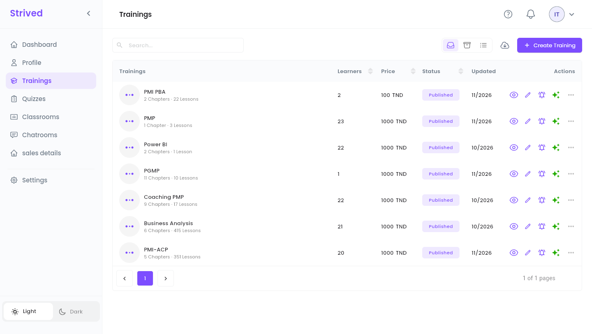
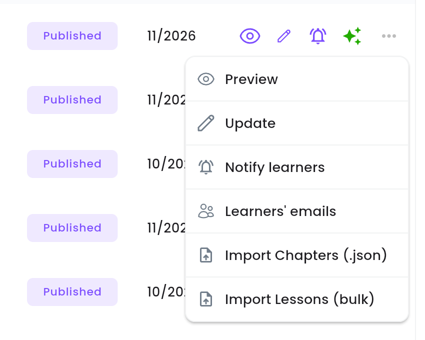
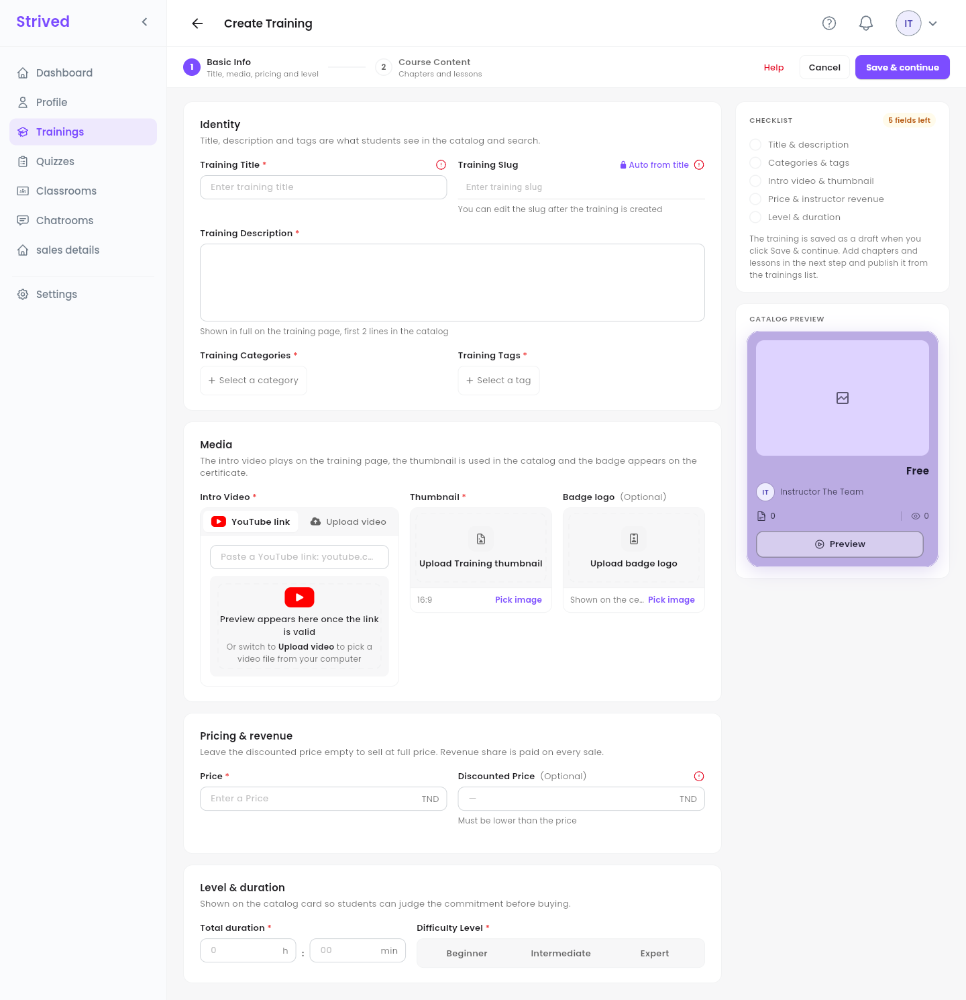
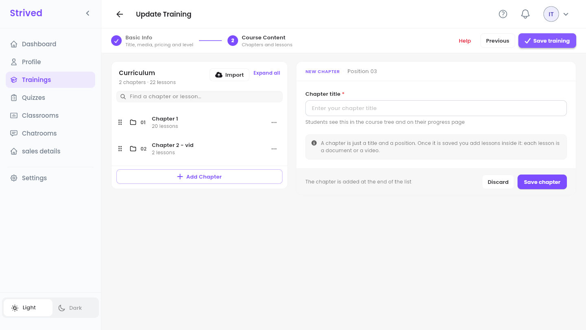
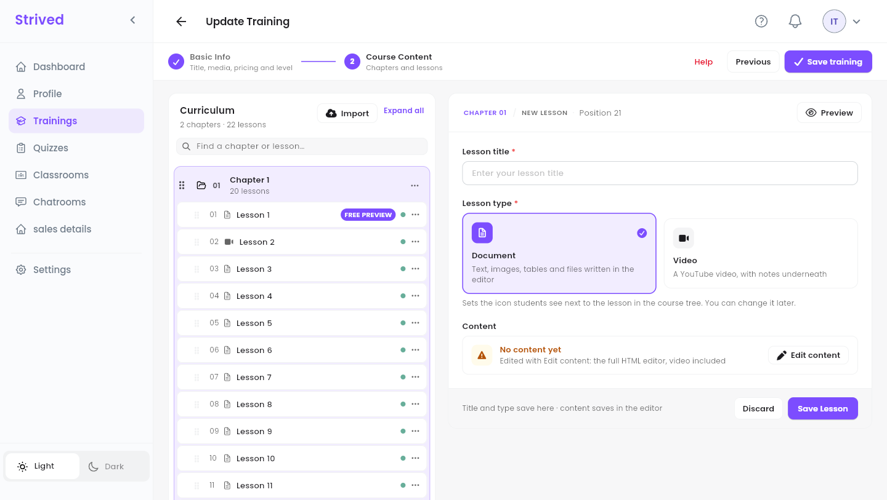
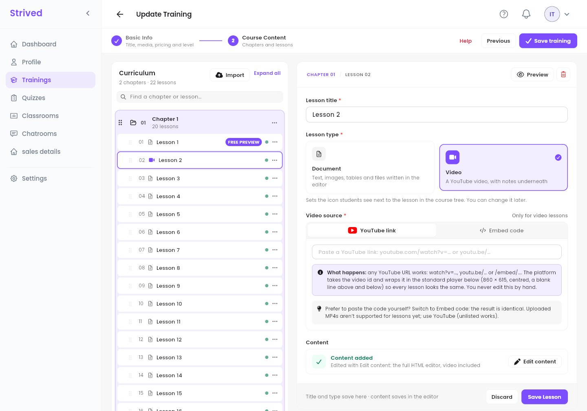
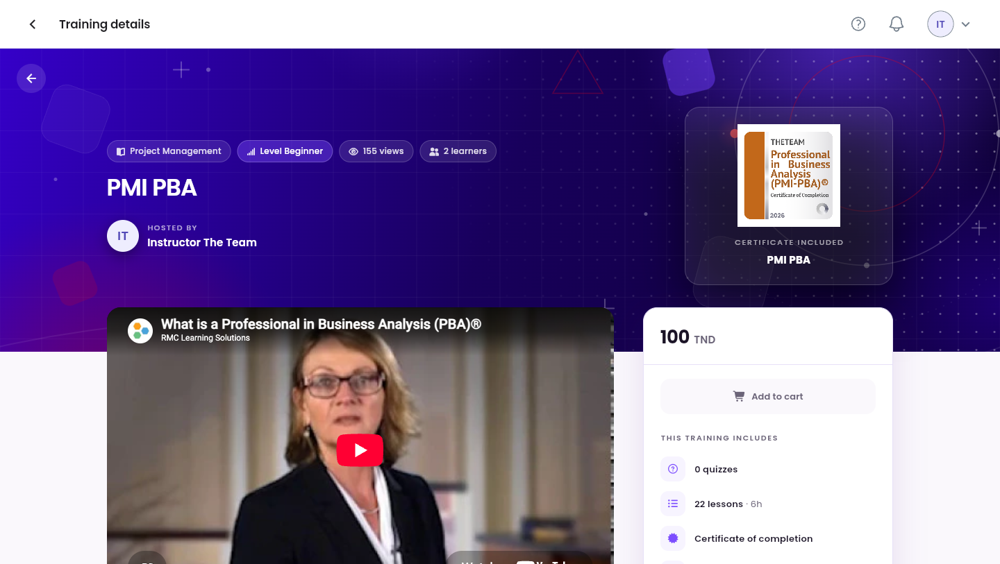
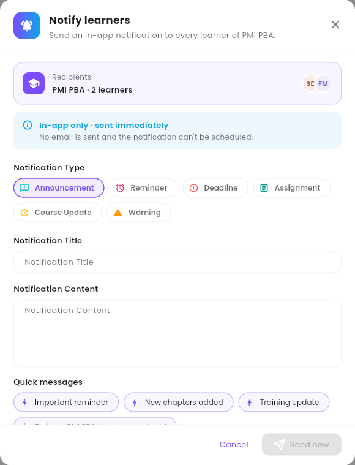

A **training** is a course sold in the catalog: a presentation, a price, and chapters full of
lessons (documents or videos). As an instructor you write it from start to finish; an admin
publishes it when it is ready.

<Note>
  Everything below is for the **web app** on a computer, signed in as an **Instructor**.
</Note>

---

## Table of contents

- **Step 1 — Open your trainings**
- **Step 2 — Create a training: Basic Info**
- **Step 3 — Build the course content**
- **Step 4 — Write a lesson**
- **Step 5 — Preview it and get it published**
- **Step 6 — Notify your learners**
- **Good to know**

---

## Step 1 — Open your trainings

Click **Trainings** in the sidebar.

<Frame caption="Your trainings.">
  
</Frame>

Each row shows the training, its number of **Learners**, its **Price**, its **Status**
(**Published** in the catalog, or **Draft**) and the month it was last **Updated**. The icons at the
end of a row are shortcuts: the eye (**Preview**), the pen (**Update**) and the bell (**Notify
learners**). The sparkles are green when an admin has enabled the **AI Assistant** for the training.

**⋯** opens every action:

<Frame caption="The ⋯ menu of a training.">
  
</Frame>

| Action | What it does |
| :-- | :-- |
| **Preview** | Opens the training as learners see it (Step 5). |
| **Update** | Opens the training editor (Steps 2 to 4). |
| **Notify learners** | Sends an in-app message to everyone who follows the training (Step 6). |
| **Learners' emails** | Lists the e-mail addresses of the training's learners. |
| **Import Chapters (.json)** | Adds chapters from JSON files, for example a training exported by an admin. |
| **Import Lessons (bulk)** | Turns images into lessons, one image per lesson, in file-name order (`01-…`, `02-…`). |

---

## Step 2 — Create a training: Basic Info

Click **Create Training** at the top right. The editor has two steps: **1 Basic Info** and
**2 Course Content**.

<Frame caption="Create Training → Basic Info.">
  
</Frame>

The **Checklist** on the right ticks each part as you fill it, and the **Catalog Preview** shows
the card learners will see, with your name on it.

<Steps>
  <Step title="Identity">
    **Training Title** and **Training Description** (shown in full on the training page, first two
    lines in the catalog). The **Training Slug** is filled **Auto from title**. Pick at least one
    item in **Training Categories** and **Training Tags**.
  </Step>
  <Step title="Media">
    **Intro Video**: paste a **YouTube link** (a preview appears) or switch to **Upload video**.
    **Thumbnail**: the 16:9 cover used in the catalog. **Badge logo** (optional): shown on the
    learners' certificate.
  </Step>
  <Step title="Pricing">
    **Price** in TND, and an optional **Discounted Price** (lower than the price). Your share of
    each sale is set by an admin, not here.
  </Step>
  <Step title="Level & duration">
    **Total duration** in hours and minutes, and the **Difficulty Level**: **Beginner**,
    **Intermediate** or **Expert**.
  </Step>
  <Step title="Save & continue">
    Click **Save & continue**. The training is saved **as a draft**, invisible to learners, and the
    **Course Content** step opens.
  </Step>
</Steps>

<Note>
  If the platform says *"Default Revenue Percentage Unset"*, your revenue percentage has not been
  set yet. Contact an admin: they set it in **Users → Set Revenue**, then you can save.
</Note>

---

## Step 3 — Build the course content

<Frame caption="Course Content: the curriculum on the left, a new chapter on the right.">
  
</Frame>

<Steps>
  <Step title="Add a chapter">
    Click **Add Chapter**, type the **Chapter title** (learners see it in the course tree), then
    **Save chapter**.
  </Step>
  <Step title="Add lessons">
    Open the chapter's **⋯** menu and choose **Add Lesson**. The same menu has **Rename chapter**
    and **Delete chapter**.
  </Step>
  <Step title="Reorder">
    Drag a chapter or a lesson by its handle (the six dots on the left).
  </Step>
  <Step title="Save the training">
    When the curriculum is ready, click **Save training** at the top right.
  </Step>
</Steps>

**Find a chapter or lesson…** searches the curriculum, **Expand all** opens every chapter, and
**Import** adds chapters from a file.

---

## Step 4 — Write a lesson

<Frame caption="A new lesson.">
  
</Frame>

<Steps>
  <Step title="Title and type">
    Type the **Lesson title** and choose **Document** (text, images, tables and files written in the
    editor) or **Video** (a YouTube video, with notes underneath).
  </Step>
  <Step title="For a video: the source">
    Paste a **YouTube link**, or switch to **Embed code**. Uploaded MP4 files are not supported for
    lessons yet: use YouTube (an unlisted video works).
  </Step>
  <Step title="Write the content">
    Click **Edit content** to open the full editor, write the lesson, then **Save Lesson** at the
    top of the editor.
  </Step>
  <Step title="Save">
    Back in the form, click **Save Lesson**.
  </Step>
</Steps>

<Frame caption="Editing a video lesson.">
  
</Frame>

In the curriculum, a **green** dot means the lesson has content, an **orange** one that it is still
empty. The lesson's **⋯** menu offers **Preview**, **Edit** and **Delete**.

<Tip>
  The first lesson of chapter 1 carries a **FREE PREVIEW** badge: visitors can watch it before
  buying. Make it a good introduction to the training.
</Tip>

---

## Step 5 — Preview it and get it published

The eye on the row (or **⋯ → Preview**) opens the training page as learners see it: category,
level, presentation video, price, and what **This training includes**.

<Frame caption="Previewing a training.">
  
</Frame>

When everything is ready, ask an admin to **publish** the training. Its status then turns
**Published** and it appears in the catalog.

---

## Step 6 — Notify your learners

Click the bell on the row (or **⋯ → Notify learners**). The bell is grey while the training has no
learners.

<Frame caption="Notify learners.">
  
</Frame>

<Steps>
  <Step title="Check the recipients">
    **Recipients** shows the training and how many learners will get the message.
  </Step>
  <Step title="Pick a Notification Type">
    **Announcement**, **Reminder**, **Deadline**, **Assignment**, **Course Update** or **Warning**.
  </Step>
  <Step title="Write the message">
    Fill in **Notification Title** and **Notification Content**, or start from a **Quick message**
    (**Important reminder**, **New chapters added**, **Training update**, and so on).
  </Step>
  <Step title="Send">
    Click **Send now**. The message is in-app only and goes out immediately.
  </Step>
</Steps>

---

## Good to know

<AccordionGroup>
  <Accordion title="Can I change a training after it is published?">
    Yes, with **Update**. Learners see the changes as soon as you save. Once the training has sold,
    some business settings are locked; an admin can tell you more.
  </Accordion>
  <Accordion title="How do I give my training to a learner for free?">
    You can't from the instructor side. Ask an admin: they can assign it, or send a voucher.
  </Accordion>
  <Accordion title="Where do quizzes come in?">
    A quiz belongs to a chapter of a training. Create it from **Quizzes** — see
    [Create exams and quizzes](/instructor-guide/create-exams-and-quizzes).
  </Accordion>
</AccordionGroup>
