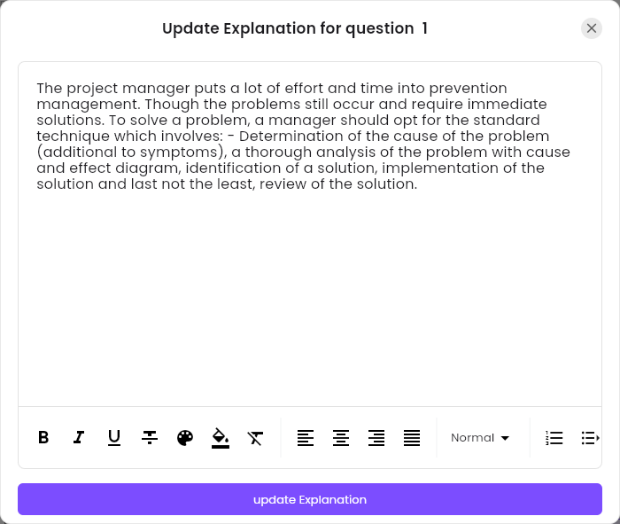
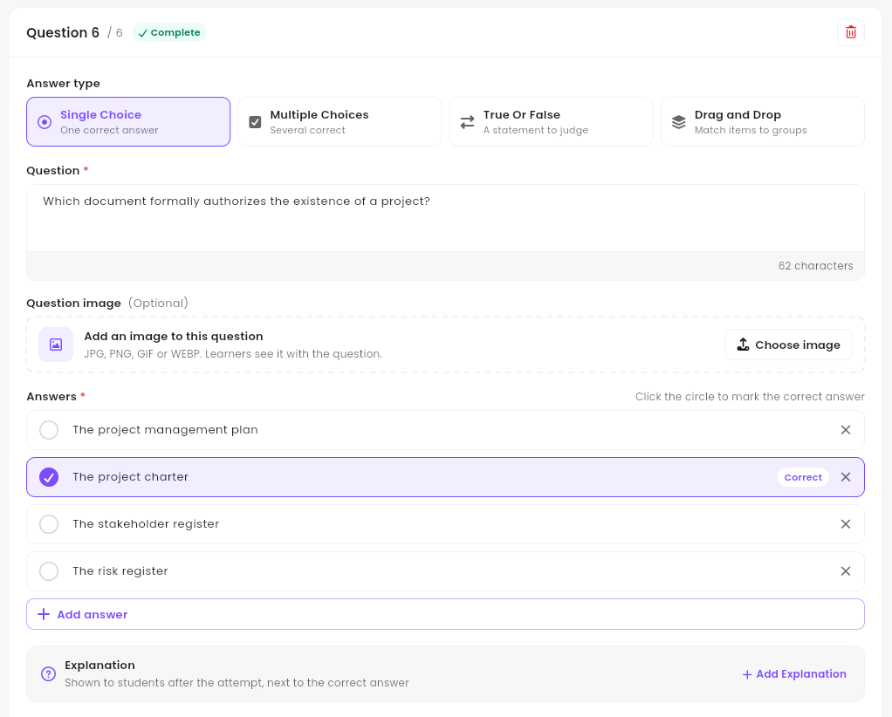
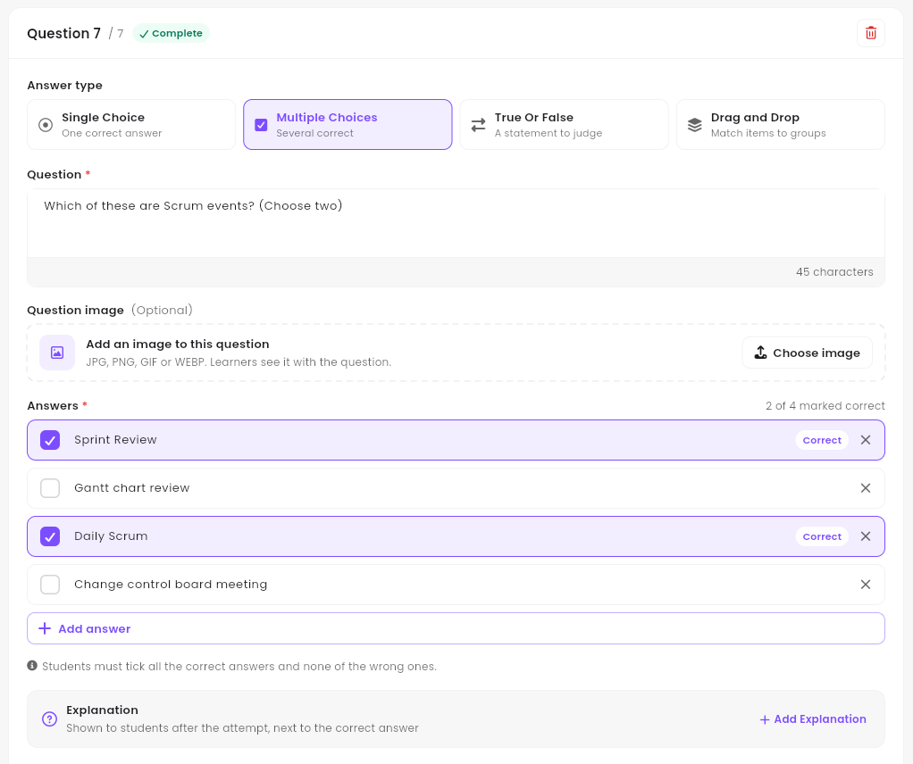
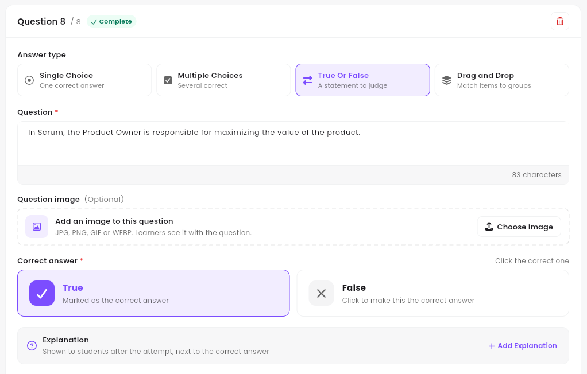
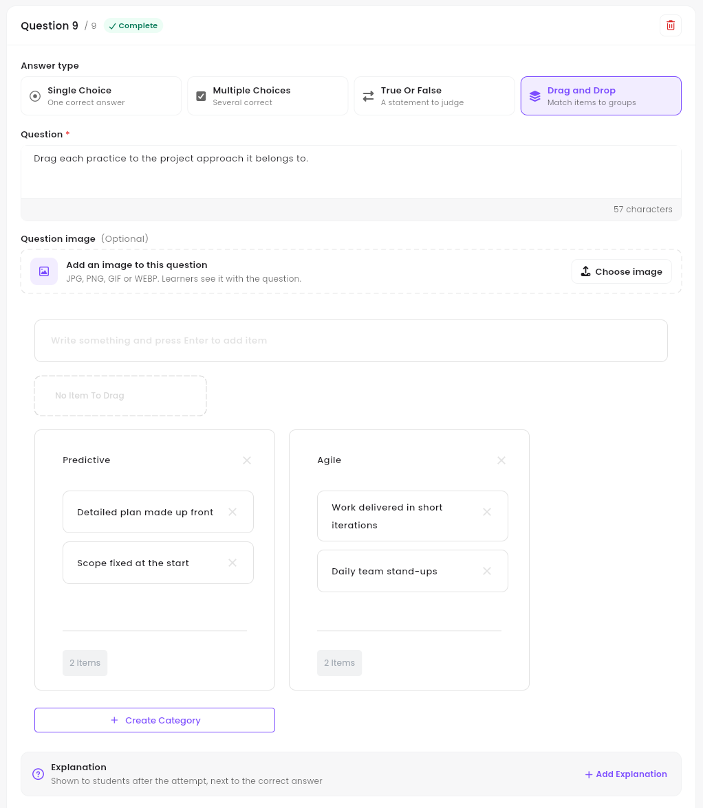

**Quizzes** in the sidebar holds two kinds of tests, built with the same editor:

| | **Exam** | **Quiz** |
| :-- | :-- | :-- |
| What it is | A standalone mock exam, sold on its own in the **Exam Catalog**. | A test inside a training, placed in one of its chapters. |
| Learners find it in | **My Content → My Exam Simulator**. | The training's **Course Content** panel. |
| Has its own price | Yes. | No: it comes with the training. |

<Note>
  Everything below is for the **web app** on a computer, signed in as an **Instructor**.
</Note>

---

## Table of contents

- **Step 1 — Open your exams and quizzes**
- **Step 2 — Training and Chapter**
- **Step 3 — Basic Info**
- **Step 4 — Write the questions**
- **Step 5 — Preview it and get it published**
- **Good to know**

---

## Step 1 — Open your exams and quizzes

Click **Quizzes** in the sidebar. Two tabs sit at the top: **Exams** and **Quizzes**.

<Frame caption="The Exams tab.">
  
</Frame>

<Frame caption="The Quizzes tab, grouped by training.">
  
</Frame>

Each row shows the number of **Learners**, of **Questions**, the **Price** (exams only) and the
**Status**: **Published** or **Draft**. On the **Quizzes** tab, **Related Training** and **Related
Chapter** say where each quiz sits. The **⋯** menu of a row offers **Preview**, **Update** and
**Import Questions** (from a JSON file).

---

## Step 2 — Training and Chapter

Click **Create Exam** (on the **Exams** tab) or **Create Quiz** (on the **Quizzes** tab). The editor
has four steps: **Training**, **Chapter**, **Basic Info** and **Questions**.

<Frame caption="Step 1: pick a training, or skip it for a standalone exam.">
  
</Frame>

- **For a quiz**: tick the training it belongs to, click **Continue to chapters**, then pick the
  chapter.
- **For an exam**: pick nothing and click **Continue** twice. The steps show **Standalone exam**.

**Reset** clears your choice. Changing the training resets the chapter, but keeps the basic info
and the questions.

---

## Step 3 — Basic Info

<Frame caption="Step 3: Basic Info.">
  
</Frame>

| Section | Fields |
| :-- | :-- |
| **Identity** | **Exam Name**, **Description** (optional, learners read it before they start) and **Exam Category**. |
| **Pricing & revenue** | **Price** and an optional **Discounted Price**. The line underneath shows what the student pays, what you earn and what the platform keeps. |
| **Attempt rules** | **Exam Duration**, **Max Attempts** (0 means unlimited), **Passing Percentage %** (70 by default) and **Has pause ?**: a break after a set number of questions, during which the timer stops. |

Click **Save & continue**: the exam is created **as a draft** and the **Questions** step opens.

---

## Step 4 — Write the questions

<Frame caption="Step 4: Questions.">
  
</Frame>

<Steps>
  <Step title="Add a question">
    Click **Add New Question** at the bottom of the list.
  </Step>
  <Step title="Choose the Answer type">
    **Single Choice** (one correct answer), **Multiple Choices** (several correct), **True Or
    False** (a statement to judge) or **Drag and Drop** (match items to groups). Each
    one is explained below, with a screenshot.
  </Step>
  <Step title="Write the question and the answers">
    Type the **Question** and add a **Question image** if needed (JPG, PNG, GIF or WEBP). Then fill
    in the answers and mark the right one (or ones): how depends on the type, see **The four answer
    types** below.
  </Step>
  <Step title="Add an explanation">
    Click **Add Explanation** under the answers, write why the right answer is right (bold, colors
    and lists are available) and click the button at the bottom of the window. The question then
    shows **Added**, and **update Explanation** opens it again. Learners read it after their
    attempt, next to the correct answer.

    <Frame caption="The explanation of a question, opened with update Explanation.">
      
    </Frame>
  </Step>
  <Step title="Submit">
    When every question is complete, click **Submit** at the top right.
  </Step>
</Steps>

The list on the left filters questions by type and searches them; drag the handles to reorder. A
question with something missing is flagged, and the editor will not submit until it is fixed.

### The four answer types

The **Answer type** at the top of a question decides what you fill in and what learners do. A
question is right or wrong as a whole: learners get no half points.

| Answer type | Use it for | Learners | Counted right when |
| :-- | :-- | :-- | :-- |
| **Single Choice** | One right answer among several | Pick one answer | They pick the right answer |
| **Multiple Choices** | Two or more right answers | Tick several answers | They tick every right answer and no wrong one |
| **True Or False** | A statement that is true or false | Pick **True** or **False** | They pick the right one |
| **Drag and Drop** | Sorting items into groups | Drag each item into a group | Every group holds exactly its own items |

Switching a question to another type starts its answers over. Switching back to the type it was
saved with brings its saved answers back.

### Single Choice

<Frame caption="A Single Choice question, with The project charter marked Correct.">
  
</Frame>

A new question starts with three empty answers: type them, click **Add answer** for more, and use
the ✕ to remove one. Click the circle in front of the right answer: it turns purple and shows
**Correct**. Only one answer can be marked. The question shows **Complete** once every answer is
typed and one is marked.

### Multiple Choices

<Frame caption="A Multiple Choices question, with two of its four answers marked correct.">
  
</Frame>

Tick the box in front of each right answer: it shows **Correct**, and the count at the top right
follows (**2 of 4 marked correct**). Mark at least two answers; for a question with one right
answer, use **Single Choice**. During the exam, learners see how many answers to tick (**Please
select 2 answer(s)**). The note under the answers recalls the rule: they must tick all the correct
answers and none of the wrong ones.

### True Or False

<Frame caption="A True Or False question, with True as the correct answer.">
  
</Frame>

Write a statement in **Question**. The two answers, **True** and **False**, are already there:
under **Correct answer**, click the right one. It turns purple and shows **Marked as the correct
answer**.

### Drag and Drop

<Frame caption="A Drag and Drop question, with four items sorted into two groups.">
  
</Frame>

1. **Add the items.** Type one in **Write something and press Enter to add item** and press
   **Enter**: it joins the items to place, under the field. The ✕ on an item deletes it.
2. **Name the groups.** Two are there to start, **Group 1** and **Group 2**: click a name to change
   it. **Create Category** adds a group, and the ✕ next to a name removes it (a question keeps at
   least two groups).
3. **Drag each item onto its group.** The count at the bottom of the group follows (**2 Items**).
   The ✕ on an item inside a group sends it back to the items to place.

The question is complete once no item is left to place and every group has a name and at least one
item. If it still shows **Needs attention** after the last item, go to another question and back.
Learners see the group names and all the items mixed together, and drag each item into a group.

<Note>
  **Preview all the questions** shows a Drag and Drop question the way learners get it, without
  its answer.
</Note>

---

## Step 5 — Preview it and get it published

**⋯ → Preview** opens the exam's page as learners see it (questions, duration, attempts, passing
grade). **Preview all the questions** goes through each question with its correct answer and its
explanation, without recording anything.

When the exam is ready, ask an admin to **publish** it: it then appears in the **Exam Catalog** (a
quiz appears in its training's chapter).

---

## Good to know

<AccordionGroup>
  <Accordion title="Can I change an exam later?">
    Yes: **⋯ → Update** opens the same four steps. The header shows whether it is **Published**.
  </Accordion>
  <Accordion title="Can I import questions instead of typing them?">
    Yes: **⋯ → Import Questions** on the exam's row, then pick a JSON file.
  </Accordion>
  <Accordion title="How many attempts do learners get?">
    The number in **Max Attempts**; 0 means unlimited. Each start of the exam uses one attempt.
  </Accordion>
</AccordionGroup>
