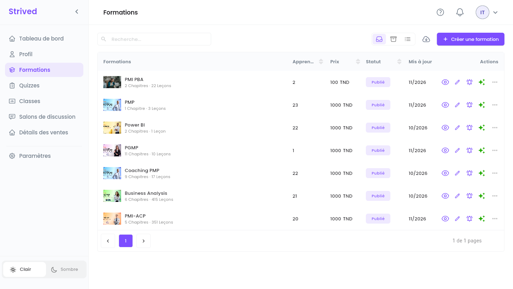
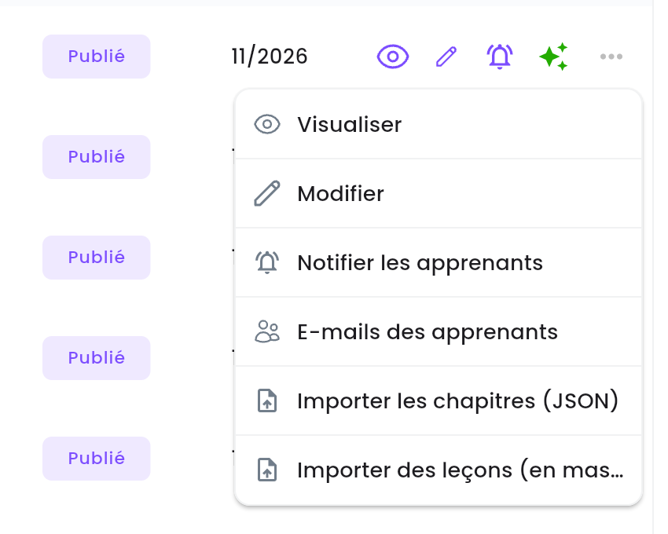
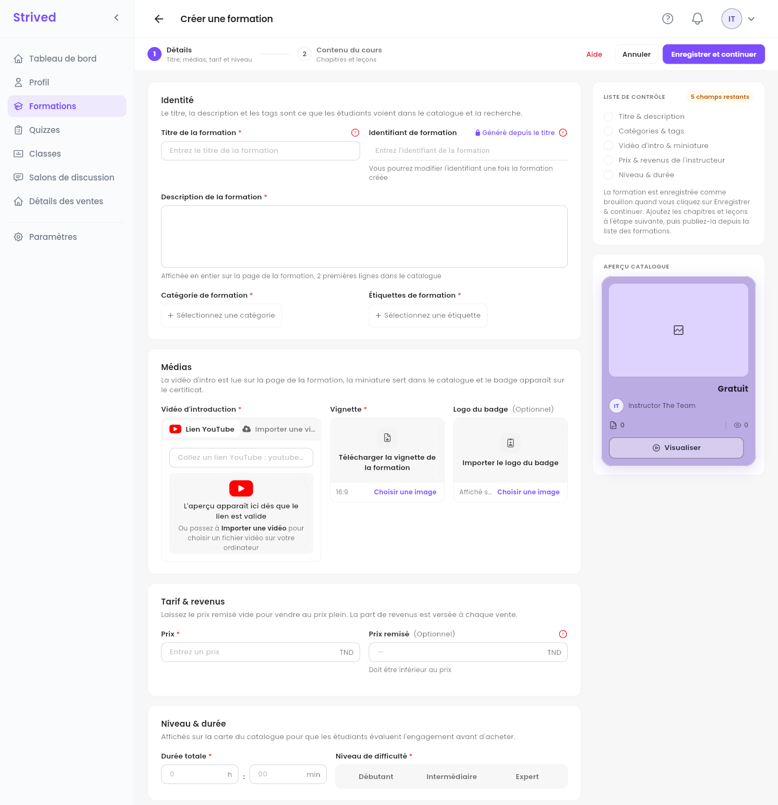
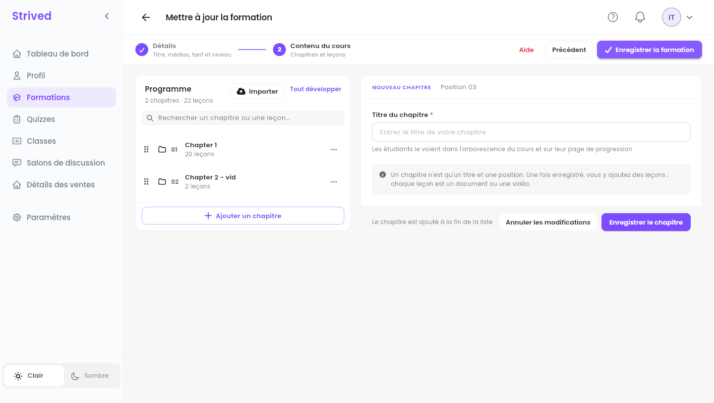
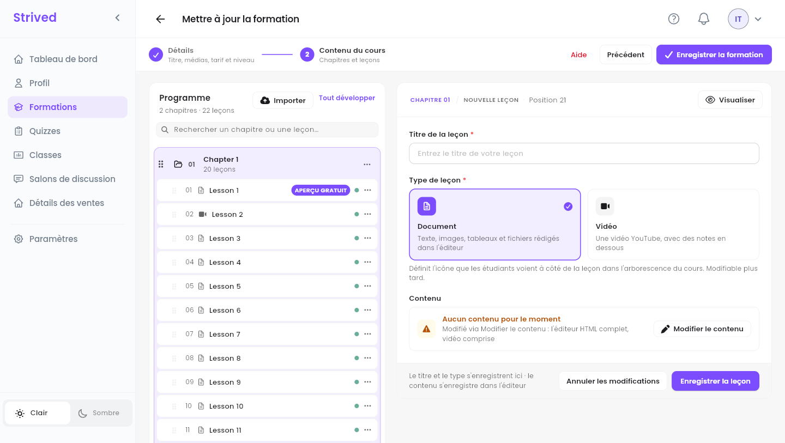
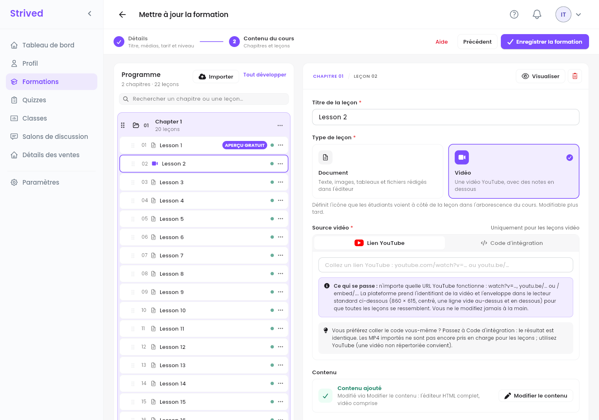
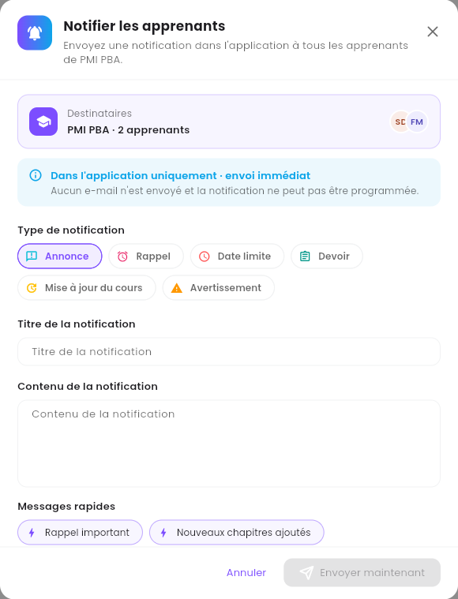

Une **formation** est un cours vendu dans le catalogue : une présentation, un prix, et des
chapitres remplis de leçons (documents ou vidéos). En tant que formateur, vous la rédigez du début
à la fin ; un admin la publie quand elle est prête.

<Note>
  Tout ce qui suit concerne l'**application web** sur ordinateur, connecté avec un compte
  formateur.
</Note>

---

## Sommaire

- **Étape 1 — Ouvrir vos formations**
- **Étape 2 — Créer une formation : Détails**
- **Étape 3 — Construire le contenu du cours**
- **Étape 4 — Rédiger une leçon**
- **Étape 5 — La prévisualiser et la faire publier**
- **Étape 6 — Notifier vos apprenants**
- **Bon à savoir**

---

## Étape 1 — Ouvrir vos formations

Cliquez sur **Formations** dans la barre latérale.

<Frame caption="Vos formations.">
  
</Frame>

Chaque ligne montre la formation, son nombre d'**Apprenants**, son **Prix**, son **Statut**
(**Publié** dans le catalogue, ou **Brouillon**) et le mois de sa dernière modification (**Mis à
jour**). Les icônes en bout de ligne sont des raccourcis : l'œil (**Visualiser**), le crayon
(**Modifier**) et la cloche (**Notifier les apprenants**). Les étincelles sont vertes quand un admin
a activé l'**Assistant IA** pour la formation.

**⋯** ouvre toutes les actions :

<Frame caption="Le menu ⋯ d'une formation.">
  
</Frame>

| Action | Ce qu'elle fait |
| :-- | :-- |
| **Visualiser** | Ouvre la formation telle que la voient les apprenants (Étape 5). |
| **Modifier** | Ouvre l'éditeur de formation (Étapes 2 à 4). |
| **Notifier les apprenants** | Envoie un message dans l'application à tous ceux qui suivent la formation (Étape 6). |
| **E-mails des apprenants** | Liste les adresses e-mail des apprenants de la formation. |
| **Importer les chapitres (JSON)** | Ajoute des chapitres à partir de fichiers JSON, par exemple une formation exportée par un admin. |
| **Importer des leçons (en masse)** | Transforme des images en leçons, une image par leçon, dans l'ordre des noms de fichiers (`01-…`, `02-…`). |

---

## Étape 2 — Créer une formation : Détails

Cliquez sur **Créer une formation** en haut à droite. L'éditeur a deux étapes : **1 Détails** et
**2 Contenu du cours**.

<Frame caption="Créer une formation → Détails.">
  
</Frame>

La **Liste de contrôle** à droite coche chaque partie au fur et à mesure, et l'**Aperçu catalogue**
montre la carte que verront les apprenants, avec votre nom.

<Steps>
  <Step title="Identité">
    **Titre de la formation** et **Description de la formation** (affichée en entier sur la page
    de la formation, les deux premières lignes dans le catalogue). L'**Identifiant de formation**
    se remplit tout seul (**Généré depuis le titre**). Choisissez au moins un élément dans
    **Catégorie de formation** et dans **Étiquettes de formation**.
  </Step>
  <Step title="Médias">
    **Vidéo d'introduction** : collez un **Lien YouTube** (un aperçu apparaît) ou passez à
    **Importer une vidéo**. **Vignette** : la couverture 16:9 utilisée dans le catalogue. **Logo du
    badge** (facultatif) : affiché sur le certificat des apprenants.
  </Step>
  <Step title="Tarif">
    **Prix** en TND, et un **Prix remisé** facultatif (inférieur au prix). Votre part de chaque
    vente est fixée par un admin, pas ici.
  </Step>
  <Step title="Niveau & durée">
    **Durée totale** en heures et en minutes, et le **Niveau de difficulté** : **Débutant**,
    **Intermédiaire** ou **Expert**.
  </Step>
  <Step title="Enregistrer et continuer">
    Cliquez sur **Enregistrer et continuer**. La formation est enregistrée **comme brouillon**,
    invisible pour les apprenants, et l'étape **Contenu du cours** s'ouvre.
  </Step>
</Steps>

<Note>
  Si la plateforme affiche *« Pourcentage de revenu par défaut non défini »*, votre pourcentage de
  revenus n'a pas encore été fixé. Contactez un admin : il le fixe dans **Utilisateurs → Définir
  les Revenus**, puis vous pourrez enregistrer.
</Note>

---

## Étape 3 — Construire le contenu du cours

<Frame caption="Contenu du cours : le programme à gauche, un nouveau chapitre à droite.">
  
</Frame>

<Steps>
  <Step title="Ajouter un chapitre">
    Cliquez sur **Ajouter un chapitre**, saisissez le **Titre du chapitre** (les apprenants le
    voient dans l'arborescence du cours), puis cliquez sur **Enregistrer le chapitre**.
  </Step>
  <Step title="Ajouter des leçons">
    Ouvrez le menu **⋯** du chapitre et choisissez **Ajouter une leçon**. Le même menu propose
    **Renommer le chapitre** et **Supprimer le chapitre**.
  </Step>
  <Step title="Réordonner">
    Faites glisser un chapitre ou une leçon par sa poignée (les six points à gauche).
  </Step>
  <Step title="Enregistrer la formation">
    Quand le programme est prêt, cliquez sur **Enregistrer la formation** en haut à droite.
  </Step>
</Steps>

**Rechercher un chapitre ou une leçon…** fouille le programme, **Tout développer** ouvre tous les
chapitres, et **Importer** ajoute des chapitres depuis un fichier.

---

## Étape 4 — Rédiger une leçon

<Frame caption="Une nouvelle leçon.">
  
</Frame>

<Steps>
  <Step title="Titre et type">
    Saisissez le **Titre de la leçon** et choisissez **Document** (texte, images, tableaux et
    fichiers rédigés dans l'éditeur) ou **Vidéo** (une vidéo YouTube, avec des notes en dessous).
  </Step>
  <Step title="Pour une vidéo : la source">
    Collez un **Lien YouTube**, ou passez à **Code d'intégration**. Les fichiers MP4 importés ne
    sont pas encore pris en charge pour les leçons : utilisez YouTube (une vidéo non répertoriée
    fonctionne).
  </Step>
  <Step title="Rédiger le contenu">
    Cliquez sur **Modifier le contenu** pour ouvrir l'éditeur complet, rédigez la leçon, puis
    cliquez sur **Enregistrer la leçon** en haut de l'éditeur.
  </Step>
  <Step title="Enregistrer">
    De retour dans le formulaire, cliquez sur **Enregistrer la leçon**.
  </Step>
</Steps>

<Frame caption="Modifier une leçon vidéo.">
  
</Frame>

Dans le programme, un point **vert** signifie que la leçon a du contenu, un point **orange**
qu'elle est encore vide. Le menu **⋯** de la leçon propose **Visualiser**, **Modifier** et
**Supprimer**.

<Tip>
  La première leçon du chapitre 1 porte le badge **APERÇU GRATUIT** : les visiteurs peuvent la
  regarder avant d'acheter. Faites-en une bonne introduction à la formation.
</Tip>

---

## Étape 5 — La prévisualiser et la faire publier

L'œil de la ligne (ou **⋯ → Visualiser**) ouvre la page de la formation telle que la voient les
apprenants : catégorie, niveau, vidéo de présentation, prix, et ce que **Cette formation inclut**.

<Frame caption="Prévisualiser une formation.">
  
</Frame>

Quand tout est prêt, demandez à un admin de **publier** la formation. Son statut passe alors à
**Publié** et elle apparaît dans le catalogue.

---

## Étape 6 — Notifier vos apprenants

Cliquez sur la cloche de la ligne (ou **⋯ → Notifier les apprenants**). La cloche reste grise tant
que la formation n'a pas d'apprenants.

<Frame caption="Notifier les apprenants.">
  
</Frame>

<Steps>
  <Step title="Vérifiez les destinataires">
    **Destinataires** affiche la formation et le nombre d'apprenants qui recevront le message.
  </Step>
  <Step title="Choisissez un type de notification">
    **Type de notification** : **Annonce**, **Rappel**, **Date limite**, **Devoir**, **Mise à jour
    du cours** ou **Avertissement**.
  </Step>
  <Step title="Rédigez le message">
    Remplissez **Titre de la notification** et **Contenu de la notification**, ou partez d'un des
    **Messages rapides** (**Rappel important**, **Nouveaux chapitres ajoutés**, **Mise à jour de
    formation**, etc.).
  </Step>
  <Step title="Envoyez">
    Cliquez sur **Envoyer maintenant**. Le message s'affiche uniquement dans l'application et part
    immédiatement.
  </Step>
</Steps>

---

## Bon à savoir

<AccordionGroup>
  <Accordion title="Puis-je modifier une formation après sa publication ?">
    Oui, avec **Modifier**. Les apprenants voient les changements dès que vous enregistrez. Une fois
    la formation vendue, certains réglages commerciaux sont verrouillés ; un admin peut vous en dire
    plus.
  </Accordion>
  <Accordion title="Comment offrir ma formation à un apprenant ?">
    Ce n'est pas possible depuis l'espace formateur. Demandez à un admin : il peut la lui attribuer,
    ou lui envoyer un voucher (bon).
  </Accordion>
  <Accordion title="Où interviennent les quiz ?">
    Un quiz appartient à un chapitre d'une formation. Créez-le depuis **Quizzes** — voir
    [Créer des examens et des quiz](/instructor-guide/creer-des-examens-et-des-quiz).
  </Accordion>
</AccordionGroup>
