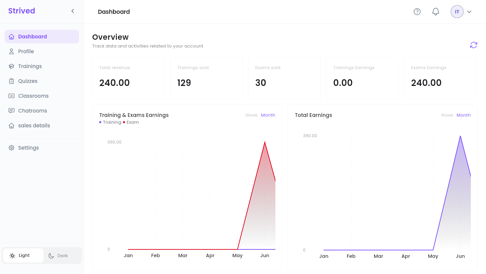
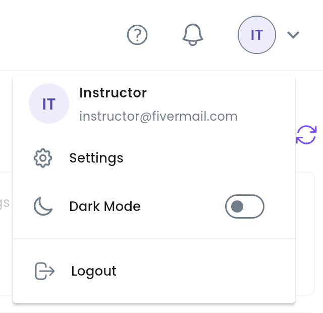
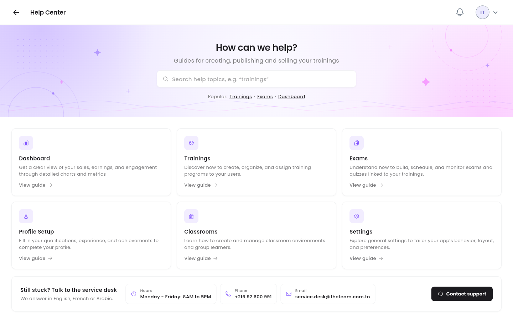

This guide covers the instructor side of the platform: where each tool lives, what your dashboard
tells you, and how your work reaches learners.

<Note>
  Everything below is for the **web app** on a computer, signed in with an **Instructor** account.
  The screenshots come from the test platform, so your figures and trainings will be different.
</Note>

---

## Table of contents

- **Step 1 — The sidebar and the top bar**
- **Step 2 — Read your dashboard**
- **Step 3 — Get help**
- **What you do, what an admin does**
- **Good to know**

---

## Step 1 — The sidebar and the top bar

After you sign in, the platform opens on your **Dashboard**. The sidebar on the left leads to every
instructor tool:

<Frame caption="The instructor dashboard, with the sidebar on the left.">
  
</Frame>

| Sidebar item | What you do there | Guide |
| :-- | :-- | :-- |
| **Dashboard** | Your sales and earnings at a glance. | This page |
| **Profile** | Your public profile: bio, skills, education, work experience, certificates. | [Build your public profile](/instructor-guide/build-your-public-profile) |
| **Trainings** | Create your trainings, write their chapters and lessons, keep learners informed. | [Create and update trainings](/instructor-guide/create-and-update-trainings) |
| **Quizzes** | Create mock exams and quizzes, and write their questions. | [Create exams and quizzes](/instructor-guide/create-exams-and-quizzes) |
| **Classrooms** | Lead a group of learners, with shared content and a group chat. | [Classrooms and chatrooms](/instructor-guide/classrooms-and-chatrooms) |
| **Chatrooms** | Read and answer the group chats of your classrooms. | [Classrooms and chatrooms](/instructor-guide/classrooms-and-chatrooms) |
| **sales details** | What each training and exam has sold, and your share. | [Track your sales](/instructor-guide/track-your-sales) |

**Settings** (password, language, notifications, two-factor authentication) is not covered in this
guide. Your name, photo and bio are edited from **Profile** instead.

At the bottom of the sidebar, **Light** / **Dark** switches the theme, and the **arrow** next to the
**Strived** logo folds the sidebar down to icons.

### The top bar

<Frame caption="The avatar menu, top right.">
  
</Frame>

| Icon | What it does |
| :-- | :-- |
| **?** | Opens the **Help Center** (Step 3). |
| Bell | Your latest notifications. |
| Avatar (your initials) | Shows your name and e-mail, with **Settings**, **Dark Mode** and **Logout**. |

---

## Step 2 — Read your dashboard

The **Overview** sums up your sales. All amounts are in TND and are **your share**, after the
platform's part.

| Card / chart | What it shows |
| :-- | :-- |
| **Total revenue** | Everything you have earned, trainings and exams together. |
| **Trainings sold** / **Exams sold** | How many orders include your trainings and your exams. |
| **Trainings Earnings** / **Exams Earnings** | What you earned on each kind. |
| **Training & Exams Earnings** | Your earnings over time, one line for **Training**, one for **Exam**. |
| **Total Earnings** | Your total earnings over time. |

Both charts switch between **Week** and **Month** at their top right. The round-arrow button at the
top right of the **Overview** reloads the figures.

<Tip>
  For the detail per training or per exam (each order, its date and your share), open
  **sales details** — see [Track your sales](/instructor-guide/track-your-sales).
</Tip>

---

## Step 3 — Get help

Click **?** in the top bar.

<Frame caption="The instructor Help Center.">
  
</Frame>

- Search a topic, or use the **Popular:** shortcuts (**Trainings**, **Exams**, **Dashboard**).
- Six cards cover **Dashboard**, **Trainings**, **Exams**, **Profile Setup**, **Classrooms** and
  **Settings**. **View guide** opens the video guide of the topic.
- **Still stuck? Talk to the service desk** gives the service desk's hours, phone number and
  e-mail. **Contact support** opens an e-mail ready to send. The service desk answers in English,
  French or Arabic.

---

## What you do, what an admin does

You write the content; the platform's admins take care of the business side:

| You (instructor) | An admin |
| :-- | :-- |
| Create and update your trainings, chapters and lessons. | **Publishes** your training or exam, so that it appears in the catalog. |
| Create exams and quizzes and write their questions. | Archives or deletes trainings and exams. |
| Notify the learners of your trainings and classrooms. | Gives learners access without an order, creates vouchers and coupons. |
| Create classrooms and lead their chatrooms. | Confirms payments, sets your revenue percentage. |

<Note>
  A new training or exam is saved as a **Draft**: learners do not see it yet. When it is ready, ask
  an admin to publish it.
</Note>

---

## Good to know

<AccordionGroup>
  <Accordion title="My revenue percentage looks wrong">
    Your share of each sale is set by an admin (in **Users → Set Revenue**). Contact the platform's
    admins or the service desk.
  </Accordion>
  <Accordion title="The figures look out of date">
    Click the round arrow at the top right of the **Overview**: the figures load again from the
    server.
  </Accordion>
  <Accordion title="Can I use the platform on my phone?">
    Yes, the mobile app has an instructor space too: see [Mobile App](/instructor-guide/mobile-app).
    This guide describes the web app, which has every tool, including the editors.
  </Accordion>
</AccordionGroup>
