The Strived mobile app has an instructor space for the essentials: answer your learners, send them
news and keep an eye on your trainings. Creating and editing your content stays on the web.

<Note>
  The screenshots come from an iPhone, signed in with an **Instructor** account on the test platform,
  so your figures and trainings will be different. The Android app has the same tabs.
</Note>

---

## Table of contents

- **Step 1 — Log in**
- **Step 2 — Read your dashboard**
- **Step 3 — Notify your learners**
- **Step 4 — Follow your classrooms and chat**
- **Step 5 — Notifications, settings and public profile**
- **What stays on the web**
- **Good to know**

---

## Step 1 — Log in

Get the app from the App Store on an iPhone, or from Google Play on an Android phone: both buttons
are on the [Presentation](/#strived-on-the-phone) page. Log in with the same **Email** and
**Password** as on the web. The app opens on your **Dashboard**.

The bar at the bottom of the screen has five tabs:

| Tab | What you find there |
| :-- | :-- |
| **Dashboard** | Your counts and the latest conversations, trainings and notifications. |
| **Trainings** | Your trainings, to notify their learners or copy their e-mails. |
| **Classrooms** | Your classrooms and their chatrooms. |
| **Notifications** | Your recent alerts and messages. |
| **Settings** | Your public profile, your account and the **Help Center**. |

In the header, your avatar opens **Settings**, the chat icon opens your chatrooms and the bell opens
**Notifications**.

---

## Step 2 — Read your dashboard

From top to bottom:

- **Your instructor space** welcomes you.
- **Some features are only on the web** gives the address of the web app, with a button to copy it.
- Four counts open their tab when you tap them: **Trainings**, **Classrooms**, **Chatrooms** and
  **Unread notifications**.
- **Recent conversations**, **My Trainings** and **Latest notifications** show the three latest
  items of each list. **See all** opens the full list.

In **My Trainings**, the three dots of a row offer **Notify learners** and **Learners' emails**.

<Columns cols={3}>
  <Frame caption="The top of the dashboard.">
    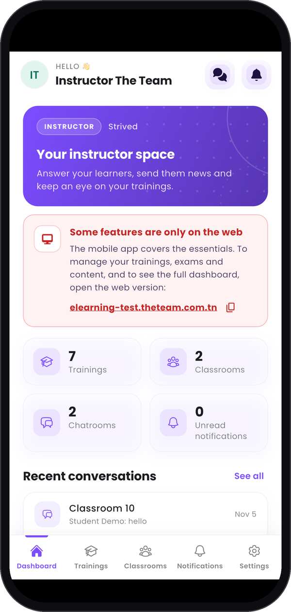
  </Frame>
  <Frame caption="Your latest conversations, trainings and notifications.">
    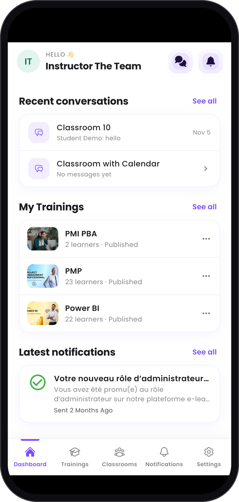
  </Frame>
</Columns>

---

## Step 3 — Notify your learners

**Trainings** lists the trainings you teach, with their status, learners, lessons and price. Each
card has two buttons:

- **Notify learners** sends an in-app notification to every learner of that training. Pick a
  **Notification Type**, fill in **Notification Title** and **Notification Content** (or tap one of
  the **Quick messages**), then tap **Send now**. As on the web, it is **In-app only · sent
  immediately**: no e-mail is sent and it can't be scheduled.
- **Learners' emails** lists their addresses. **Copy all emails** copies them separated by commas,
  ready to paste into your e-mail's recipients.

<Columns cols={3}>
  <Frame caption="Your trainings.">
    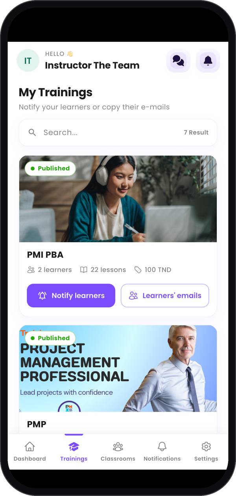
  </Frame>
  <Frame caption="Notify learners.">
    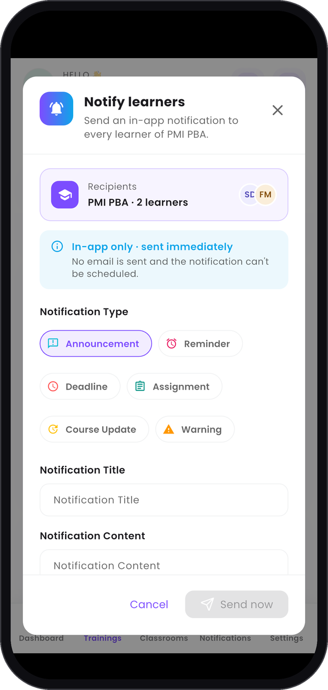
  </Frame>
  <Frame caption="Learners' emails.">
    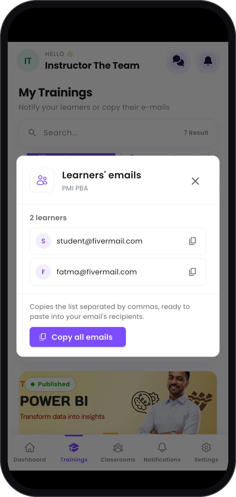
  </Frame>
</Columns>

---

## Step 4 — Follow your classrooms and chat

**Classrooms** opens **Classrooms & Chat**. Two buttons switch the view:

- **Classrooms** shows your classrooms and their members. Tap one to read its page: **Content** is
  what your learners see, and **Chat room** opens its chat.
- **Chat** lists your chatrooms with their last message. Tap one to read it and answer. You can join
  images to a message: JPG, PNG, GIF or WEBP, up to 20 MB each, 4 per message.

**Learners can write**, at the top of a conversation, works as on the web: turn it off to make the
chatroom read-only for learners.

<Columns cols={3}>
  <Frame caption="Your classrooms.">
    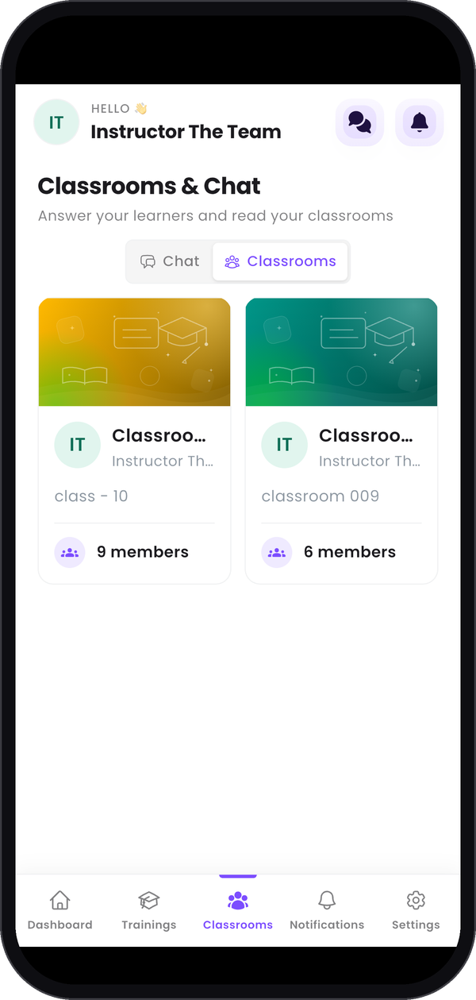
  </Frame>
  <Frame caption="A classroom's page.">
    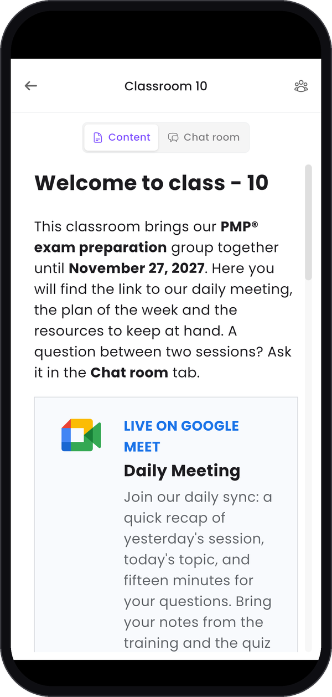
  </Frame>
  <Frame caption="Your chatrooms.">
    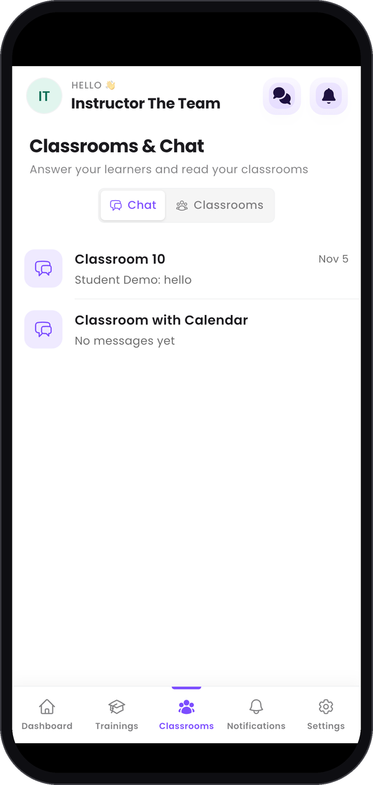
  </Frame>
  <Frame caption="A conversation.">
    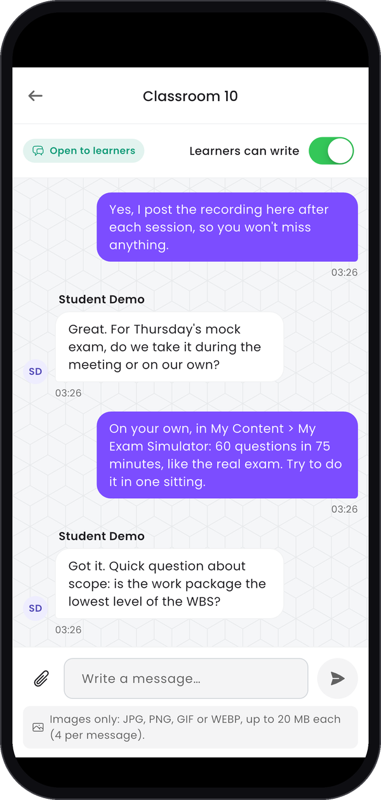
  </Frame>
</Columns>

---

## Step 5 — Notifications, settings and public profile

**Notifications** lists your recent alerts and messages.

**Settings** starts with **My public profile**, the page your learners see. You can read it on the
phone, but you edit it on the web: see
[Build your public profile](/instructor-guide/build-your-public-profile). **Edit Profile**, in the
same list, changes your photo and your name. The **Help Center** is further down.

<Columns cols={3}>
  <Frame caption="Notifications.">
    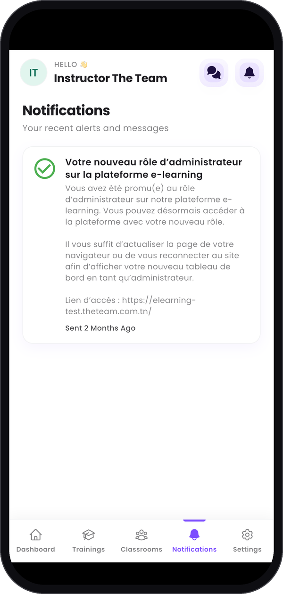
  </Frame>
  <Frame caption="Settings.">
    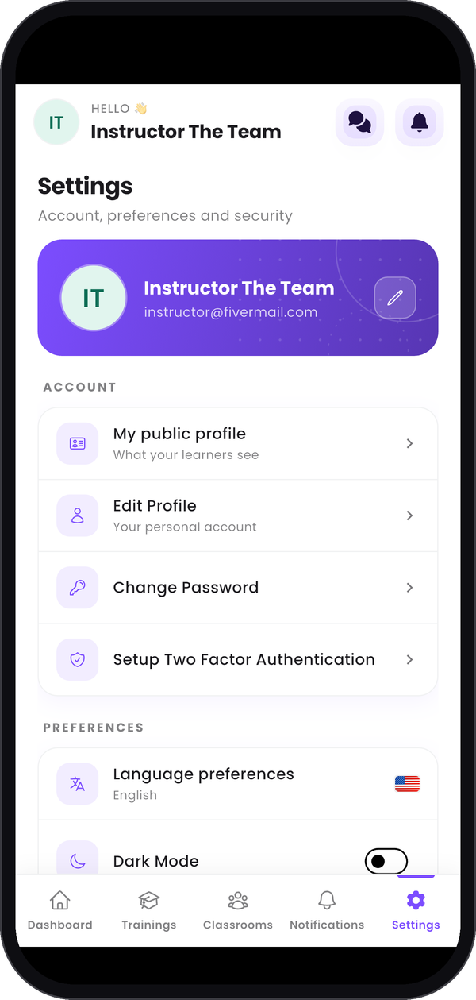
  </Frame>
  <Frame caption="Your public profile.">
    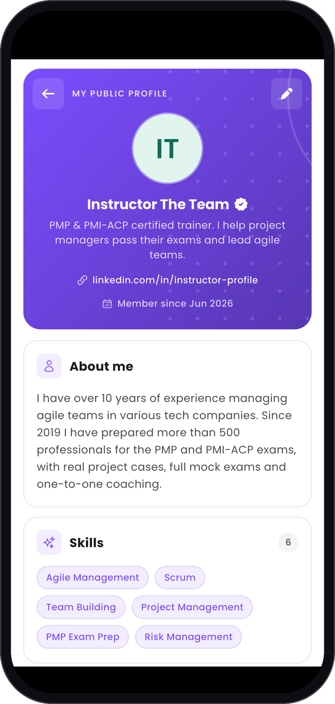
  </Frame>
</Columns>

---

## What stays on the web

The phone covers the essentials. Open the [web app](/instructor-guide/get-started) on a computer to:

- create and edit your trainings, exams and quizzes;
- create and edit your classrooms;
- edit your public profile;
- see the full dashboard and follow your sales.

---

## Good to know

<AccordionGroup>
  <Accordion title="How do I write to my learners by e-mail?">
    **Notify learners** sends in-app notifications only, on the phone and on the web. To write by
    e-mail, copy their addresses with **Learners' emails** and paste them into your own mailbox.
  </Accordion>
  <Accordion title="A training has no learners: can I notify it?">
    No. With no learners there is nobody to notify, and the app tells you so.
  </Accordion>
  <Accordion title="I see no classrooms">
    Your classrooms show in the app once they exist on the web: see
    [Classrooms and chatrooms](/instructor-guide/classrooms-and-chatrooms).
  </Accordion>
</AccordionGroup>
