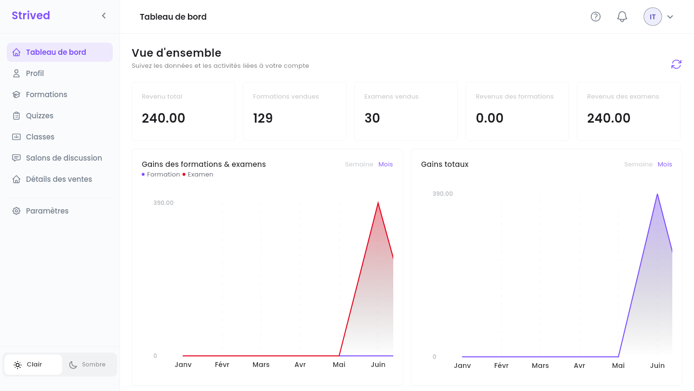
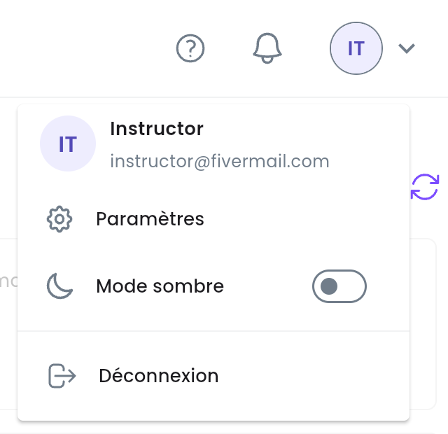
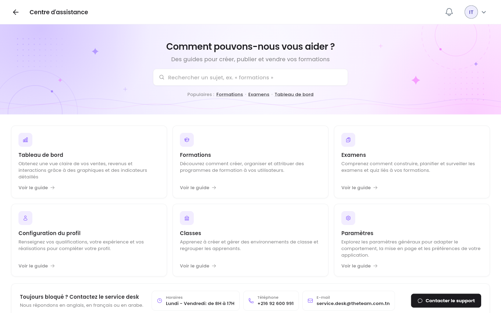

Ce guide présente l'espace formateur de la plateforme : où se trouve chaque outil, ce que vous dit
votre tableau de bord, et comment votre travail parvient aux apprenants.

<Note>
  Tout ce qui suit concerne l'**application web** sur ordinateur, connecté avec un compte
  formateur. Les captures d'écran viennent de la plateforme de test : vos chiffres et vos formations
  seront différents.
</Note>

---

## Sommaire

- **Étape 1 — La barre latérale et la barre du haut**
- **Étape 2 — Lire votre tableau de bord**
- **Étape 3 — Obtenir de l'aide**
- **Ce que vous faites, ce que fait un admin**
- **Bon à savoir**

---

## Étape 1 — La barre latérale et la barre du haut

Après la connexion, la plateforme s'ouvre sur votre **Tableau de bord**. La barre latérale, à
gauche, mène à chaque outil du formateur :

<Frame caption="Le tableau de bord du formateur, avec la barre latérale à gauche.">
  
</Frame>

| Élément de la barre latérale | Ce que vous y faites | Guide |
| :-- | :-- | :-- |
| **Tableau de bord** | Vos ventes et vos gains en un coup d'œil. | Cette page |
| **Profil** | Votre profil public : bio, compétences, diplômes, expérience professionnelle, certificats. | [Construire votre profil public](/instructor-guide/construire-son-profil-public) |
| **Formations** | Créez vos formations, rédigez leurs chapitres et leurs leçons, tenez les apprenants informés. | [Créer et modifier des formations](/instructor-guide/creer-et-modifier-des-formations) |
| **Quizzes** | Créez des examens blancs et des quiz, et rédigez leurs questions. | [Créer des examens et des quiz](/instructor-guide/creer-des-examens-et-des-quiz) |
| **Classes** | Animez un groupe d'apprenants, avec un contenu partagé et une discussion de groupe. | [Classes et salons de discussion](/instructor-guide/classes-et-salons-de-discussion) |
| **Salons de discussion** | Lisez les discussions de groupe de vos classes et répondez-y. | [Classes et salons de discussion](/instructor-guide/classes-et-salons-de-discussion) |
| **Détails des ventes** | Ce que chaque formation et chaque examen a vendu, et votre part. | [Suivre vos ventes](/instructor-guide/suivre-ses-ventes) |

**Paramètres** (mot de passe, langue, notifications, authentification à deux facteurs) n'est pas
couvert par ce guide. Votre nom, votre photo et votre bio se modifient depuis **Profil**.

En bas de la barre latérale, **Clair** / **Sombre** change le thème, et la **flèche** à côté du logo
**Strived** réduit la barre latérale à ses icônes.

### La barre du haut

<Frame caption="Le menu de l'avatar, en haut à droite.">
  
</Frame>

| Icône | Ce qu'elle fait |
| :-- | :-- |
| **?** | Ouvre le **Centre d'assistance** (Étape 3). |
| Cloche | Vos dernières notifications. |
| Avatar (vos initiales) | Affiche votre nom et votre e-mail, avec **Paramètres**, **Mode sombre** et **Déconnexion**. |

---

## Étape 2 — Lire votre tableau de bord

La **Vue d'ensemble** résume vos ventes. Tous les montants sont en TND et correspondent à **votre
part**, après celle de la plateforme.

| Carte / graphique | Ce qu'elle montre |
| :-- | :-- |
| **Revenu total** | Tout ce que vous avez gagné, formations et examens confondus. |
| **Formations vendues** / **Examens vendus** | Le nombre de commandes qui contiennent vos formations et vos examens. |
| **Revenus des formations** / **Revenus des examens** | Ce que vous avez gagné sur chaque type. |
| **Gains des formations & examens** | Vos gains dans le temps, une courbe pour **Formation**, une pour **Examen**. |
| **Gains totaux** | Vos gains totaux dans le temps. |

Les deux graphiques passent de **Semaine** à **Mois** en haut à droite. Le bouton à flèche
circulaire, en haut à droite de la **Vue d'ensemble**, recharge les chiffres.

<Tip>
  Pour le détail par formation ou par examen (chaque commande, sa date et votre part), ouvrez
  **Détails des ventes** — voir [Suivre vos ventes](/instructor-guide/suivre-ses-ventes).
</Tip>

---

## Étape 3 — Obtenir de l'aide

Cliquez sur **?** dans la barre du haut.

<Frame caption="Le Centre d'assistance du formateur.">
  
</Frame>

- Recherchez un sujet, ou utilisez les raccourcis **Populaires :** (**Formations**, **Examens**,
  **Tableau de bord**).
- Six cartes couvrent **Tableau de bord**, **Formations**, **Examens**, **Configuration du
  profil**, **Classes** et **Paramètres**. **Voir le guide** ouvre le guide vidéo du sujet.
- **Toujours bloqué ? Contactez le service desk** donne les horaires, le numéro de téléphone et
  l'e-mail du service desk. **Contacter le support** ouvre un e-mail prêt à envoyer. Le service desk
  répond en anglais, en français ou en arabe.

---

## Ce que vous faites, ce que fait un admin

Vous rédigez le contenu ; les admins de la plateforme s'occupent de la partie commerciale :

| Vous (formateur) | Un admin |
| :-- | :-- |
| Créez et modifiez vos formations, vos chapitres et vos leçons. | **Publie** votre formation ou votre examen, pour qu'il apparaisse dans le catalogue. |
| Créez des examens et des quiz et rédigez leurs questions. | Archive ou supprime des formations et des examens. |
| Notifiez les apprenants de vos formations et de vos classes. | Donne accès à des apprenants sans commande, crée des vouchers (bons) et des coupons de réduction. |
| Créez des classes et animez leurs salons de discussion. | Confirme les paiements, fixe votre pourcentage de revenus. |

<Note>
  Une nouvelle formation ou un nouvel examen est enregistré comme **Brouillon** : les apprenants ne
  le voient pas encore. Quand il est prêt, demandez à un admin de le publier.
</Note>

---

## Bon à savoir

<AccordionGroup>
  <Accordion title="Mon pourcentage de revenus semble faux">
    Votre part de chaque vente est fixée par un admin (dans **Utilisateurs → Définir les Revenus**).
    Contactez les admins de la plateforme ou le service desk.
  </Accordion>
  <Accordion title="Les chiffres ne semblent pas à jour">
    Cliquez sur la flèche circulaire en haut à droite de la **Vue d'ensemble** : les chiffres sont
    rechargés depuis le serveur.
  </Accordion>
  <Accordion title="Puis-je utiliser la plateforme sur mon téléphone ?">
    Oui, l'application mobile a elle aussi un espace formateur. Ce guide décrit l'application web,
    qui réunit tous les outils, éditeurs compris.
  </Accordion>
</AccordionGroup>
